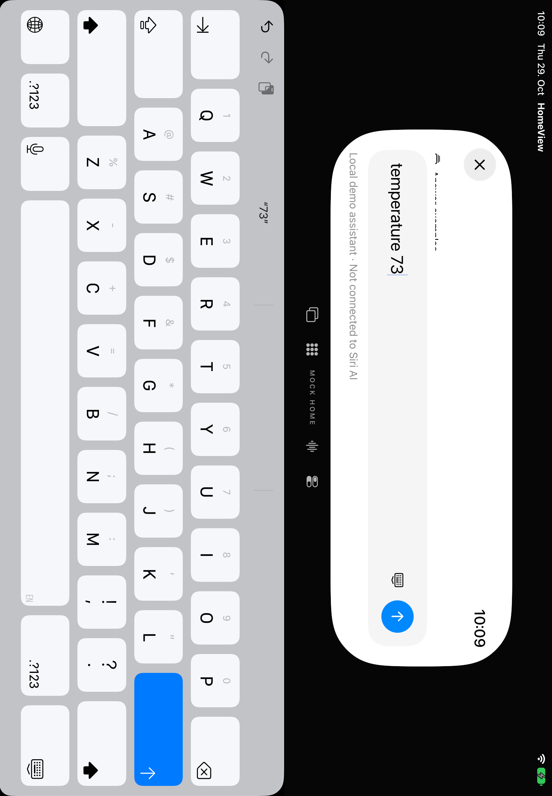
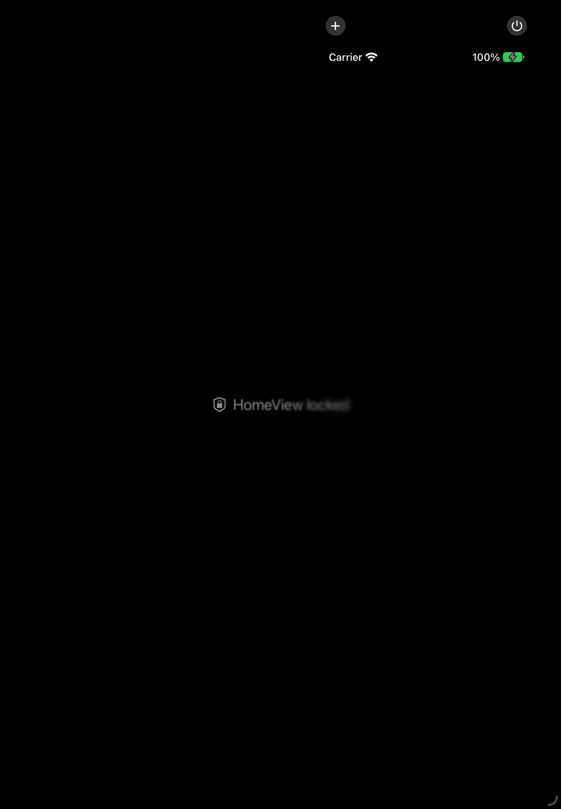

# Assistenteneingabe · Software-Abnahme für #38

29. Oktober 2026 · [AI-06 / #38](https://github.com/Olli0103/homeview/issues/38). Eigene HomeView-Eingabe, **kein Siri und keine vollständige Original-Parity**.

## Unverändertes Kriterium

> Auf iPad Hoch-/Querformat keine verdeckten Eingabefelder und kein versehentlicher Sendeschritt.

Die ursprüngliche Testgrenze trennt persönliche Accounts und physische Geräte ausdrücklich von der synthetischen Abnahme. Hier wird dieses Softwarekriterium geprüft. Physische Tastatur, VoiceOver/Switch Control und Originalgeometrie werden dadurch weder bestanden noch aus dem Gesamtprojekt gestrichen; sie bleiben bei #73/#77/#78 und in F048/F049 offen.

## Gelieferte Änderung

**⌘.** betätigt dieselbe sichtbare Aktion **Dismiss keyboard**: Fokus schließen, Entwurf behalten, nicht senden. **⌘⇧S**, der beschriftete Footer und die eigene obere Randgeste öffnen weiterhin dieselbe Eingabe. Die lokale Fähigkeiten- oder Antwortstimmen-Einstellungsseite sperrt jetzt zusätzlich den darunterliegenden Composer. tvOS bekommt keinen nicht unterstützten Shortcut; kein neuer Feld-Adapter und kein Cmd-Return-/Escape-Handler werden geliefert.

## Nachweismatrix

| Ursprüngliche Arbeit | Gebundene Softwareprüfung |
|---|---|
| Randgeste, Tastatur, Entwurf, Abbruch, Navigationsrückkehr | Native obere App-Geste, Tastatur im Hoch-/Querformat, tatsächliche Eingabe-/Send-Geometrie, Touch-Dismiss/⌘., Wiedereinstieg, Entwurf über Navigation und Löschung bei Hintergrund |
| Control Center, Scrollen, Systemgesten | Tatsächliche Bildschirm-Top-Rechts-Geste öffnet **Apples** Control Center; native SpringBoard-Root/Controls geprüft. Rückkehr erhält Entwurf/Antwort, Mock-Thermostat bleibt 68°. Zusätzlich getrennte eigene Rand-/Scrollgesten in beiden Orientierungen |
| Touch-, Tastatur-, zugänglicher Einstieg | Beschriftete native Aktion, ⌘⇧S und Randgeste erreichen denselben Entwurf. Ungefilterter nativer Trefferflächen-Audit. Das ist keine physische Hilfsmittelabnahme |
| Kein verdecktes Feld / implizites Senden | Sichtbare Tastaturgeometrie bei Rotation; nur expliziter Software-Send setzt den Mock-Wert auf 73°. Sprachvorschau allein nicht. Lange Antwort wird tatsächlich oberhalb des Composers sichtbar, Einstellungsrückkehr behält die Antwort |

Der System-Control-Center-Test verlangt echte SpringBoard-Elemente, nicht das ähnlich benannte eigene Panel. Auf diesen Simulatoren enthält das OS-Panel nur Add Controls/Power, keine Airplane-Kachel. Der erste Pilot erwartete fälschlich Airplane und bleibt fehlgeschlagen erhalten; die korrigierte Identitätsprüfung prüft die tatsächlich vorhandene OS-Root und beide Steuerelemente. Keine OS-Konfiguration wurde geändert.

## Rohe Spezialtasten bleiben getrennt

Eine **separate reine UIKit-App**, ohne HomeView oder SwiftUI-FocusState, wurde mit identischem eingefrorenem XCTest-Bundle auf iPad und iPhone ausgeführt. Beide liefern dieselbe Beobachtung:

| Injektion | Beobachtung im unabhängigen UITextField |
|---|---|
| Normales `typeKey("3")` | Zeichen wird angefügt |
| Rohes Delete | Text bleibt unverändert |
| Text-Delete | Entfernt ein Zeichen |
| Rohes Return | Delegate-Zähler bleibt 0 |
| Software-Text-Newline | Delegate-Zähler steigt auf 1 |
| Rohes Escape | Cancel-Zähler bleibt 0 |

Das widerlegt eine ausschließlich HomeView-spezifische Erklärung des beobachteten No-op, beweist aber weder die interne XCTest-Ursache noch funktionierende physische Return-/Escape-Tasten. Die beiden erfolgreichen Kontrolltests bestätigen normale Zeichen/Software-Return und **zeichnen die rohen No-ops auf**; sie sind kein Raw-Key-PASS. [Exakte diagnostische Quellen](verification/assistant-input-probes/README.md).

Auch der Cmd-Return-Kandidat bestand nicht und wurde entfernt. Seine Quell-/Binärarchive bleiben ebenso erhalten wie die [zehn älteren erfolglosen Ausführungen](assistant-raw-key-transport.md). Keine Umdeutung alter Fehler in Erfolge.

## Gebundene Ergebnisse

**18/18 gezielte UI-Ausführungen bestanden**, neun Methoden auf jedem Simulator: iPhone 18 Pro und iPad Air 11-inch M4, OS 27.0 (24A434). Keine Fehler, Skips oder XCTest-Runtime-Warnungen. Kein behaupteter vollständiger UI-Suitelauf. Beide Läufe haben identische 225 Quell-/Ressourcen-/Testinputs und 51 kompilierte/Launchinputs; zusätzlich drei Kontrollapp-Inputs. Vorher/Nachher unverändert, Archive vollständig zurückgelesen, installierte Produkt- und Kontrollappbytes geprüft.

Fünf SDK-Builds bestanden: iOS, macOS, tvOS, visionOS, watchOS. Fünf Appbundles / 69 Dateien separat archiviert und vollständig zurückgelesen. 86 Core-/Coretest-Dateien sind zum historischen **397er-Lauf** bytegleich; **kein neuer Core-Lauf** für diese View-/UI-Teständerung. [Quellen](verification/assistant-input-acceptance-source.json) · [Ergebnisse und getrennte Fehlstände](verification/assistant-input-acceptance.json) · [Geometrie](verification/assistant-input-acceptance-geometry.json) · [SDK-Produkte](verification/assistant-input-acceptance-platforms.json).

24 PNGs dekodiert, auf vier Tafeln gesichtet; zwölf ausgewählte tatsächliche Zustände veröffentlicht. Zwei Appfenster-Aufnahmen des Querformat-Thermostats haben den bekannten inkonsistenten Rotationsausschnitt und dienen **nicht** als Geometriebeleg. Die Tastaturbilder stammen vom vollständigen Bildschirm.

## Grenzen

Kein vollständiger Test aller Systemgesten, kein gesperrtes physisches Gerät, keine echte Hilfsmittel-/Hardwaretastatur-/Originalbewegungsabnahme. Die eigene iPhone-Kompaktansicht kann bewusstes Schließen der Tastatur verlangen, bevor Dokumentnavigation erreichbar ist. F048/F049 bleiben **partial / parity=false**. Der Geräte-/Signing-Hold bleibt unverändert.

Nur synthetische Eingaben, MockHome und gebündelte Medien-/Sprachfixtures. Keine echten Konten, Mikrofon-/Kameraaufnahme, Nachrichten, Anrufe oder Home-Anbindung.
