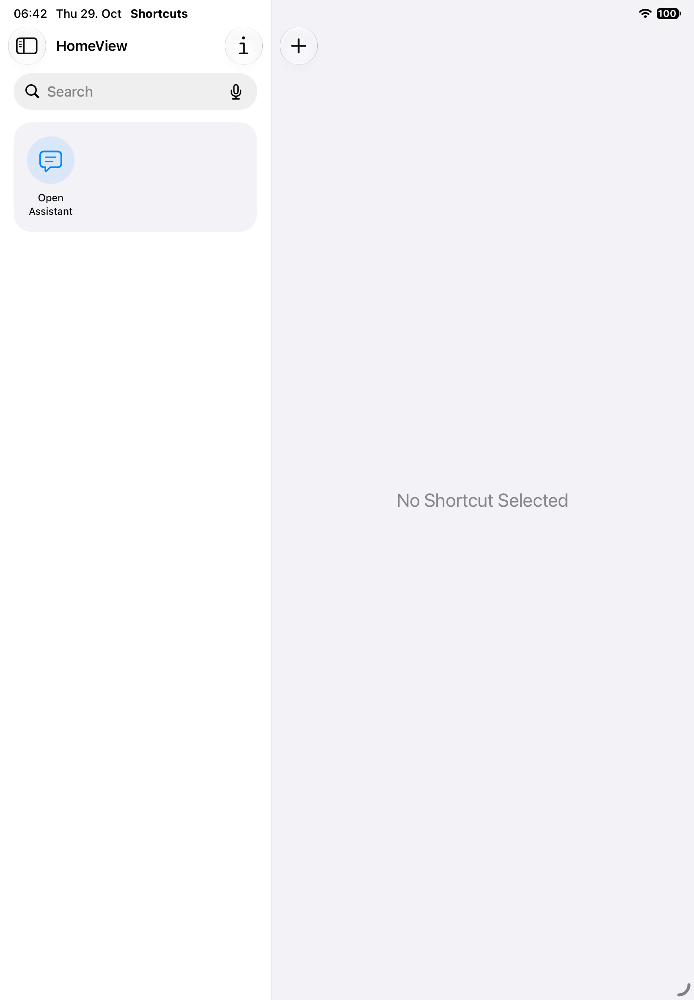
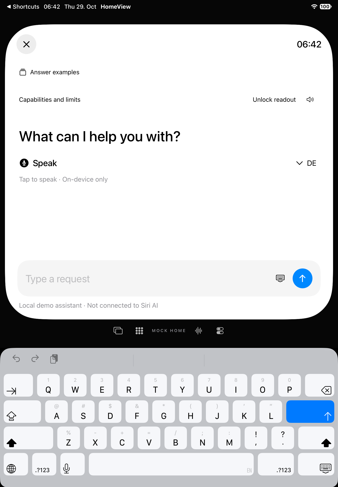

# Eigener App Shortcut: tatsächlicher OS-Aufruf

29. Oktober 2026 · Teilabnahme von [#74 / SYS-11](https://github.com/Olli0103/homeview/issues/74). **#74 bleibt offen; F104/F105 ohne Parity.**

## Was jetzt nachgewiesen ist

In Apples **Kurzbefehle → Mediathek → Apps → HomeView → Open Assistant** wird die eigene parameterlose Aktion tatsächlich gefunden und betätigt. Kein direkt aufgerufener `perform()`-Body, kein eigener Ersatz für die Kurzbefehle-App und keine neu erstellte Automation.

| Zustand | iPhone 18 Pro | iPad Air 11-inch M4 |
|---|---|---|
| Eigene Aktion im OS sichtbar und tatsächlich antippbar | bestanden | bestanden, nach bewusstem Schließen der überlagernden Sidebar |
| HomeView beendet → Systemaktion startet den Prozess und öffnet/fokussiert den Assistenten | bestanden | bestanden |
| Tatsächliche Softwaretastatur mit mehr als zehn nativen Tasten | bestanden | bestanden |
| Bereits laufender Prozess → Kurzbefehle → dieselbe Aktion → Assistent | bestanden | bestanden |
| Hintergrund löscht alten Entwurf; Rückkehr sendet/restauriert ihn nicht | bestanden | bestanden |
| Mock-Thermostat bleibt nach beiden Aufrufen 68° | bestanden | bestanden |

Beide Simulatoren laufen mit OS 27.0 (24A434). Der Prozess nach dem Warmaufruf hat jeweils dieselbe PID wie nach dem OS-Kaltstart. Prozess- und Launchdienst-Read-back bestätigen zusätzlich: **keine `--uitesting`- oder `--reference-clock`-Argumente**. Nach der Kaltstartaktion wurde der App-Prozess nicht durch einen Test-`launch()` ersetzt.

## Normaler Start, isolierte Daten

Für diese Prüfung wurden zwei eigene frische Simulatoren ohne Accounts oder frühere App-Daten angelegt. Die normale dreistufige Einrichtung endet ausdrücklich mit **Use the demo**. Das ist kein Testmodus und keine persönliche Dienstfreigabe. Die anfängliche leere Kurzbefehle-Sammlung und anschließend die automatisch angebotene eigene App-Aktion wurden gesichtet. Keine persönlichen Kurzbefehle gelesen oder verändert; kein neuer Kurzbefehl, Login oder System-Automationsplan angelegt.

Die sichtbaren OS-Willkommens-/Tastaturhinweise werden regulär mit Continue geschlossen. Dictate, Mikrofon, Anrufe, Nachrichten und Home werden nicht betätigt. Die Authentifizierungspolicy bleibt unverändert `requiresLocalDeviceAuthentication`; diese Simulatoren sind entsperrt. **Kein Test eines gesperrten Geräts oder eines Authentifizierungsdialogs.**

## Warm ist nicht dasselbe wie aktiv

Der frühere native In-Prozess-Test erhält einen Entwurf, solange die App aktiv bleibt. Der echte Wechsel zur Kurzbefehle-App erzeugt dagegen einen Hintergrundwechsel. Die vorhandene Datenschutzregel muss den Entwurf dort löschen. Der neue OS-Test schreibt synthetisch `temperature 73`, wechselt tatsächlich in den Hintergrund und ruft erst danach die eigene Systemaktion auf. Der zurückkehrende Composer ist leer, die initiale Antwort unverändert und der Thermostat weiterhin 68°. Der Shortcut umgeht die Hintergrundregel nicht.

## Gebundene Ergebnisse und erhaltene Fehler

**Zwei finale UI-Ausführungen, vier tatsächliche OS-Aktionsaufrufe**, jeweils Kalt-/Warmstart auf beiden Geräten, ohne Fehler/Skips/XCTest-Runtime-Warnungen. Beide verwenden identische 225 Quellen-/Ressourcen-/Testinputs und 51 kompilierte/Launchinputs. Eingaben vor/nach unverändert, vollständiger Archiv-Read-back und installierte Appbytes geprüft. Archiv SHA-256 `6b0c1e0ddd9b7889116e01f91509a06ec09bb4baafd9b95ed7dfc5ee54261bda`.

**Kein neuer Produktcode.** Alle 19 tatsächlichen App-Bundledateien bleiben zum [gelieferten #38-Stand](assistant-input-acceptance.md) bytegleich. Die dortigen fünf SDK-Builds und historischen 397 Coretests werden nicht als neue Läufe gezählt. Nach Archivierung ist die temporäre, ausschließlich auf die zwei eigenen Simulatoren begrenzte Diagnostik aus dem normalen UI-Target entfernt; alle 225 gelieferten Inputs entsprechen wieder dem #38-Stand. [Exakter ausgeführter Probequelltext](verification/assistant-os-shortcut-probes/README.md) · [ausgeführter Quellenstand](verification/assistant-os-shortcut-source.json) · [Ergebnisse/Fehlstände](verification/assistant-os-shortcut.json).

Die gesamte Erkundung umfasst elf Ausführungen: sechs erfolgreich, fünf fehlgeschlagen. Zwei frühe Erkundungs-PASSes prüfen nur Einrichtung/Entdeckung, keine Systemausführung. Fehler bleiben erhalten: falscher Buttontyp für den Aktionstitel, anderer iPad-Sidebar-Zeilentyp, beim Neustart eingeklappte Sidebar, zu früh gelesener Hintergrundzustand und ein durch die iPad-Sidebar verdeckter Aktionstaster. Die letzte Fassung wartet auf den echten Hintergrund und verlangt tatsächliche Antippbarkeit. Es wurde dafür keine Produktanforderung abgeschwächt oder App-Policy geändert.

Sechs finale PNGs dekodiert, auf zwei Tafeln gesichtet; vier stabile Kaltstart-/Aktionszustände veröffentlicht. Zwei Warmbilder entstanden während der Tastaturbewegung und bleiben privat, nicht als statischer Tastatur-Geometriebeleg verwendet. Die aktuelle separate Eingabegeometrie ist bei identischen Produktbytes in #38 geprüft.

## Nicht dadurch abgenommen

Siri-/Vocal-Shortcut-Sprachaufruf, echte Dictation, Live Speech, Live Captions, RTT/Telefonie, gesperrtes Gerät, physische Hilfsmittel, Mac-/Vision-Systemausführung, ältere OS-Versionen und Mehrfenster-Zielwahl. Die übrigen Zellen der [Plattformmatrix](speech-feature-boundaries.md) bleiben einzeln offen; eine erfolgreiche App-Aktion erfüllt nicht sämtliche F104/F105-Unterfunktionen. Geräte-/Signing-Hold und Home-Sperre bleiben unverändert.
