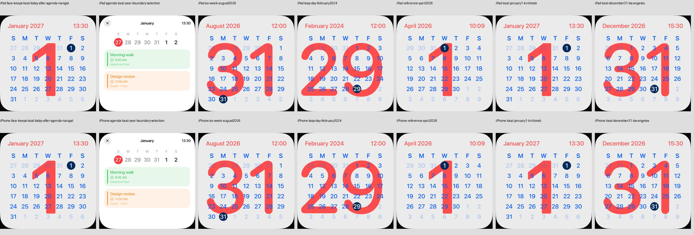

# Kritische Kalenderdaten im nativen Viewport

18. Oktober 2026 · [FACE-13 / #22](https://github.com/Olli0103/homeview/issues/22).
Integriert in [af8d5de](https://github.com/Olli0103/homeview/commit/af8d5de467cba00913b2381303139d334df22971).
Begrenzte synthetische Funktionsprüfung, keine Original- oder Hardwareabnahme.

## Umfang

Foundation und das vorhandene MonthLayout reichen für diese Prüfung; keine neue
Bibliothek und keine zusätzliche Kalenderverbindung. Vier Modellfälle prüfen die
vollständigen sechs Wochen, Februar 2024, August 2026, den Jahreswechsel am
selben Zeitpunkt in Los Angeles/Kiritimati sowie die Jahrhundertregeln 2000/2100.

Die native Testuhr akzeptiert feste Zeit und Zone nur mit --uitesting und aktivem
Referenzmodus. Normale Starts behalten aktuelle Zeit beziehungsweise die vorhandene
Referenzuhr. Es wird kein Kalenderkonto oder EventKit-Speicher geöffnet.

Auf beiden Größen sind alle 42 Tagesfelder einschließlich Nachbarmonat lesbar
und im Viewport; 29 und 31 werden nicht abgeschnitten. Derselbe Zeitpunkt zeigt
lokal Dezember 2026/31 beziehungsweise Januar 2027/1. Eine andere Auswahl in der
synthetischen Wochenagenda ändert nicht das lokale Heute des Faces. Eigene
Accessibility-Werte kennzeichnen Heute beziehungsweise Agenda-Auswahl; das ist
keine vollständige VoiceOver-Abnahme und keine belegte Apple-Auswahlregel.

## Belege

139 Modelltests vor und erneut nach Feature- und Integrationscommit bestanden.
Sechs gezielte Fälle je iPad/iPhone, zusammen zwölf Ausführungen, null Fehler,
Skips oder Runtime-Warnungen. Enthalten sind auch bestehende Agenda- und normale
Kamera-/Referenzuhr-Fälle. Alle fünf SDK-Builds bestanden. Kein vollständiger
UI-Suite-PASS. Der getrennte Vier-Fälle-iPad-Pilot wird nicht hinzuaddiert.

133 Quellen vor/nach Lauf und gegen die integrierten Bytes identisch:
SHA-256 09d35b59ef2d63e785d346cb2ab3e4c36a70f610447e6a446c6ebeb9a5cfb80e.

[Prüfbeleg](verification/calendar-critical.json),
[Quellenmanifest](verification/calendar-critical-source.json),
[Bildmanifest](screenshots/goal-20261018/calendar-critical-manifest.json).
Alle 14 eigenen Viewports beider Größen wurden gesichtet.

## Historische Originalabweichungen dieses Prüfschritts

Die nachfolgende [getrennte UI08-Kalibrierung](calendar-ui08.md) korrigiert Eins,
Kopfzeile, Heute-Kreis und lokale Farben. Die folgenden Angaben gehören zum
oben belegten unveränderten Datums-Prüfstand.

UI08 bleibt der belegte englische, sonntags beginnende Aprilzustand. Der direkte
private Bildvergleich zeigt noch eine zu breite große rote Eins mit zu tiefer
Schulter sowie abweichenden Kopfzeilenabstand. Dieser Schritt ändert bewusst
keine Geometrie. Exakte Schrift, Farben, weitere Sprachen, Original-Auswahlregeln
und echte Kalender-/Hardwareabnahme sind offen. #22 bleibt offen. Keine
Originalbilder, extrahierten Konturen oder proprietären Schriften veröffentlicht.
