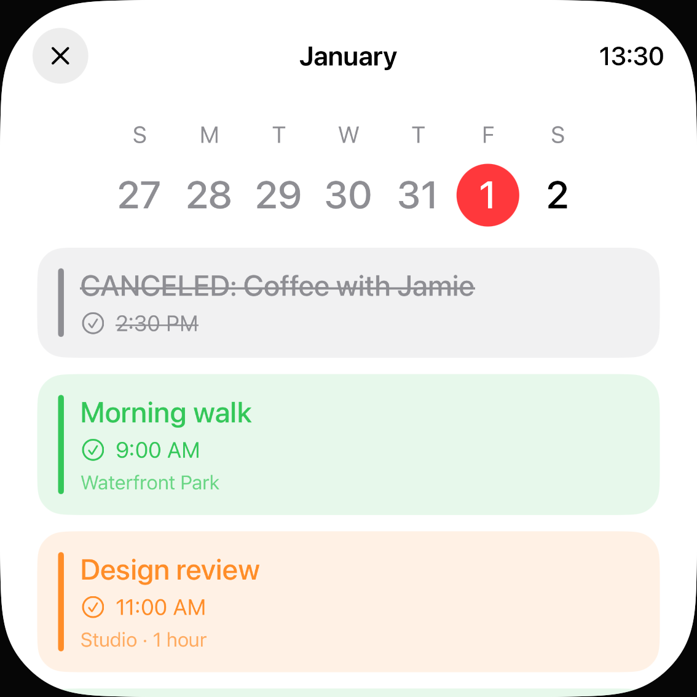
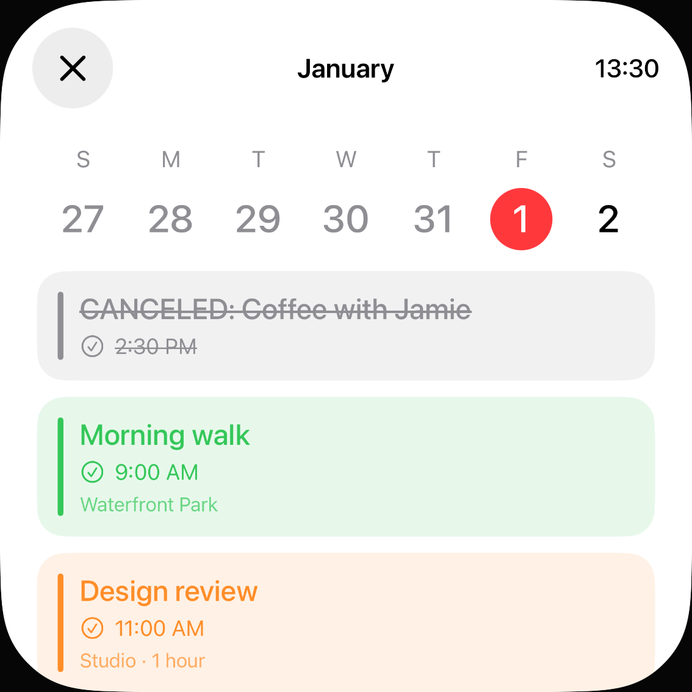
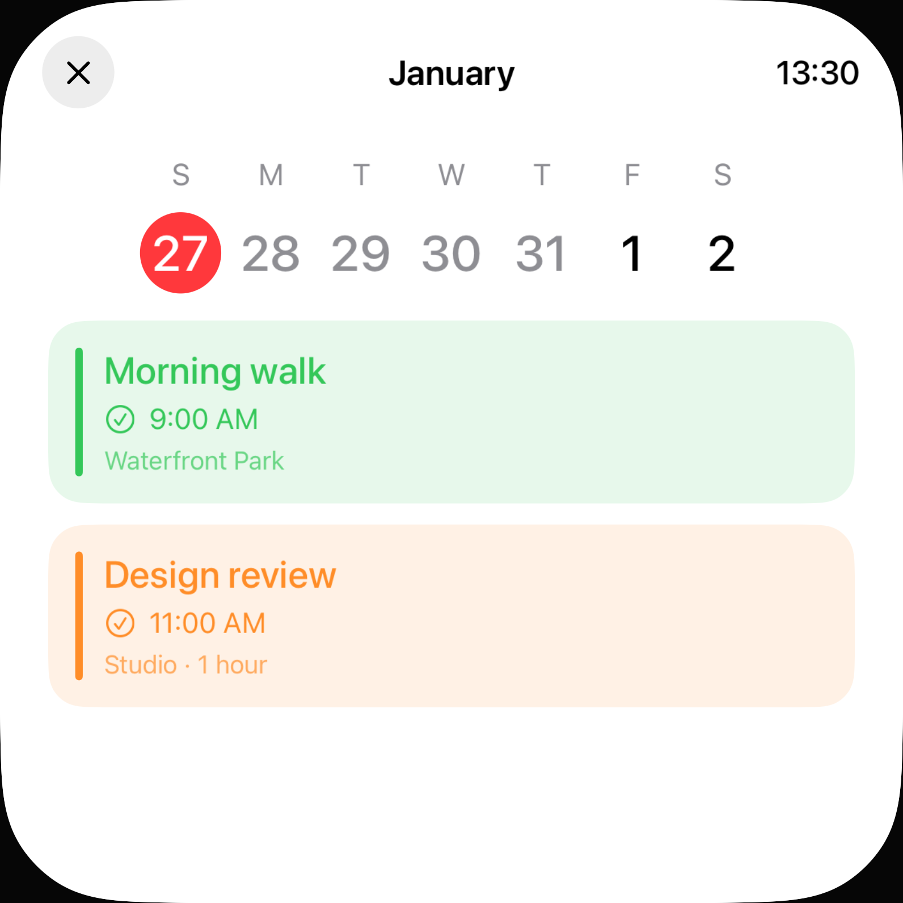
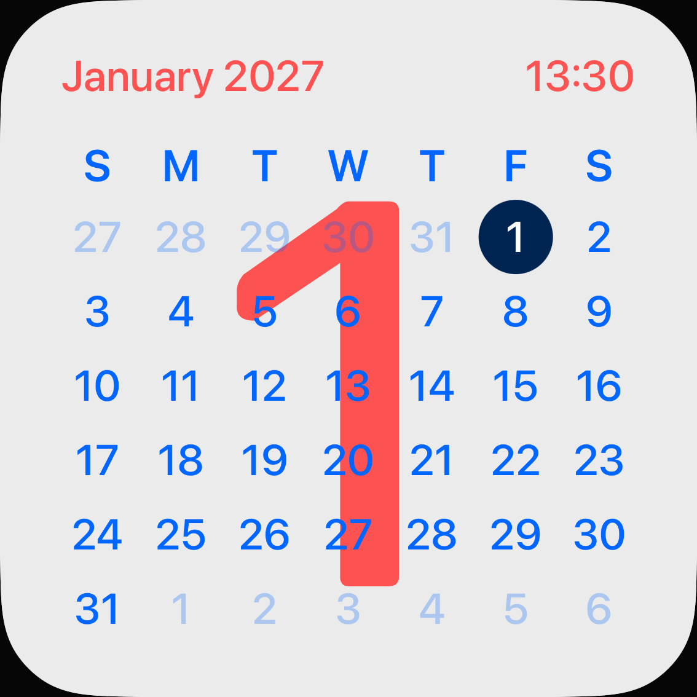

# Kalender-Tageswahl: wirkliche Ziele statt schmaler Ziffern

20. Oktober 2026 · [#73](https://github.com/Olli0103/homeview/issues/73) · [Messwerte, Quellenbindung und Bilder](verification/calendar-hit-regions.json)

## Reproduktion

Die lokale Demoagenda wurde mit dem eingefrorenen Zeitpunkt 31. Dezember 2026, 23:30 UTC und der IANA-Zone Pacific/Kiritimati gestartet. Lokal ist bereits der 1. Januar 2027; die sichtbare Woche reicht vom 27. Dezember bis zum 2. Januar. Keine Systemuhr oder echte Kalenderquelle geändert.

Zwei öffentliche, ungefilterte `.hitRegion`-Audits je Gerät prüfen die anfängliche Auswahl und den ausgewählten 27. Dezember. Auf dem iPad sind beide Listen bereits vorher leer. Auf dem iPhone meldet die erste Liste die schmale „2“, die zweite zusätzlich die nun nicht mehr hinterlegte „1“: ein bzw. zwei Befunde, nicht sieben automatisch gemeldete Fehler. Die sichtbare 54-Punkte-Referenzzelle garantiert kein gleich großes Accessibility-/Touchrechteck.

Ein eigener strenger Randtest verlangt native 44 × 44 Punkte, Sichtbarkeit, Hittable-Status und vollständige Viewport-Einschließung. Auf dem iPhone stoppt er **vor** dem ersten Tages-Tap an nur 24,15 Punkten Breite. Auf dem iPad sind die ersten fünf Tageswechsel tatsächlich erfolgreich; erst die „1“ ist mit 20,56 Punkten zu schmal und wird nicht angetippt. Die historischen Teilaktionen werden nicht als vollständiger PASS oder als gar nicht ausgeführt umgedeutet.

## Korrektur und Gegenprüfung

Nur CalendarView erhält vom tatsächlichen Canvas-Transform abgeleitete native Mindestmaße und eine rechteckige Content-Shape auf jedem wirklichen Buttonlabel. Close verwendet den vorhandenen optionalen Größenparameter. Datums-/IANA-/Wochenberechnung, Auswahlzustand, Agenda-Daten und -Sortierung, Schrift, Tageskreis und andere Produktansichten bleiben unverändert. Keine globale Änderung am Canvas, AppHeader oder RoundButton.

Sechs finale UI-Ausführungen mit drei unveränderten Methoden auf beiden Geräten bestehen: vier leere Auditlisten und **18 echte Zwei-Punkte-Randaktionen**. Alle sieben Tage sind getrennt auswählbar, benachbarte Zielrechtecke überlappen nicht, genau ein Wert ist Selected. Der abgesagte Demoeintrag erscheint nur beim lokalen Heute. Der untere Rand des 27. Dezember funktioniert erneut, Close führt zurück; danach zeigt das Kalender-Face weiterhin den lokalen 1. Januar als Today und January 2027. Keine Agenda-Auswahl schreibt das Face-Heute um.

Historie: zwölf UI-Ausführungen, acht erfolgreich und vier dokumentierte Vorherfehler; keine Skips oder strukturierten Runtime-Warnungen. Fünf aktuelle SDK-Builds bestanden. 206 Quellen und je 28 App-/Test-/Metadaten-/Starteingaben sowie installierte Appbytes gebunden; zwei Archive mit je 234 Einträgen vollständig zurückgelesen. 36 PNGs dekodiert, vier Übersichten und vier zusätzliche Vollbilder gesichtet, 14 eigene Bilder veröffentlicht. 72 Core-/Coretest-Dateien sind bytegleich zum historischen 301-Test-Lauf bei `2b223b7`; kein neuer Core-/nativer Modellprozess behauptet.

## Eigene Aufnahmen

| iPhone vorher | iPhone nachher |
| --- | --- |
|  |  |

| iPad: ausgewählter Dezembertag | iPhone: lokales Heute nach Rückkehr |
| --- | --- |
|  |  |

## Grenzen

Nur lokale Demoagenda; verbundene Kalender, Refresh, Freigaben, echte Einträge, alle Sprach-/Zeitzonen-/Schriftgrößen und Offscreen-Inhalte sind nicht durch diese Auswahl abgenommen. Die zwei sichtbaren Audit-Zustände sind keine vollständige Accessibility-Prüfung. Tatsächliche VoiceOver-/Voice-Control-/Switch-Control-/AssistiveTouch-, Fokus-/Ansage-, Kontrast-, Hardware- und Originalabnahme bleiben offen. Close ist eine zusätzliche finale Mindestzielprüfung, kein ursprünglicher automatischer Befund.

Keine allgemeine Pixelgleichheitsbehauptung: Tagesabstände und Close dürfen auf kleinen Ansichten wachsen. **#73 bleibt OPEN; F103 partial/parity=false.** Keine persönliche Quelle, Berechtigung, Nachricht/Anruf, Systemalarm oder neue Live-Activity; keine Home-Anbindung.
