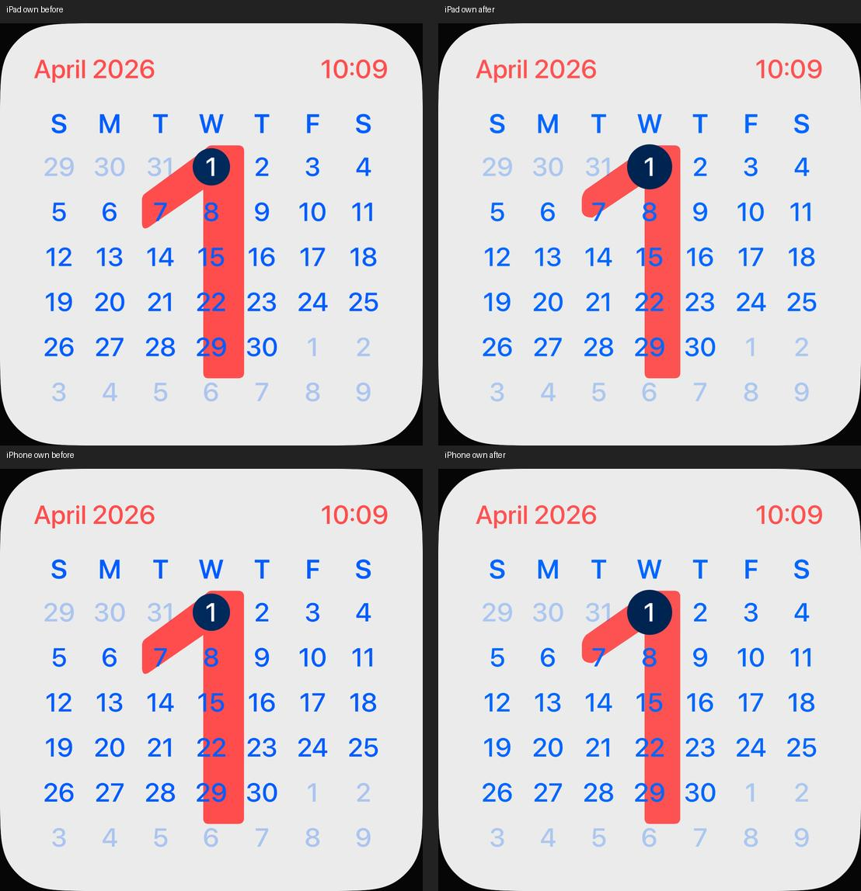

# Kalender-Geometrie nach UI08

18. Oktober 2026 · [FACE-13 / #22](https://github.com/Olli0103/homeview/issues/22).
Integriert in [eb308e8](https://github.com/Olli0103/homeview/commit/eb308e8ab853cf5449916fc42f72070867ace8a3).
Separater Bildschritt nach der [Datumsprüfung](calendar-critical-dates.md).

## Sichtbare Korrekturen

Die große rote Eins hatte einen zu breiten Stamm und eine zu tiefe Schulter.
Eine eigene, nur für den Kalender aktive native Form nähert beide an den
belegten UI08-Zustand an. Die bestehende Modular-Eins bleibt bytegleich; andere
Tage verwenden weiterhin Systemtext, keine gespeicherten Schriftkonturen.
Die Kopfzeile erhält zusätzlich fünf Punkte horizontalen Innenabstand, ohne das
Kalenderraster zu verschieben. Der Heute-Kreis ist nun unabhängig von der
Textzellenhöhe 64 Punkte groß. Rot, Blau und Dunkelblau werden nur lokal im
Kalender angepasst. Kein neues Paket, keine Originalgrafik oder private API.

Der erste getrennte Prototyp wurde bildgeprüft und anschließend bei Schulter,
Kreis und Farben nachkorrigiert. Seine zwei iPad-Fälle werden nicht zu den
aktuellen Ergebnissen addiert. Originalbilder und der direkte private Vergleich
werden nicht veröffentlicht. Der folgende Vergleich enthält nur eigene Bilder.

## Quellengebundene Prüfung

139 Modelltests, erneut nach Feature- und Integrationscommit. Fünf gezielte Fälle
je iPad und iPhone, zehn Ausführungen ohne Fehler, Skips oder Runtime-Warnungen.
Enthalten sind April, Schaltjahr, sechs Wochen belegter August, lokaler
Jahreswechsel, Agenda-/Face-Auswahl und der unveränderte Modular-Editor.
Alle fünf SDK-Builds bestanden; kein vollständiger UI-Suite-PASS.

133 Quellen vor/nach Lauf sowie gegen Feature-/Integrationsbytes identisch:
SHA-256 55382a5975a50de93888821303f4d41a94f6093f2cbd6af69a9e64824067fe6d.
14 eigene Kalender-Viewports und zwei Modular-Regressionsbilder sind gesichert.

[Prüfbeleg](verification/calendar-ui08.json),
[Quellenmanifest](verification/calendar-ui08-source.json),
[Bildmanifest](screenshots/goal-20261018/calendar-ui08-manifest.json),
[Herkunft des eigenen Vergleichs](screenshots/goal-20261018/calendar-ui08-own-comparison.json).

## Grenzen

Der begrenzte Bildstand ist näher an UI08, kein Originalpixel-PASS. Exakte
Typografie und Kanten, andere Originaltage/Sprachen und vollständige
Original-Auswahlregeln sind nicht abgenommen. Die kritischen Datumsszenarien
bleiben synthetisch; kein EventKit-Konto und keine Hardware wurden verbunden.
#22 bleibt offen. Keine HomeKit-Geräte, Mikrofone oder echten Anrufe.
