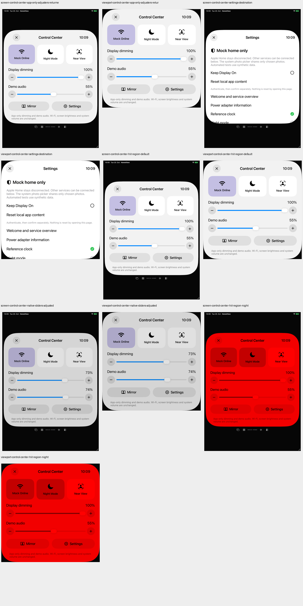
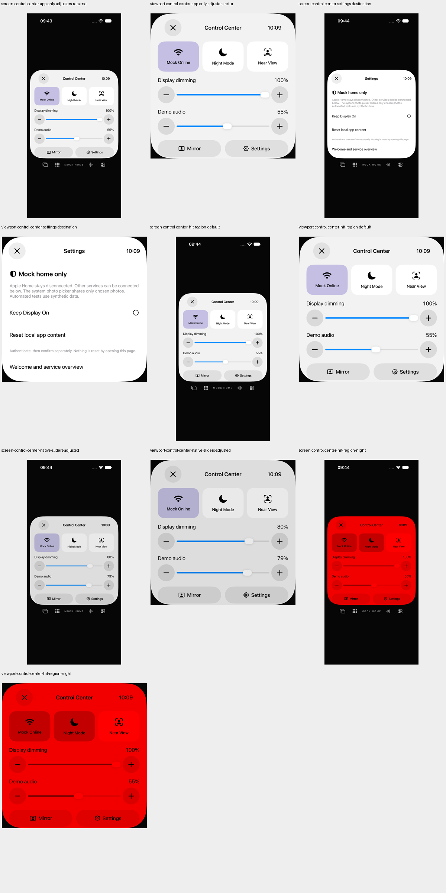

# Control Center: native Touchflächen

20. Oktober 2026 · Teilfix von [#73](https://github.com/Olli0103/homeview/issues/73), das offen bleibt.

## Befund und Änderung

Die ungefilterten öffentlichen Hitflächen-Audits melden auf iPhone jeweils beide Slider als zu klein: 19,53 Punkte. Auf iPad sind die Auditlisten leer, die zusätzliche strikte Geometrieprüfung findet dennoch nur 41,13 Punkte. iPhone-Plus/Minus und Close messen 30,24 Punkte; Settings 37,59. Die drei großen Schalterkarten erfüllen die Größenprüfung bereits. Der Vorherlauf hat vier bestandene und sechs fehlgeschlagene Testausführungen; reale lokale Aktionen werden trotz der Größenfehler fortgesetzt und getrennt bewertet.

Das Control Center verwendet nun opt-in `ceil(44 / nativeCanvasScale)` für Close, beide ValueAdjuster und die beiden Pill-Tasten. Wiederverwendet wird der zuvor in den Einstellungen geprüfte öffentliche Standard-UIKit-Slider. Die drei Schalteraktionen bleiben unverändert. Der Header bleibt fest, der Inhalt erhält eine native ScrollView mit unterem Abstand, damit größere Bedienflächen und der Scope-Hinweis erreichbar bleiben. Andere Pill-Aufrufer erhalten den Defaultwert null, keine globale Mindestgröße. Eine Pixelgleichheit ihrer Darstellung wurde nicht geprüft.

## Tatsächliche Gegenprüfung

- Fünf Methoden je iPad/iPhone, **zehn Ausführungen bestanden**, keine Skips oder strukturierten XCTest-Runtime-Warnungen.
- Default- und Nachtzustand ergeben insgesamt **vier vollständig gespeicherte leere Auditlisten**. Kein Finding wird ausgefiltert.
- **24 native Zwei-Punkte-Rand-Taps**: je Gerät drei lokale Schalter hin/zurück, Close zur persönlichen Oberfläche, Settings zur tatsächlichen Einstellungsseite und je Minus/Plus für App-Dimmung und Demo-Audio. Vor jedem Tap mindestens 44 × 44 Punkte, Hittability und vollständige Viewport-Enthaltenheit geprüft; Werte und Ziele bestätigt.
- Beide Slider werden pro Gerät ungefähr auf 25 und 75 Prozent verstellt, insgesamt acht native Verstellungen. Der sichtbare Modellwert muss innerhalb zehn Prozentpunkten des XCTest-Gestenziels liegen. Das ist kein Nachweis exakter Positionierungspräzision.
- Fünf SDK-Builds bestanden. Sie gehören zum vorherigen Produktcheckpoint; danach wurde ausschließlich der UI-Test-Scrollhelfer geändert. Alle Produkt-, Ressourcen-, Projekt-, Paket- und übrigen Testinputs sind bytegleich. Keine unnötige Wiederholung der SDKs und kein neuer Core-Gesamtlauf beansprucht.

### Zwei bewusst unterbrochene Zwischenläufe

Der generische Foto-Scrollhelfer verlangte auch an der oberen Kante der neuen ScrollView 40 Punkte Freiraum. Die bereits vollständig sichtbare erste Schalterreihe kann am Content-Anfang diesen Freiraum nicht herstellen. Nach reproduziertem Helferfehler wurde die Wiederholung mit SIGINT an genau die beiden eigenen UI-Testprozesse beendet. Ergebnis: je Gerät nur eine bestandene und eine fehlgeschlagene Ausführung, Exit 75; übrige Fälle nicht ausgeführt. Der erfolgreiche Parent-Collector macht daraus keinen grünen Testlauf.

Auch die erste Helferkorrektur blieb zu eng und wurde nach demselben wiederholten Fehler gestoppt: ebenfalls je Gerät nur eine bestandene und eine fehlgeschlagene Ausführung, Exit 75. Ein separater unveränderter Produkt-/Testcheckpoint mit der bereits vorhandenen Auditmethode bestand anschließend auf beiden Geräten und belegte alle Controls als vollständig im Viewport, hittable und mindestens 44 Punkte groß. Diese zwei Audit-Ausführungen ersetzen keinen vollständigen Interaktionslauf.

Danach wurde **nur der Testhelfer** angepasst: vollständig sichtbare und hittable Controls im tatsächlichen Viewport benötigen keinen künstlichen Top-Inset. Die unabhängigen strikten Randprüfungen verwenden weiterhin die tatsächlichen Control-/Viewport-Frames; der untere Sicherheitsabstand bleibt bestehen. Fixed Close wird nicht gescrollt. Alle Größen-, Sichtbarkeits-, Wert- und Rand-Tap-Assertions sowie sämtliche Auditbefunde bleiben erhalten. Erst der anschließende vollständige Zehnerlauf ist der aktuelle PASS. Vorher- und unterbrochener Stand bleiben mit eigenen Quell-/Bundlearchiven gesichert.

## Grenzen und Quellbindung

Nur lokale Mock-Online-, Nacht-/Fernwerte, App-Dimmung und Demo-Audio wurden verändert. Keine Systemhelligkeit, Systemlautstärke oder WLAN-Konfiguration. Kein Medienstart. Mirror wird nur vermessen, nicht geöffnet; kein Kamera-/Mikrofon-/Account-/Fotozugriff, keine Nachrichten, Anrufe oder Systemalarme. **Keine Home-Anbindung.**

VoiceOver-Ansagen/Fokus, Voice Control, Switch Control, AssistiveTouch, Dynamic Type, Kontrast/Zoom sowie reale Hardware- und Originalabnahme bleiben offen. Ein leerer öffentlicher Audit ersetzt diese Prüfungen nicht; #73/F103 bleiben partial und Parity=false, alle ursprünglichen Kriterien unverändert.

[Getrennte Ergebnisse, vollständige aktuelle Auditlisten/Geometrien, Archiv- und Bildhashes](verification/control-center-hit-regions.json), [aktuelles 209-Dateien-Manifest](verification/control-center-hit-regions-source.json), [vollständige Vorherbefunde](verification/control-center-hit-regions-before.json). Pro Lauf sind Quellen und kompilierte App-/Testbundles samt Startkonfiguration eingefroren und nachgeprüft; installierte Appbytes entsprechen dem jeweiligen Build. Die fünf getrennten Archive sind bytegeprüft, eigene PNGs dekodiert und Geräteübersichten gesichtet.

