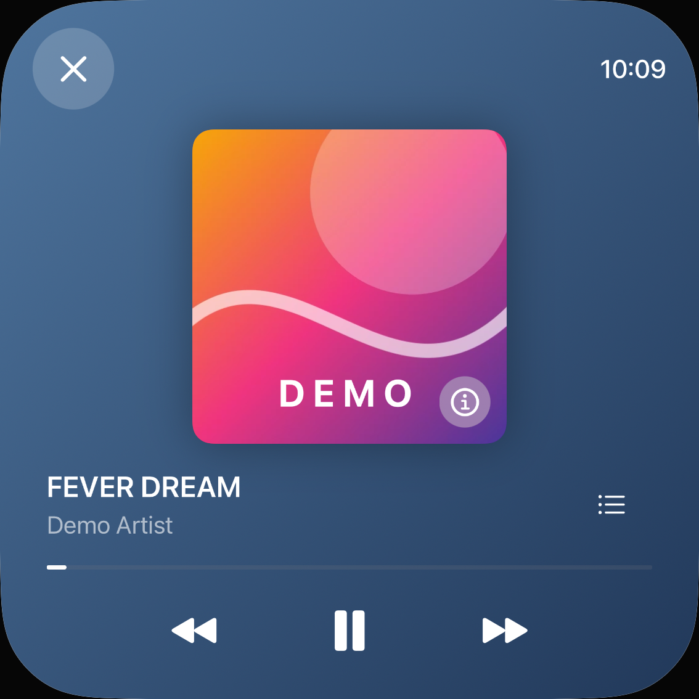
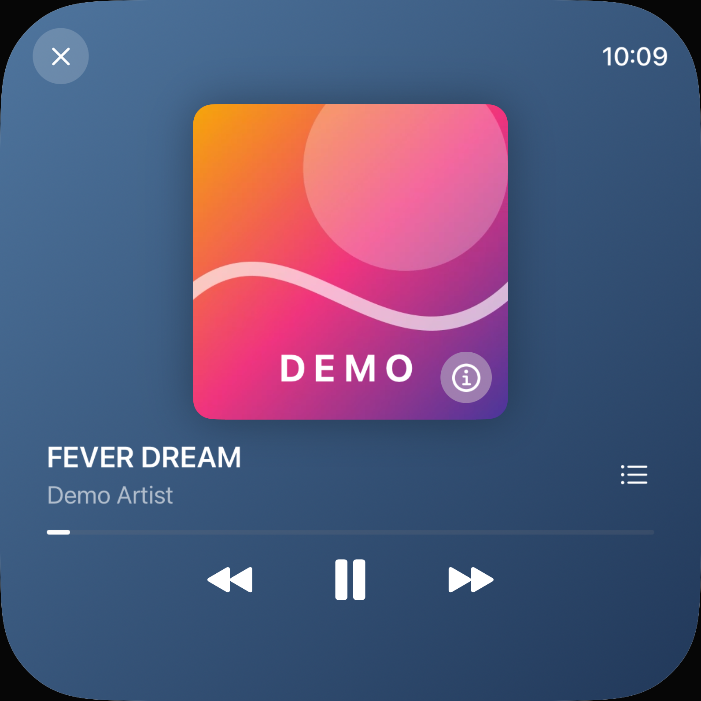
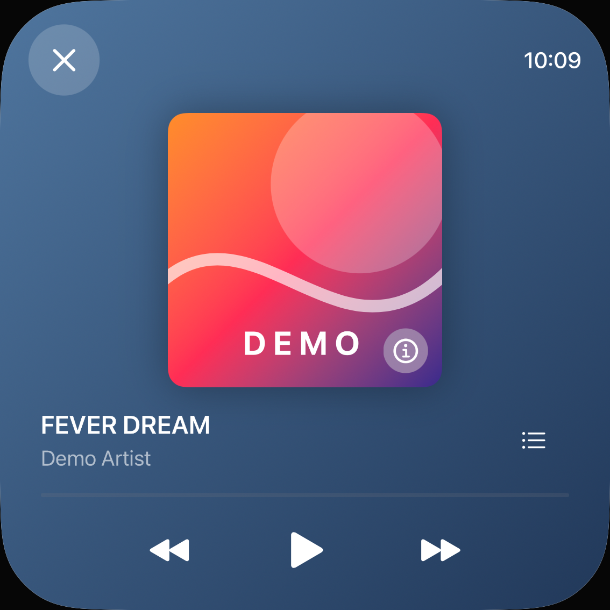
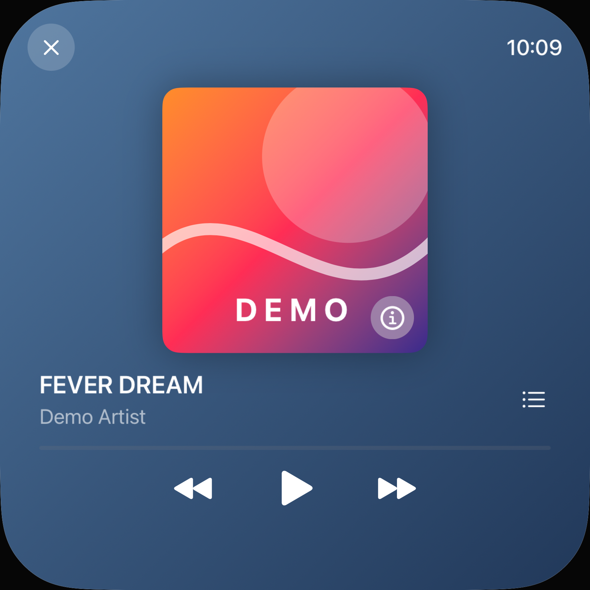
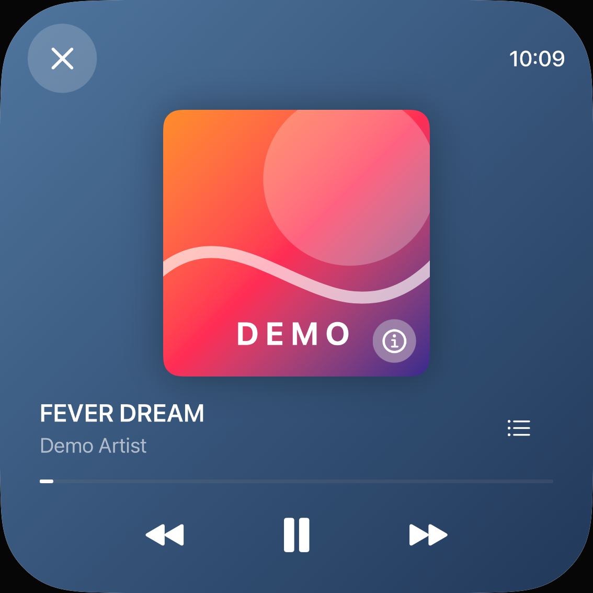
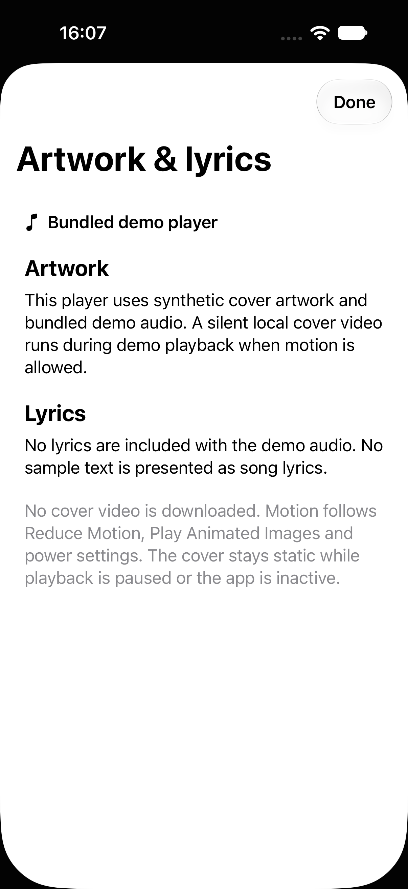
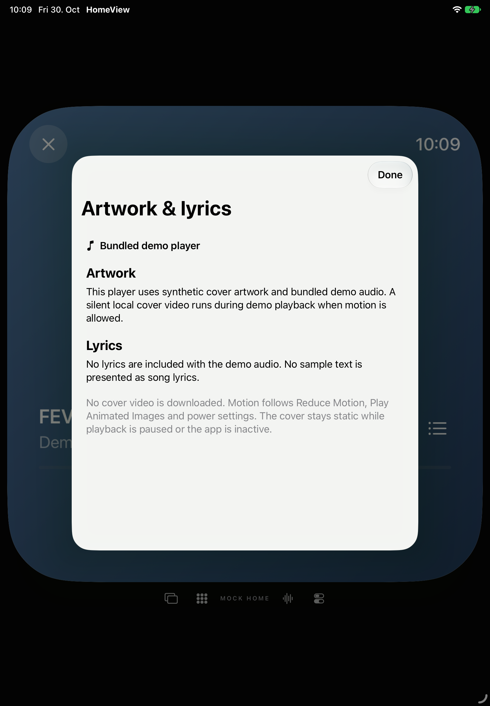

# Own animated artwork: actual local playback · #58

30 October 2026. This extends the [dated public-capability decision](music-artwork-and-lyrics.md). It does **not** acquire Apple Music animations or lyric rights. #58 is closed/completed in its original conditional public-capability contract; F079 remains partial, parity=false. [Exact original-body/task/state read-back](verification/demo-animated-artwork-issue-readback-20261030.json).

Later same-day follow-up: [native TV remote focus and actual cover rendering](tv-media-focus.md). The iPhone/iPad and SDK checkpoint below is retained with its original source pins. Background attachment fields named audio describe the existing UI playing flag, not independently measured backend/acoustic audio continuity.

## Supported content and rights

The bundled demo player now renders an original, project-generated **silent four-second H.264 loop**, 512×512 at 12 fps, 93,364 bytes. [Generator](../Scripts/generate_demo_artwork.swift), [movie](../Resources/demo-artwork.mp4), MIT [notice](../NOTICE.md), and the current asset manifest record its provenance. CoreGraphics gradients, a circle and a cubic wave are its only inputs: no photos, font outlines, catalog artwork, borrowed lyrics or audio. The runtime DEMO caption is an ordinary system-font UI element, not a movie input.

This supplies a real asset and renderer, not just an animated-looking screenshot. Existing AVFoundation is used; no dependency, remote transport, paid service or account connection is introduced. Native decoding confirms one video track, zero audio tracks, four seconds and four distinct fully colored decoded frames at seconds 0/1/2/3.

| Source | Actual app behavior | Still not claimed |
|---|---|---|
| Own bundled demo | Local video while explicitly playing and motion is allowed; old static cover otherwise | Original Apple geometry/motion, physical/acoustic playback or energy/frame-rate acceptance |
| Connected MusicKit | Existing static artwork; visible explanation that this connection supplies no video or lyric text | Catalog animation access, live-account playback acceptance or lyric timing |
| Optional `MPMediaItem.lyrics` | Public optional field remains documented, adapter not implemented | Not declared impossible or silently replaced by demo prose |
| Animated Now Playing metadata | Public supply-your-own-asset API remains documented, adapter not implemented | No OS/Lock Screen animated presentation or metadata write |

`Song.hasLyrics` is not lyric text or permission to scrape. Neither source scrapes lyrics or presents sample text as lyrics. API availability and content rights remain separate decisions.

## Lifecycle and bounds

One view-owned `AVQueuePlayer`/`AVPlayerLooper`/`AVPlayerLayer` reads a fixed bundle file, with an enforced **1,000,000-byte input ceiling**, muted audio and external playback disabled where that public API exists (not visionOS). It creates no network or persistent video cache. Decoder/system memory is not claimed to be bounded to the compressed file size. The layer stays hidden over the static cover until ready; invalidated observations and a generation fence prevent a late ready callback from reviving a dismantled renderer.

Animation requires all of: demo playback, active scene, no Reduce Motion, Play Animated Images enabled, no low-power mode, and a nominal/fair thermal state. Pause, scene inactivity or restrictions remove the video surface; dismantling pauses and releases its queue/items/looper. The old paused cover, geometry, controls and catalog source are preserved. No claim is made about every offscreen/scroll-occlusion state or physical power consumption.

Existing screenshot-test freezing is preserved. The new test-only power/autoplay/thermal arguments can only further restrict animation, never override an OS restriction. The 64-vector Core policy check permits exactly the playing+foreground+autoplay/no-restriction combination. Runtime tests observe pixels, not only policy values or player buttons.

## Native evidence

[Results and limits](verification/demo-animated-artwork-20261030.json) · [253 matrix inputs](verification/demo-animated-artwork-final-source-20261030.json) · [253 delivery inputs](verification/demo-animated-artwork-delivery-source-20261030.json). Product/test commit: `d353bb111a2d57c18c381aa281a56007a92a5b25`.

- **Four baseline executions** on unchanged product code, then **four separate renderer pilots**, then **20 final executions** (ten methods each on iPhone/iPad): all passed, zero skips or structured runtime warnings. These are three separate checkpoints, not a fabricated single 28-test suite.
- **458 Core tests passed**. Core/package/test inputs remained byte-identical from that checkpoint to final; no redundant new Core run is claimed.
- Four whole paused native viewports (normal/reduced × both devices) are exactly equal to their baseline decoded RGBA pixels. Final review decoded all 76 PNGs and actually viewed eight contact pages; earlier baseline/pilot review is separately retained.
- Independent pixel comparisons of predeclared inner-cover ROIs: **six moving pairs** exceed 100 changed RGBA channels, **twelve stationary pairs** have zero changes. The ROI excludes DEMO lettering, information button, progress and player chrome. Actual Home/background return is tested separately from explicit Pause; both player UIs still indicated playing on return, and their covers actually resumed moving. The Play/Pause-label observation is not an independent audio-backend or acoustic-continuity proof.
- Reduce Motion, disabled autoplay, low-power and serious/critical thermal restrictions are four distinct playing/static test cases. Forced test restrictions prove these software branches, not a physical low-battery/heat experiment.
- Five SDK builds, final installed App/Runner bytes, compiled inputs, source-delta reconstruction and output read-back are recorded in the receipt. Watch intentionally excludes this unused video and has no new Music UI. SDK success on Mac/TV/Vision is not native renderer/runtime acceptance there.

The first five-SDK run had four successes and a genuine visionOS compiler failure: `allowsExternalPlayback` is unavailable there. The only source change after the 20-case matrix is an `#if !os(visionOS)` guard around that call. All five corrected SDK builds pass, with **77 product files** fully read back. Both SDK runs retain their normal single iOS missing-SSU metadata clean/build recovery. After correction, **two separate mobile motion/Pause/background executions** pass with exact installed App/Runner bytes and ten independently checked ROI pairs (six moving/four still); these do not replace or inflate the earlier 20-case matrix. Their 26 PNGs/four contact pages were actually reviewed, bringing all checkpoints to 142 decoded PNGs/16 viewed pages. All 253 delivery inputs match the code commit and reconstructed source archives. 998 terminal evidence files are sealed and read back in place; unchanged archives are shared rather than duplicated per device.

The generator's public legacy AVAssetWriter calls emitted four macOS27 deprecation warnings; they are not runtime errors. An initial native-probe nonblack classifier accidentally counted alpha; it was corrected to RGB-only before the final decoder run. Both runs decoded the same colorful frames; this was a probe correction, not a product rendering failure. Two review commands initially used a Python without Pillow and failed before reading images; the existing external Pillow environment was then used successfully, without installing a dependency.

## Own captures

| iPhone | iPad |
|---|---|
|  |  |
|  |  |
|  |  |
|  |  |

Remaining acceptance is not hidden: optional library lyrics and OS animated-Now-Playing integration are not delivered, catalog transport/rights are not inferred, real-account/physical playback remains held at #57, and original comparison remains at #78. Static covers alone do not close F079; the newly proven own movie is a partial implementation, not general original parity. No Home, real-library/account, camera/microphone, message, call, signing, TCC or host configuration change was made.

The original four task strings and acceptance sentence are unchanged. Closure does not require implementing every possible public provider/API: it records the supported own content and explicitly unsupported catalog/library/system paths. Real-account/hardware playback remains #57, original comparison #78 and the remaining platform matrix #79. [Complete fresh backlog reconciliation](verification/backlog-reconciliation-after-artwork-20261030.json):47 original completed,1 scope exclusion,34 open.
