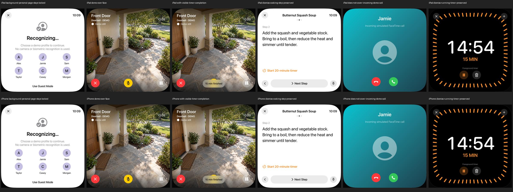

# Synthetische Türklingel-Unterbrechung

18. Oktober 2026. Teilumsetzung zu [CAM-02, #28](https://github.com/Olli0103/homeview/issues/28).
Prototyp [dc37cfd](https://github.com/Olli0103/homeview/commit/dc37cfd2df4cb4a7c9b7a545f9760f3905947720),
auf dem Albumstand zusammengeführt und in
[e906d0e](https://github.com/Olli0103/homeview/commit/e906d0eef473f095e64358938978a3f03d512d5a)
integriert. Begrenzte synthetische Funktionsabnahme, kein Live-/Original-PASS.

## Kein neues HomeKit-Setup

Der vorhandene Settings-Knopf startete zuvor direkt eine Kamera-Route; Schließen
führte pauschal zum persönlichen Home Screen. Der neue Schritt behandelt
ausschließlich den vorhandenen synthetischen Ablauf mit den eigenen
Demo-Standbildern. Er meldet weder einen echten Klingelknopf noch eine Kamera an.

Die installierten öffentlichen iOS-27-SDK-Header enthalten
HMServiceTypeDoorbell, HMCharacteristicTypeInputEvent, das Aktivieren von
Charakteristik-Mitteilungen und den HMAccessoryDelegate-Wertänderungsaufruf.
Das sind API-Kandidaten, kein Nachweis einer eingerichteten, erreichbaren oder
zuverlässig beobachteten Türklingel. Es wurde kein HomeKit-Manager konstruiert,
kein echtes Haus entdeckt und kein Ereignis abonniert. Der HomeKit-Adapter
bleibt gesperrt. Dafür ist keine zusätzliche Bibliothek oder ein eigener
Cloud-/Push-Dienst nötig.

## Eigene begrenzte Präsentationsregeln

Demo-Ereignisse haben UUID, Kameraindex und Zeitpunkt, keine persönliche
Account- oder Haushaltsliste. Alte, unzulässig zukünftige oder ungültige
Ereignisse öffnen keine Ansicht. Die letzten 64 Ereignis-IDs verhindern
Wiederholung, auch nach Abweisen. Ein neues unterscheidbares Ereignis ersetzt
das aktuelle; es gibt keine versteckte Warteschlange, die nach dem Schließen
eine Kamera erneut öffnet.

Die Anzeige hat höchstens 30 Sekunden Restlaufzeit. Ablauf wird über monotone
Prozesszeit geprüft; ein bereits älteres Ereignis bekommt nicht erneut eine
volle Frist. Ein nicht verfügbarer Mock-Kamerazustand oder laufender Demo-Anruf
öffnet keine Kamera. Wird ein bereits angezeigter Ablauf dadurch ungültig,
wird er beendet. Diese Prioritäten, Fristen und das Duplikatfenster sind unsere
Regeln, keine vollständig nachgewiesenen Apple-Vorgaben.

## Ansicht statt Navigationsersatz

Die Unterbrechung liegt über der bestehenden Route. Ihr Schließen entfernt nur
die Unterbrechung. Timer und Kochschritt werden nicht neu erzeugt, und eine
Face-Geste wechselt nicht die verdeckte Uhr. Unterliegende Bedienung ist
gesperrt; die Timer-Abschlussmeldung liegt trotzdem über der Kamera.
Die ausdrückliche Kamera-Rasteraktion darf weiterhin zur Übersicht navigieren.

Hintergrund, persönliche Sperre, Ablauf und Schließen räumen den temporären
Zustand samt Mock-Talkback auf. Es wird keine alte persönliche Route gespeichert,
die nach einer Sperre wieder eingesetzt werden könnte. Ein eingehender
Demo-Anruf bleibt vorrangig. Es gibt keinen echten Anruf, Live-Stream oder
Mikrofonzugriff; die Kamera trägt weiterhin den Demo-Status.

## Prüfung

Sieben neue kontrollierte Modellfälle prüfen Wiederholung/Abweisen,
unterschiedliche Ereignisse, Veraltung/ungültige Eingaben, nicht verfügbare Kamera,
laufenden Anruf und monotones Ende. Ein nativer Prototyplauf mit sechs Fällen
prüft Face-/Timer-/Kochrückkehr, sichtbaren Timerablauf über der Kamera,
Hintergrundsperre sowie Offline-/Anrufvorrang. Auf dem gemeinsamen, unveränderten Quellstand bestehen alle 135 Modelltests,
erneut nach der Integration. Acht gezielte Fälle je iPad und iPhone ergeben
16 erfolgreiche UI-Ausführungen. Ein zusätzlicher normaler Kamera-Raster-/Detail-/
Mock-Talkback-Fall je Gerät prüft die weiterhin verwendeten Standard-Callbacks.
Zusammen neun gezielte Fälle je Gerät beziehungsweise 18 Ausführungen, null
Fehler, Skips oder Runtime-Warnungen, alle auf identischen Quellen.
Die sechs Türklingelfälle werden um Albumwechsel samt tatsächlicher
Foto-Vorschau-Berührung und Trennen/Hintergrundsperre des Albumkatalogs ergänzt.
Alle fünf SDKs kompilieren: iOS, macOS, tvOS, visionOS und watchOS. Der getrennte
alte Prototyp hatte 115 Modelltests und sechs iPad-Ausführungen; diese werden
nicht als zusätzliche gemeinsame oder vollständige Regression gezählt.

132 Quellen, vor/nach Lauf und gegen beide Integrationscommits identisch,
SHA-256 a39992c86491f1ffdf48913002619ab4c400efc44db8ac6ddd069387c772543f.
Die tatsächlichen zwölf eigenen Viewports beider Größen wurden gesichtet.

[Prüfbeleg](verification/demo-doorbell.json),
[Quellenmanifest](verification/demo-doorbell-source.json) und
[Bildmanifest](screenshots/goal-20261018/demo-doorbell-manifest.json).

Ein anfänglicher UI-Fehler war eine äußere Accessibility-Kennung, die die
Kennungen der Kamera-Bedienelemente überschrieb. Die sichtbare Ansicht und ihr
archivierter Accessibility-Snapshot belegen die Ursache. Ein expliziter Container
erhält die eigenen Bedienelemente. Das Vorhandensein eines verdeckten Containers
oder ein einzelnes Hittable-Flag ist allein kein Interaktionsbeweis; die
Prüfung verwendet tatsächliche Berührungen, sichtbare Zustände und den
unveränderten Navigations-/Timer-/Kochzustand.

Original-Unterbrechungshierarchie, echte Eventzustellung, Streamfreigaben,
physische Authentifizierung, Audio-/Video-Lifecycle auf Hardware und die
vollständige VoiceOver-Abnahme bleiben offen. Der öffentliche Headerbefund
hebt keine dieser Grenzen auf.
