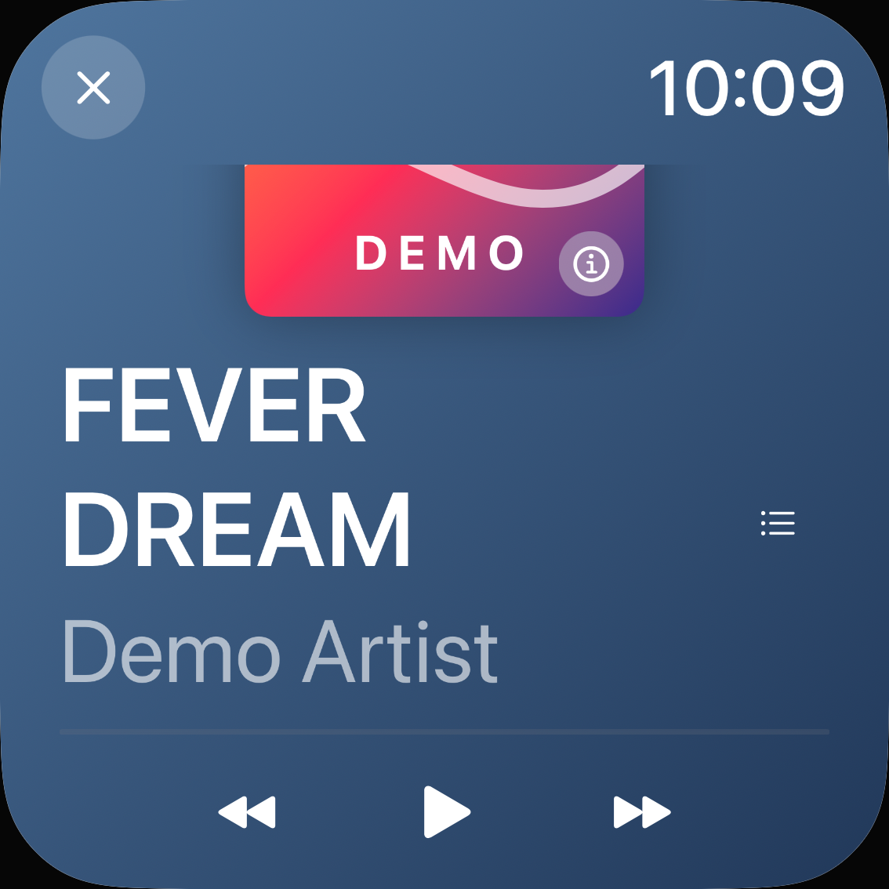
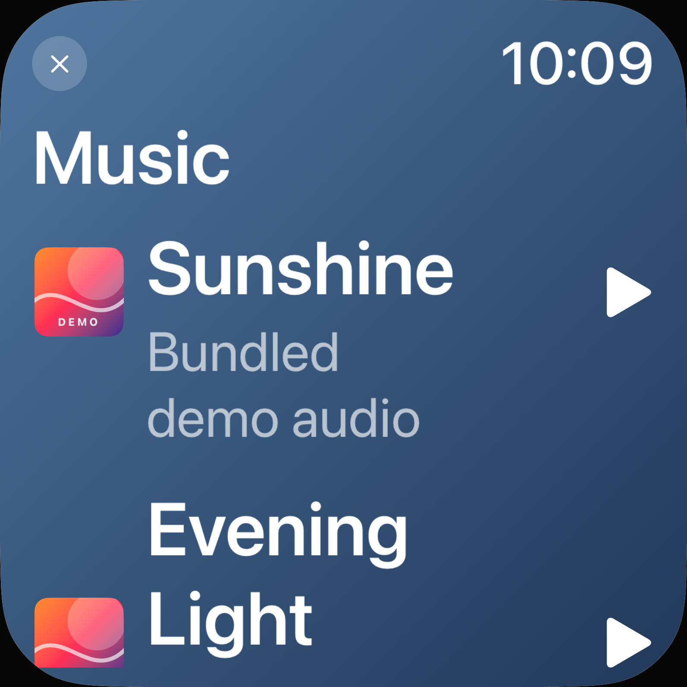

# Demo-Musik: Systemschrift ohne geänderte Normalansicht

30. Oktober 2026 · begrenzte Korrektur für [#73](https://github.com/Olli0103/homeview/issues/73), keine vollständige Accessibility-Abnahme.

## Befund und Änderung

Im pausierten Demo-Player und in seiner Bibliothek blieben **14 native Textausdehnungsbedingungen bei größter Accessibility-Schrift exakt 1,00**. Die bereits semantische Settings-Überschrift wuchs auf beiden Geräten korrekt und ist eine positive Gegenkontrolle.

Nur `MusicView` in `Everyday.swift` geändert: sechs lokale `ScaledMetric`-Eigenschaften für Player-/Bibliothekstexte und Header; bei Accessibility-Schrift ein nativer Scrollbereich mit festem Header. Der normale Layoutzweig, Farben, Opazitäten, Cover, Transportregeln, Datenquellen und Modelle bleiben erhalten. Der bestehende SwiftUI-Weg genügt; keine neue Bibliothek. Header-Uhr mit skaliert, aber nicht als eigene isolierte Textmessung ausgegeben. Die übrigen 165 Produkt-/Ressourceninputs und alle Teile von `Everyday.swift` außerhalb `MusicView` bleiben bytegleich.

**Aktuell 14/14 Textbedingungen grün**, native Höhen 2,765–5,655-fach einschließlich Umbruch. Sieben Zustände pro Gerät sind nicht sieben unterschiedliche neue Schriftmetriken. Alle deklarierten kurzen Textziele werden vollständig in ihrem tatsächlichen Clip erfasst; keine Paragraphenausschnitte als Ganztext-PASS. Das ist eine Textausdehnungs-, keine isolierte Fontfaktor- oder Hilfsmittelprüfung.

## Gleiche Normalansicht und erhaltene Aktionen

**Alle 16 ganzen normalen nativen RGBA-Paare exakt gleich**, einschließlich zwei positiver Settings-Kontrollen. Alle 16 Zielrahmen und tatsächlichen Clips ebenfalls exakt gleich. Keine Toleranz, Registrierung, Maske oder Bildskalierung in dieser Prüfung.

Weiter/Zurück ändern den Titel und bleiben pausiert. Artwork-Info/Done, Bibliothek und Close funktionieren auch in der größten Kategorie. Keine Bibliothekszeile ausgewählt und keine Wiedergabe gestartet. Vier vorhandene Regressionen prüfen zusätzlich zehn tatsächliche Randaktionen, Rückkehr und die lesbare passive Fortschrittsanzeige; Play dabei nur gemessen, nicht aktiviert. Die dort beibehaltenen sofortigen und zwei Sekunden späteren Sheet-Bilder sind keine neue pauschale Renderbereitschafts- oder Pixelabnahme.

## Ausgeführt und gebunden

- **Acht akzeptierte aktuelle UI-Ausführungen, drei unterschiedliche Methoden:** vier Normal-/XXXL-Inventuren und vier bestehende Regressionen auf iPhone 18 Pro/iPad Air 11-inch M4, iOS Simulator 27.0/24A434. Null aktuelle Fehler/Skips. Keine vollständige UI-Suite.
- Zwei akzeptierte Testpins bei **identischen 166 Produktinputs und 19 kompilierten Appdateien**: normale Inventuren und SDKs am Pin `9694c294…`; größte Kategorie/Regressionen am gelieferten Testpin `647b2a2a…`. Nicht als identischer UITest-Quellstand dargestellt. 235 Quellen/Test-/Ressourceninputs je Pin, tatsächliche installierte Apps und Runner vor/nach den Läufen geprüft.
- **Fünf SDKs, 73 Produktdateien und sechs Tooling-Tests bestanden.** Die SDKs gehören zum ersten genannten Pin; spätere UITest-Vorbereitungen ändern das Produkt nicht. Kein erfundener SDK-Neulauf. 89 Core-/Package-/Coretestinputs zum historischen 405-Test-Stand `0c42086` bytegleich, kein neuer Core-Lauf.
- 14 UI-Inputarchive plus SDK-Archiv vollständig byteweise zurückgelesen. 178 native PNGs dekodiert, 22 Kontaktbögen, zwei separate Live-Beobachtungen und ein zusätzliches volles natives Bibliotheksbild tatsächlich gesichtet. Zwölf unmodifizierte eigene Viewport-PNGs samt Herkunfts-/SHA-Manifest veröffentlicht; keine Originalbilder oder Systemfotos.
- Acht Textgrößen-Controller-Ausführungen/20 Präferenzwrites einschließlich Rückstellungen. Alle Originalwerte `large` wiederhergestellt und zurückgelesen. Simulator-Override, keine neue echte OS-Settings-/Assistive-Service-Abnahme.

### Erhaltene Testfehler

Vier funktionale Vorherausführungen bestanden. Vier nachfolgende Großschriftversuche scheiterten am übernommenen Foto-Helfer: zuerst zwei Transportfälle, danach zwei erste Bibliothekszeilen. Sein zusätzlicher 40-Punkte-Innenrand ist nicht der tatsächliche Musik-Scrollclip. Native Bilder zeigen die Ziele am natürlichen Inhaltsende/-anfang.

Nur Musik-Vorbereitungen korrigiert: öffentliche begrenzte Gutter-Scrolls gegen den echten Clip, vollständige Zielrahmen und Treffbarkeit vor den unveränderten Weiter-/Zurück-/Pausen-Assertions; bei Messungen vollständige kurze Texte. Globale Foto-Helfer, Produkt-Padding, Literale, Wachstumsgrenze und Normal-Pixelregeln nicht verändert. Die vier Fehlläufe bleiben erhalten. **Gesamthistorie 16 Ausführungen: zwölf PASS/vier Instrumentierungs-FAIL**, keine nachträgliche 16er-Erfolgssuite. Ein Git-Aufruf im falschen Arbeitsverzeichnis und zwei zunächst verweigerte direkte Simulator-Ablagen sind separat erhalten; kein Produktfehler und keine TCC-/Rechteänderung.

Strukturierte XCTest-Runtimewarnungen leer; doppelte AX-Loader-, `noURL`- und Remote-AX-Meldungen verbleiben in den privaten Rohlogs. Keine Behauptung eines universell warnungsfreien Runtimes.

## Grenzen

UI-Test-App **19** Dateien, frisches Standard-SDK-iOS-Paket **22**: drei SSU/NLU-Dateien fehlen weiterhin in der separat installierten UI-Lane. Diese Schriftprüfung ist keine neue Shortcut-Verpackungs-/Laufzeitabnahme. Farben unverändert; insbesondere keine neue Kontrastabnahme auf dem Verlauf. Kein verbundener Music-/Podcast-Provider, Audio-, akustischer, VoiceOver-/anderer Hilfsmittel-, Original- oder physischer PASS.

**#73 bleibt OPEN/F103 partial/parity=false.** Home-Sperre, Geräte-/Signing-Pause und Snoopy-Rechteausschluss bleiben unverändert. Gesamtauftrag geht mit weiteren umsetzbaren Flows weiter.

[Quellen, Messungen, Ergebnis-/Archiv- und Paket-Lanes](verification/demo-music-dynamic-type.json) · [Native eigene Bilder und SHA-256](verification/demo-music-dynamic-type-images.json).
