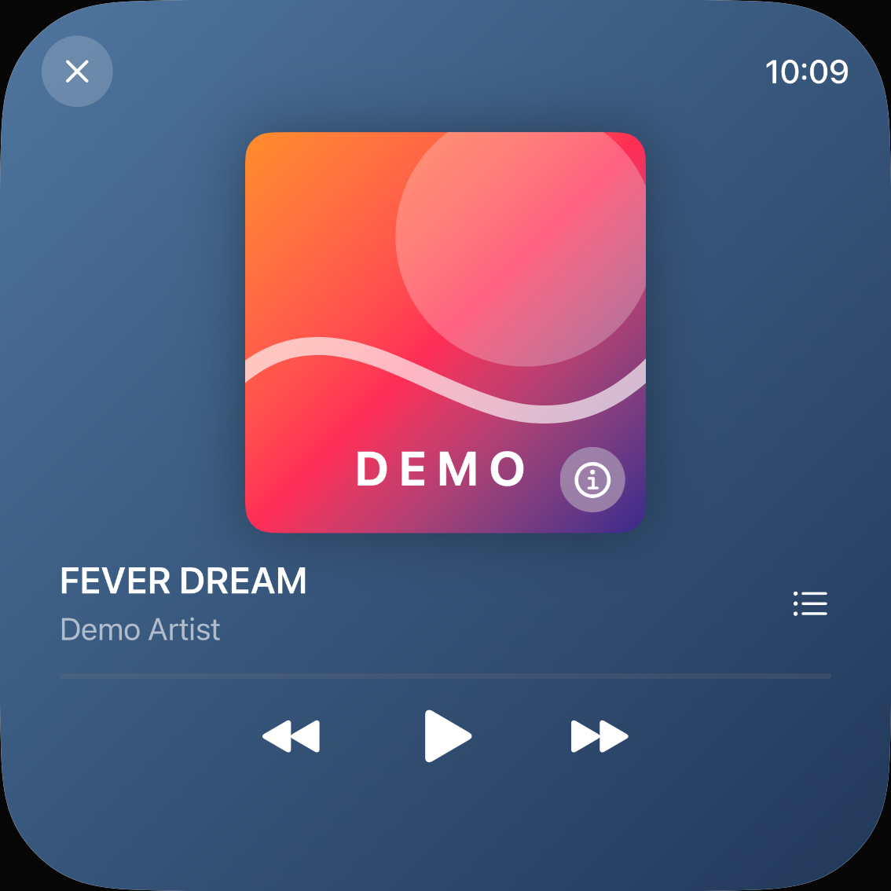
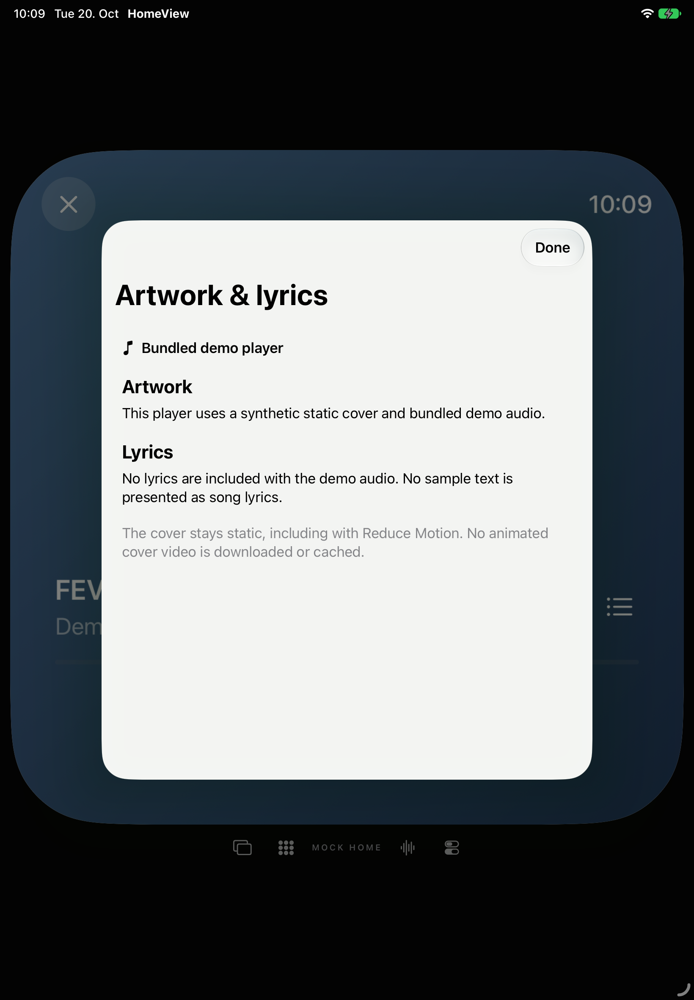
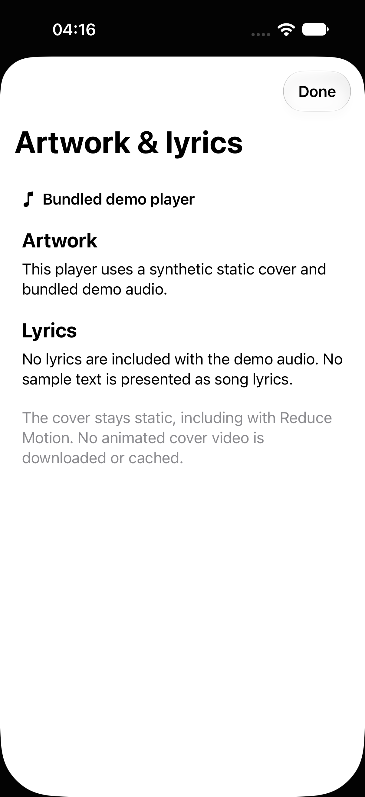

# Demo-Musik: Ziele vergrößern, Status lesbar lassen

20. Oktober 2026 · [#73](https://github.com/Olli0103/homeview/issues/73) · [Messwerte, Quellen und eigene Bilder](verification/demo-music-hit-regions.json)

## Vorherbefund

Drei vollständige öffentliche `.hitRegion`-Audits je Gerät prüfen pausierten Player, Bibliothek und Informationsblatt. Alle Meldungen wurden gesammelt, keine Ausnahmen ignoriert. Bibliothek und Info sind bereits vorher auf beiden Geräten leer. Im Player meldet das iPad die sehr dünne, unbenannte Fortschrittsanzeige; das iPhone zusätzlich Bibliothekstaste, Previous, Play und Next, insgesamt fünf Befunde. Das sind weder fünf fehlerhafte Audiotransporte noch eine gemessene Wiedergabestörung.

Ein zusätzlicher strenger 44-Punkte-Randtest stoppt auf beiden Geräten vor dem ersten Next-Tap: 29,19 bzw. 13,65 native Punkte Höhe. In diesem Baseline-Randversuch wurden keine Aktionen geliefert.

## Produktänderung

Nur MusicView erhält aus dem tatsächlichen Canvas-Transform berechnete native Mindestflächen auf den wirklichen Previous-/Next-/Play-/Bibliothekslabels und vorhandenes optionales Close-Sizing. Die Symbole behalten ihre Schriftgrößen, Close darf auf kleinen Ansichten wachsen. Keine globale Änderung an Design, AudioEngine oder AppModel. Der bereits 72 Referenzpunkte große Infoknopf und das gemeinsame Informationsblatt bleiben bytegleich.

Die Fortschrittsleiste hat im Quellcode keine eigene Geste, Seek- oder Slideraktion. Sie bleibt sichtbar und zugänglich: neuer Name **Demo progress**, Wert **0 of 180 seconds** im geprüften pausierten Zustand. Die [öffentliche SwiftUI-Eigenschaft](https://developer.apple.com/documentation/swiftui/view/accessibilityrespondstouserinteraction(_:)) kennzeichnet sie ausdrücklich als nicht interaktiven Status für die betreffende assistive Zielauswahl. Kein accessibilityHidden und kein Auditfilter. Ein positiver nativer Test verlangt weiterhin vorhandenen Namen und Wert sowie das Fehlen einer Slider-/Buttonrolle. Keine tatsächliche Voice-Control-/Switch-Control-/Full-Keyboard-Access-Bedienung daraus behauptet. Der Wert beschreibt den vorhandenen simulierten Demo-Zähler, nicht einen neu gemessenen AVAudioPlayer-Playhead.

## Tatsächliche Gegenprüfung ohne Wiedergabe

Zehn Funktionsausführungen bestehen: vier bytegleich erhaltene Methoden plus ein neuer positiver AX-/Aufnahmetest je iPad/iPhone. Sechs Auditlisten leer, zehn echte Zwei-Punkte-Randaktionen mit nativen 44-Punkte-Mindestmaßen, vollständiger Viewport-Einschließung und tatsächlichen Folgezuständen. Pausiertes Next zeigt A Little Sunshine, Previous wieder FEVER DREAM. Info öffnet die richtige Demoerklärung, gewöhnliches Done kehrt zum weiterhin pausierten Player zurück. Die Bibliothek zeigt drei eigene Titel, Close führt zur persönlichen Appansicht.

**Play wurde nur vermessen, nicht aktiviert. Kein Bibliothekstitel wurde ausgewählt.** Keine neue Wiedergabe-, Seek-, akustische, Audiofokus-, MusicKit- oder Accountabnahme. Fortschritt, Audio-, Titel- und Auswahlalgorithmen bleiben unverändert.

## Einblendpose gesondert geprüft

Die ersten Blattaufnahmen zeigen die Einblendbewegung noch nicht abgeschlossen. Der Produktcode wurde dafür nicht verändert. Nur der positive AX-/Aufnahmetest wurde auf beiden Geräten wiederholt: Ganzdisplaybild sofort, weitere Aufnahme nach deklarierter Zwei-Sekunden-Wartezeit samt tatsächlicher Uptime und Frameprotokoll. Die Accessibility-Endrechtecke waren bereits identisch, während die Pixel noch verschiedene Einblendpositionen zeigen. Die späteren Bilder zeigen das vollständige Blatt. Dies wird nicht allein als app.screenshot-Zuschnittfehler oder neue Produktionskorrektur ausgegeben.

Alle 18 App-/Widgetdateien sind für diesen Aufnahme-Nachlauf zum Zehner-Prüfstand bytegleich. Die fünf bereits bestandenen SDK-Builds gelten damit für denselben Produktcode; keine unnötige Wiederholung. Akzeptierter Umfang: zehn Funktionsausführungen plus zwei gesonderte Aufnahmen desselben positiven Tests, **keine einzelne grüne Zwölfer-Suite**. Historie insgesamt 20 UI-Ausführungen, 16 erfolgreich und vier dokumentierte Vorherfehler; keine Skips oder strukturierten Runtime-Warnungen. 206 aktuelle Quellen und je 28 App-/Widget-/Test-/Metadaten-/Starteingaben sowie installierte Appbytes gebunden. Drei Archive mit jeweils 234 Einträgen vollständig zurückgelesen. 52 PNGs dekodiert, sechs Übersichten und vier zusätzliche Vollbilder gesichtet, 14 eigene Bilder ausgewählt.

72 Core-/Coretest-Dateien sind zum historischen 301-Test-Lauf bei `2b223b7` bytegleich; kein neuer Core-Lauf. Der öffentliche API-Text wurde vollständig als DocC-JSON am 20. Oktober gelesen und per Hash gebunden; keine SDK-Header oder Fremdbinaries werden hier verteilt.

## Eigene Aufnahmen

| iPhone vorher | iPhone nachher |
| --- | --- |
|  |  |

| iPad nach Ende der Einblendung | iPhone nach Ende der Einblendung |
| --- | --- |
|  |  |

## Grenzen

Nur lokale Demosteuerung; keine verbundenen Medien, tatsächliche Hilfsmittel, Fokus-/Ansage-/große-Schrift-/Kontrast-/Hardware- oder Originalabnahme. Die leeren Bibliotheks-/Infoaudits sind kein neuer Beleg für unverändert ausgeführte Bibliotheks-Wiedergabe. Keine allgemeine Pixelgleichheit: Mindestziele und Close können Geometrie ändern. **#73 bleibt OPEN; F103 partial/parity=false.** Keine neue Lyrics-/Animationsfähigkeit; #58 und dessen ursprüngliche Grenzen unverändert. Keine privaten Daten, Konten, Berechtigungen, Wiedergabe, Nachrichten/Anrufe, Systemalarme oder neuen Live Activities. Keine Home-Anbindung.
