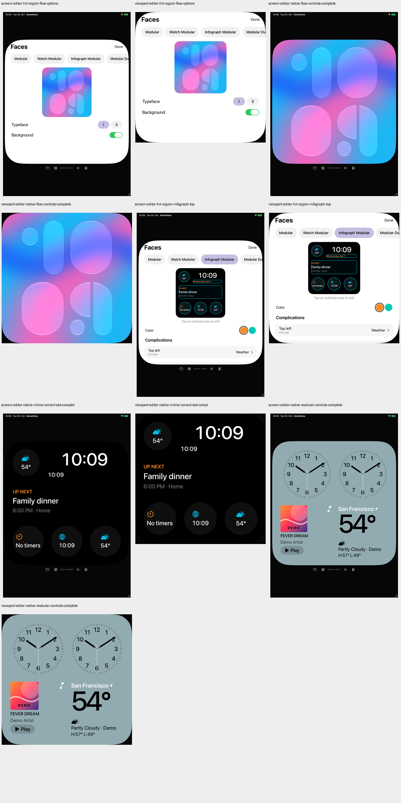
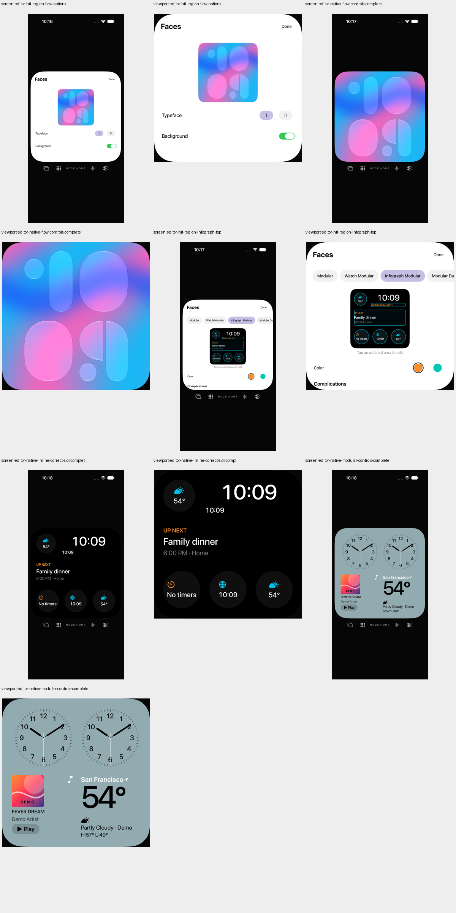

# Face-Editor: Trefferflächen und tatsächliche Auswahl

20. Oktober 2026 · Teilfix von [#73](https://github.com/Olli0103/homeview/issues/73), das offen bleibt. Keine Original-Geometrieabnahme von #7.

## Vorher

Sieben ungefilterte öffentliche Hitflächen-Audits je Gerät: Modular oben/Liste, Flow oben/Optionen, Watch Modular, Infograph und die Complication-Auswahl. Alle sieben iPad-Ausführungen bestehen; alle sieben iPhone-Ausführungen scheitern. Die vollständigen Listen bleiben erhalten: Root-Done, Flow-Background, Inline-Datum und Sheet-Done werden beanstandet. Keine Findings werden ausgefiltert.

Auch leere Auditlisten sind kein 44-Punkte-Nachweis: iPad-Done misst 27,20 Punkte Höhe, die Datumsvorschau 21,23. Auf iPhone sind es 12,81 und 10,08; zusätzlich sind Carousel, Farbe, Typeface und Slotzeilen kleiner als 44 Punkte.

## Begrenzte Korrektur

Root-Done, Face-Auswahl, Farbwahl, Typeface und alternative Slotzeilen erhalten lokale Label-Rechtecke mit `ceil(44 / nativeCanvasScale)`. Face-/Typeface-Auswahl liefert ihren tatsächlichen Selected-Wert. Mehr unterer Scrollabstand hält die letzte Auswahl oberhalb des Gestenstreifens erreichbar. Auswahl-, Save-, Familien- und Ursprungs-Face-Regeln bleiben unverändert.

Der native Flow-Switch mit seinem 1/0-Wert bleibt erhalten. Der erste große Labelrahmen bestand die Größenprüfung, reagierte aber an seinem oberen Rand nicht: Der modellierte Wert blieb 1. Die volle Label-Rechteckfläche führt deshalb nun dieselbe lokale Umschaltung aus. Obere/untere Rand-Taps und die bestehende normale Switch-Tap-Regressionsprüfung bestätigen die Zustandswechsel; kein doppelter Wechsel beobachtet.

Die Datumslinie behält ihr gemaltes Rechteck aus `face.definition.placements`. Nur ihre Trefferfläche wird unter Berücksichtigung beider Skalierungen in nicht interaktiven Vorschauraum erweitert, mit einem nativen Punkt Abstand zum nächsten Slot. Originalrechteck und Canvas müssen enthalten bleiben; keine Geschwisterfläche darf überlappt werden, sonst bleibt die ursprüngliche Fläche erhalten. Alle Slot-IDs und räumlichen Buttons bleiben verfügbar; keine AX-Aktionen werden versteckt. Andere kleine Vorschau-Slots sind damit **nicht** pauschal 44 Punkte groß, ihre vergrößerten Listenalternativen bleiben wichtig. Die zugrunde liegende Slotdefinition und feste Uhrposition werden nicht geändert. Keine Pixelidentität behauptet.

Ein nomineller 44-Punkte-Sheet-Done-Rahmen ergab auf iPhone tatsächlich nur 42,25 × 42,25 Punkte, auf iPad 44 × 44. Eine konkrete interne OS-Ursache wird nicht behauptet. Der Rahmen verwendet jetzt 48 Punkte; gemessen werden 46,09 auf iPhone und 48 auf iPad. Die Tests prüfen die tatsächlich gelieferten Koordinaten nach stabiler Darstellung, nicht die nominelle Zahl oder eine vermutete unskalierte Modalansicht.

## Nachweis

| Stand | iPad PASS/FAIL | iPhone PASS/FAIL |
|---|---:|---:|
| Unverändertes Produkt, sieben Audits | 7 / 0 | 0 / 7 |
| Erster Kandidat, fünf gezielte Fälle | 4 / 1 | 3 / 2 |
| Korrigierter gezielter Gegenlauf | 5 / 0 | 5 / 0 |
| Restliche Audits und bestehende Regressionen | 9 / 0 | 9 / 0 |

Die letzten beiden Auswahlläufe verwenden **identische Quellen, Tests und kompilierte App-/Testbundles**, ohne erneuten Build. Zusammen 14 verschiedene Methoden / 28 erfolgreiche UI-Ausführungen, keine Skips oder strukturierten XCTest-Runtime-Warnungen. Das ist keine vollständige XCTest-Suite und kein einzelner 28er-Aufruf. Alle 14 aktuellen ungefilterten Auditlisten sind leer.

38 tatsächliche Zwei-Punkte-Rand-Taps prüfen vor jedem Ereignis mindestens 44 × 44 Punkte, Hittability und vollständige Viewport-Enthaltenheit: Farbe und Rückwahl, Slotliste/Clock, Face-Wechsel und erhaltene Auswahl, Root-Done, Typeface, Flow-Hintergrund sowie Inline-Datum/Sheet-Done/Off/Clock. Die Datumstrefferfläche ist gegen tatsächliche Geschwister-AX-Rechtecke disjunkt; die Inline-Auswahl darf Music/Weather nicht anbieten. Nach Abschluss zeigt der richtige gerenderte Slot Clock.

Die bestehenden Prüfungen decken zusätzlich normalen Switch-Tap und erneutes Öffnen, Inline-Filter/Off/Clock/Prozessneustart/World-Clock-Ziel, Watch-Modular-Familien und Isolation sowie Duo-/Compact-Auswahl ab. Fünf SDK-Builds bestehen; der reduzierte Watch-Target ist nur eine Kompilationsregression, kein Editor auf watchOS. Core, Ressourcen, Projekt, Packages und Shaderdateien sind unverändert; bestehende Renderer-Körper und Slotdefinitionen wurden nicht geändert. Kein neuer Core-Gesamtlauf beansprucht.

## Grenzen und Bindung

Sehr schmale, nicht geprüfte Fenster können die geschützte Erweiterung verhindern. Weitere räumliche Vorschau-Touchflächen können kleiner bleiben. Echte VoiceOver-Ansagen/Fokus, Voice Control, Switch Control, AssistiveTouch, Dynamic Type, Kontrast/Zoom sowie physische Geräte und Original-Parity bleiben offen. #73/F103 bleiben partial, Parity=false und Originalkriterien unverändert; #7 wird nicht geschlossen.

[Getrennte Quellen, Ergebnisse, vollständige aktuelle Auditlisten/Geometrien, Archiv- und Bildhashes](verification/editor-hit-regions.json), [209-Dateien-Manifest](verification/editor-hit-regions-source.json), [vollständige Vorherbefunde](verification/editor-hit-regions-before.json). Pro Lauf Quellen und App-/Testbundle/Startkonfiguration eingefroren, installierte Apps gegen den Build zurückgelesen und Archive bytegeprüft. Eigene PNGs dekodiert; Vorher- und aktuelle Geräteübersichten gesichtet. Frühere echte Fehler bleiben Fehler.

Nur UUID-/ephemere Demostores und vorhandene synthetische Medien-/Wetter-/Kalenderinhalte. Kein Musikstart, Account-/Fotozugriff, Kamera-/Mikrofonbetrieb, Systemalarm, Nachricht/Anruf oder Home-Anbindung.

