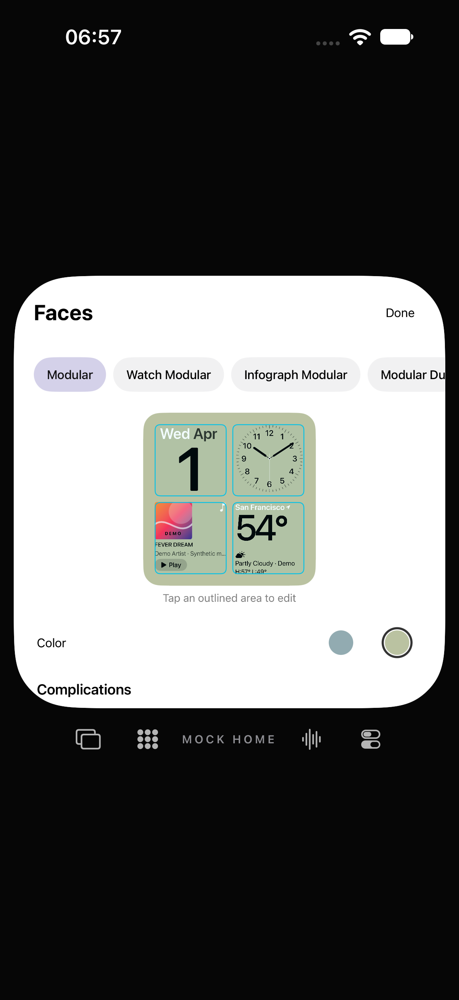
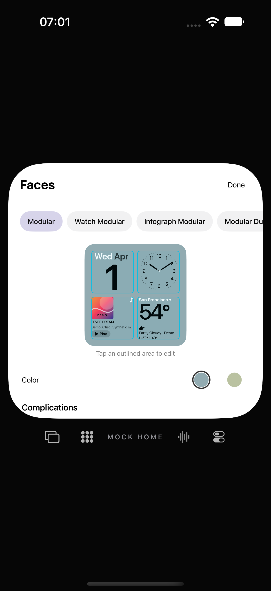

# Face-Farben ohne Seiteneffekt

29. Oktober 2026 · begrenzte Korrektur für [#7 / FACE-03](https://github.com/Olli0103/homeview/issues/7). **#7 bleibt für Originalgeometrie und vollständigen Optionsumfang offen.**

## Zwei nachgewiesene Fehler

Am unveränderten veröffentlichten Produktcode scheitern zwei neue Fälle:

1. Home Modular auf **Teal** setzen → Modular wird ohne eigene Auswahl zu **Sage**. Der eigene UUID-Testzustand enthält `theme=1`, Home-Konfiguration `theme=1`, aber **keine** Modular-Konfiguration. Die zusätzliche globale Farbschreibung verändert dessen Legacy-Fallback.
2. Home Modular Clock bietet Purple/Teal an, obwohl sein Renderer eine feste Palette benutzt und keine dieser Einstellungen liest. Das Vorhandensein einer gespeicherten Einstellung ist keine sichtbare Funktion.

Die zwei fehlgeschlagenen Ausführungen, tatsächliche Bilder, ursprüngliche Quell-/Binärinputs und gespeicherte Testdatei bleiben erhalten. [Gebundener Befund](verification/face-color-isolation.json).

## Änderung

- Farbauswahl schreibt nur die Konfiguration des ausgewählten Faces. Der globale Legacy-Farbwert bleibt unangetastet.
- Home Modular liest seine eigene Konfiguration; fehlende alte Konfigurationen behalten den bestehenden Legacy-Fallback.
- Beim festfarbigen Home Modular Clock wird keine wirkungslose Farbauswahl mehr angeboten. Gespeicherte ältere Konfigurationen werden nicht gelöscht. Das behauptet **nicht**, dass das Original keine Farboptionen besitzt; der eigene Renderer unterstützt sie derzeit nicht.

Keine neuen Paletten, Shader, Materialien oder Originalgeometrien. Bestehende mehrdeutige globale Altwerte werden nicht rückwirkend geraten oder zurückgesetzt; die Korrektur verhindert neue Querveränderungen und respektiert vorhandene explizite Face-Konfigurationen.

## Abnahme des begrenzten Fixes

**397 Coretests, zwölf gezielte UI-Ausführungen und fünf SDK-Builds bestanden.** Sechs UI-Methoden je iPhone 18 Pro / iPad Air 11-inch M4, OS27.0 (24A434), keine Fehler/Skips/XCTest-Runtime-Warnungen. Keine behauptete vollständige UI-Suite. Die zwei alten Fehler bleiben getrennte Vorherstände.

Die neuen Fälle verlangen tatsächlich geänderte Home-Pixel nach der Auswahl, unveränderte Modular-Pixel nach Home-Änderung **und** Prozessneustart sowie exakt gleiche Home-Teal-Pixel nach Neustart. Alle drei Exaktvergleiche der **vollständigen Face-Viewports**, nicht der OS-Statusleisten, haben auf beiden Geräten **null geänderte RGBA-Pixel**, ohne Toleranz. Auswahlstatus und gespeicherte UUID-Dateien bestätigen unabhängig: global weiter 0, eigene Home-Konfiguration 1, Modular weiterhin ohne eigene Konfiguration. Editor-Trefferflächen, echte Paletten-/Karussell-Randtaps, Slotfilter, Neustart und Nacht-Rotfilter bleiben bestanden.

225 Quell-/Ressourcen-/Testinputs und 51 kompilierte/Launchinputs auf beiden UI-Läufen identisch, vor/nach unverändert. Archive vollständig zurückgelesen und installierte Appbytes geprüft. Der abschließende Core-Lauf verwendet ebenfalls eingefrorene Quellen und ein archiviertes bereits gebautes Testbundle; der vorherige Build-/Testlauf wird nicht zu 794 verschiedenen Tests addiert. Fünf SDK-Produkte separat archiviert und vollständig zurückgelesen. [Quellen](verification/face-color-isolation-source.json) · [Ergebnisse, Pixelzahlen, Store-Read-back und Fehler](verification/face-color-isolation.json) · [Plattformprodukte](verification/face-color-isolation-platforms.json).

35 eigene PNGs dekodiert, sieben Tafeln gesichtet und zwölf ausgewählte Bilder veröffentlicht. Keine Originalmedien aus der parallelen [Gesten-GIF-Nachprüfung](transition-reference-review-20261029.md) als App-Assets oder öffentliche Vergleichsbilder verwendet.

Originaleditor-Palette/-geometrie, vollständige Familien-/Anbieterauswahl und physische Hilfsmittel-/Geräteabnahmen bleiben offen. F003/F004/F005 bleiben ohne Parity; Geräte-/Signing-Hold unverändert. Nur eigene UUID-Testdaten und MockHome, keine Konten, Mikrofon/Kamera, Anrufe/Nachrichten oder Home-Anbindung.
