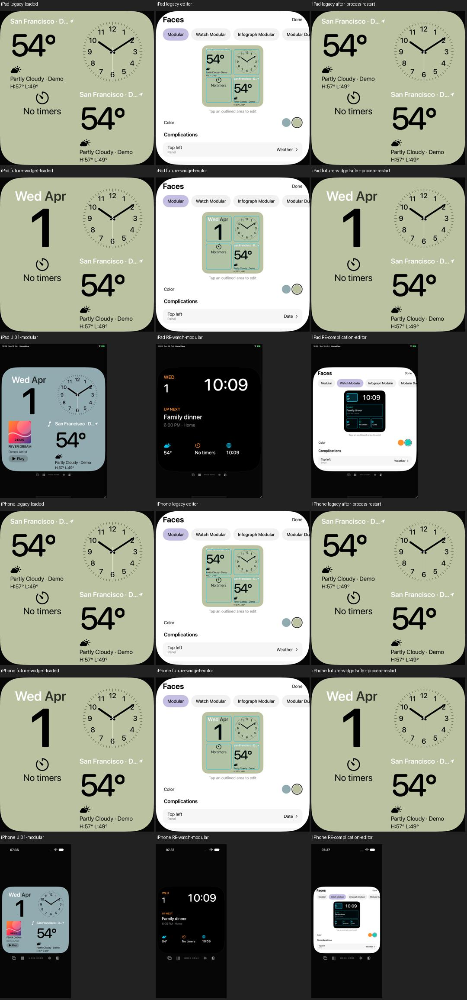

# Gespeicherte Face-Einstellungen gezielt wiederherstellen

18. Oktober 2026 · [FACE-03 / #7](https://github.com/Olli0103/homeview/issues/7) ·
[QA-05 / #80](https://github.com/Olli0103/homeview/issues/80).

## Nachgewiesener Fehler

Die synthetisierten Codable-Regeln verlangten alle später ergänzten Flowfelder.
Eine alte Face-Konfiguration ohne diese Felder konnte deshalb nicht gelesen
werden. Ebenso ließ ein unbekannter Widgetname die komplette betroffene
Konfiguration scheitern, einschließlich gültiger Nachbarwidgets und Farbe.
Die übergeordnete Snapshot-Tabelle verwarf dann diesen ganzen Face-Eintrag.

Zwei neue Modelltests gegen unveränderten veröffentlichten Decoder und
Snapshot-Lader belegten beide Fälle mit acht fehlgeschlagenen Assertions.
Die Ausgangsquellen und Ergebnisse bleiben getrennt gebunden. Es wurden keine
normalen Nutzerdaten untersucht; die Eingaben sind vollständig erfunden.

## Begrenzte Decoder-Korrektur

Jede gespeicherte Option wird separat gelesen. Fehlende oder falsch typisierte
Felder erhalten ihre bekannten Vorgaben. Ein unbekanntes oder beschädigtes
Widget wird ausgelassen, gültige Geschwister bleiben. Ein normaler Slot nutzt
danach wie bisher seine vorhandene Legacy-/Layoutvorgabe. Ein bekannter, aber
für seine Familie unzulässiger Inhalt bleibt wie bisher Off.

Die unterstützten Farb-/Schriftindizes bleiben 0/1, Hintergrundvorgabe true.
Slotnamen und Tabellen sind begrenzt; das ist eine eigene Datenhygienegrenze,
keine Original-Produktgrenze. Nicht-Objekte bleiben abgelehnte Tabelleneinträge.
Gültige vollständige Konfigurationen bestehen den kanonischen Roundtrip.
Der Versionsschutz für unbekannte komplette Snapshots wird nicht verändert.

Ein zusätzlicher früher Test erwartete fälschlich Date statt des bereits
vorhandenen Off-Verhaltens bei inkompatibler Familie. Dieser 166-Tests-Stand
mit einem Testfehler bleibt erhalten. Korrigiert wurde die neue Erwartung, nicht
die bestehende Familienregel oder die Decoder-Korrektur.

## Native Prüfung über den normalen Speicherpfad

Die App-Testvorlage kann nur hinter UITesting und expliziter UUID einen noch
nicht vorhandenen eigenen Test-Speicher anlegen. Bereits vorhandene Dateien
werden nicht überschrieben. Ein Modus enthält die alte Konfiguration, einer
einen unbekannten Widgetnamen; eine andere Flow-Konfiguration und weitere
synthetische Daten haben bewusst abweichende Werte.

Danach arbeiten der normale Snapshot-Lader, Editor und Writer. Sage-Farbe wird
an echten Bildpixeln geprüft, Widgets und Stil im Editor kontrolliert. Eine
reale Editoraktion speichert; der Prozess wird beendet. Der zweite Prozess
startet ohne Testvorlage oder Reset und muss den gespeicherten Zustand lesen.
Die vollständigen nativen Viewports vor und nach Neustart werden verglichen.

Zusätzlich liest ein externer read-only Prüfer nur die aus dem Testprotokoll
bekannten UUID-Ordner zurück. Originalkopien müssen zum Inhalts-Hash im
Dateinamen passen. Der reparierte Speicher muss gültige Widgets/Stil enthalten;
alle anderen Snapshotfelder und die andere Flow-Konfiguration bleiben gleich.
Keine echte Bibliothek, persönliche Accounts, Systemalarme oder Homes beteiligt.

Dies ist ein begrenzter Wiederherstellungsnachweis, keine vollständige
Migration-/Editor-/Original-/Hardwareabnahme. Issues #7 und #80 bleiben offen.

## Gebundener Abschlussstand

166 Modelltests vor sowie nach Feature- und Integrationscommit, acht gezielte
UI-Ausführungen (vier je iPad/iPhone), fünf SDK-Builds. Keine Fehler, Skips oder
XCTest-Runtime-Warnungen. Zwei separate Pilotfälle werden nicht addiert.

Alle vier eigenen Originalkopien und normalisierten UUID-Test-Speicher wurden
nach den tatsächlichen Prozessneustarts direkt zurückgelesen: Hash-Dateinamen
und Originalbytes stimmen zusammen. Alle übrigen Snapshotfelder und die andere
Flow-Konfiguration bleiben unverändert; reparierte Slots und Stile sind gespeichert.
Vier vollständige Neustart-Bildpaare sind pixel- und PNG-bytegleich. Sage wird
an echten Pixeln geprüft, nicht allein über das Editor-Label. Vorhandene Editor-
und Familienregressionen bestehen auf demselben Stand.

[Quellen, getrennte Fehlversuche und Datei-Prüfwerte](verification/face-configuration-recovery.json) ·
[18 eigene PNGs mit Inhaltsbindungen](screenshots/goal-20261018/face-recovery-manifest.json).
