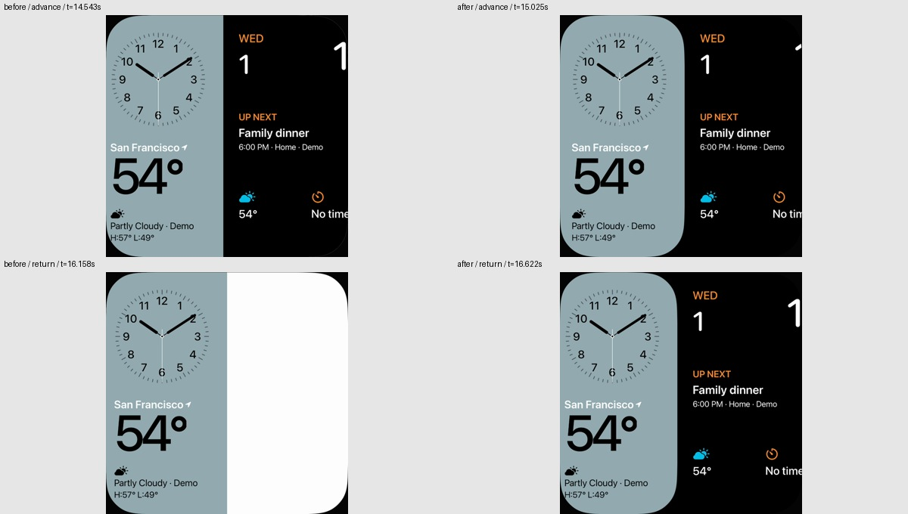
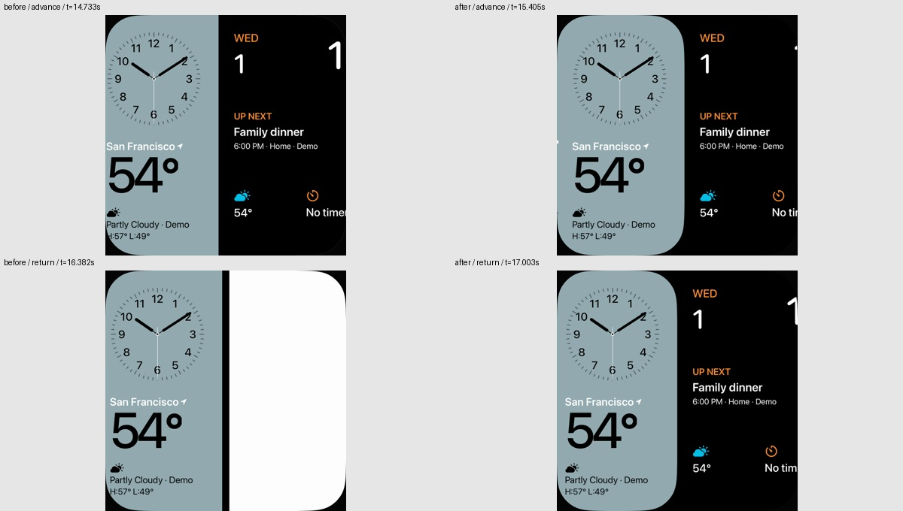

# Gerundete Face-Karten und korrektes Zurückwischen

29. Oktober 2026 · begrenzte Korrektur für [#6 / FACE-02](https://github.com/Olli0103/homeview/issues/6). **Originalkurven und vollständige Gestenabnahme bleiben offen.**

## Tatsächlicher Vorherbefund

Die [vollständig nachgeprüfte vorhandene Original-GIF-Folge](transition-reference-review-20261029.md) zeigt einzeln gerundete, überlappende Karten. Das belegt weder einen numerisch bestimmten Radius noch Fingerkoordinaten, Geschwindigkeit, Abbruchregeln oder eine vollständige feste Face-Reihenfolge.

Danach wurde der **unveränderte veröffentlichte eigene Renderer** auf iPhone und iPad nativ aufgezeichnet: Modular → Watch Modular → Modular. 254 bzw. 276 tatsächliche Videoframes, mit originalen Aufzeichnungszeitstempeln und ohne FPS-Resampling. Zwei sichtbare Fehler:

1. Ein einziger äußerer Clip rundet nur den Viewport, nicht die innere Kante der bewegten Karte. Die Kante bleibt gerade.
2. Beim Rückweg bewegen sich beide Karten nach links und legen rechts ein weißes Panel frei. Die ausgehende Identität behält die früher gewählte Entfernungsrichtung.

Die eigenen Vorher-/Nachher-Aufnahmen verwenden bewusst dieselben eigenen Faces. Sie behaupten nicht, dass Watch Modular ein Nachbar in der Original-Demofolge ist. Originale und abgeleitete Originalbilder bleiben privat, keine Referenzbilder werden App-Assets.

## Änderung

- Beide Karten lesen die **aktuelle** Wechselrichtung, statt eine alte Entfernungsseite festzuhalten.
- Während der Bewegung bekommt jede Karte die bereits vorhandene eigene 84-Punkte-Rundung. Im Ruhezustand bleibt der bisherige Viewport-Clip allein zuständig; keine doppelte Randglättung.
- Nur während des tatsächlichen Übergangs ist die Bühne dunkel. Ihre Rückkehr zum bisherigen weißen Untergrund hängt am nativen Animationsabschluss, nicht an einem geratenen Sleep. Eine Revisionsnummer verhindert, dass ein älterer Abschluss einen neueren Übergang beendet.
- Die vorhandene eigene Feder `response=0.46`, `dampingFraction=0.95` wird an einer Stelle ausgelöst. Vorher lagen äußerer Ease-in-out- und innerer impliziter Feder-Transaction übereinander. Der neue eindeutige Ablauf ist keine vermessene Originalkurve.
- Dominante Achse, Distanzen und Randzonen bleiben unverändert. Der vorhandene Reduce-Motion-Zweig verwendet weiterhin eine Identitätstransition. TV-Richtungseingaben benutzen denselben Wechselpfad; das ist dort SDK-, keine Fernbedienungsabnahme.

Keine neue Animationsbibliothek, Renderengine, Karussellreihenfolge oder Dateimigration. Native SwiftUI-Transitions und Animationsabschluss reichen für diesen abgegrenzten Fehler. Keine neue Abhängigkeit.

## Vorab festgelegte Gegenprüfungen

Die Kriterien wurden vor dem ersten Produktionskandidaten gespeichert:

| Eigenschaft | Unverändert | Angenommener Stand |
|---|---|---|
| Innere Mist-Kante, obere Zeile gegen Mitte, normalisiert auf 600 | 0 Pixel Einzug | iPhone 27–43, iPad 26–41 Pixel; alle 76 ausgewählten inneren Kantenbeobachtungen über der vorher festgelegten Grenze 20 |
| Durchgehendes nahezu weißes Panel auf Messzeile 520 | Beim Rückweg bis 297 / 288 Pixel | 0 Pixel in den 76 Messframes, Grenze vorher 16; tatsächliche Bilder zusätzlich gesichtet |
| Vollständige native Ruhe-Viewports | Drei Zustände je Gerät | **Alle sechs RGBA-Paare exakt, null geänderte Pixel**, ohne Randbeschnitt oder Toleranz |

Kantenmessung nur bei einer inneren Mist-Kante zwischen x=120 und x=480. Die grobe H264-Farbklassifikation ist eine Geometriehilfe, kein Farbkalibrationsnachweis. Die Anfangs-, Watch- und Rückkehrbilder stammen separat aus nativen verlustfreien PNGs: 1134×1134 bzw. 1592×1592. Keine Statusleiste in diesen Gleichheitsprüfungen. Die vier weiteren Rundlauf-Rückkehrvergleiche sind eigene XCTest-Assertions; sie werden nicht als zusätzliche Vorher-/Nachher-Paare gezählt.

Zwei Produktionskandidaten wurden trotz grüner UI-Rundläufe verworfen: Der erste ersetzte den äußeren Hostuntergrund und änderte 24.396/24.400/24.396 Pixel. Der zweite ließ einen schmalen Ruhe-Rand anders glätten: iPhone 1.924/1.928/1.924, iPad jeweils 2.700 Pixel. Kriterien wurden nicht gelockert. Diese Quell-/Binärarchive, Aufnahmen und Vergleiche bleiben historische Fehlstände; ihre damaligen Dateinamen mit `final` sind keine Abnahme. Zusätzlich bleiben ein Architektur-Aufruffehler und ein Swift-Isolations-Compilefehler dokumentiert.

## Ausgeführte Prüfung

**22 gezielte UI-Ausführungen erfolgreich, insgesamt 24 ausgeführt:** elf unterschiedliche Methoden je iPhone 18 Pro / iPad Air 11-inch M4, iOS Simulator 27.0 (24A434). Zwei ältere Quadrat-Annahmen im Randgestentest scheiterten beim inzwischen bewusst rechteckigen Assistenten. Nur dieser Helper-Aufruf wurde korrigiert (`assistantRectangle:true`); die vorhandenen Prüfungen für Inhalt, sichtbaren Viewport und enthaltenes Send-Element bleiben bestehen. Beide betroffenen Fälle danach grün. Null Skips/strukturierte XCTest-Runtimewarnungen, aber ausdrücklich zwei erhaltene Fehlläufe; keine nachträgliche Umdeklarierung zur fehlerfreien 22er-Gesamtsuite. Zwei aufgezeichnete native Rundläufe mit acht tatsächlichen Wischübergängen; weitere 20 Ausführungen prüfen den eigenen Reduce-Motion-Testschalter, dominante Diagonalen, ignorierte kurze/vertikale Gesten, echte Randziele, Scrollen, Langdruck-Editor, synthetische Klingelunterbrechung und bestehenden Timer sowie die 14-Face-Nachtmatrix. Keine vollständige UI-Suite und keine echte Hilfsmittel-Einstellungs-/Hardwareabnahme.

225 Quell-/Ressourcen-/Testinputs und sämtliche kompilierten/Launchinputs sind vor/nach jedem Lauf unverändert, archiviert und vollständig zurückgelesen. Die zwei Aufnahmen und zwei breiten Ergänzungsläufe teilen den ersten Stand; die zwei gezielten Wiederholungen unterscheiden sich ausschließlich in einer bestehenden UI-Helper-Zeile und im Testbundle. **Alle 19 Produkt-Bundledateien bleiben dabei byteidentisch.** Installierte Appbytes stimmen jeweils mit dem eingefrorenen Build überein. Fünf SDK-Builds des unverändert gelieferten Produktcodes bestanden; der vor der reinen UI-Testkorrektur gebaute Quellenstand wird genau benannt, nicht als neuer Build umetikettiert. Produkte separat archiviert/zurückgelesen. 88 Core-/Paket-/Coretestinputs sind zum historischen gebundenen 397-Test-Stand von `435afd3` bytegleich; **kein neuer Core-Lauf** für diese RootView-/UI-Teständerung.

[Quellen und kompilierte Inputs](verification/face-transition-cards-source.json) · [Ergebnisse, native Videodigests/-zeitpunkte, Geometrie, Pixelpaare und Fehlstände](verification/face-transition-cards.json) · [SDK-Produkte](verification/face-transition-cards-platforms.json).

Der angenommene Stand liefert 349 bzw. 364 dekodierte eigene Aufzeichnungsframes, insgesamt 713. Variable Recorder-Zeitabstände sind weder App-Framerate noch Eingabelatenz. Die GIF-Abstände sind ebenfalls kein Original-UI-Takt. Kein Kamera-/Perspektivbild wird durch Verzerren zur vermeintlichen Pixelreferenz gemacht.

**#6 bleibt offen:** Original-Langsam-/Schnell-/Abbruchfolgen, genaue Feder/Touchregeln und vollständige App-Raster-/dynamische Inhaltsstabilität sind damit nicht erledigt. F002 bleibt partial und ohne Parity. Geräte-/Signingabnahmen bleiben pausiert. Nur synthetische Daten und MockHome; keine Home-Anbindung, persönlichen Konten, Mikrofon/Kamera, Anrufe oder Nachrichten.

Nebenbefund des Ressourcenchecks: Der vorangegangene veröffentlichte Farbfix hatte den aktuellen Herkunfts-Quellhash von `Faces.swift` nicht nachgeführt. Nur dieser gegen den historischen Commit geprüfte Quellenhash ist [aktualisiert](verification/asset-provenance-source-refresh-20261029.json); alle 58 Ressourcen und 17 Herkunftseingaben bestehen den bestehenden Checker. Keine neuen Ressourcen, Lizenzänderung oder nachträgliche historische Rechtefreigabe.

98 native PNGs dieser sechs UI-Läufe vollständig dekodiert, acht eigene Bildtafeln tatsächlich gesichtet. Dazu beide finalen Bewegungsübersichten und die beiden veröffentlichten eigenen Vergleichstafeln geprüft; acht ausgewählte eigene Recorderframes und zwei Vergleichstafeln veröffentlicht. Keine Original-GIF-Bilder in diesem Paket.
