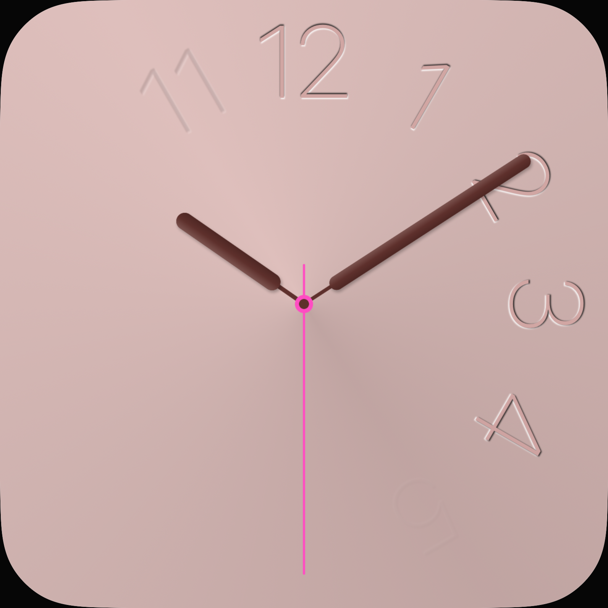
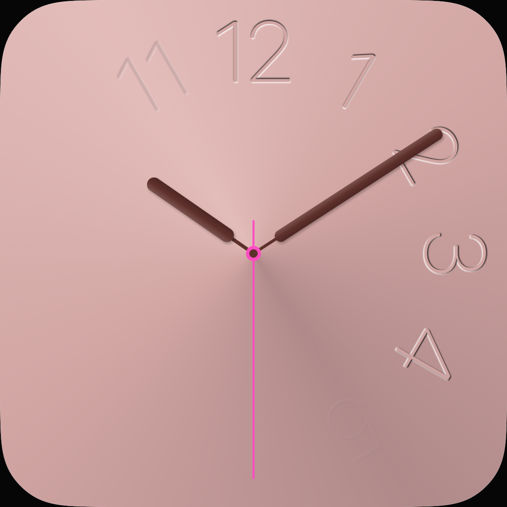

# Fade: hellere, neutralere Grundfläche

19. Oktober 2026 · [#18](https://github.com/Olli0103/homeview/issues/18).

Nur die fünf konischen Farbstops und eine zugehörige Core-Erwartung ändern sich.
Zeitkurve, Ziffern, Zeiger und Renderer bleiben unverändert. Acht freie Flächen aus
dem privaten flachen UI12-Bild bestimmen die Farbziele; keine Originalbilder oder
extrahierten Schriftkonturen werden veröffentlicht.

Der mittlere Kanalfehler sinkt auf beiden Geräten von 10,92 auf 1,17 (89,3 %).
Alle acht RGB-/Chromaziele und die Kontrastspanne bestehen. 166 Modelltests,
vier gezielte UI-Ausführungen je iPad/iPhone sowie fünf SDK-Builds bestanden.
Keine Fehler, Skips oder von XCTest gemeldeten Runtime-Warnungen. 30 eingefrorene
native Eingaben bleiben bytegleich; installierte App-Dateien wurden zurückgelesen.
Numerals bleibt im ganzen Viewport pixelgleich; Fade bewegt sich bei verschiedenen
Phasen und bleibt bei reduzierter Bewegung im festgelegten Hintergrundbereich still.

## Die vier Zeigerpixel

Die ursprüngliche dunkle 5×5-Auswahl scheiterte an vier Minutenzeigerpixeln.
Dieser Fehlschlag bleibt erhalten. Eine getrennte native Kontroll-App ändert nur
den Untergrund auf Schwarz/Weiß: alle vier Pixel reagieren darauf. Der unveränderte
normale Kontrollhintergrund erhält sämtliche ursprünglichen Messpunkte exakt.
Damit waren diese vier Punkte keine hintergrundunabhängigen Kerne.

Vor dem Abschlusslauf wurden neue Masken aus den **unveränderten** Schwarz-/Weiß-
Kontrollen eingefroren: volle 5×5-Nachbarschaft exakt hintergrundunabhängig und
ursprünglich dunkel. Auf iPad 11.059/14.757 und iPhone 5.373/7.098 Kernpixel;
alle vier Mengen bleiben im Kandidaten RGBA-exakt. Keine RGB-Toleranz, keine
nachträgliche Änderung des fehlgeschlagenen Vertrags. Die Diagnose-App wird nicht integriert.

## Eigene Aufnahmen

| | Vorher | Nachher |
|---|---|---|
| iPad |  |  |
| iPhone |  |  |

[Prüfung und Bilddigests](verification/fade-surface-tones.json) ·
[Quellenbindung](verification/fade-surface-source.json).

Die Farbprüfung verwendet nominale RGB-Werte eines einzelnen Referenzzustands,
keine Farbmanagement- oder vollständige Originalabnahme. Originalzeitkurve,
weitere Übergänge, Typografie, Licht und Hardware bleiben offen; **#18 bleibt offen**.
Die getrennte, fehlgeschlagene Wetter-Gradzeichenvariante wird nicht übernommen.
Apple Home bleibt gesperrt.
