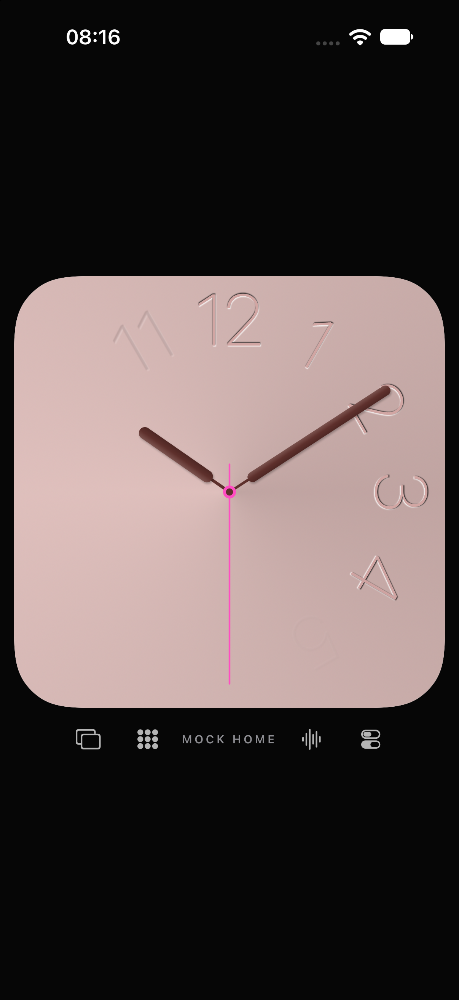
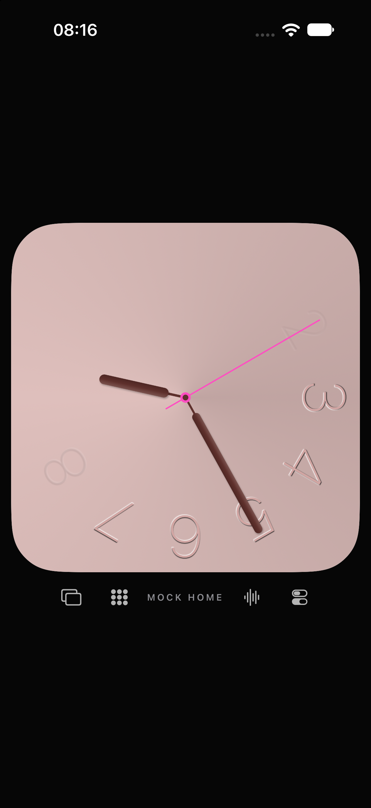

# Fade: Zeitabbildung bleibt ungeklärt

29. Oktober 2026 · [#18](https://github.com/Olli0103/homeview/issues/18) bleibt offen.

## Beobachtung und verworfene Hypothese

Die vorhandene offizielle Montage UI12 zeigt etwa 10:09:30 und einen sichtbaren
Ziffernfächer ungefähr von 12 bis 5. Im bereits gesicherten Original-GIF
`S07-2SGgVQxTxWtexDdgiVfKnQ` zeigen die analogen Zeiger dagegen ungefähr 9:25,
ebenfalls bei einem Fächer auf der oberen/rechten Seite. Das sind unterschiedlich
beleuchtete, zugeschnittene bzw. gefilmte Ansichten, keine instrumentierten Uhren.
Die GIF-Zeit ist aus der Zeigerpose geschätzt, kein Original-Zeitstempel.

Unsere bestehende Funktion zentriert das Fenster bei `minutes / 5`. Zwei neue
native iPhone-Ruheaufnahmen mit unverändertem veröffentlichtem Produkt zeigen
den entsprechenden Unterschied: bei 10:09:30 liegt das Fenster oben/rechts,
bei 9:25:10 unten/rechts. Die zweite Pose zeigt damit eine offene sichtbare Lücke.
Sie beweist weder eine bestimmte Originalperiode noch deren Ursache.

Eine Bindung an den Sekundenzeiger wäre **keine belegte Korrektur**: Sie würde
die erste GIF-Pose erklären, passt aber nicht zum sichtbaren Fächer der UI12-Pose
mit Sekundenzeiger bei 6. Die archivierten Artikel S08/S09 beschreiben
sonnenuhrartige, zeitabhängig verblassende Ziffern, nennen jedoch keine genaue
Periode, Zeigerbindung oder Interpolationskurve. Auch Verlaufsphase und
Ziffernfenster sind getrennte unbekannte Originalfunktionen.

## Begrenzte Filmnachprüfung

Im vorhandenen AppleInsider-Film V03 wurden zusätzlich die sieben Zeitpunkte
342, 344, 346, 348, 350, 352 und 354 Sekunden geprüft. Sie zeigen Fotos bzw.
den Moderator, keine weitere Fade-Sequenz. Das ist keine kontinuierliche Sichtung
des Intervalls oder gesamten Films. Werbung wurde vorab regulär übersprungen;
Titel, URL, 833,401 Sekunden Quelldauer und fehlender Werbezustand wurden geprüft.
Für sechs Zeitpunkte ist zusätzlich die tatsächlich präsentierte Frame-Medienzeit
aufgezeichnet; bei 342 Sekunden nur `currentTime`. Der letzte Zeitpunkt ist als
Browser-Screenshot erhalten, nicht als akzeptierter Canvas-Bildtransfer.
Private Originalbilder und Browseroberflächen werden nicht veröffentlicht.
Der bestehende Referenzkatalog bleibt bei 24 Quellen / 51 Zuständen.

## Quellenbindung und Fehler

225 unveränderte Quell-/Projekt-/Test-/Ressourceneingaben, 19 tatsächlich
installierte Produktdateien und der eigene Aufnahmesteuertext sind vor/nach
den finalen zwei Aufnahmen geprüft und im Archiv vollständig zurückgelesen.
Die finalen 1206×2622-PNGs wurden dekodiert und gemeinsam visuell geprüft.
Die OS-Statusuhr ist nicht die eingefrorene Face-Uhr.

Die ersten stdout-Screenshotversuche lieferten trotz Exitcode 0 leere Dateien;
der nächste Versuch fotografierte nur die weiße Startoberfläche. Beides bleibt
als Fehlversuch erhalten und zählt nicht als Fade-Nachweis. Der finale Lauf
wartet begrenzt auf eine tatsächlich rosafarbene Face-Oberfläche, verwendet
temporäre eigene Dateien und prüft deren zurückgelesene Bytes. Abgeschnittene
bzw. längenveränderte Browser-Bildübertragungen wurden ebenfalls verworfen.

Keine neue Produkt-/Testcodeänderung, kein neuer XCTest-/Core-/SDK-Lauf und kein
Original-PASS. Frühere Prüfstände bleiben historisch. Die Ausblendfunktion wird
nicht durch eine geratene Kurve ersetzt; vollständige Originalphasen und
Minuten-/Stundenwechsel fehlen weiterhin. Unabhängige Softwarearbeit läuft weiter.

[Prüfbericht und Digests](verification/fade-time-mapping-review.json).

