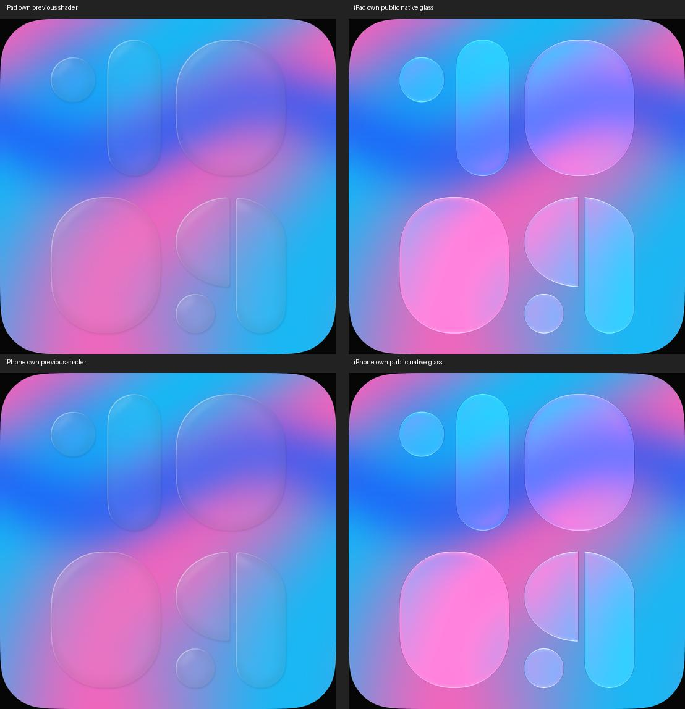

# Flow: öffentliche Glaslinse auf eigenen Ziffern

18. Oktober 2026 · [FLOW-02 / #16](https://github.com/Olli0103/homeview/issues/16).
Begrenzte Materialkorrektur, keine Original- oder Hardwareabnahme.

## Befund und Umsetzung

Der eigene bisherige Shader ließ die Ziffernkörper vor dem sichtbaren Fluid sehr
schwach erscheinen. Das war auch nach mindestens 30 Sekunden Wartezeit sichtbar,
nicht nur in der eingefrorenen Startphase. Ein eigener Shader-Pilot bestand seine
zwei funktionalen Fälle, sah aber wie flach gefüllte Scheiben aus und wurde verworfen.

Die übernommene Variante verwendet die **öffentliche SwiftUI-API**
`Color.clear.glassEffect(.clear, in: shape)` mit den vorhandenen eigenen
`FlowDigitShape`-Konturen. Keine privaten Materialien, extrahierten Glyphen oder
Originalbilder werden geladen. Hintergrund an nutzt diesen Weg auf unterstützten
iOS-/tvOS-Versionen und macOS ab 26; visionOS ist ausdrücklich ausgenommen.
Hintergrund aus, visionOS und ältere unterstützte Macs behalten das vorhandene
eigene Metal-Glyphenmaterial. Beiderlei Schriftstile und der Hintergrundschalter
bleiben unabhängig bedienbar.

Fluidrechnung, CGImage-Upload, Palette, Glyphenkonturen und Typografiemetriken sind
unverändert. Die Fluidrechnung läuft **weiter auf CPU**. Dieser Schritt erledigt
weder den GPU-Port aus #17 noch die vollständige Typografieabnahme aus #15.

## Bewegungsprüfung innerhalb der Ziffern

Ein Test friert ausschließlich die eigenen Glyphenachsen ein, wartet 30 Sekunden
bei weiterlaufendem Fluid und nimmt zwei native Bilder mit 1,2 Sekunden Pause auf.
Die Bezeichnungen der Bilder sind keine Garantie einer exakten Simulationsphase.
Eine eigene weiß-schwarze Glyphenmaske grenzt die Körper ein: RGB über 245 an
Mittelpunkt und acht Nachbarn, Abstand zwei Prozent der Bildbreite, Schrittweite
zwei Pixel. Dadurch wird nicht bloß Bewegung im Hintergrund oder durch eine
veränderte Glyphenform als Materialbewegung ausgegeben.

In diesen Körpern ändern sich 446.572 RGBA-Kanäle auf dem iPad und 232.460 auf dem
iPhone. Mit Reduce Motion sind es auf beiden Geräten **null**. Auch die vorhandene
Prüfung der inneren 90 Prozent des gesamten Viewports zeigt Bewegung beziehungsweise
Stillstand. Die Masken-/Achsenoptionen erfordern ausdrücklich `--uitesting`.

Der zweite Schriftstil mit Hintergrund wurde nativ aufgenommen. Nach tatsächlicher
Bedienung des Nachtmodus wird das **gesamte** native Quadrat geprüft: Alle Pixel mit
maximalem RGB-Kanal über 25 müssen Grün und Blau höchstens bei 40 Prozent von Rot
halten. Beide Größen haben mehr als 100 solche Pixel und null Verletzungen. Das
bedeutet keine wörtlich grün-/blaufreien Pixel und keine Hardware-Luminanzmessung.

## Quellengebundene Prüfung

133 Quellen identisch vor/nach Lauf und gegen Feature-/Mergebytes; nur Motion.swift
und UI-Tests unterscheiden sich vom Timerstand. 139 Modelltests, erneut nach Feature-
und Integrationscommit. Fünf gezielte Fälle je iPad/iPhone, **zehn Ausführungen ohne
Fehler, Skips oder Runtime-Warnungen**: feste Ziffernkörper nach Wartezeit, normale
Bewegung/Reduce Motion, farbige Ziffern auf Schwarz, unabhängige Editoroptionen sowie
zweiter Schriftstil/Nachtfilter. Fünf SDK-Builds bestehen; das ist kein Laufzeittest
auf fünf Plattformen. Beide nativen Größen und 16 eigene Bilder sind geprüft.
Frühere Piloten zählen nicht zu diesen zehn Ausführungen; keine vollständige UI-Suite.

[Prüfbeleg](verification/flow-native.json), [Quellen](verification/flow-native-source.json),
[Bildmanifest](screenshots/goal-20261018/flow-native-manifest.json),
[Herkunft des eigenen Vergleichs](screenshots/goal-20261018/flow-native-own-comparison.json).
Vorherbilder stammen vom älteren, separat gekennzeichneten Quellenstand; beide
Vergleichsseiten zeigen eigene ruhende Startphasen, keine Originalaufnahme.

## Weiter offen

UI47 ist eine perspektivische Geräteaufnahme. Ihre angenäherte Entzerrung erlaubt
nur qualitative Kontrastbeobachtung, keinen kalibrierten Pixel-/Glyphenvergleich.
Exakte Lichtführung, Brechung, Bevel und Deckung, sämtliche Ziffern/Phasen,
Langzeit-Farbverteilung, Impuls-/Randverhalten, Videovergleich, alte Macs/visionOS,
Energie-/Framezeitmessung und physische Originalabnahme bleiben offen. #16 bleibt
**offen**. Nur synthetische Daten, keine echten Homes, Bibliotheken oder Accounts.
