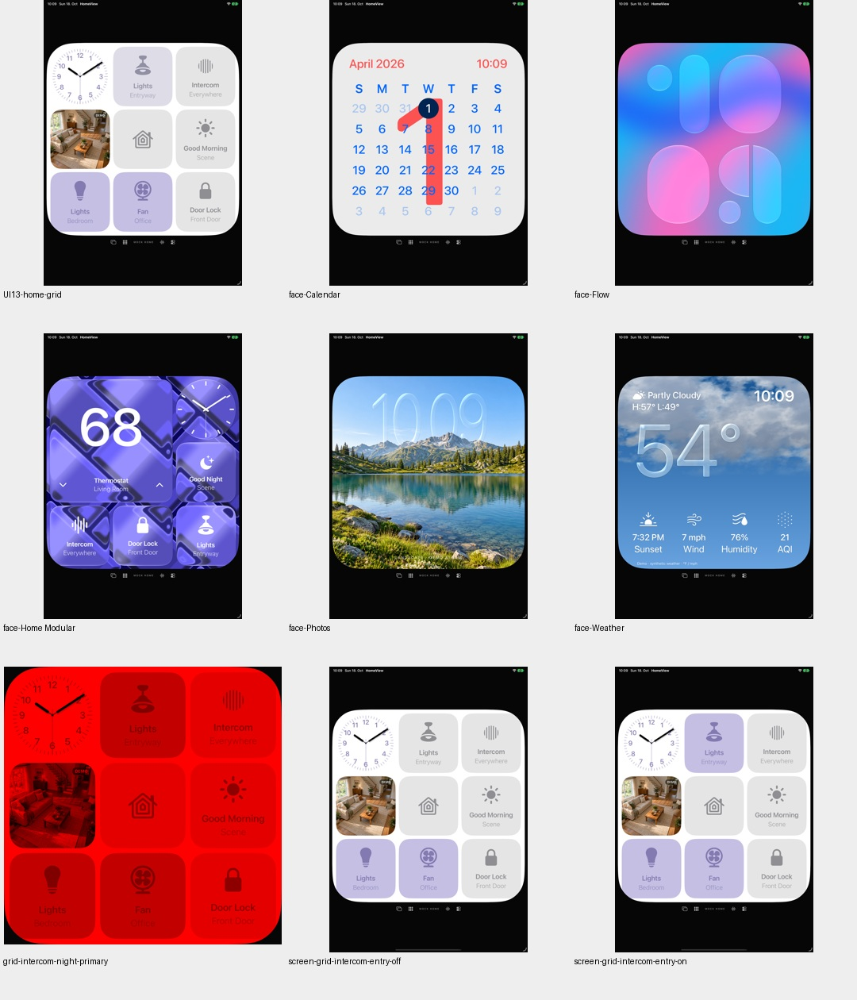
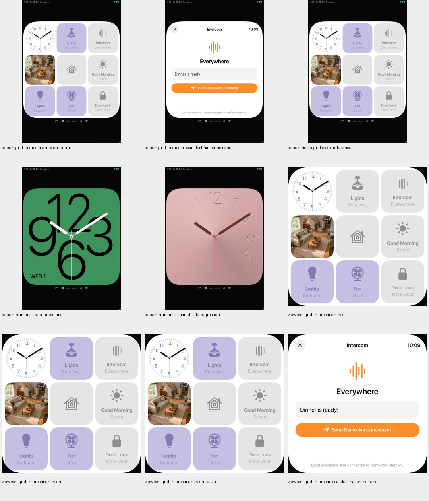
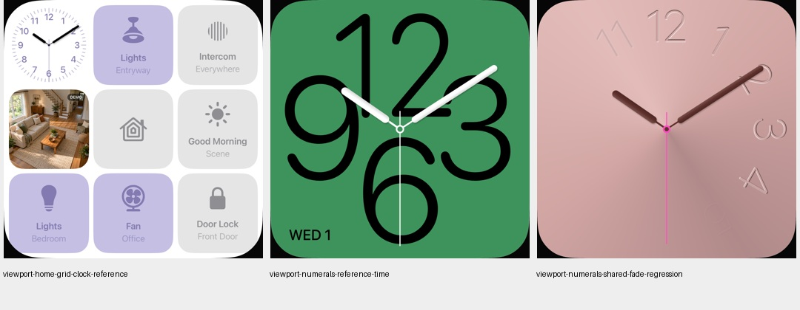
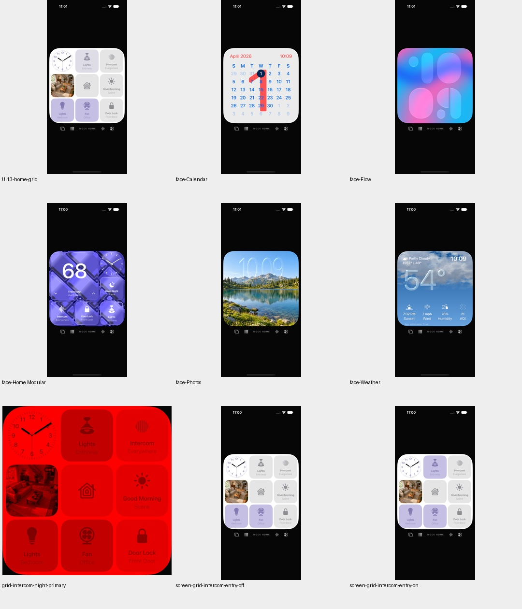
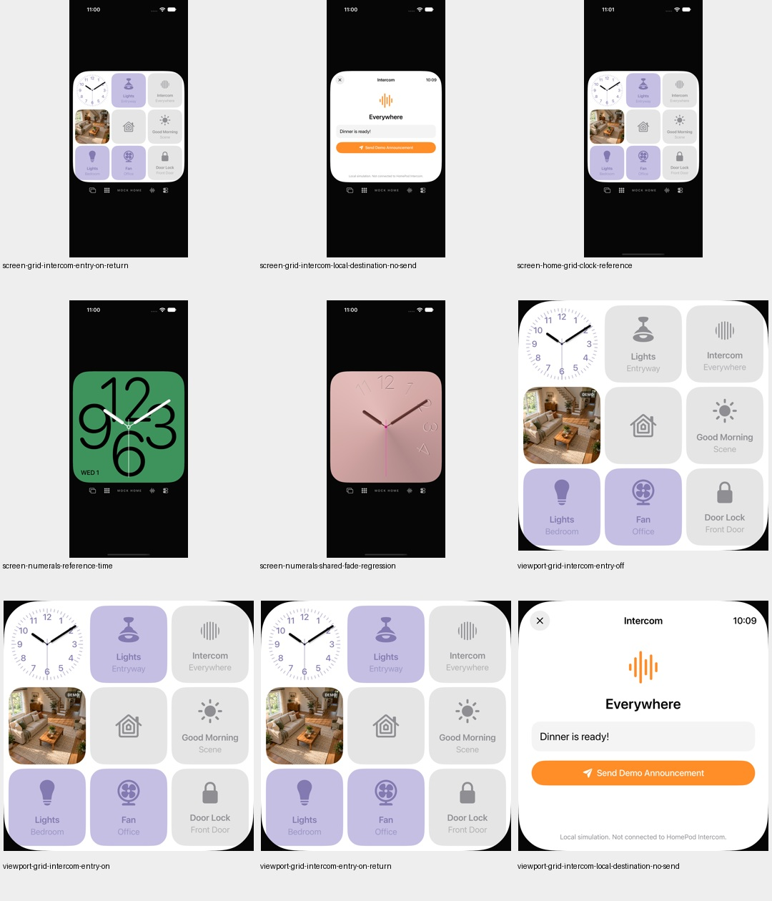
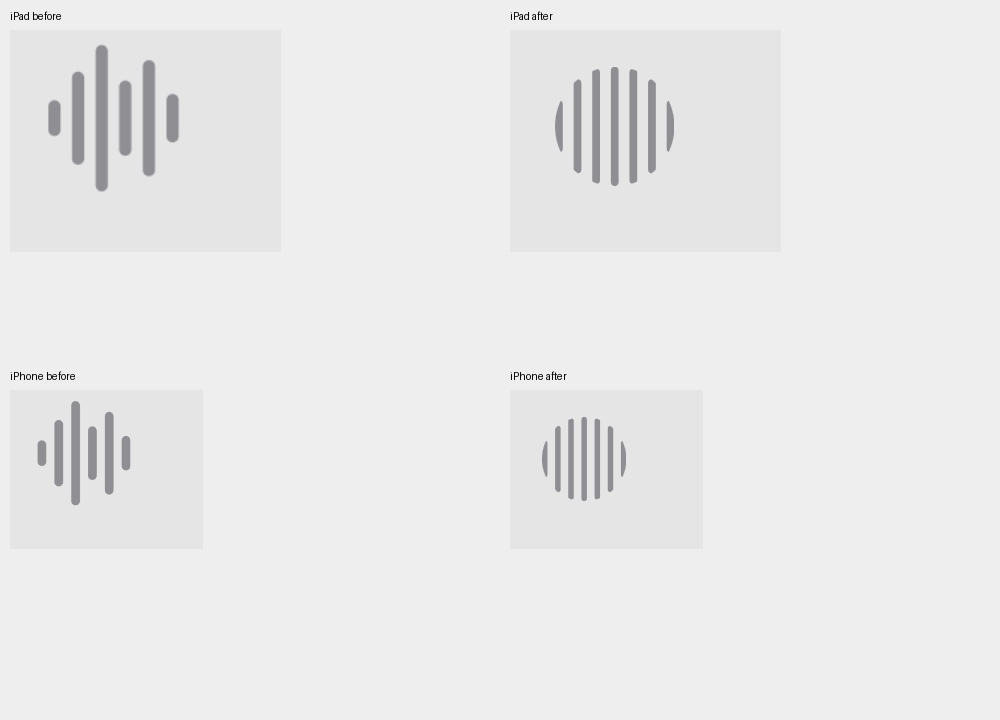
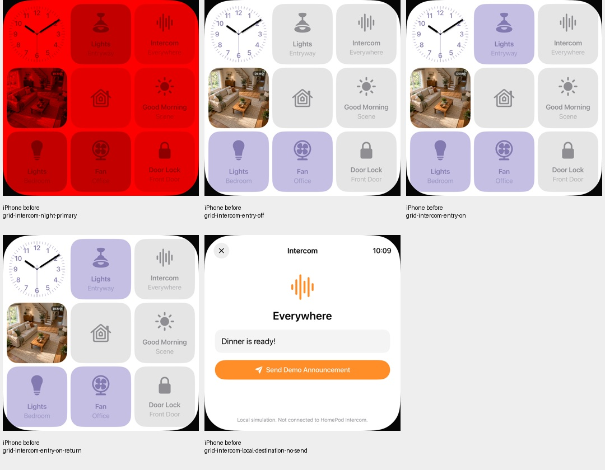

# Home-Raster: Intercom-Zeichen näher an UI13

18. Oktober 2026 · [HOME-01 / #23](https://github.com/Olli0103/homeview/issues/23) bleibt offen.
Nur ein sichtbares Rasterzeichen, keine Fortsetzung der realen HomeKit-Einrichtung
und kein Nachweis echter HomePod-/Intercom-Kommunikation.

UI13 zeigt sieben symmetrische vertikale Balken in runder Silhouette. Das
bisherige öffentliche SF-Zeichen hat sechs asymmetrische Balken. Der Nachbau
verwendet hier sieben eigene einfache Rundbalken mit kreisförmigem Ausschnitt,
keine extrahierten Konturen oder Referenzbilddatei. Das alte Systemzeichen bleibt
unsichtbarer Layoutplatzhalter: Texte und Kachelgeometrie werden nicht versetzt.
45 × 45 Entwurfspunkte und drei Punkte vertikaler Versatz gelten nur im Home-Raster;
andere Intercom-Zeichen bleiben unverändert.

## Identischer Zustand statt Farbverwechslung

Der passende Vorherzustand hat Entryway-Licht **an**, wie die Referenz. Eine
spätere Aufnahme desselben alten Tests entstand nach dem Toggle und zeigte
absichtlich **aus**; sie wäre kein passender Farbvergleich. Zustandsfarben,
Schrift, Kamera-Demobild und Uhr wurden nicht geändert.

## Begrenzter Nachweis

166 Modelltests, sechs gezielte UI-Ausführungen (drei je Gerät) und fünf
SDK-Builds bestanden; null UI-Fehler, Skips oder XCTest-Runtime-Warnungen.
Modelltests nach Feature- und Integrationscommit erneut. 142 Quellen vor/nach
Lauf und gegen die committed Bytes identisch. Der Grafikbaseline ist bis auf
neue Testinstrumentierung bytegleich zu `004d651`; separate zwei Baseline- und
zwei Pilot-Ausführungen werden nicht zu den abschließenden sechs addiert.

Auf beiden Geräten erfüllen Licht-an, Licht-aus und Rückkehr-zu-an die vor dem
Prototyp festgelegten Grenzen: sieben getrennte Balken, Größe/Position im
Symbolbereich und **exakt null geänderte Pixel außerhalb**. Rückkehr-zu-an
und die lokale Intercom-Zielseite sind pixel- und PNG-bytegleich zum jeweiligen
Vergleich. Im Nachtviewport sind null unzulässige Primärfarbpixel gemessen.
Der echte UI-Tap öffnet die lokale Intercom-Ansicht; die Sendeschaltfläche wird
nicht betätigt und keine Durchsage erzeugt.

42 finale eigene PNGs und zehn Vorher-Crops tatsächlich gesichtet; zusätzlich
eigene Detailtafel. Der erste Prototype-Buildaufruf scheiterte vor dem Compiler
an einem relativen Projektpfad aus dem falschen Arbeitsordner; der korrekte
absolut adressierte Aufruf bestand ohne Sourceänderung.

Keine vollständige Original-, Schrift-, HomeKit-, Hardware- oder aktuelle
Gesamtsuitenabnahme. F023-Kriterien und Sperrstatus bleiben unverändert; nur
der aktuelle Bildbefund ist ergänzt. Der Prismenprototyp bleibt zurückgehalten.

[Quellen, Ergebnisse und Pixelgrenzen](verification/home-grid-intercom.json) ·
[eigene Bilder und Hashes](screenshots/goal-20261018/home-grid-intercom-manifest.json).

