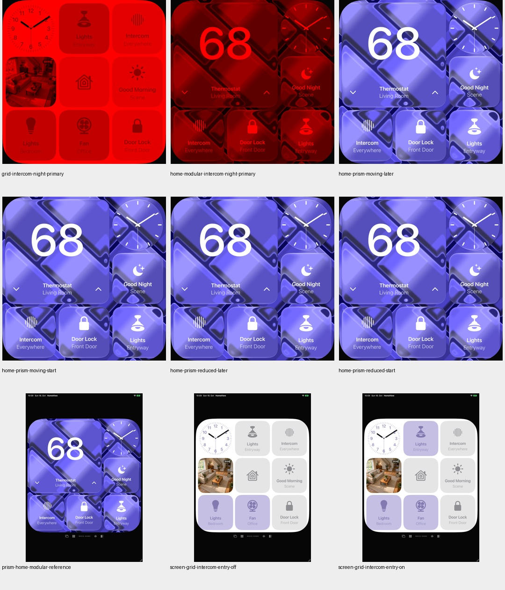
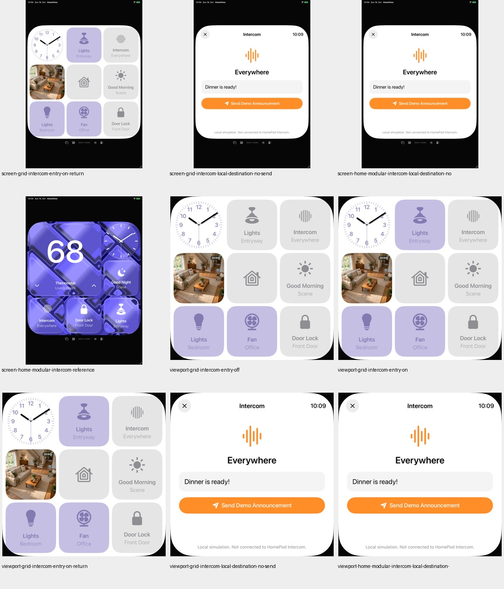
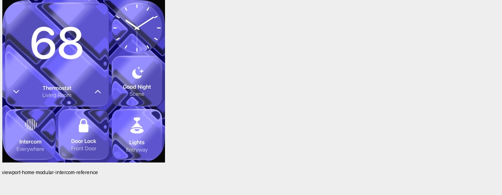
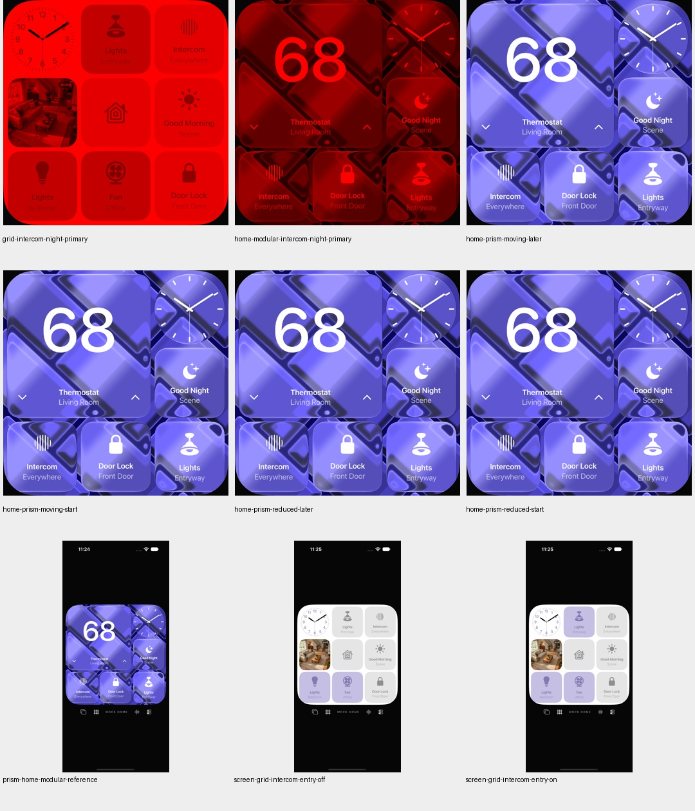
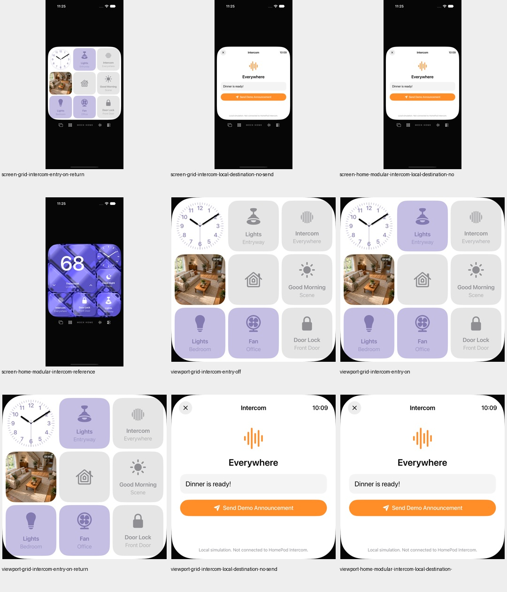
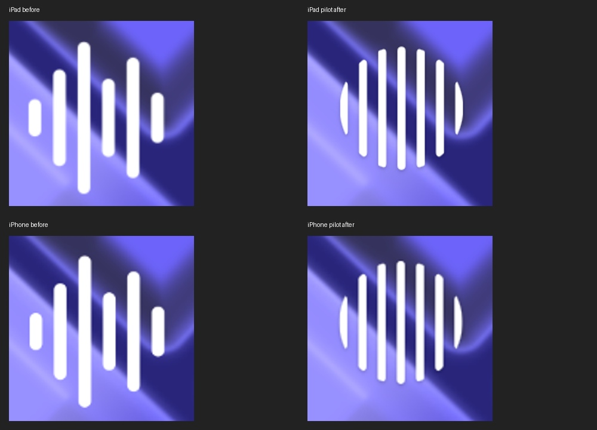
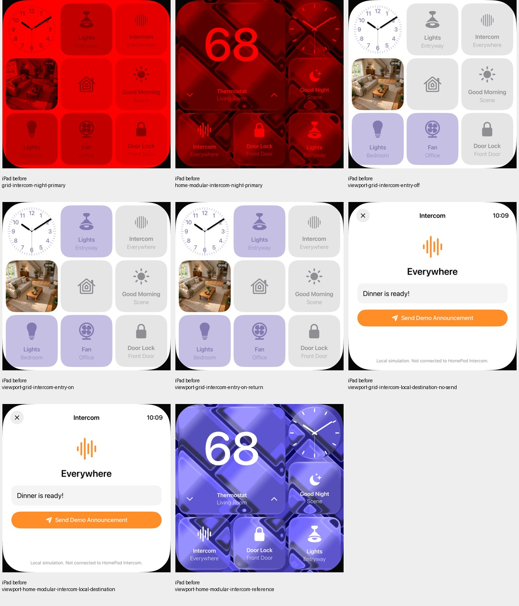

# Home Modular: Intercom-Zeichen näher an UI07

18. Oktober 2026 · [HOME-01 / #23](https://github.com/Olli0103/homeview/issues/23) bleibt offen.
Begrenzter Symbolschritt, keine HomeKit-Einrichtung oder reale Kommunikation.

UI07 zeigt sieben weiße symmetrische Balken mit runder Silhouette und feiner
Schattenkante. Das bisherige SF-Zeichen zeigte sechs asymmetrische Balken. Der
bereits veröffentlichte eigene Rasterpfad wird unverändert gemeinsam verwendet;
Home Modular nutzt 44 Entwurfspunkte, zwei Punkte horizontalen und −3 Punkte
vertikalen Versatz sowie eine dezente öffentliche SwiftUI-Schattenkante.
Das unsichtbare ursprüngliche Systemzeichen behält seine Layoutbox; Text und
Kachelgeometrie bleiben stehen. Keine extrahierten Konturen oder Referenzraster.

## Nachweis auf exaktem Abschlussstand

**Acht gezielte UI-Ausführungen**, vier je iPad/iPhone, **166 Modelltests** und
**fünf SDK-Builds** bestanden. Null UI-Fehler, Skips oder XCTest-Runtime-Warnungen.
Modelltests nach Feature- und Integrationscommit erneut; 142 Quellen vor/nach
Lauf und gegen beide Commits identisch. Ein vorher erfolgreicher Stand wurde
wegen einer zusätzlichen EOF-Leerzeile nicht zum Abschlussstand erklärt: Alle
Prüfungen sind auf dem bereinigten Quellensiegel wiederholt, nicht aufsummiert.
Vier Baseline-, vier Pilot- und acht frühere UI-Ausführungen bleiben separat.

Auf beiden Geräten: sieben tatsächliche Weißkernkomponenten innerhalb der vorher
festgelegten Größen-/Positionsgrenzen; tags und nachts **null geänderte Pixel
außerhalb des Symbolbereichs**. Das Home-Raster ist für Licht-an, Licht-aus,
Rückkehr-zu-an, Nacht und lokale Intercom-Zielseite pixel- und PNG-bytegleich
zum Baseline: zehn exakte Bildpaare. Auch die aus Home Modular geöffnete lokale
Zielseite bleibt bytegleich. Es wird keine Durchsage betätigt oder aufgenommen.

Der vorhandene Prismen-Bewegungstest prüft unterschiedliche bewegte Bilder und
exakt gleiche dekodierte Pixel bei Reduce Motion; gespeicherte PNGs bestätigen
das unabhängig. Alle bisherigen Design-/Glasflächen-/Prismenshader und andere
Face-Körper sind bytegleich erhalten. Dies erklärt oder akzeptiert den früheren
Fehler des getrennt zurückgehaltenen planaren Prismenprototyps **nicht**.

38 finale eigene PNGs und 16 Vorher-Crops tatsächlich gesichtet; zusätzlich
eigene Pilot-Detailtafel. Keine RGB-Fehlertoleranz. Keine vollständige Original-,
Typografie-, Relief-, Hardware- oder aktuelle Gesamtsuitenabnahme; F022-Status,
Kriterien und gesperrter HomeKit-Adapter bleiben unverändert.

[Quellen, Zähler und Pixelgrenzen](verification/home-modular-intercom.json) ·
[eigene Bilder und Hashes](screenshots/goal-20261018/home-modular-intercom-manifest.json).

