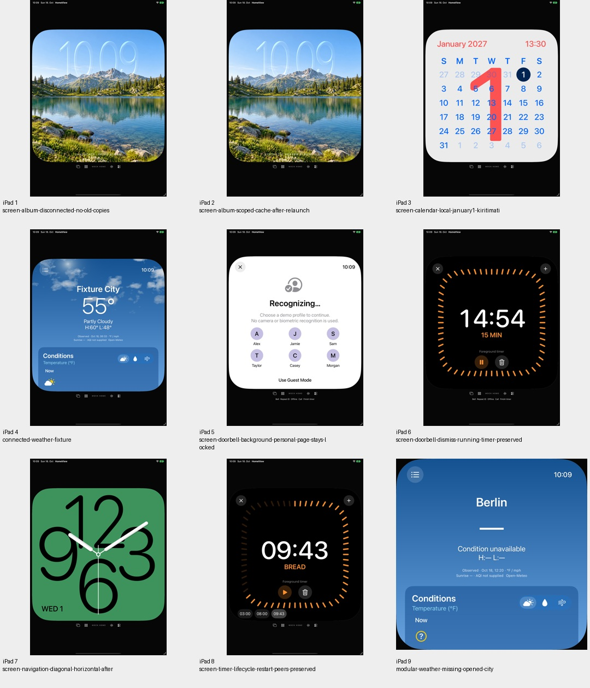
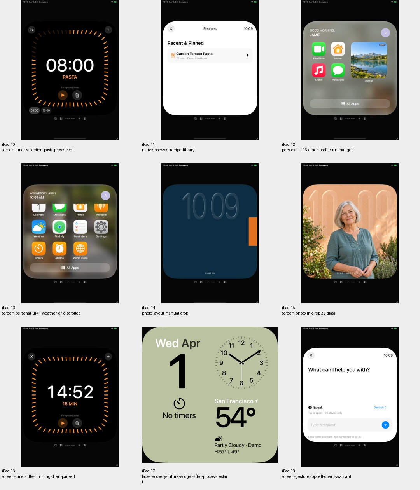
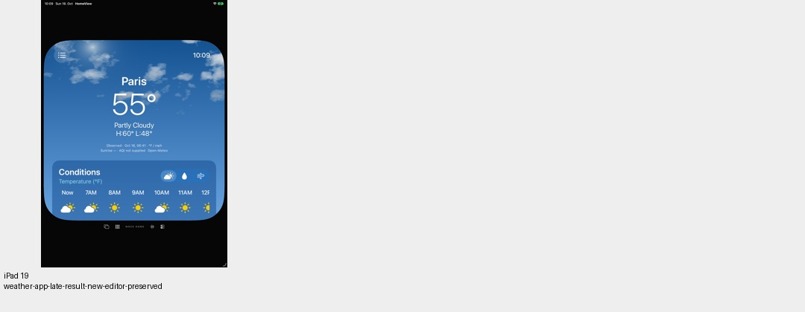
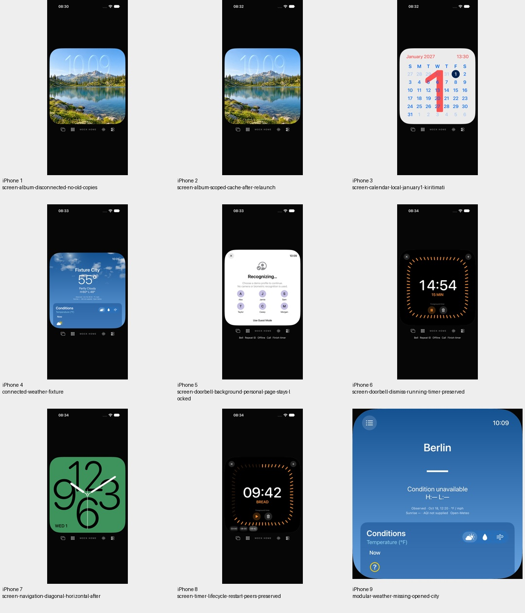
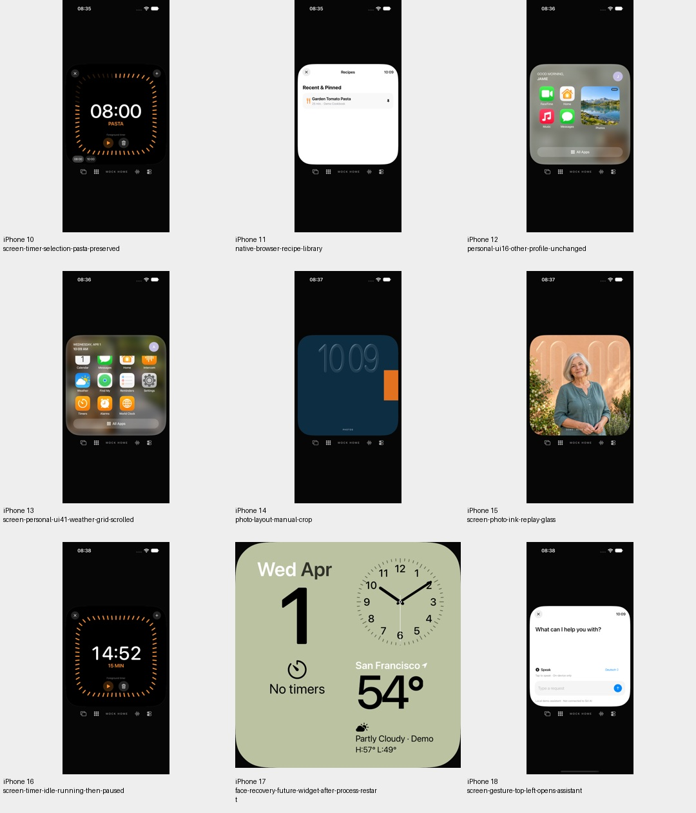
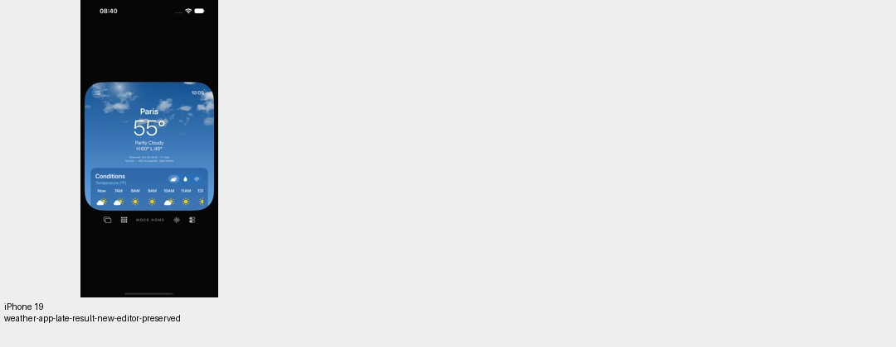

# Begrenzte synthetische Integrationsprüfung

18. Oktober 2026. Unveränderter veröffentlichter App-Stand; diese Prüfung
verbindet ausgewählte bisher einzeln geprüfte Funktionen. Kein neuer Renderer
und keine Abnahme von Originaloptik, Hardware oder echten Diensten.

## Auswahl und Grenzen

Die native Enumeration enthält 136 vorhandene UI-Fälle. Genau 20 sind für
diesen Lauf aktiviert, jeweils auf iPad und iPhone. Vier vorhandene native
AlarmKit-Fälle werden ausdrücklich nicht ausgeführt; weitere 112 Fälle liegen
außerhalb dieser begrenzten Auswahl. Dies ist **keine vollständige UI-Suite**
und ersetzt die historische Gesamtsuite nicht.

Die Auswahl verbindet profilgetrennte Medienlayouts, Wetterraster-Navigation,
Diagonalgeste und Viewportränder, gespeicherte Face-Optionen, verbundene
Fixture-Musik/-Wetterwerte, verspätete Ortsantworten, den Modular-Wetter-Tap,
eigene Foto-Maskenwiedergabe und Crop, Albumtrennung und Wiederherstellung,
Kalender-Jahres-/Zeitzonenwechsel, Türklingel-Unterbrechung und Hintergrund,
versteckte Timersteuerung, Mehrtimer-Auswahl und Prozessneustart, synthetische
Sprachvorschau sowie lokale WebKit-Rezepte.

Alle App-Starts nutzen `--uitesting`. Persönliche Dienste und Alben verwenden
ihre Fixture-Provider, die Sprachvorschau öffnet kein Mikrofon, die Kommunikation
übergibt nicht an externe Apps. Der Browserfall liest eigenes gebündeltes HTML.
Timer bleiben lokal; kein ausgewählter Fall aktiviert Systemalarme.
Speicherläufe verwenden eigene neu erzeugte UUID-Testordner, sonst flüchtigen
Zustand. Keine echte Bibliothek, Kamera, HomeKit-Suche, Nachricht oder Anruf.

## Nachweisgrenze

Der Quellenmanifest wird vor Build und Ausführung eingefroren und nach dem
Lauf erneut verglichen. Terminale XCTest-Zähler, Warnungen und tatsächliche
eigene Aufnahmen werden erst nach Abschluss ergänzt. Keine vorläufigen
Logzeilen werden als endgültiger Gesamterfolg ausgegeben. Frühere Modell- und
SDK-Prüfungen desselben Quellendigest bleiben separat datiert; sie sind keine
neu ausgeführten SDK-Builds dieses Integrationslaufs.

Die offenen Original- und Hardwarekriterien sowie der zurückgehaltene
Prismenprototyp bleiben unverändert.

## Terminales Ergebnis

40 erfolgreiche Ausführungen: 20 je Gerät, null Fehler, Skips oder von XCTest
gemeldete Runtime-Warnungen. Der Quellenmanifest mit 142 Dateien ist vor und
nach dem Lauf identisch. Kein App-/Testcode wurde dafür verändert.

38 repräsentative eigene PNGs wurden tatsächlich dekodiert und über
6 Kontaktbögen gesichtet; dies ist keine vollständige Bildabnahme jeder
Zwischenansicht. Die Funktionsassertionen aller 20 ausgewählten Fälle bleiben
in den nativen Ergebnissen gebunden.

166 Modelltests und fünf SDK-Builds des identischen Digest sind im vorherigen
[Modular-Nachweis](modular-weather-reference.md) gebunden. Für diesen Lauf
wurden keine fünf weiteren SDK-Builds behauptet.

[Quellen, Auswahl und terminale Zähler](verification/integration-synthetic.json) ·
[eigene Bilder](screenshots/goal-20261018/integration-synthetic-manifest.json).

