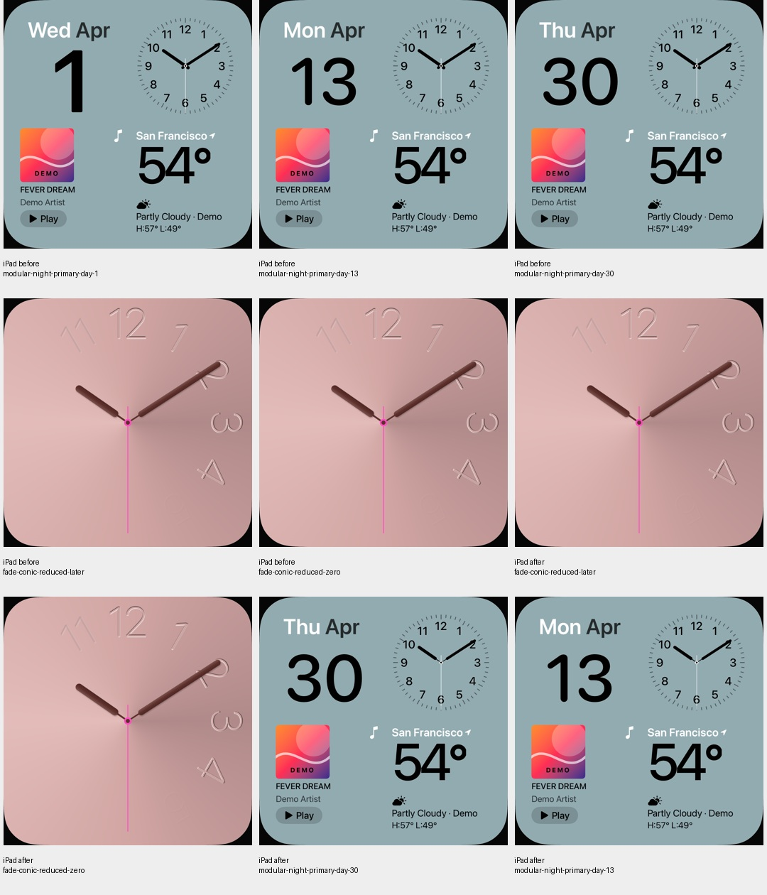
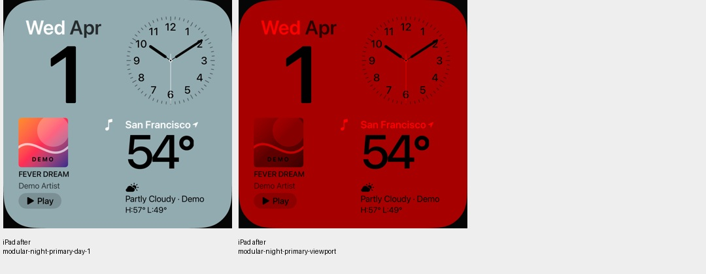
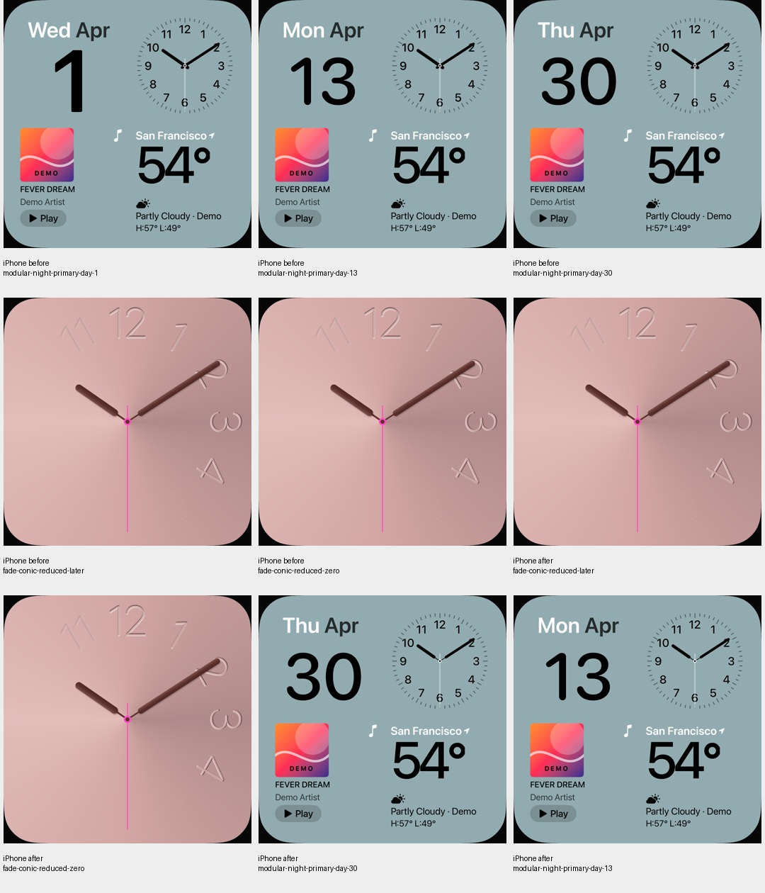
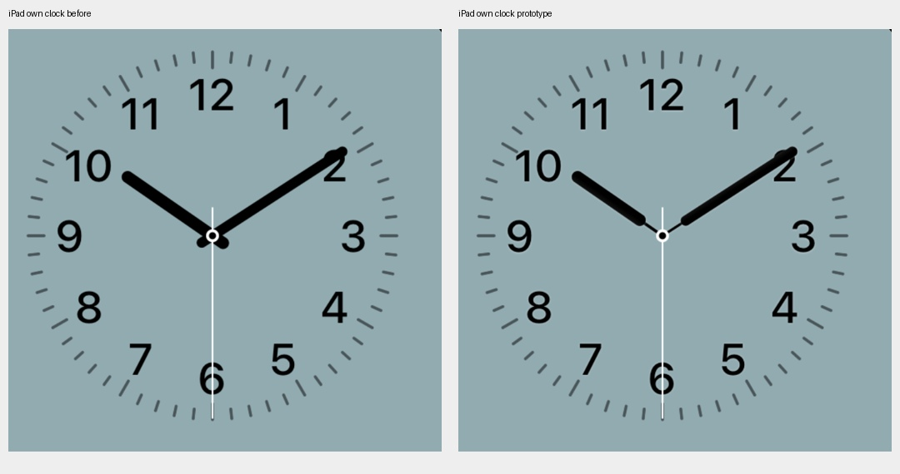
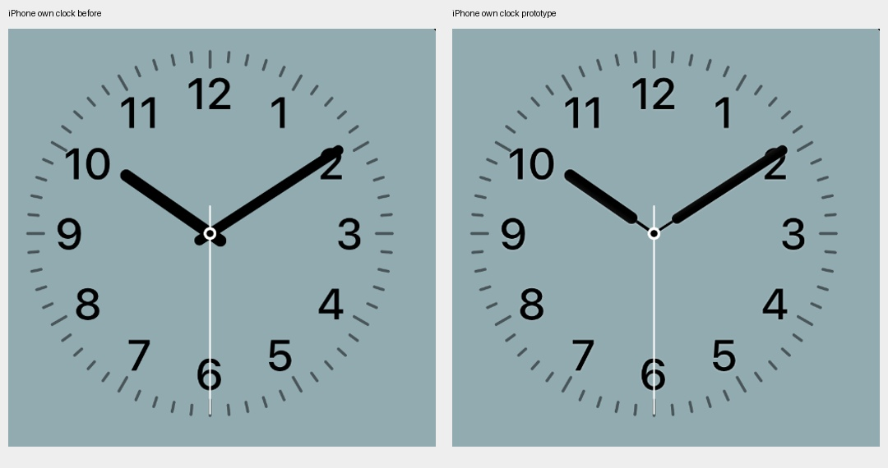

# Modular-Analoguhr: schmale Zeigerstege und feine Kanten

18. Oktober 2026 · [FACE-01 / #5](https://github.com/Olli0103/homeview/issues/5).

## Direkter UI01-Vergleich und vorhandener Renderer

Die private frontale UI01-Ansicht zeigt feine helle Ziffern-/Zeigerkanten und
schmale Verbindungen zwischen breiten Zeigerkörpern und Nabe. Unser Ausgangsstand
zeichnet durchgehend breite Striche mit rückwärtigem Überstand. Die 12 besitzt
bereits nahezu die gemessene Referenzbreite/-höhe; eine Schriftverkleinerung wurde
daher nicht vorgenommen. Eine erste grobe 9-Diagnose enthielt Skalenstriche und
ist keine Schriftabnahme.

Modular nutzt jetzt die schon vorhandene Stegform des öffentlichen Fade-Renderers
mit eigener feiner Lichtkante. Der bisherige versetzte dunkle Fade-Schlagschatten
bleibt nur für dessen bestehende Variante erhalten. Ein standardmäßig deaktivierter
Schalter begrenzt das Kantenlicht auf Modular. Schriftgrößen/-positionen,
Zeigerlängen, Skalen, Sekundenzeiger und Nabengeometrie sind nicht geändert.
Kein Originalshader und keine extrahierten Fontkonturen werden übernommen.

## Native Eigenschaft statt Parameterbehauptung

Drei Datumszustände je Gerät verändern außerhalb der vorab festgelegten
Uhrfläche exakt null Pixel. Die schwarzen Stegflächen in den eigenen definierten
Abtastbändern sinken auf rund 26–30 Prozent des Ausgangsstands; die schmale
Anbindung ist tatsächlich gerendert. Die Kanten sind in den eigenen Detailbildern
sichtbar. Vier Fade-Vergleichspaare bleiben pixel- und PNG-bytegleich, trotz der
Erweiterung des gemeinsam genutzten Renderers. Die Modular-Nachtprüfung besteht.

## Messgrenze und fehlgeschlagene Erstprüfungen offenlegen

Die erste Innenmaske mit einem Referenzpixel Abstand läuft bei der dünnen 3 auf
dem iPad leer. Dieser Nichtleerheits-Check erhält **keinen PASS**. Ein zusätzlicher
roher Vergleich aller zuvor RGB-schwarzen Pixel scheitert ebenfalls an wenigen
Pixeln; zuvor schwarz quantisierte antialiasierte Ränder sind nicht automatisch
vollständig deckendes Inneres. Beide Auswertungen bleiben vollständig erhalten.

Die Diagnose veröffentlicht die Ergebnisse aller nativen Abstände von null bis
drei Pixeln. Der ergänzende Zwei-Nativpixel-Vergleich prüft auf dem iPad 511 statt
20 bisher erfasste Innenpixel, einschließlich einer nicht leeren 3-Maske; auf dem
iPhone bleiben es 54. Die früheren Masken sind tatsächlich Teilmengen dieser
größeren Flächen. Dort gibt es exakt null RGB-Änderungen. Es werden somit mehr
Innenpixel und kein erlaubter RGB-Fehler geprüft; die Erstfehler werden nicht
umgeschrieben oder nachträglich zu PASS erklärt. Die App-Quellen blieben während
dieser Diagnose unverändert.

Das ist eine begrenzte, dokumentierte eigene Rasterprüfung, keine vollständige
Originalfont-/Glanz-/Naben-/Positionsabnahme. Die private Referenztafel wird nicht
veröffentlicht. Physische Darstellung, Leistung und weitere Kombinationen bleiben
offen. #5 bleibt offen; der andere Prismen-Bewegungsbefund wird nicht erklärt.

## Gebundener Abschlussstand

166 Modelltests vor sowie nach Feature und Merge, sechs gezielte native
UI-Ausführungen und fünf SDK-Builds bestanden. Null Fehler/Skips oder
XCTest-Runtime-Warnungen im nativen Lauf. Die zwei früheren Fade-Ausgangsläufe
werden nicht zusätzlich zu den sechs gezählt.

22 eigene native PNGs über vier Kontaktbögen und zwei Detailtafeln tatsächlich
gesichtet. Der intern Prototyp genannte native Lauf behält seinen Namen; seine
Quellen entsprechen unverändert Feature und Merge.

[Quellen, Erstprüfungen und ergänzte Maskenprüfung](verification/modular-clock.json) ·
[eigene PNGs](screenshots/goal-20261018/modular-clock-manifest.json).

