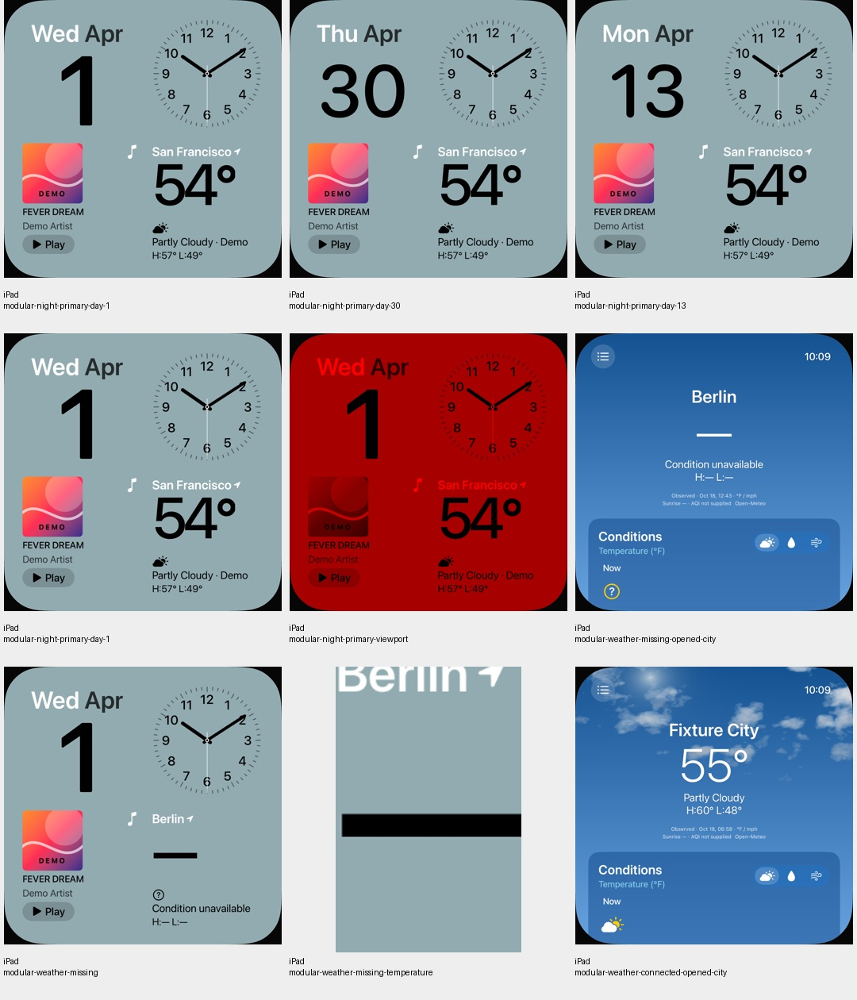
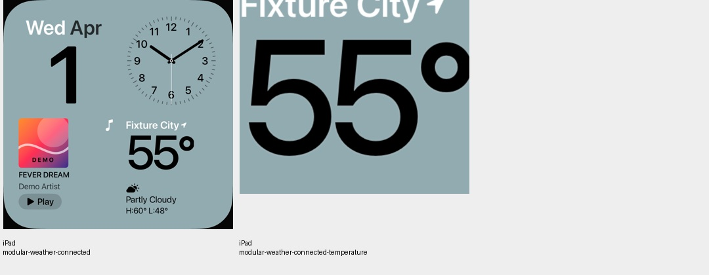
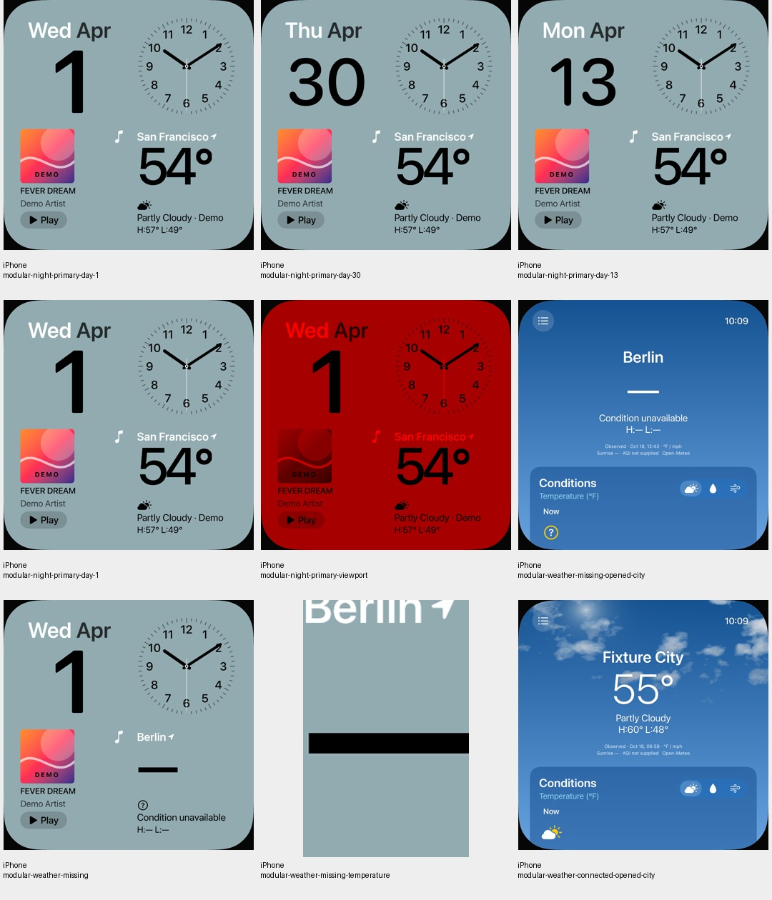
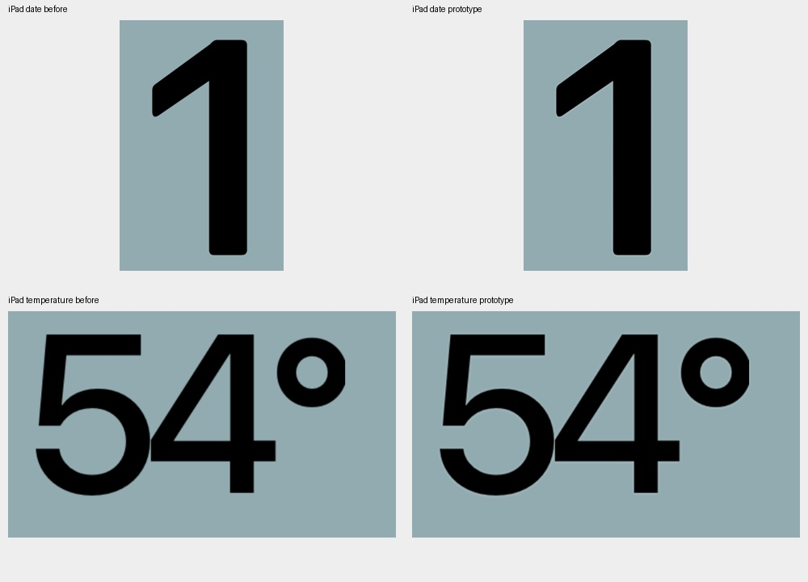
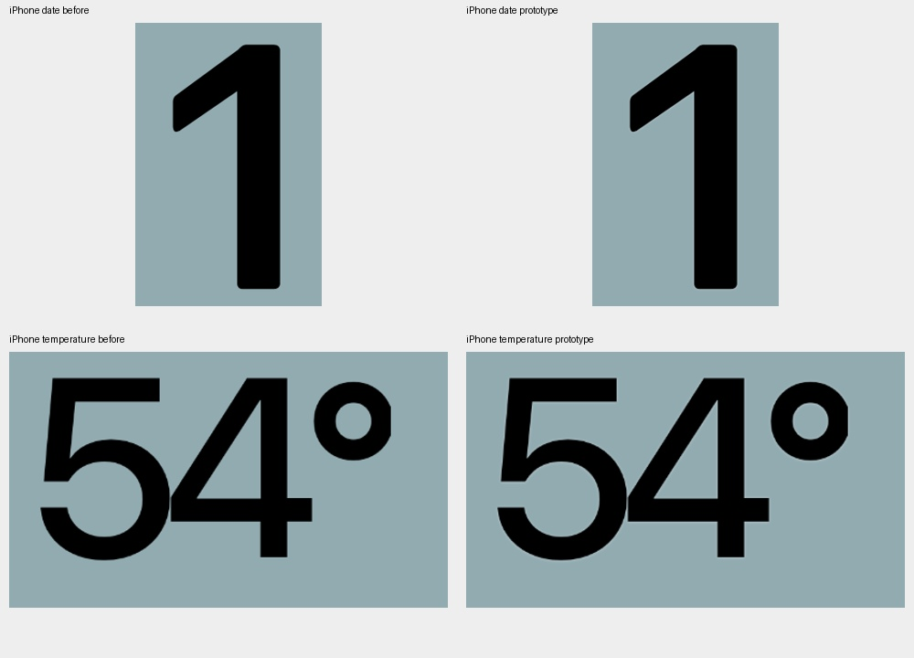

# Feine Lichtkante an Datum und Temperatur des Modular-Face

18. Oktober 2026 · [FACE-01 / #5](https://github.com/Olli0103/homeview/issues/5).

Der direkte private UI01-Vergleich zeigt eine feine helle Kante an den schwarzen
Datums- und Temperaturziffern. Zwei zurückhaltende öffentliche SwiftUI-Schatten
nähern diesen Eindruck an. Es werden keine Originalshader oder Fontkonturen
übernommen. Die System-Temperaturschrift und unsere bestehende Datumsform bleiben
unverändert; keine neue Schrift, Geometrie, Rahmen- oder Positionsänderung.

Die Korrektur liegt nur in den beiden Modular-Aufrufen. Andere Face-Körper,
Root-Nachtfilter, Core, Provider, Tests und Ressourcen bleiben bytegleich. Die
Schutz-/Werte- und Tap-Logik bleibt unverändert. Datum 1/13/30, Demo-54°, verbundene
55° und unbekannte Werte sowie die tatsächlichen Wetter-Widget-Ziele werden nativ
geprüft. Die Nachtansicht bleibt innerhalb ihrer unveränderten Farbgrenze.

## Eigene Bildgrenzen, keine neue Originalabnahme

Vor den nativen Prototyp-Aufnahmen sind zwei feste eigene Änderungsbereiche für
den UI01-artigen 1.-April-Zustand definiert. Außerhalb sind exakt null Pixeländerungen
erlaubt. Das dunkle Zifferninnere wird vor dem Vergleich um einen Referenzpixel
nach innen abgegrenzt (auf ganze native Pixel gerundet), damit antialiasierte Randpixel nicht als Inneres gelten;
auch dort sind exakt null Änderungen erlaubt. Ein getrennt vorher festgelegter
Positivnachweis verlangt tatsächlich hellere Randpixel an beiden Feldern.

Die anfängliche Vertragsfassung ohne diese präzise Innenabgrenzung bleibt als
Entwurf erhalten. Die Präzisierung erfolgte vor jedem sichtbaren Prototyp-Frame,
nicht nach einem fehlgeschlagenen Bildtest. Die zwischenzeitliche Basiskorrektur
ändert nur den Nachtfilter; ihre sechs Tagesbilder sind zum älteren Ausgangsstand
bytegleich. Die neue Basis passt exakt zu den bereits erfassten nativen Aufnahmen.

Beide Geräte erfüllen alle Grenzen: außerhalb der Bereiche und im abgegrenzten
dunklen Inneren jeweils exakt null geänderte Pixel. Sichtbare helle Randpixel
sind tatsächlich vorhanden. Die sichtbaren Nachbau-Details sind gesichtet, nicht
nur Accessibility-IDs. Der Lauf trägt intern den Namen Prototyp; sein Quellstand
bleibt bis Feature/Integration identisch und wird nicht als zusätzlicher Lauf gezählt.

Die feine Annäherung reproduziert nicht das genaue Original-Relief, dessen Font,
Beleuchtung, sämtliche Widget-Kombinationen oder physische Darstellung. #5 bleibt
offen. Die getrennte Nachtkorrektur und ihr ursprünglicher iPad-Ausgangsfehler sind
in [Nacht-Primärrot](night-primary.md) dokumentiert, nicht diesem Lichtkanteneffekt
zugerechnet. Der andere Prismen-Bewegungsfehler bleibt ebenfalls ungeklärt.

## Gebundener Abschlussstand

166 Modelltests vor/nach Feature und Merge, sechs gezielte UI-Ausführungen und
fünf SDK-Builds bestanden. Keine Fehler/Skips oder XCTest-Runtime-Warnungen.
22 eigene native PNGs über vier Kontaktbögen und zwei Detailtafeln gesichtet.

[Quellen und tatsächliche Pixel](verification/modular-light-v2.json) ·
[Eigene Bilder](screenshots/goal-20261018/modular-light-v2-manifest.json).

