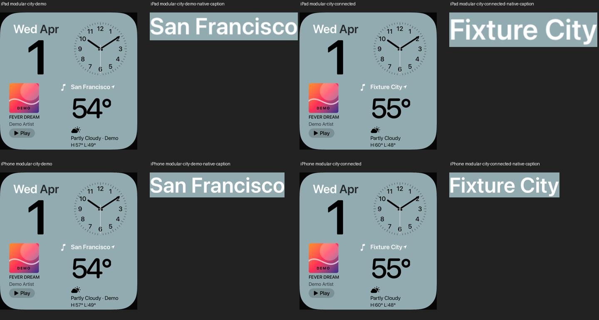
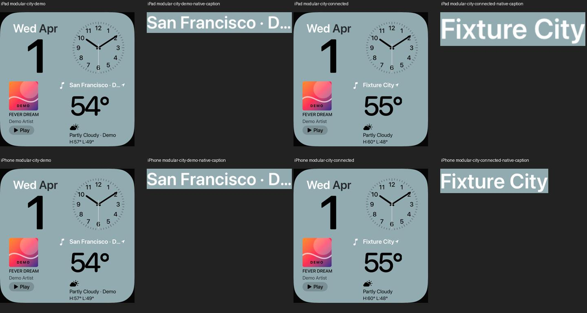

# Modular: Stadtüberschrift ohne abgeschnittenen Demo-Zusatz

18. Oktober 2026 · [FACE-01 / #5](https://github.com/Olli0103/homeview/issues/5) ·
[FACE-12 / #21](https://github.com/Olli0103/homeview/issues/21).

Der direkte qualitative Vergleich mit UI01 zeigt Stadt und Ortszeichen. Unsere
Demo ergänzte in derselben Zeile zusätzlich „· Demo“. Dieser Zusatz wurde im
festen Widget abgeschnitten, während darunter bereits „Partly Cloudy · Demo“
steht. Das eigene native Ausgangsbild und die tatsächlichen Buchstabenaufnahmen
belegen die Kürzung; Originalbilder werden nicht veröffentlicht.

Die einzige sichtbare Änderung ist die reine Stadtbezeichnung „San Francisco“
im Demo-Titel. Schrift, Größen, Abstände, Ortszeichen und Wetterwerte bleiben
unverändert. Die sichtbare Demo-Herkunft in der Wetterbedingung bleibt erhalten.
Verbundenes Wetter verwendet weiter unverändert seinen tatsächlichen Stadtnamen.
Das Modell und andere Wetteransichten verwenden ihre bisherige Kennzeichnung.

Der Ausgangslauf ergänzt nur Accessibility-Bezeichner und einen Testprobe,
keine sichtbare Formatänderung. Beide Geräte werden vor/nach dem Eingriff mit
Demo und verbundenem Fixtureprovider erfasst. Der Testprovider heißt ausdrücklich
„Fixture City“ und ist kein echter öffentlicher Datenabruf. Die erste Probe
erwartete dort fälschlich San Francisco und scheiterte; nach Korrektur dieser
neuen Testerwartung wurde der Ausgangsstand vor jeder Titeländerung erneut
erfolgreich erfasst. Ursprüngliche Ergebnisse bleiben getrennt erhalten.

Die Bildprüfung verlangt im Demo-Ganzbild exakte Gleichheit außerhalb der
vereinigten alten/neuen Überschriftfläche. Drei native Pixel Rand für mögliche
Glyphenantialiasierung erweitern nur diese Änderungsfläche; Unterschiede
außerhalb werden nicht toleriert. Verbundenes Wetter muss als vollständige PNG
pixel- und bytegleich bleiben. Die finalen tatsächlichen Titelaufnahmen werden
zusätzlich gesichtet. Das ist keine Original-Glyphen-/Gesamt-Parityabnahme.

## Gebundener Abschlussstand

166 Modelltests vor sowie nach Feature- und Integrationscommit, vier gezielte
UI-Ausführungen (zwei je iPad/iPhone), fünf SDK-Builds. Keine Fehler, Skips oder
XCTest-Runtime-Warnungen. Getrennte Ausgangsaufnahmen und die korrigierte erste
Pilotprobe werden nicht in diese vier aktuellen Ausführungen addiert.

Im Demo-Ganzbild ändern sich 3.595 / 1.756 Pixel ausschließlich innerhalb der
Überschrift. Außerhalb der gebundenen Änderungsfläche sind es exakt null.
Beide verbundenen Ganzbilder sind vollständig pixel- und PNG-bytegleich zum
Ausgangsstand. „San Francisco“ und „Fixture City“ sind tatsächlich ohne Ellipse
gesichtet; die Demo-Kennzeichnung bleibt darunter sichtbar.

Die vorhandene Wetter-Face-Prüfung trennt weiterhin Demo-AQI 21 vom unbekannten
AQI verbundener Fixture-Daten. Alle Core- und Wetterproviderquellen bleiben
bytegleich. Kein realer Datenabruf oder neues Gesamtsuite-/Original-/Hardware-PASS.

[Quellen und Pixelwerte](verification/modular-weather-caption.json) ·
[20 eigene PNGs mit Quellstand und Inhaltsbindung](screenshots/goal-20261018/modular-caption-manifest.json).
