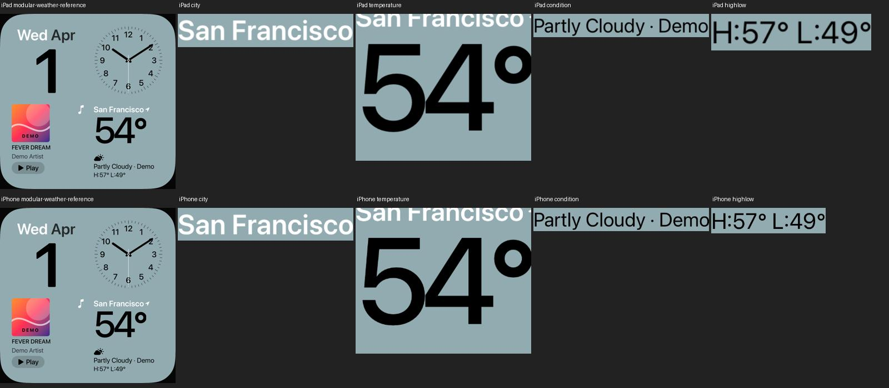
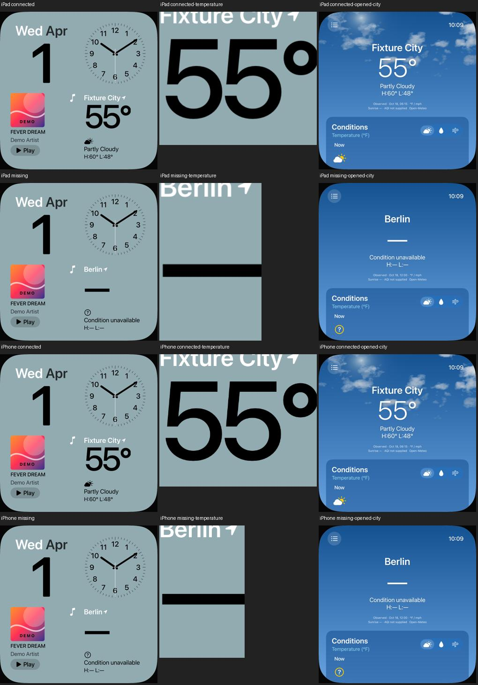

# Modular-Wetterblock: Schrift und sichtbare Positionen an UI01 annähern

18. Oktober 2026 · [FACE-01 / #5](https://github.com/Olli0103/homeview/issues/5) ·
[FACE-12 / #21](https://github.com/Olli0103/homeview/issues/21).

## Direkter Originalvergleich, keine neue Oberfläche

Der private frontale UI01-Vergleich zeigt einen weniger gerundeten Temperatur-
schriftzug, eine etwas weiter rechts liegende Wetterspalte und höher platzierte
Wetterelemente. Der Stadttitel war bereits getrennt korrigiert. Originalbilder
bleiben privat; die veröffentlichten Aufnahmen zeigen nur unsere eigene App.

Die Temperatur nutzt nun die öffentliche normale statt gerundete Systemschrift
mit kleiner visueller Skalierung. Stadt, Temperatur, Symbol, Bedingung und
Höchst-/Tiefstwert erhalten getrennte visuelle Korrekturen. Die Typografie bleibt
Laufzeitschrift; keine extrahierten oder gespeicherten OS-Schriftkonturen.

## Layoutplätze erhalten, andere Kacheln schützen

Die Korrekturen ändern sichtbare Transformationen statt Größen-Padding. Die
bisherigen Layoutplätze bleiben bestehen, damit die intrinsische Höhe des
Wetterblocks nicht die gemeinsame untere Zeile und damit die Musikkachel bewegt.
Ein strenger Ganzbildvergleich verlangt **null veränderte Pixel außerhalb des
vorab festgelegten Wetterbereichs**. Eine Fehler-/Pixeltoleranz wird dort nicht
eingeführt.

Native Feldaufnahmen und tatsächliche Glyphenpixel prüfen getrennt Stadt,
Temperatur, Symbol und die beiden Textzeilen. Vor der Bildabnahme festgelegte
eigene Positionsgrenzen beziehen sich auf den privat betrachteten UI01-Zustand;
sie sind keine behaupteten Apple-Layoutkonstanten oder vollständige Parity.

## Diagnosegrenzen offen halten

Eine erste grobe gemeinsame Bildfläche schnitt den unteren Teil unserer
Temperatur ab und verwechselte unser Symbol mit dem Bedingungstext des
Originals. Diese Diagnose wird nicht als Abnahme ausgegeben. Anschließend
wurden die tatsächlichen nativen Elementrahmen erfasst und die Pixelmasken
je Feld korrekt begrenzt. Der Original-/Nachbau-Zoom enthält proprietäre
Referenzpixel und wird ausdrücklich nicht veröffentlicht.

Der Grafikprototyp und ein erster vollständiger Darstellungslauf bestanden.
Danach wurde der Test um den tatsächlichen Widget-Tap bei verbundenen und
fehlenden Daten ergänzt. Der Grafikcode blieb dabei unverändert; vorangehende
Läufe zählen nicht zusätzlich zum finalen Nachweis.

Wetterwerte, Demo-/unbekannte Trennung und Provider bleiben unverändert.
Die Bedingungszeile kennzeichnet die Demo weiterhin sichtbar. Exaktes
Originalfont-/Symbolbild, Licht/Umrisse, sämtliche Widgetkombinationen und
physische Geräte bleiben gesonderte offene Abnahmen.

## Gebundener Abschlussstand

166 Modelltests vor sowie nach Feature- und Integrationscommit, sechs gezielte
UI-Ausführungen (drei je iPad/iPhone), fünf SDK-Builds. Keine Fehler, Skips oder
XCTest-Runtime-Warnungen. Separate Ausgangs-, Prototyp- und frühere reine
Darstellungsläufe werden nicht zu diesen sechs addiert.

Die tatsächlichen finalen Demo-Pixel erfüllen die vorab festgelegten eigenen
Positionsgrenzen auf beiden Geräten. Gegenüber dem getrennten Ausgangsstand
ändern sich 121.996 / 57.821 Pixel innerhalb des Wetterbereichs; außerhalb
sind es **exakt null**. Andere drei Kacheln und deren Positionen bleiben im
Demo-Ganzbild unverändert. Kein RGB-Fehlerbudget außerhalb des Bereichs.

Ein Elementausschnitt enthält dessen tatsächlichen Aufnahmebereich, nicht
behauptete isolierte Fontkonturen. Nach den visuellen Verschiebungen kann der
Typografie-Leerraum einer Temperaturaufnahme oben andere weiße Beschriftung
enthalten; die getrennte dunkle Schriftmaske prüft deshalb nur ihre echten
Temperaturpixel.

Verbundene Fixture-Daten zeigen 55° für Fixture City, vollständig fehlende Werte
„—“ für Berlin und keine Demo-Rückkehr. Beide Werte besitzen tatsächliche dunkle
Glyphenpixel. Die Widget-Taps öffnen jeweils genau die zugehörige Stadtansicht
mit Conditions. Der separate Wetter-Face unterscheidet weiterhin Demo-AQI 21
vom unbekannten AQI verbundener Fixture-Daten. Kein realer Wetterabruf.

[Gebundene Quellen, eigene Positionsgrenzen und Pixelwerte](verification/modular-weather-reference.json) ·
[36 eigene PNGs, getrennt nach Quellstand](screenshots/goal-20261018/modular-reference-manifest.json).

UI01 wurde direkt privat geprüft. Die Annäherung ist kein vollständiger
Originalfont-, Symbol-, Schatten-/Licht- oder Hardware-PASS. #5/#21 bleiben offen.
