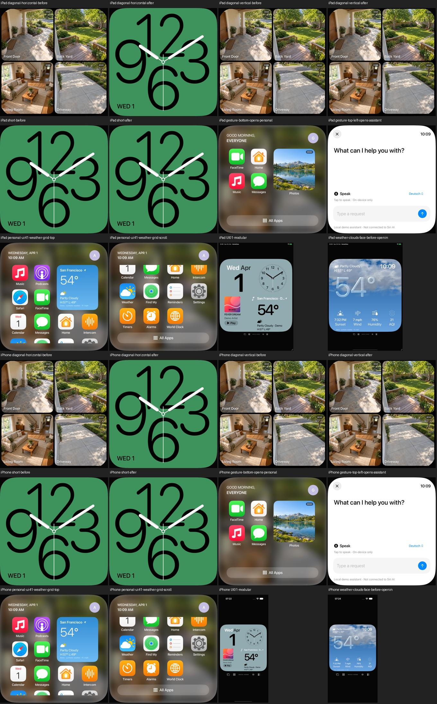
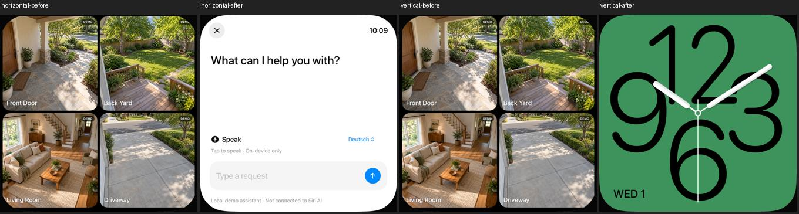

# Wisch-Navigation: Achsenabsicht vor Randziel

18. Oktober 2026 · [FACE-02 / #6](https://github.com/Olli0103/homeview/issues/6).
Eigene Erkennungsregel; keine Behauptung gemessener Original-Wischschwellen.

## Reproduzierbarer Ausgangsbefund

Bei einer überwiegend horizontalen Geste vom oberen Rand öffnete die App
den Assistenten, sobald nur der vertikale Anteil 70 Punkte überschritt. Bei
einer überwiegend vertikalen Geste aus der Mitte wechselte sie das Face,
sobald der horizontale Anteil 80 Punkte überschritt. Die bisherigen Regeln
prüften die dominante Achse nur beim unteren Rand.

Beide tatsächlichen Touch-Gesten sind auf unverändertem veröffentlichtem
Navigationscode als fehlerhafte Ziele reproduziert und in nativen Bildern
gesichtet. Der erste horizontale Test erwartete versehentlich den Nachbarn
einer Links- statt einer Rechtsgeste. Dieser Teststand bleibt qualifiziert
erhalten. Nach Korrektur auf den tatsächlichen Nachbarn Numerals wurden beide
Fälle vor jeder Produktionsänderung erneut ausgeführt: zwei Fehler. Die
Anwendungsquellen des Ausgangslaufs sind bytegleich zum veröffentlichten Stand.

## Begrenzte Korrektur

Ein gemeinsamer Entscheider verlangt nun zuerst eine eindeutige dominante Achse.
Überwiegend horizontale Wischer wechseln auf einem Face nur dieses Face.
Überwiegend vertikale Wischer dürfen nur in ihren vorhandenen Randbereichen
Home, Assistent oder Control Center öffnen. Ein exakter 45-Grad-Gleichstand
hat keinen Gewinner. Vertikale Gesten aus der Mitte lösen keinen Face-Wechsel aus.

Die bestehenden strikten Abstände 70/80 Punkte und Randanteile 16/600, 12 %
und 74 % bleiben erhalten; sie sind weiterhin eigene Vorgaben, keine neu
ermittelten Apple-Werte. Nicht-Face-Screens erhalten keinen horizontalen
Face-Wechsel. Der separate untere Home-Streifen, Longpress, Übergänge und
Animationseinstellungen sind nicht verändert. Ungültige Geometrie wird ignoriert.

Modellprüfungen decken beide Richtungen, Achsenkonflikte, Gleichstand, genaue
Abstandsgrenzen, andere Routen sowie verschiedene dargestellte Quadratgrößen ab.
Native Kontrollen prüfen reale Ziele und bei ignorierten kurzen/vertikalen
Gesten die tatsächlichen vollständigen Viewportpixel.

Original-Federkurven, Geschwindigkeit/Beschleunigung, interaktiver Übergangsabbruch,
Hardware und vollständige Gesten-Parity bleiben offen.

## Gebundener Abschlussstand

159 Modelltests vor sowie nach Feature- und Integrationscommit, 14 gezielte
UI-Ausführungen (sieben je iPad/iPhone), fünf Plattform-Builds. Keine Fehler,
Skips oder XCTest-Runtime-Warnungen. Vier separate Pilotfälle sind nicht in
den 14 enthalten. Scrollen im persönlichen Wetterraster, Langdruck-Editor und
normaler Wetter-Tap bleiben funktional erhalten.

Vier vollständige Vorher-/Nachher-Paare der ignorierten vertikalen und kurzen
Gesten sind pixel- und PNG-bytegleich. Der beabsichtigte horizontale Wechsel
ändert 2.478.080 / 1.257.414 Pixel und erreicht auf beiden Geräten Numerals.
Die tatsächlichen finalen Bilder beider Geräte sind gesichtet.

[Quellen und getrennte Fehlergeschichte](verification/navigation-intent.json) ·
[28 eigene gebundene PNGs](screenshots/goal-20261018/navigation-intent-manifest.json).
Issue #6 bleibt offen. Keine neue Vollsuite oder Originalbewegungsabnahme.
