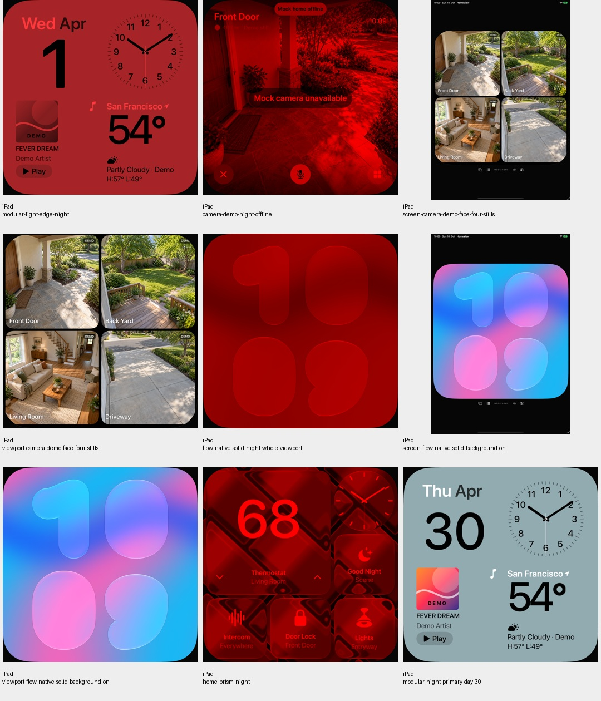
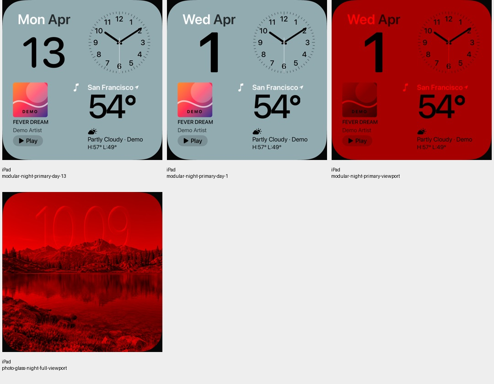
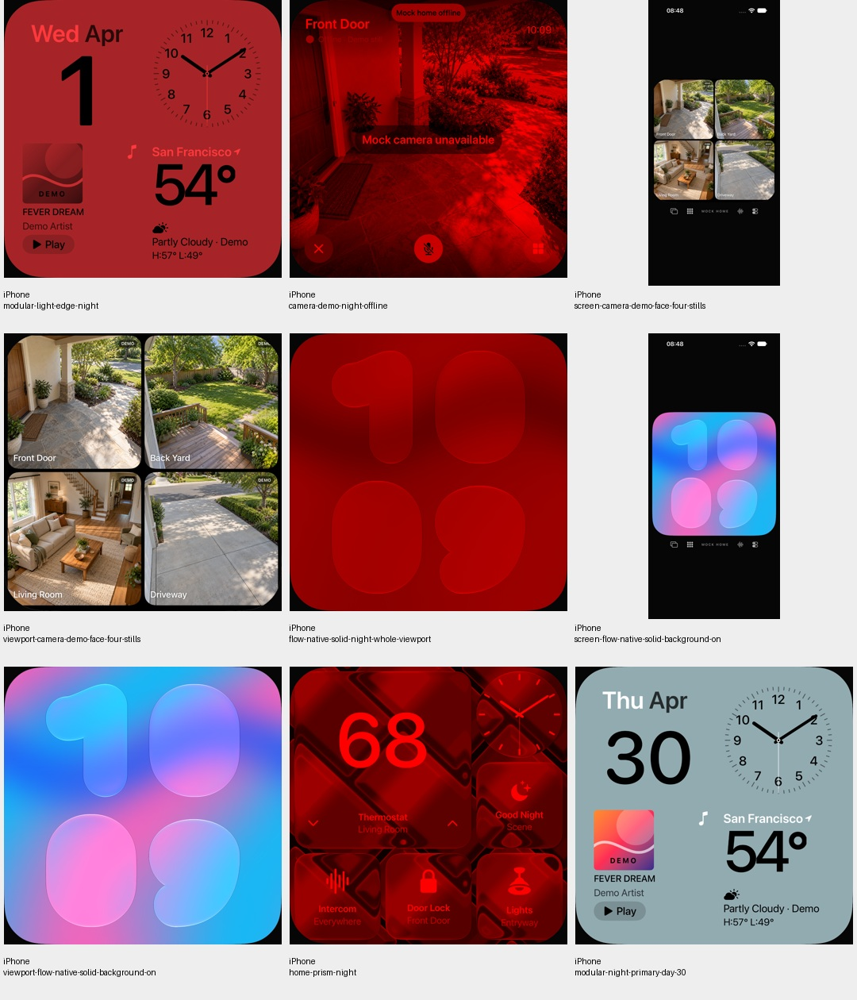

# Explizites Primärrot für den vollständigen Nacht-Viewport

18. Oktober 2026 · [FACE-07 / #13](https://github.com/Olli0103/homeview/issues/13).

## Befund vor der Korrektur

Bei der Vorbereitung einer getrennten Modular-Lichtkante wurde zunächst die
unveränderte veröffentlichte Grafik aufgenommen. Der neue Ganzbild-Nachttest
scheiterte auf dem iPad an genau acht symmetrischen Rundungskantenpixeln mit
RGB 27/10/11. Auf dem iPhone bestand derselbe Ausgangstest. Der ursprüngliche
Lauf bleibt mit drei bestandenen und einer fehlgeschlagenen Ausführung erhalten.

Der vorhandene benannte Rot-Multiplikator liefert bei hellem Inhalt unter anderem
RGB 255/56/60 statt Primärrot. Zusammen mit der weichen Rundungskante überschreiten
die acht dunklen Pixel die vorhandene eigene Farbgrenze: Bei R > 25 müssen G/B
jeweils höchstens 0,4 × R betragen. Es wurde **keine Fehlpixel- oder RGB-Toleranz**
eingeführt. Das ist ein begrenzter Rendererbefund, keine vollständige Rekonstruktion
der internen SwiftUI-Farbraum-/Rundungspipeline oder der Originaldarstellung.

## Getrennte kleine Korrektur

Nur der RootView-Nachtmultiplikator wechselt von benanntem Rot auf explizites
RGB 1/0/0. Sättigung, Rundungsgeometrie, Tagesmultiplikator Weiß und sämtliche
Face-, Provider-, Core- und Ressourcenbytes bleiben unverändert. Die geplante
Lichtkante ist nicht enthalten. Dunkle Hintergrundpixel außerhalb der runden
Fläche werden nicht fälschlich als ausschließlich rot behauptet.

## Gebundener Nachweis

166 Modelltests vor sowie nach Feature- und Integrationscommit, zwölf gezielte
UI-Ausführungen (sechs je iPad/iPhone), fünf SDK-Builds. Null Fehler/Skips oder
XCTest-Runtime-Warnungen im abschließenden Lauf. Die 142 Quellen sind eingefroren
und nach dem Lauf sowie gegen die Commits erneut geprüft.

Fünf vollständige native Nachtansichten je Gerät – Modular, Home-Glas, Kamera,
Foto-Glas und Flow – enthalten nach unabhängiger Dekodierung **null** Pixel,
die die unveränderte Nachtfarbgrenze verletzen. Helle Flächen erreichen nun
255/0/0. Die sechs Modular-Tagespaare für den 1., 13. und 30. sind sowohl pixel-
als auch PNG-bytegleich zum getrennten Ausgangsstand. Keine geänderte Tagesgrafik.

32 eigene PNGs sind gebunden. Vier tatsächlich gesichtete Kontaktbögen zeigen
26 Frames; die zusätzlichen sechs Tages-Ausgangsbilder sind bytegleich zu den
dort gezeigten Endbildern. Keine proprietären Referenzbilder werden veröffentlicht.

Ein anfänglicher externer Runner-Dateifilter erkannte den universellen Buildnamen
nicht und startete keine Tests. Die erste externe Bildauswertung verwechselte
wegen eines gemeinsamen Namenspräfixes ein Tagesbild mit einer Nachtansicht;
eine explizite Zustandsliste korrigiert das. Beide Diagnosegrenzen bleiben erhalten,
ohne App-/Test-Prädikate oder RGB-Grenzen zu verändern.

Der zurückgehaltene Prismen-Bewegungsprototyp ist ein anderer Stand und ein anderer
Befund. Diese Nachtkorrektur erklärt oder akzeptiert dessen früheren Pixelunterschied
nicht. Keine neue Vollsuite, Original-, physische Geräte- oder Langzeitabnahme.
#13 bleibt offen.

[Quellen, Ausgangsfehler und tatsächliche Pixel](verification/night-primary.json) ·
[32 eigene PNGs](screenshots/goal-20261018/night-primary-manifest.json).

