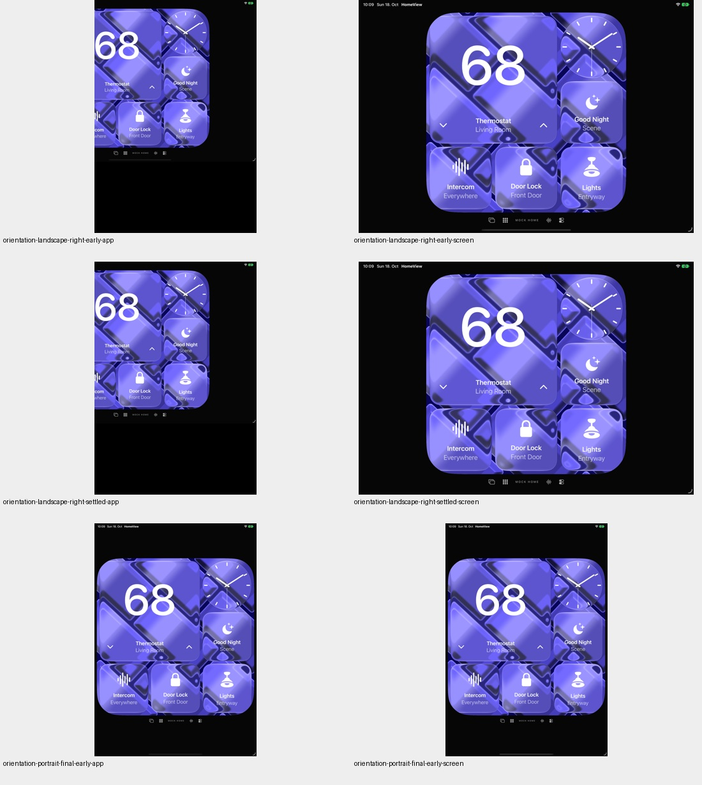
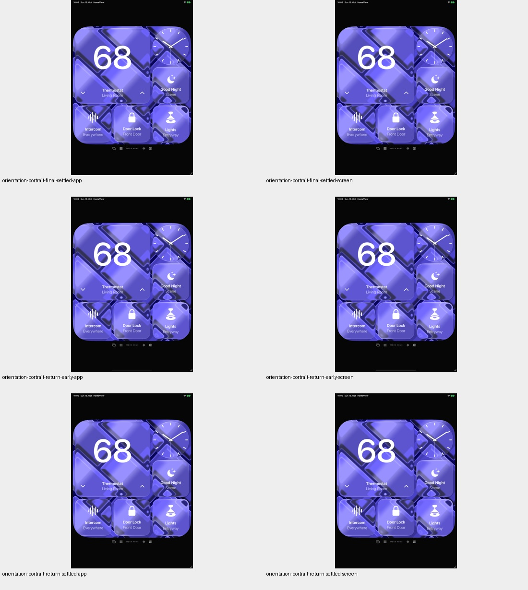
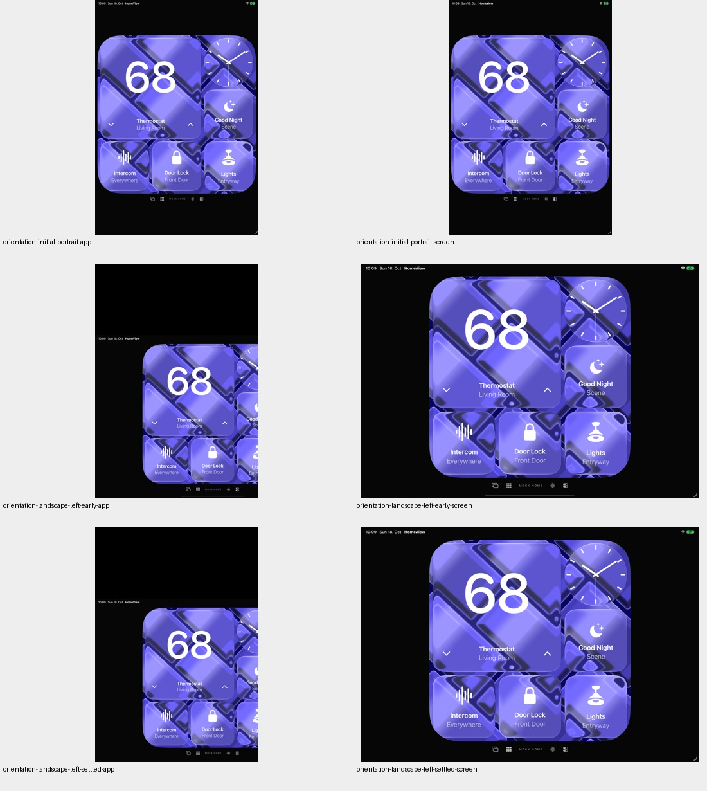
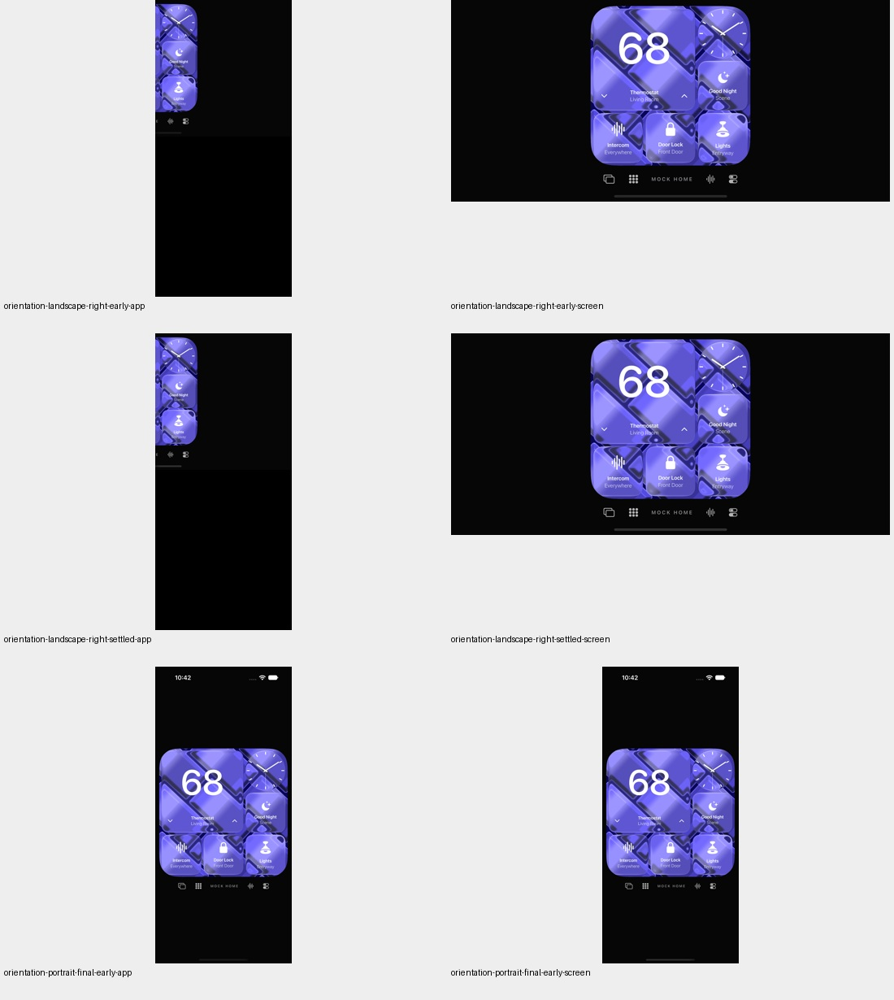
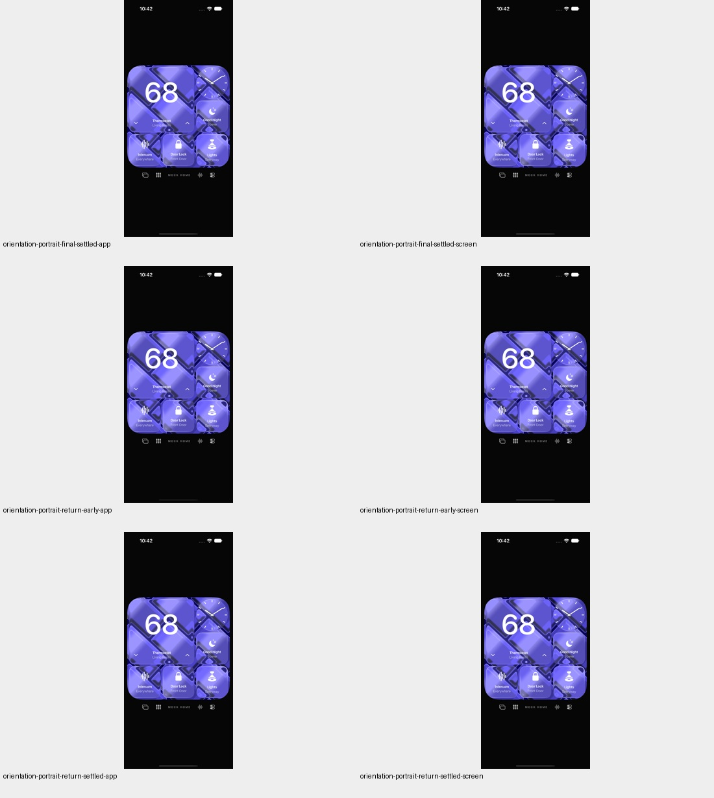
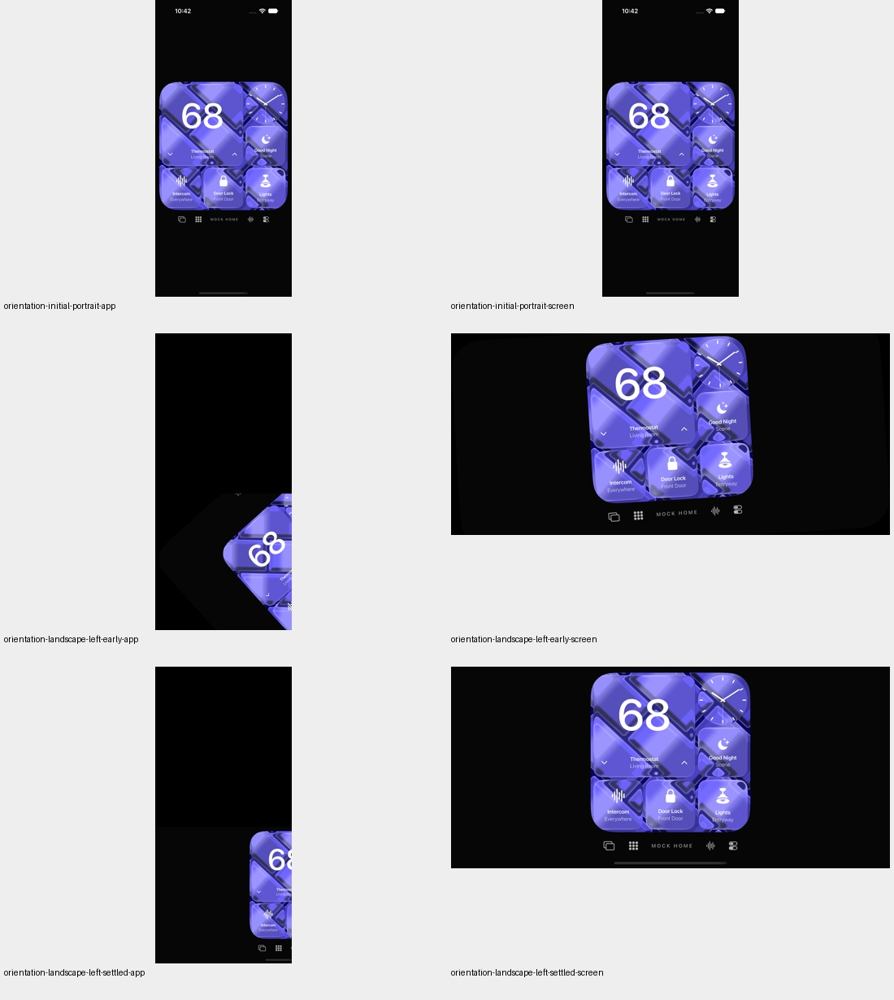
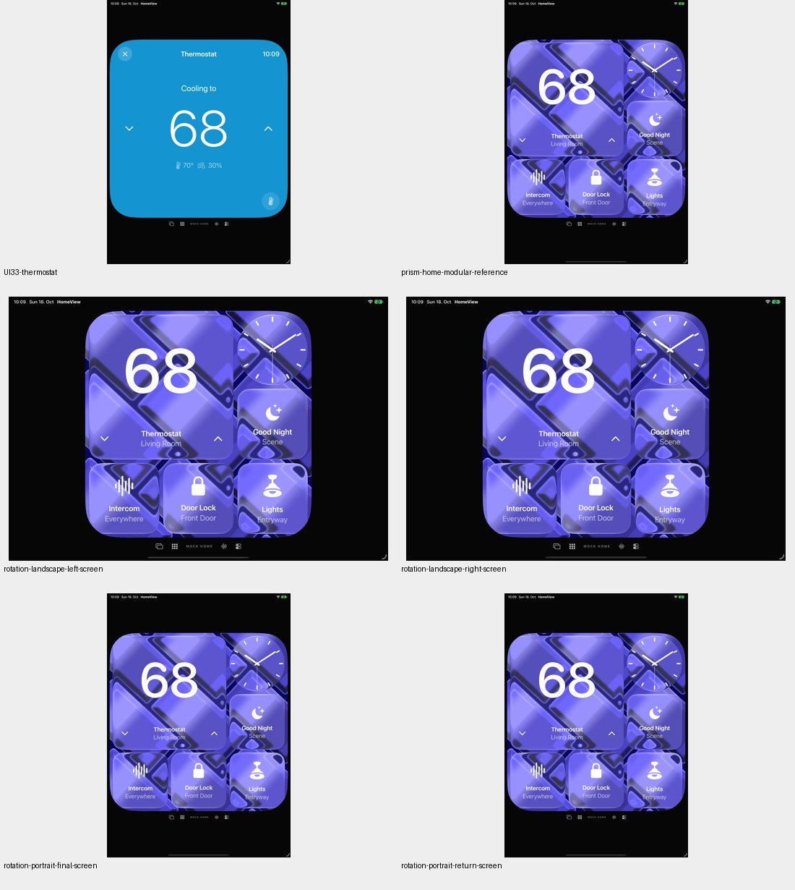
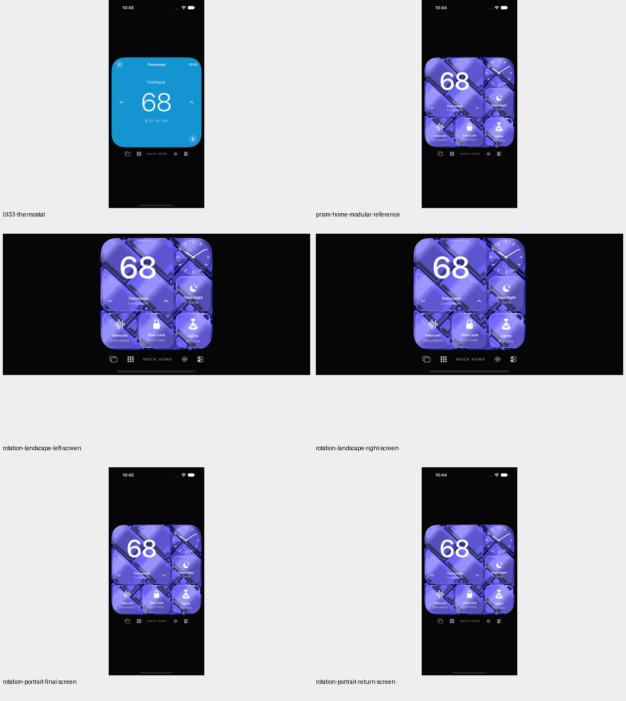

# Rotation: Aufnahmefehler getrennt von Layout und Bedienung

18. Oktober 2026. Nur der bestehende UI-Test wurde verstärkt; App, Core,
Provider, Ressourcen und Projektdateien sind bytegleich zum Stand `2cc29b37`.
Keine Rendereränderung und keine neue Originalabnahme.

## Ausgangsbefund

Der [268er-Lauf](all-synthetic.md) bestand auch den bisherigen Rotationstest: Er
prüfte lediglich die Existenz des Thermostatbuttons. Beide Querformat-Appbilder
sind jedoch abgeschnitten. Diese Rohbilder bleiben als nicht akzeptierte
Bildzustände dokumentiert. Ein Funktionstest-PASS war keine Bildfreigabe.

Ein getrennter Test erfasst Fenster-/Viewport-Geometrie sowie unmittelbar
aufeinanderfolgende App- und Bildschirmaufnahmen. Auf beiden Simulatoren
(iOS 27.0 / 24A434) bleibt `app.screenshot()` selbst nach zwölf Sekunden
stabiler Geometrie abgeschnitten. Seine orientierten UIImage-Punktmaße sind
im Querformat vertauscht. `XCUIScreen.main.screenshot()` passt dagegen exakt
zu den Fenstermaßen und zeigt den vollständigen zentrierten Viewport.
Das grenzt den beobachteten Aufnahmeweg ein; eine interne XCTest-Ursache
oder universelle Aussage über andere Laufzeiten ist damit nicht bewiesen.

## Qualifizierte Fehlversuche

Der erste reine Diagnosebuild kompilierte wegen falsch benannter XCTest-APIs
nicht; dabei wurde kein Test ausgeführt. Nach Korrektur auf öffentliche APIs
scheiterte der Diagnosetest je Gerät einmal an `home.thermostat.isHittable`.
Dieses AX-Feld war schon im initialen Hochformat auf dem unveränderten
Baseline-Renderer falsch; der bestehende Glaskacheltest dokumentiert denselben
Befund. Beide nativen Fehler bleiben erhalten. Der Folgeschritt ersetzt die
AX-Annahme durch echte simulierte Koordinatentaps und überprüfte Zielwerte,
nicht durch eine behauptete Treffbarkeit.

Der getrennte Touch-Diagnoselauf besteht je Gerät einen Fall mit vier
Orientierungswechseln. Seine zwei Ausführungen zählen nicht zusätzlich zu
den sechs abschließenden Ausführungen.

## Verstärkter bestehender Test

Beide Querformatrichtungen und jeweils die Rückkehr ins Hochformat benötigen
einen stabilen quadratischen Viewport innerhalb des Fensters, einen enthaltenen
Thermostatbutton und erreichbare Navigation. Die orientierten Punktmaße der
Bildschirmaufnahme müssen exakt dem App-Fenster entsprechen. In jedem Zustand
öffnet ein echter Touch den Thermostat; Hoch-/Runtersteuerung muss 68 → 69 → 68
liefern. Die Orientierung wird auch bei einem Testabbruch zurückgesetzt.

**Sechs gezielte UI-Ausführungen bestanden**, je Gerät drei Fälle: Rotation,
Glaskachelbedienung und Thermostat/Scene-Propagation. Null Fehler, Skips oder
XCTest-Runtime-Warnungen. **166 Modelltests bestanden**, nach Feature- und
Integrationscommit erneut. Der Quellenmanifest mit 142 Dateien bleibt identisch
und ist gegen die committed Bytes geprüft.

Zwölf finale eigene PNGs und 36 Diagnosebilder wurden tatsächlich auf acht
Kontaktbögen gesichtet. Die acht finalen Rotationsbilder sind vollständig. Keine
RGB-/Pixelfehlertoleranz eingeführt. Der Prismen-Bewegungsprototyp bleibt
unverändert zurückgehalten.

Der iOS-Testbundle-Build ist neu. Ein weiterer Fünf-SDK-Lauf wird für die reine
Teständerung nicht behauptet; die unveränderten App-Quellen sind im vorherigen
[Uhrnachweis](modular-clock-detail.md) für fünf SDKs gebaut. Keine vollständige
Neuausführung aller 134 Fälle auf dem geänderten Testquellenstand, keine neuen
Systemalarme oder echten Bibliotheken/HomeKit-Geräte. Historische QA-01 und
Original-/Hardware-/Livekonto-Gates bleiben unverändert.

[Quellen und terminale Ergebnisse](verification/orientation-capture.json) ·
[Eigene Bilder, Metadaten und Hashes](screenshots/goal-20261018/orientation-capture-manifest.json).

