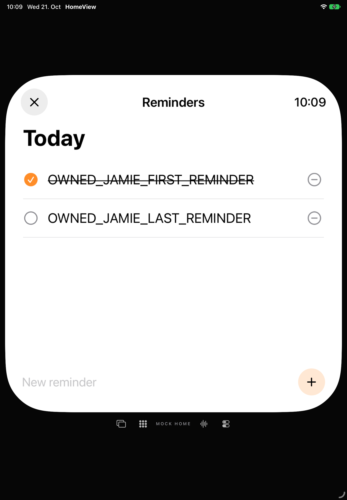
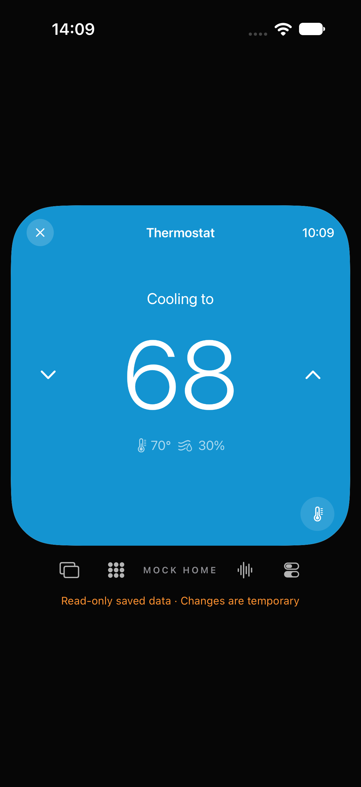

# QA-05: gemeinsame Persistenz- und Lifecycle-Abnahme

21. Oktober 2026 · [Issue #80](https://github.com/Olli0103/homeview/issues/80).

## Fest begrenzter Auftrag

Die vier ursprünglichen Kriterien bleiben maßgeblich: sechs gespeicherte Datenfamilien mit alten und beschädigten Formen, Verbindungsabbrüche/verspätete Antworten, ausschließlich eigene begrenzte Testordner und kein falscher Erfolg bei fehlgeschlagenem Write. Diese Software-Abnahme ist weder die Abnahme aller Originaldetails noch die Freigabe echter Accounts, Geräte, Homes oder Systemalarm-Zustellung.

Frühere Teilberichte bleiben historische Nachweise ihrer jeweiligen Quellen. Hier werden die Kriterien auf einem gemeinsamen Abschlussstand zusammengeführt; ihre Testzahlen werden nicht zu einem vermeintlichen aktuellen Gesamtlauf addiert.

## Datenmatrix

Alle zwölf Zellen sind explizite Methoden in `PersistenceAcceptanceTests`. Jede Zelle prüft zusätzlich sämtliche nicht betroffenen Snapshotfelder und einen stabilen kanonischen Save-/Reload-Roundtrip.

| Familie | Unterstützte ältere Form | Beschädigte Form |
| --- | --- | --- |
| Face | gespeicherter Stil ohne spätere Flowoptionen | kaputte Einzeloption erhält gültigen Stil und anderes Face |
| Slot | ursprüngliche Vier-Widget-Liste ohne spätere Face-Konfiguration | falscher Mitgliedstyp erhält bekannte Nachbarn und bestehende Familienregeln |
| Galerie | geordnete lokale IDs ohne späteren Auswahl-Diskriminator | falscher Typ, ungültiger Dateiname und Duplikat erhalten gültige Reihenfolge ohne Doppelanzeige |
| Timer | bestehende ID, Deadline und Ablaufbeleg ohne spätere System-Zuordnung | defekter Eintrag und doppelte ID verwerfen nicht den gültigen Timer |
| Rezept | Rezept ohne spätere optionale Bild-/Zeitmetadaten | defektes ausgewähltes Rezept setzt auf den bekannten Fallback zurück, gültiger angehefteter Nachbar bleibt einmal erhalten |
| Profil | fehlende zweite Inhaltsliste bleibt leer statt neuer Demo-Nachrichten | kaputte Mitglieder und doppelte Reminder-ID bleiben auf das eigene Profil begrenzt |

„Älter“ bezeichnet unterstützte, aus der vorhandenen Modellgeschichte abgeleitete Feldformen mit erfundenem Inhalt; keine behauptete Rettung einer realen alten Nutzerdatei. Zwei weitere Methoden prüfen gemischte lokale System-ID-Listen und die weiterhin geschlossene Album-/Consent-Grenze.

### Gefundene Migrationslücken

Die unveränderte Ausgangsimplementierung scheiterte in zwei der 14 neuen Methoden: Ein falscher Mitgliedstyp löschte alle Galerie-IDs beziehungsweise alle gespeicherten Systemdienst-Zuordnungen. Lokale UUID-Listen werden nun eintragsweise validiert, dedupliziert und innerhalb der vorhandenen Grenzen erhalten. System-IDs werden weiterhin kanonisch begrenzt; weder Dateipfade noch Rechte werden daraus abgeleitet.

Der erste Fix scheiterte an der **bestehenden** Album-Multiplizitätsprüfung: Deduplikation konnte einen vorher nicht exakt passenden Albumgrant gültig erscheinen lassen. Die ursprüngliche rohe, geordnete ID-Liste muss deshalb ebenfalls exakt zum Grant passen. Dieser Zwischenfehler bleibt erhalten. Verbindungsfreigaben werden ausdrücklich **nicht** teilweise gerettet; beschädigter Consent bleibt leer, unbekannte Version bleibt read-only.

## Native Alarmgrenze: vor dem Effekt speichern

18 kontrollierte AppModel-Szenarien bilden einen gemeinsamen Vorher-/Nachher-Bestand. Vorher scheiterten neun Szenarien mit 20 Assertions; neun Kontrollen bestanden bereits. Nachher bestehen alle 18 mit 95 Assertions:

- Pause/Fortsetzen/Löschen eines registrierten Timers und Deaktivieren/Löschen eines registrierten Alarms dispatchen bei echtem atomarem Dateischreibfehler keine Systemaktion und behalten den letzten Zustand.
- Fehler des Systemdiensts restaurieren die vorherigen lokalen Daten; normale erfolgreiche Aktionen speichern genau ihren Effekt und erhalten Nachbarn.
- Ein bereits zurückgekehrter Schedule wird bei gescheitertem Eigentums-Write wieder storniert, statt eine ungespeicherte native ID zu behaupten.
- Ein verspäteter Schedule übernimmt keinen inzwischen pausierten Timer. Bei Aus-/Einschalten eines noch wartenden Alarms wird der alte Abschluss bereinigt, **bevor** der Nachfolger startet. Die Serialisierung ist pro Identität; unterschiedliche IDs blockieren sich nicht.
- Die lokale Systemalarm-Abstimmung verwendet ebenfalls den bestehenden Commit/Rollback-Pfad, statt nach Writefehlern nur den RAM-Zustand zu verändern.

Die Probe kompiliert das tatsächliche AppModel und die übrigen App-/Corequellen auf macOS. Nur seine äußere AlarmKit-Compilerbedingung wird für einen symbolischen `NativeAlarmService` ausgewählt und ein privater Store-Accessor angefügt. Sie importiert/linkt **kein AlarmKit** und fordert keine OS-Rechte an. Es gibt echte Swift-Tasks, gesteuerte Continuations, echte lokale Writefehler, UUID-Speicher, Originalbytes und normale AppModel-Neuladung – keine echten Systemalarme. [Ausgeführte Probe](verification/qa80-native-alarm-probe.swift).

Die erste Host-Compile-Vorbereitung enthielt fälschlich den separaten Widget-Einstieg ohne dessen iOS-Typ und scheiterte vor jeder Ausführung. Das Harness wählt danach App/Core; kein Produktcode wurde für diesen Vorbereitungsschritt geändert.

## Lifecycle, Datenschutz und Dateisystem

Der vollständige aktuelle Modelllauf enthält 55 `DeviceConnectionTests`: Berechtigung ohne privaten Read, späte Erfolge/Fehler nach Sperre und Disconnect, alte Bereinigung gegen neue Sitzung, Task-Abbruch vor Write beziehungsweise während Read-back, Musik-/Wetterfehler und explizite Consent-Wiederherstellung. Dazu vier Player-Serialisierungstests, 15 Album-Session- und fünf Album-Snapshottests sowie die bestehenden Gesprächs-, Gast- und Profilgrenzen. Die Zuordnung ist Teil des [maschinenlesbaren Berichts](verification/qa80-acceptance.json); keine Addition historischer Teilresultate.

Vier aktuelle Reader- und sechs Resettests prüfen ausschließlich selbst angelegte temporäre Ordner: Byte-/Größenbegrenzung, fehlend versus unsicher, Links/Verzeichnisse, FIFO, unzulässiges Root und gefälschtes Cleanup-Journal. Die neuen nativen Proben nutzen ausschließlich frische `test-<UUID>`-Ordner. Fault-Cleanup verlangt den exakten eigenen Canary und den erwarteten einzelnen Verzeichniseintrag; normale Nutzerspeicher werden nicht geöffnet. Die Simulatorfälle verwenden ebenfalls eigene UUIDs. Keine Nachricht, kein Anruf, keine Home-Erkennung und kein reales Providerkonto.

## Abschlussgate

**Die ursprüngliche synthetische QA-05-Matrix ist bestanden.**

| Lane | Gemeinsamer Abschlussstand |
| --- | --- |
| Modell | **352 Tests**, null Fehler/Skips; einschließlich zwölf expliziter Migrationszellen und zwei zusätzlicher ID-/Grant-Gegenproben |
| Native Alarmgrenze | **18 Szenarien / 95 Assertions**, null Fehler; identische Fälle wie im getrennt archivierten Vorherlauf |
| App | **22 bestandene Ausführungen**, elf Methoden je iPad/iPhone, null Fehler/Skips/Laufzeitwarnungen |
| Datei-Read-back | Vier Profilstände: ursprünglicher Seed-SHA, Originalkopien, normale Reminder-Writes, Nachbarn und Neustart exakt. Zehn weitere UUID-Stände: unbekannte Version exakt unverändert, Rezept-Recovery/normaler Write, gespeicherte Galeriewahl und Face-Backups geprüft |
| SDK | iOS Simulator, macOS, tvOS Simulator, visionOS Simulator und watchOS Simulator bestanden; kein Geräte-/Watch-Runtime-PASS |
| Bilder | **88 PNGs dekodiert**, zwei Übersichten gesichtet, 16 eigene Endzustände mit Hash publiziert |

Quellenmanifest: `37f5f95889d3f42b6fba6b29cdcca82452185123a2284d9263ffe53f3bbf0ee2`, **210 Eingaben vor/nach unverändert**. 28 UI-Ausführungseingaben einschließlich App, Testbundle und Launchkonfiguration vor/nach identisch; installierte Appbytes auf beiden Simulatoren zurückgelesen. 238 Archiveinträge vollständig bytegeprüft. Native Vorher-/Nachher-Archive enthalten jeweils 98 ebenfalls bytegeprüfte kompilierte Eingaben. Baseline- und Zwischenfehler bleiben getrennt erhalten.

Auswahl: alte/defekte Face-Konfiguration, korrupter Rezept-Store, schreibgeschützte unbekannte Version, Galerierotation, absolute Timerfristen nach Prozessneustart, alte/defekte Profillisten, read-only Face/Slot und Rezept sowie expliziter begrenzter Reset. Keine ganze UI-Suite und kein Anspruch auf Gesamt-Parity.

## Bewusste Grenzen

Synthetische Providergrenzen sind keine Live-Account-, Biometrie-, App-Switcher-Snapshot- oder Hardwareabnahme. Die Abhängigkeit SYS-03 bleibt für Partnergerätebindung/Originalidentifikation separat offen. Physische Alarm-/Audiozustellung, Berechtigungsdialoge, Geräte-Neustart und Live Activities sind getrennte Gerätegates in ihren eigenen Issues. Home bleibt ausdrücklich gesperrt.

Dateisystem und OS-Dienst bilden keine gemeinsame atomare Transaktion: Ein Prozessabsturz zwischen Save und Systemeffekt oder ein gescheiterter kompensierender Systemaufruf ist nicht ausgeschlossen. Fehler werden angezeigt; ein misslungener lokaler Rollback sperrt weitere lokale Writes. Kein pauschaler Crash-Recovery-, beliebiger Fremdschreiber-, allgemeiner Ressourcen-, Original- oder Release-PASS.
