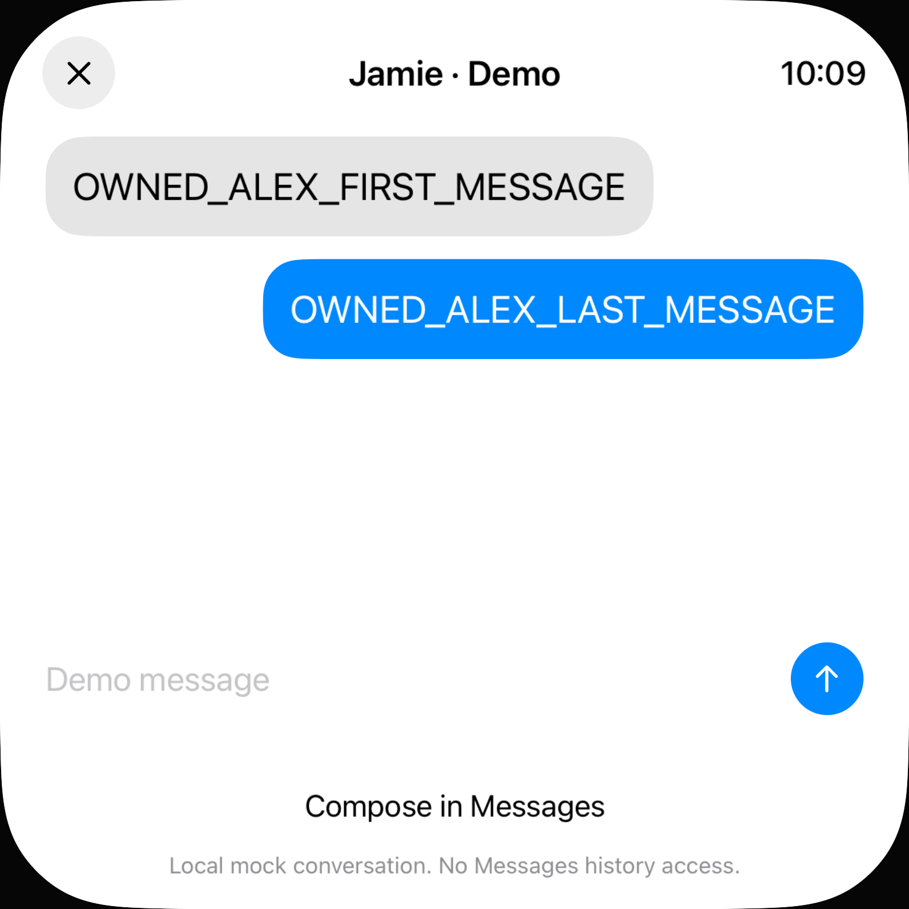
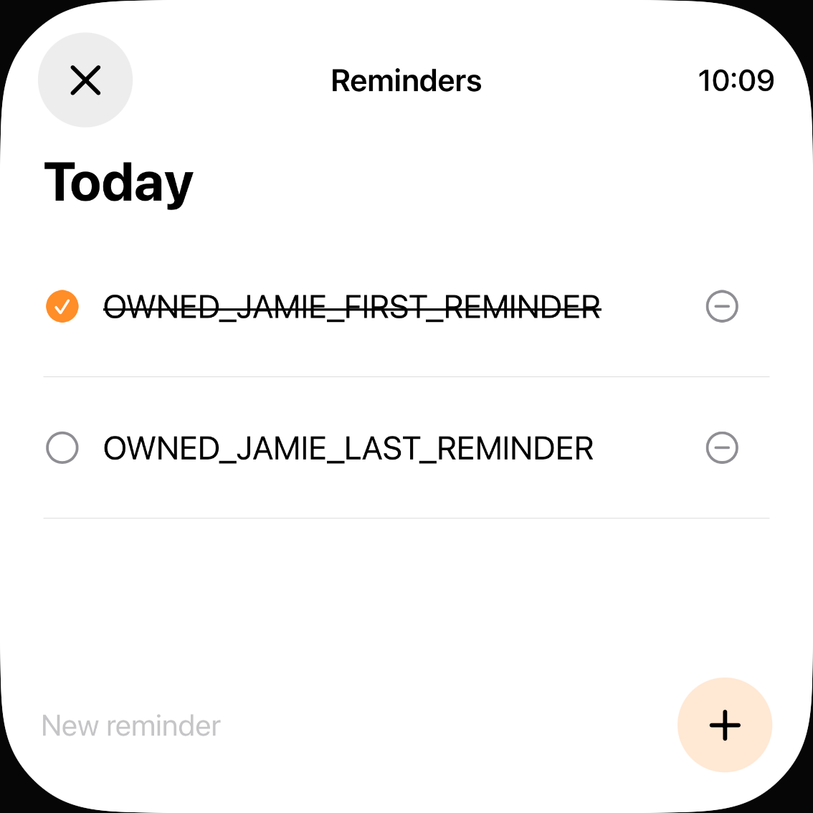

# Beschädigte Profilfelder unabhängig wiederherstellen

20. Oktober 2026 · begrenzter Fix für [#80](https://github.com/Olli0103/homeview/issues/80). Keine Nachrichten gesendet, keine Home-Anbindung.

## Vorherbefund

`PersonalContent` verwendete synthetisiertes `Codable`: Eine fehlende oder beschädigte Nachrichten-/Erinnerungsliste ließ den ganzen Profileintrag scheitern. Damit gingen auch gültige Nachbarlisten oder gültige Mitglieder einer teilweise beschädigten Liste verloren. Doppelte Erinnerungs-IDs blieben dagegen erhalten und konnten zwei Zeilen mit derselben Aktionsidentität erzeugen.

Neun neue Regressionen gegen unveränderte Produktionsquellen: **sechs fehlgeschlagene Fälle mit 19 Assertions**, drei bestandene Kontrollen. Abgedeckt sind beschädigte Nachbarfelder, fehlende ältere Listen, fehlerhafte Mitglieder, doppelte Erinnerungsidentität und Null-/Nichtlistenwerte. Gesunde und explizit leere Inhalte sowie Nichtobjekt-Ablehnung bilden Kontrollen.

## Kleine Änderung am bestehenden Modell

Der Decoder liest die beiden gespeicherten Listen unabhängig und jedes Mitglied isoliert. Fehlende oder beschädigte Listen werden **leer**, nicht mit neuen Demoinhalten befüllt und nicht aus einem anderen Profil übernommen. Gültige Mitglieder behalten ihre Reihenfolge. Nachrichten mit gleichem Text bleiben zulässig. Bei gleicher Erinnerungs-ID bleibt der erste gültige Eintrag; unterschiedliche IDs bleiben getrennt.

Die normale Konstruktion eines neuen Demoprofils behält ihre bisherigen zwei Beispielnachrichten und Erinnerungen. Die Änderung betrifft das Dekodieren gespeicherter Daten. Kein neuer Speicher, keine Abhängigkeit, kein neues Dienstrecht und keine Änderung am Writer, Reader, Reset oder den bestehenden Datei-/Tabellengrenzen. Kein Anspruch auf Rettung bereits verworfener Daten oder Rekonstruktion unbekannter beschädigter Inhalte.

## Tatsächliche Abnahme

| Lane | Ergebnis |
| --- | --- |
| Core | **338 Tests**, null Fehler/Skips; neun neue Fälle. Gesunder kanonischer Roundtrip und unveränderte neue Demo-Konstruktion enthalten |
| App | Zwei Methoden je iPad/iPhone: alte fehlende Felder und beschädigte Listen. **Vier bestandene Ausführungen**, null Skips/Laufzeitwarnungen |
| Sichtbare Inhalte | Zwei gültige Alex-Nachrichten erhalten; im Jamie-Nachrichtenfenster weder Alex- noch erfundene Beispielnachrichten. Jamie-Erinnerungen mit zwei unterschiedlichen IDs, ohne doppelte Zeile |
| Normaler Write/Neustart | Erste lokale Jamie-Erinnerung tatsächlich über den normalen Button erledigt. Nach Prozessneustart ohne Fixture bleiben Alex-Inhalte erhalten, erste Erinnerung erledigt und letzte nicht erledigt |
| Unabhängige Dateien | Vier eigene UUID-Speicher: Originalkopie entspricht dem beim Seeden geschriebenen SHA-256. Alle Snapshotfelder **außer** den absichtlich reparierten/geschriebenen Profilinhalten bleiben exakt gleich. Gültige Nachrichten, leere beschädigte/fehlende Listen, originale eindeutige Erinnerungs-IDs und gespeicherter Erledigt-Status bestätigt |
| SDKs | iOS Simulator, macOS, tvOS Simulator, visionOS Simulator und watchOS Simulator bestanden. Reduzierter Watch-Build ist keine funktionale UI-Abnahme |

Die Fixture ist an `--uitesting`, eine explizite gültige Test-UUID, ein separates Flag und einen noch nicht vorhandenen eigenen Store gebunden. Verbindungsfreigabe ist explizit leer. Die Reminders-Aktion schreibt ausschließlich den lokalen Mock; keine EventKit-Aktion. Die Messages-Ansicht wird nur gelesen. Keine normalen Nutzerverzeichnisse untersucht oder verändert.

## Quellen und Bilder

[Bericht](verification/personal-field-recovery.json), [finale Quellenliste](verification/personal-field-recovery-source.json), [native Eingaben](verification/personal-field-recovery-ui-inputs.json), [separate Host-Assertions](verification/personal-field-recovery-readback.py.txt).

209 Eingaben je Checkpoint; Vorher-/Core-Archive mit jeweils 23 kompilierten Produktdateien vollständig zurückgelesen. Nach dem 338er-Lauf kamen nur AppModel-Testfixture und UI-Tests hinzu; Core und CoreTests bleiben bytegleich. Frühere Ergebnisse werden nicht rückwirkend dem späteren vollständigen Quellenstand zugeschrieben. Native Prüfung und fünf SDKs sind an diesen späteren Stand gebunden. 28 native Ausführungseingaben vor/nach identisch, installierte Appbytes auf beiden Simulatoren geprüft. Native Eingaben in 237 vollständig geprüften Archiveinträgen. 24 PNGs dekodiert, zwei Kontaktbögen gesichtet, zwölf eigene Viewports veröffentlicht.

Die übrige Daten-/Lifecycle-/Provider-/Alarmoperationsmatrix bleibt separat offen. Keine Original-, Hilfsmittel-, Konto- oder Hardware-Gesamtabnahme. #80 bleibt OPEN.
