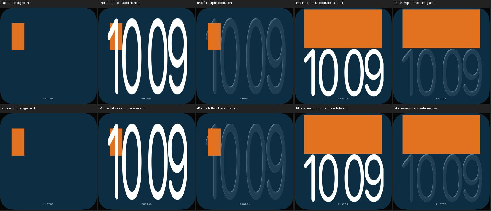

# Foto-Uhr: adaptive hohe Bänder mit vorhandener Matte

18. Oktober 2026 · [FACE-01 / #5](https://github.com/Olli0103/homeview/issues/5) ·
[analytisches Layoutpaket / #12](https://github.com/Olli0103/homeview/issues/12).

## Größere Uhr nur mit tatsächlich vorhandenem Vordergrund

Die hohen Schriftzustände von UI04/UI11 sind der qualitative Maßstab. Die eigene
Implementierung verwendet weiter eine öffentliche Laufzeit-Systemschrift, keine
extrahierten Schriftkonturen oder Originalbilder. **Schriftform, Proportionen und
Originalalgorithmus sind damit nicht als identisch abgenommen.**

Nach der bestehenden Positions-/Ausschnittwahl werden eigene größere Bänder von
90 beziehungsweise 56 Prozent Höhe geprüft. Sie stehen nur bei vorhandener
brauchbarer Maske, vorhandenen Vordergrundbytes, automatischer Uhrposition,
automatischem Ausschnitt und voller Zielfläche zur Verfügung. Die Abdeckung wird
für das größere Rechteck im tatsächlich ausgewählten Quellausschnitt neu berechnet.
Die bestehende **18-Prozent-Grenze bleibt unverändert**; überschreitet auch die
mittlere Variante die Grenze, bleibt die kompakte Uhr.

Renderer und Bewertung verwenden dasselbe Uhrrechteck. Vor der horizontalen
Streckung wird die Schriftbreite begrenzt; innerhalb des 540-Punkte-Bands bleiben
20 Punkte je Seite für Schriftüberhänge. Keine nachträglich gelockerte Pixelgrenze.
Die Ziffern werden durch eine vorhandene Vordergrundebene tatsächlich verdeckt.

Ohne Matte, bei manueller Uhrposition, manuellem Ausschnitt oder Letterboxing bleibt
die bisherige kompakte Geometrie erhalten. Ein erkanntes Gesicht beziehungsweise
Schutzrechteck ist weiterhin **keine Alpha-Maske**. Das eigene Demo-Porträt hat im
Simulator weiterhin keinen nativen Vordergrund; sein Kopf bleibt durch die Uhr
unterhalb des Gesichts frei.

Alle orangefarbenen Motive sind ausdrücklich eigene geometrische Fixtures mit
bekannten PNG-Alpha-Pixeln und dazu passender Maskenrasterung. Sie sind kein
vorgeblich von Vision freigestelltes Foto und keine Originalgrafik.

## Sichtbare Verdeckung statt bloßem Depth-Flag

Drei unabhängige Zustände verwenden dieselben Bild-/Layoutdaten:

1. Fotohintergrund ohne Uhr.
2. Weiße Kontrollschrift ohne Vordergrundebene, um tatsächlich vorhandene Schrift
   hinter dem asymmetrischen Motiv nachzuweisen. Diese Option existiert nur unter UITesting.
3. Normaler Glasrenderer mit vorhandener Vordergrundebene.

In einem vorab festgelegten inneren Motivbereich werden **alle** so identifizierten
Kontrollschriftpixel wieder exakt zum Hintergrund: 29.994 auf iPad und 15.540 auf
iPhone, jeweils null abweichende RGB-Pixel. Außerhalb bleibt die Glas-Uhr sichtbar.
Die asymmetrische Position prüft dabei auch eine versehentlich gespiegelte
Vordergrundtransformation. Hohe und mittlere Positivkontrollen liegen vertikal
und horizontal innerhalb ihrer berechneten Rechtecke. Grenzen und Positivkontrollen
werden nicht anhand eines Fehlstands nachträglich gelockert.

Zehn ganze native kompakte Bilder sind pixel- **und PNG-bytegleich** zum
[vorherigen eigenen Stand](photo-type.md): Hintergrund, weiße Kontrolle, Glas,
Porträt-Kopfschutz und Nacht auf beiden Größen. Manuelle Position/Neustart/Reset,
manueller Ausschnitt/Reset sowie dichte und randständige Motive sind zusätzlich
geprüft und gesichtet. Die bestehende Glasdurchsicht und Nacht-Farbprüfung bleibt
unverändert.

## Quellengebundene Abnahme und bewahrte Fehlstände

143 Modelltests, nach Feature und Integration erneut ausgeführt, **20 gezielte
UI-Ausführungen** (zehn je iPad/iPhone), fünf SDK-Builds. Keine UI-Fehler,
übersprungenen Fälle oder XCTest-Runtime-Warnungen. 133 Quellen vor/nach Prüfung
und gegen beide Codecommits identisch. 30 eigene finale Bilder mit Digests,
keine privaten Hostpfade oder Originalbilder. Kein neuer vollständiger Suite-PASS
und keine Laufzeitabnahme auf fünf Plattformen.

Ein früherer Kandidat bestand bereits 20 Funktionstest-Ausführungen, aber die
zusätzliche Bildkontrolle fand die rechte Schriftkante bei rund 96,17 statt maximal
95 Prozent. **Dieser Stand wurde nicht übernommen.** Die damaligen Tests hatten
horizontal noch nicht geprüft. Der korrigierte Stand begrenzt die Schrift vor der
Streckung und prüft jetzt beide horizontalen Ränder ausdrücklich. Alte Ergebnisse,
Quellen und Bildbefunde bleiben getrennt erhalten und werden nicht rückwirkend grün.
Auch ein erster lokaler Modell-Smoke mit zwei fehlgeschlagenen Erwartungen ist im
Beleg als solcher erhalten; dessen Manifest wurde erst danach erstellt und wird
nicht als vorab eingefrorener Prüfstand ausgegeben. Pilotfälle sind nicht zu den
20 finalen Ausführungen addiert.

[Prüfbeleg und getrennte Historie](verification/photo-adaptive.json) ·
[Quellenmanifest](verification/photo-adaptive-source.json) ·
[eigene Bilddateien](screenshots/goal-20261018/photo-adaptive-manifest.json) ·
[zusätzliche Regressionsansichten](screenshots/goal-20261018/photo-adaptive-regression-states.jpg).

## Getrennt weiter offen

Die native Vision-Freistellung wird durch diesen Renderer-Schritt nicht repariert;
der [dokumentierte Simulatorbefund](photo-native-boundary.md) bleibt gültig.
Originalfont, genaue Licht-/Brechungswirkung, weitere Originalzustände und reale
Foto-/Gerätequalität bleiben offen. #5 bleibt offen. Der historische geschlossene
Status von #12 bleibt ausdrücklich auf sein früher abgenommenes analytisches
Layoutpaket begrenzt; er ist kein neuer nativer Depth- oder Original-PASS.
Keine echte Fotobibliothek, Accounts, Homes oder Geräte wurden verwendet.
