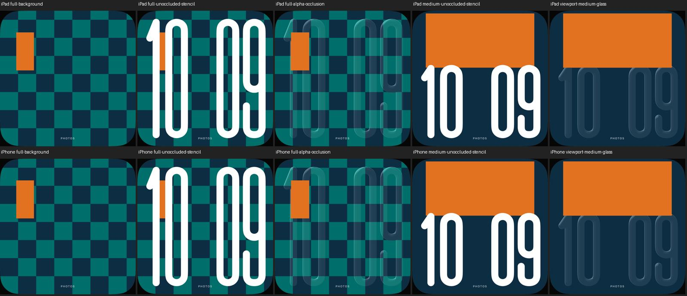
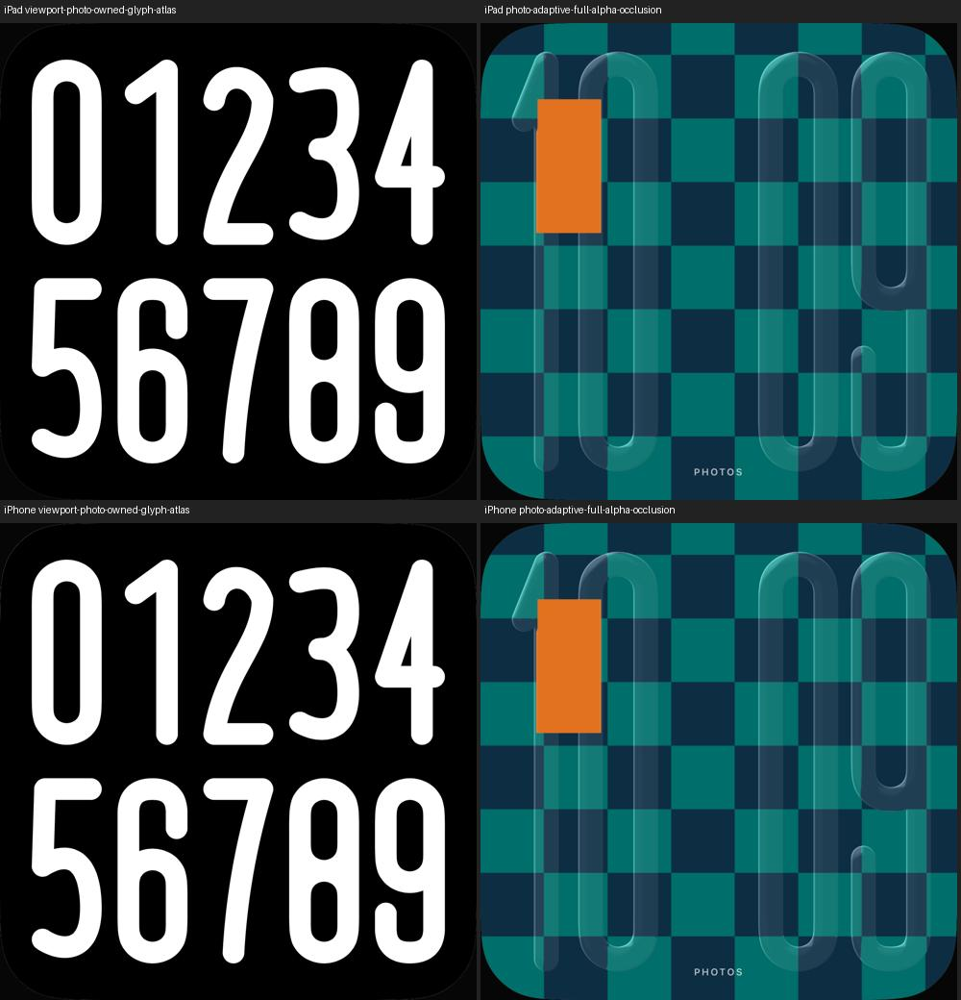

# Foto-Uhr: eigene hohe Glaskonturen

18. Oktober 2026 · [FACE-01 / #5](https://github.com/Olli0103/homeview/issues/5) ·
[PUB-01 / #3](https://github.com/Olli0103/homeview/issues/3).

## Form statt gestreckter Ellipsen

Die hohen Varianten aus UI04/UI11 sind der qualitative Maßstab. Null und Neun
verwenden nun eigene gerundete Rechteckkonturen mit langen geraden Seiten und
entsprechenden Innenräumen. Eins hat eine eigene Schulter und einen schmaleren
Vorschub; der Abstand zwischen Stunden- und Minutenpaar ist an UI04 angenähert.
Die anderen Ziffern sind eigene, noch nicht originalgetreu kalibrierte Formen.
Ein vollständiger Originalfont wird **nicht** behauptet.

Alle Konturen sind projektseitige SwiftUI-Pfade. Keine Apple-Fontdatei oder
extrahierte OS-Schriftkontur wird gespeichert, eingebettet oder verteilt. Die
vorhandenen eigenen kubischen Grundformen werden teilweise wiederverwendet.
Der Glas-Shader erhält deren Alpha wie zuvor das der Laufzeitschrift; seine
Funktionsbytes bleiben unverändert, nur ein Kommentar ist aktualisiert.

Nur die bereits [geprüften großen mattegestützten Bänder](photo-adaptive.md)
verwenden die neuen Pfade. Ohne Matte, bei manueller Korrektur und Letterboxing
bleibt die kompakte Laufzeitschrift erhalten. Die Motiv-/Ausschnittberechnung,
Vordergrundvoraussetzung und 18-Prozent-Abdeckungsgrenze bleiben unverändert.
UI36 zeigt außerdem eine kompakte Variante mit Doppelpunkt; sie ist durch diesen
hohen Schriftzug nicht nachgebaut.

Die farbigen Motive und das Schachmuster sind ausdrücklich eigene geometrische
Testbilder, keine native Vision-Freistellung oder Originalfotografie.

## Sichtbare Prüfung aller zehn Ziffern

Ein nativer Atlas prüft jede Ziffer separat auf sichtbare Pixel und freie Ränder.
Die vorgesehenen Innenräume von 0/6/8/9 bleiben offen. Bei 6/9 werden zusätzlich
die sichtbaren Verbindungen von Ring und Schaft geprüft. Beide Größen sind als
Atlas und tatsächliche Glas-/Alpha-Zustände gesichtet.

Der erste Prototyp bestand drei grundlegende UI-Ausführungen, hatte aber im Bild
fehlendes Material an den überlappenden Ring-/Schaftverbindungen von 6/9. Er wurde
**nicht übernommen**. Eine explizite Pfadvereinigung ersetzt das bloße Hinzufügen;
gezielte weiße Verbindungspixel sichern den Fehler zusätzlich ab. Der ursprüngliche
Stand, seine Ergebnisse und Bilder bleiben getrennt erhalten, nicht rückwirkend grün.

## Glasdurchsicht und Motivschutz tatsächlich gerendert

Eine weiße Schriftkontrolle ohne Vordergrundebene belegt, wo Schrift hinter dem
asymmetrischen Motiv liegt. Der normale Vordergrund stellt dort den Hintergrund
exakt wieder her. Außerhalb bleibt die Glas-Uhr sichtbar. Ein gemusterter Hintergrund
prüft zusätzlich die richtige Texturregistrierung; eine einfarbige Fläche würde
falsche Koordinaten nicht zuverlässig zeigen.

Die unveränderte RGB45-Grenze wird bei mehr als 80 Prozent der geprüften
Ziffern-Innenpixel eingehalten, die deckende Kontrolle erreicht null. Exakte
Zähler je Gerät stehen im Beleg. Alle horizontalen und vertikalen Ziffernränder
bleiben innerhalb der berechneten Bänder. Das eigene Foto-Porträt bleibt dagegen
weiter ohne native Matte und mit kopffreier kompakter Uhr.

Zehn ganze kompakte native Bilder sind pixel- und PNG-bytegleich zum unmittelbar
vorherigen gebundenen Stand. Nachtmodus, manuelle Position/Neustart/Reset,
manueller Ausschnitt/Reset sowie dichte und randständige Motive sind mitgeprüft.

## Quellen und Umfang

143 Modelltests, nach Feature und Integration erneut ausgeführt; **22 gezielte
UI-Ausführungen**, elf je iPad-/iPhone-Simulator iOS 27.0 / 24A434; fünf SDK-Builds.
Null UI-Fehler, Skips oder XCTest-Runtime-Warnungen. 134 Quellen vor/nach Lauf
und gegen beide Codecommits identisch. 52 eigene finale PNGs einschließlich
20 Ziffernkacheln und zweier Atlanten mit Herkunft und Digests. Die getrennten
Pilotläufe sind nicht hinzuaddiert. Keine vollständige UI-Suite oder Laufzeitabnahme
auf fünf Plattformen.

[Prüfbeleg und Fehlerhistorie](verification/photo-glyphs.json) ·
[Quellenmanifest](verification/photo-glyphs-source.json) ·
[eigene Bilder](screenshots/goal-20261018/photo-glyphs-manifest.json) ·
[zusätzliche Regressionsbilder](screenshots/goal-20261018/photo-glyphs-regression-states.jpg).

Originalfont und weitere Varianten, genaue Licht-/Brechungswirkung, native
Vordergrundextraktion und physische Gerätequalität bleiben offen. #5 und #3
bleiben offen. Kein nativer Depth-/Original-/Hardware-PASS und keine echte
Fotobibliothek, Accounts oder Homes. Der frühere [Simulatorbefund](photo-native-boundary.md)
bleibt gültig.

## Nachfolgende Größenbewertung

Dieser historische Konturstand ließ die Rechteckgrenze unverändert. Der
[getrennte folgende Schritt](photo-ink-placement.md) ändert ausdrücklich nur die
erweiterte Größenbewertung auf Schrift-Alpha plus Einzelzifferschutz. Er ist
keine rückwirkende Änderung der hier dokumentierten Testergebnisse.
