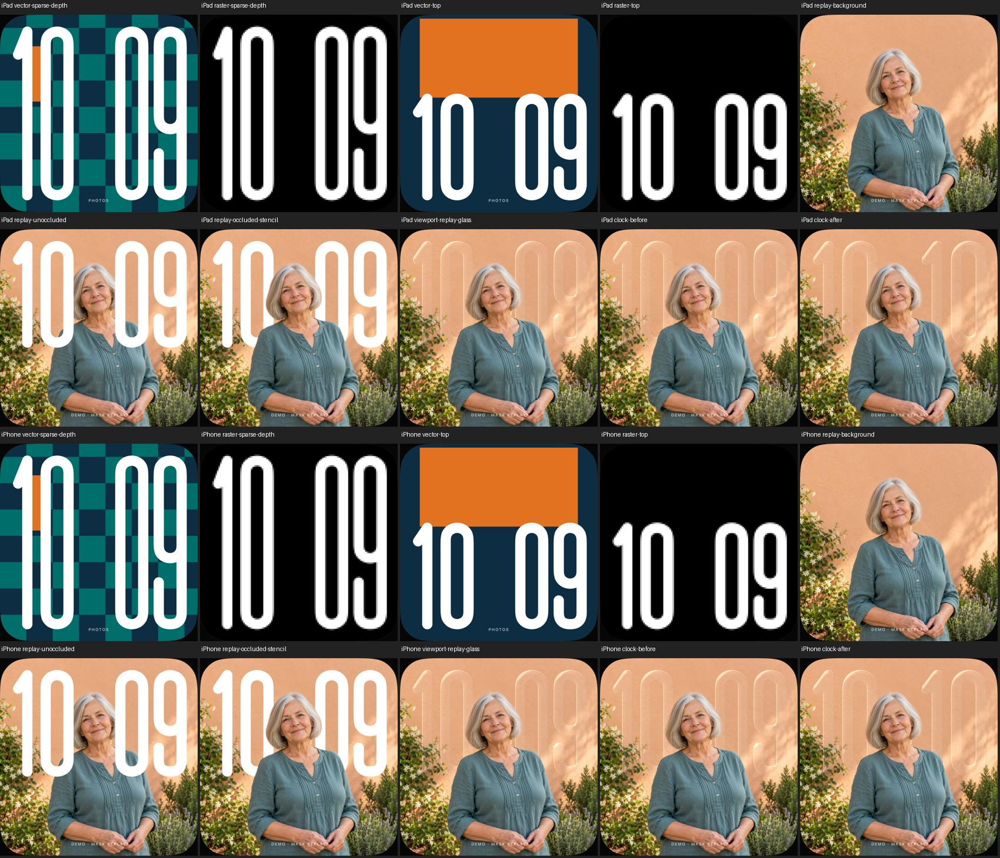

# Foto-Uhr: Größenwahl nach sichtbarer Schrift

18. Oktober 2026 · [FACE-01 / #5](https://github.com/Olli0103/homeview/issues/5).
Begrenzte eigene Implementierung, keine Rekonstruktion von Apples Auswahlalgorithmus.

## Warum die zusätzliche Bewertung nötig ist

Die bisherige Rechteckbewertung berücksichtigt auch den leeren Raum zwischen
Ziffern und in deren Innenräumen. Bei unserem eigenen Porträt lehnt sie deshalb
auch ein gut lesbares mittelhohes Band ab. Eine reine Gesamtquote der Schrift
könnte umgekehrt eine einzelne kleine Ziffer vollständig verschwinden lassen.

Die neue **eigene Regel für vergrößerte Bänder** begrenzt deshalb die tatsächlich
verdeckte Schrift auf höchstens **18 % insgesamt und 30 % je Ziffer**. Der Nenner
ist die Alpha-Stärke der eigenen sichtbaren Konturen, nicht mehr die Fläche des
Uhrrechtecks. Das ist eine ausdrückliche Änderung der erweiterten Größenwahl,
keine Behauptung, die alte Rechteckregel sei unverändert geblieben.
Die Quoten messen geometrische Verdeckung, nicht wahrgenommenen Kontrast oder
allgemeine Lesbarkeit jedes Motivs. Licht und Glas bleiben getrennte Bildabnahmen.

Die kompakte Eintrittsprüfung bleibt bei höchstens 18 % Rechteckabdeckung. Eine
brauchbare Maske und tatsächliche Vordergrunddaten, automatische Position und
Ausschnitt sowie eine vollflächige Bilddarstellung bleiben Voraussetzungen.
Ohne gültige Schriftmessung wird nicht vergrößert. Alte Modellaufrufer ohne
Schriftnachweis behalten die bisherige Rechteckbewertung. Fehlende Matte,
manuelle Korrektur und Letterboxing verwenden weiter die kompakte Schrift.
`coverage` bleibt echte Rechteckabdeckung; Schriftwerte sind separat erfasst.

## Gleiche Konturen, aktueller Ausschnitt und aktuelle Uhrzeit

Vier getrennte 128×128-Schriftmasken verwenden dieselben eigenen SwiftUI-Pfade,
Schulter/Vorschub der Eins und Paarabstände wie die sichtbare Uhr. Jede Ziffer
wird separat gegen die bilinear abgetastete weiche Motivmaske im aktuell
gewählten Quellausschnitt gewichtet. Leere, fehlende, doppelte oder nicht
passende Nachweise erlauben keine Vergrößerung.

Nur die Typografie wird nach angezeigter Uhrzeit zwischengespeichert, niemals
die Motivüberschneidung eines vorherigen Bildes. Ein Minuten- oder Zeitzonen-
wechsel berechnet die Konturen und Komposition neu. Der beschleunigte Prüf-
Minutenwechsel verändert keine Systemuhr und ist nur unter UITesting aktiv.

## Transparenter Testaufbau

Die markierte Szene **DEMO · MASK REPLAY** verwendet ausschließlich unser eigenes
bereits erzeugtes Demo-Porträt und den Alphakanal seiner tatsächlich auf dem Mac
gewonnenen Vordergrund-PNG. Sie erzeugt keine iOS-Freistellung. Der normale
Demo-Fotobutton und die native Analyse bleiben unverändert; die vorgefertigte
Maske ist kein Produktionsersatz bei fehlgeschlagener Segmentierung.

Eine unabhängige native weiße Vektorschriftaufnahme wird gegen die offengelegte
rohe Rechenmatrix verglichen: mindestens 90 % Schnitt-/Vereinigungsquote sowohl
insgesamt als auch für jede Ziffer, in voller und mittlerer Höhe. Die Anzeige
der Rechenmatrix enthält keine nachträgliche Korrekturspiegelung. Hintergrund,
Schrift ohne Vordergrund und Schrift mit Vordergrund bilden getrennte Kontrollen
für die tatsächliche Motivverdeckung. Eine vorab am eigenen Alphakanal geprüfte
voll deckende Kopf-Innenfläche verlangt mindestens 100 gekreuzte Schriftpixel
und höchstens zwei RGB-Stufen Unterschied zum unverdeckten Fotohintergrund.

## Fehlergeschichte und Abnahmegrenze

Der erste Kandidat bestand 151 Modelltests, aber nur eine von drei Pilot-UI-
Ausführungen. Seine Rechenmatrix war sichtbar vertikal gespiegelt. Die volle
Gesamtquote allein verdeckte diesen Fehler teilweise, während der mittelhohe
Vergleich und die Porträt-Größenwahl fehlschlugen. Quellenarchiv, Bilder und
Ergebnisse bleiben erhalten; dieser Stand wurde nicht übernommen. Die Korrektur
konvertiert die Bitmap-Koordinaten einmal beim Rastern. Zusätzliche Einzelziffer-
vergleiche sichern insbesondere die asymmetrischen Eins und Neun ab.

Originalformen, weitere Motive/Uhrzeiten, allgemeine Vision-Qualität, tatsächliche
Mac-App-Darstellung und physische Geräte bleiben gesonderte Abnahmen. Der
bekannte iOS-Simulatorbefund wird durch ein Masken-Replay nicht aufgehoben.

## Gebundener Abschlussstand

151 Modelltests vor sowie nach Feature- und Integrationscommit, **28 gezielte
UI-Ausführungen** (14 je iPad/iPhone), fünf Plattform-Builds. Keine Fehler,
Skips oder XCTest-Runtime-Warnungen. Der separate korrigierte Pilot zählt nicht
zu den 28 finalen Ausführungen.

Das eigene Porträt wählt nun das 56-%-Band oben: ungefähr 12,9 % Schrift insgesamt
und höchstens 25,9 % je Ziffer verdeckt, unabhängig auch an den tatsächlichen
PNG-Konturen gemessen. 1.292 / 644 gekreuzte Kopf-Schriftpixel stimmen nach
Vordergrundüberlagerung mit dem Hintergrund überein (festes RGB-Fehlerbudget 2).
Die geometrische Vollhöhen-Fixture erhält ihre strengere exakte Alpha-Kontrolle:
45.540 / 23.010 kontrollierte Schriftpixel ohne jede RGB-Abweichung.

Zehn native kompakte Ganzbilder ohne Matte sind pixel- **und** PNG-bytegleich
zum zuvor veröffentlichten Stand. Glastransmission, Nacht, manuelle Korrektur,
Neustart der Korrektur, Randmotive, dichte Maske und alle zehn Konturen sind
auf demselben Stand erneut gezielt geprüft. Keine neue Vollsuite behauptet.

[Quellen, frühere Fehlversuche und Pixelwerte](verification/photo-ink.json) ·
[72 eigene PNGs mit Inhaltsbindungen](screenshots/goal-20261018/photo-ink-manifest.json).

Alle vorhandenen 51 Ressourcen sind bytegleich. Ein zuvor veralteter Hash für
Info.plist im Assetverzeichnis wurde berichtigt; die Ressource selbst wurde
nicht geändert. Der neue Masken-Assetname ist eindeutig, seine Ableitung und
Inhalte stehen in der Foto-Provenienz und im aktuellen Assetmanifest.
