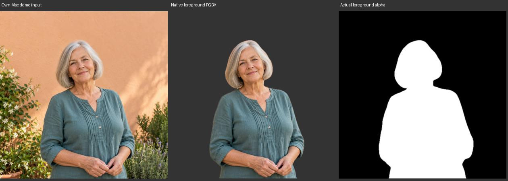

# Native Mac-Freistellung: vollständiger Adapter-Nachweis

18. Oktober 2026 · [FACE-01 / #5](https://github.com/Olli0103/homeview/issues/5).
Ein einzelnes eigenes Demo-Porträt, macOS 27.0.1 / 26A434, arm64.
**Kein gestarteter App-, iOS- oder physischer iPad-Nachweis.**

## Was tatsächlich ausgeführt wurde

Der unveränderte `NativeSubjectExtractor` aus dem aktuellen Projekt wurde mit
den unveränderten Foto-Layout-/Maskenmodellen als Mac-Kommandozeilenprogramm
kompiliert. Das isolierte Probe-Bundle enthält denselben gebauten eigenen
Assetkatalog. `NSImage(named:).tiffRepresentation` bereitet das Demo-Porträt wie
der Mac-Button „Use Demo Photo“ auf; die Einzelbildauswahl erzeugt danach kein
Thumbnail. Keine Fotobibliothek, persönlicher Speicher, App-Fenster oder Home-
Verbindung wurde konstruiert.

Alle Adapter-, Modell-, Wrapper- und Bundle-Dateien sind vor dem qualifizierten
Lauf gebunden und danach erneut geprüft; auch das ausgeführte Binary ist
gebunden. Der Wrapper bleibt getrennt von der App. Es wurde keine Produktions-
Quelle geändert und keine neue Modell-/UI-/SDK-Gesamtsuite behauptet.

Der erste Versuch scheiterte vor Vision an einem nicht ausführbaren Bundle-
Bildladehelfer. Sein Abbruch ist kein Vision-Fehler. Der zweite verwendet direkt
den App-Pfad `NSImage(named:)` mit eigenem isoliertem Bundle. Dieser eine native
Adapterlauf ist der hier beschriebene Nachweis; der erste Versuch wird nicht
nachträglich als erfolgreicher nativer Lauf gezählt.

## Tatsächliche Ausgabe statt bloßer Instanzzählung

| Eigenschaft | Beobachtung |
|---|---|
| Eingabe | Eigenes gebautes Demo-Asset, TIFF, 1254 × 1254 |
| Gesicht | Ein Ergebnis, ein akzeptierter Schutzbereich |
| Adapterdiagnose | `face_results_1_accepted_1_foreground_encoded` |
| Modellmaske | 128 × 128, Stärkesumme 1.333.434, nicht leer |
| Vordergrund | Tatsächliche RGBA-PNG, 1254 × 1254 |
| Alpha | Minimum 0, Maximum 255 |
| Voll transparent | 1.055.216 Pixel |
| Voll deckend | 486.579 Pixel |
| Teiltransparent | 30.721 Pixel |

Die tatsächlichen Dateien sind dekodiert und gesichtet: Das Motiv steht richtig
herum, Kopf und Körper sind erhalten, der Hintergrund ist entfernt. Das rechte
Bild zeigt den **Alphakanal der ausgegebenen PNG**, nicht einen behaupteten
Rohdump des internen Vision-Puffers. Diese begrenzte Sichtung eines eigenen
synthetischen Bildes ist keine allgemeine Segmentierungsqualitätsabnahme.

## Was das Modell damit entscheidet

Die unveränderte Platzierung wählt das kompakte obere Uhrband und erlaubt Depth.
Dessen Maskenabdeckung ist 15,86 %. Das volle Band erreicht 36,38 % und wird durch
die bisherige 18-%-Rechteckgrenze abgelehnt; die große eigene Schrift wird für
dieses Porträt also noch nicht gewählt. Ein ausgegebenes `depth_enabled=true`
ist hier eine **Modellentscheidung**, kein beobachteter App-Renderzustand.

[Quellen-/Input-/Binary-Bindung und Werte](verification/photo-native-mac.json) ·
[ausgeführter Probe-Wrapper](verification/photo-native-mac-probe.swift) ·
[eigene Bilddateien mit Digests](screenshots/goal-20261018/photo-native-mac-manifest.json).

## Weiter getrennt offen

Die frühere Hostkontrolle belegte nur eine Instanz; dieser neue Lauf ergänzt
erstmals die tatsächlich kodierte Vordergrund-PNG und die nutzbare Modellmaske
für den genannten Mac-Demopfad. Er verändert weder die alten Ergebnisse noch
den [iOS-Simulatorbefund](photo-native-boundary.md). Dessen Vision-Fehler bleibt
offen. Mac-App-Bild, physisches iPad, weitere persönliche Fotos, Originalformen,
Licht und allgemeine Gerätequalität sind damit nicht abgenommen. #5 bleibt offen.
