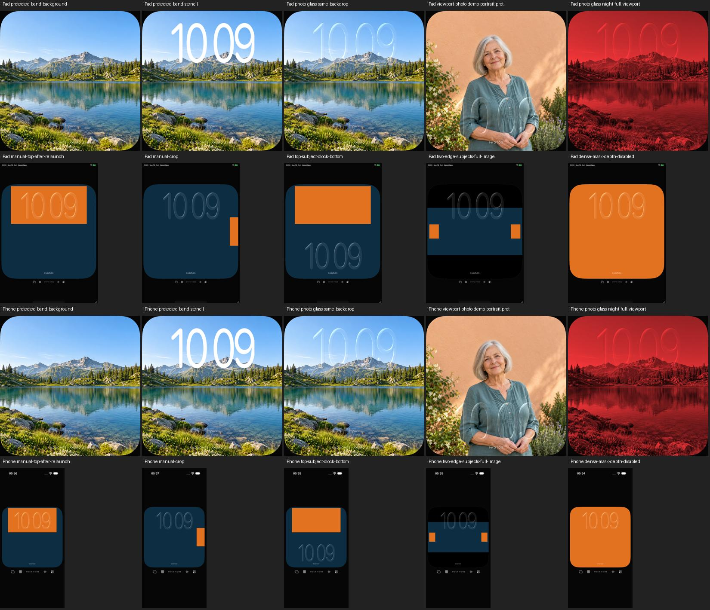

# Foto-Uhr: höhere Glasziffern innerhalb der Schutzzone

18. Oktober 2026 · [FACE-01 / #5](https://github.com/Olli0103/homeview/issues/5).
Ein begrenzter Schritt in Richtung der hohen Glasziffern von UI04/UI11,
**kein Nachbau ihrer nahezu bildhohen beziehungsweise halbhohen Varianten**.

## Änderung

Die vorhandene öffentliche Laufzeit-Systemschrift wird ausschließlich vertikal
mit Faktor 1,4 gestreckt. Keine gespeicherten Schriftkonturen, extrahierten Fonts
oder Originalbilder. Uhrposition, Bildausschnitt, Motivberechnung, Maskengrenzen
und Glas-Shader bleiben unverändert. Die sichtbare Schrift bleibt innerhalb der
vorhandenen eigenen 32-Prozent-Schutzzone; eine größere Uhr braucht zuvor einen
passenden erweiterten Motiv-/Maskenvertrag und wird hier nicht hineingezwängt.

Die geometrischen Farbflächen sind ausdrücklich synthetische Maskenfixtures.
Das eigene erzeugte Porträt hat weiterhin **keine native Vordergrundmatte**:
Gesichtsschutz verschiebt die Uhr nach unten, der Kopf bleibt frei. Rechtecke
werden weder als Alpha ausgegeben noch als erfolgreicher Depth-Effekt bezeichnet.

## Tatsächlich gerenderte Eigenschaften

Ein eigener Hintergrundkontrolllauf und eine weiße Positivkontrolle trennen
Ziffern von hellen Fotopixeln. Die Grenzen waren vor der finalen Prüfung festgelegt:
oberer Rand mindestens 7 %, unterer Rand höchstens 39 %, sichtbare Höhe mindestens
27 % der Fläche. Gemessen werden native Pixel, nicht Accessibility-Textgrenzen.

Die finale Ziffernhöhe beträgt 28,20 % auf iPad und 28,31 % auf iPhone. Der ältere
gebundene eigene iPad-Stand lag bei 20,16 %. Dessen Schriftfunktion ist mit dem
unmittelbaren Ausgangsstand identisch; er wird nicht als vollständiger identischer
aktueller App-Stand ausgegeben. Das ist ein Vergleich eigener Renderstände,
kein Pixelabstand zum Originalfont.

Die vorhandene unveränderte Glasprüfung vergleicht denselben Bildausschnitt mit
und ohne Glyphen sowie deckender Positivkontrolle. Mehr als 80 % der geprüften
Innenpixel bleiben innerhalb der bestehenden RGB45-Grenze zum Fotohintergrund;
die deckende Kontrolle erreicht davon null. Volle Nachtflächen haben keine
fremden Farbkanäle oberhalb der bestehenden Grenze. Exakte Zahlen im Beleg.

## Geprüfter Stand

Acht Fälle je iPad-/iPhone-Simulator iOS 27.0 / 24A434: **16 erfolgreiche
Ausführungen**, keine Fehler, Skips oder XCTest-Runtime-Warnungen. Dazu 139
Modelltests, nach Feature und Integration erneut ausgeführt, und fünf SDK-Builds.
133 Quellen sind vor/nach Lauf und gegen beide Codecommits identisch.

Zusätzlich zur Durchsicht, Nacht und sichtbaren Schriftausdehnung wurden das
native eigene Porträt, obere/randständige und dichte Maskenfixtures sowie manuelle
Uhrposition mit Neustart/Reset und manueller Ausschnitt/Reset geprüft. Die
finalen Bilder beider Größen sind gesichtet. Der frühere Drei-Ausführungen-Pilot
zählt nicht zu den 16; die nachfolgende Testpräzisierung schließt helle Wolken
als vermeintliche Schrift aus, ohne die Grenzen oder Produktionsschrift zu ändern.

[Prüfbeleg und Messwerte](verification/photo-type.json) ·
[Quellenmanifest](verification/photo-type-source.json) ·
[eigene Bilddateien](screenshots/goal-20261018/photo-type-manifest.json).

## Weiter offen

Originalschriftform, adaptive nahezu bildhohe Typografie, genaue Brechung und
Lichtführung, native Freistellung und physische Gerätequalität. Keine vollständige
UI-Suite, keine fünfplattformige Laufzeitabnahme und keine echte Fotobibliothek.
#5 und die Originalabnahme bleiben offen. Der vorherige
[Simulatorbefund](photo-native-boundary.md) wird dadurch nicht aufgehoben.
