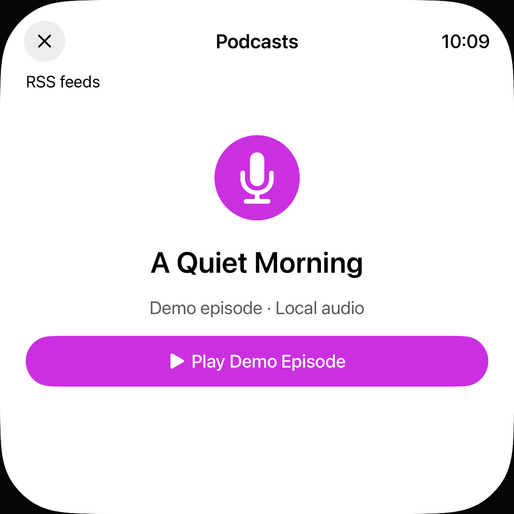

# Podcast: neun lokale Textfarben korrigiert

30. Oktober 2026 · begrenzter Teil von [#73](https://github.com/Olli0103/homeview/issues/73), kein vollständiger Accessibility-Abschluss.

## Befund und Änderung

Die unveränderten normalen nativen Aufnahmen des veröffentlichten Typografiestands liefern **20 negative Farbbedingungen**: zehn sekundäre Textzustände auf iPhone und iPad. Selbst ihr dunkelstes Vordergrundpixel erreicht höchstens4,004:1. Vier schwarze Kontrolltexte bleiben bei21:1. Der vorab festgelegte einheitliche Zielwert ist4,5:1; daraus folgt nicht, dass jeder große Text seine eigene Mindestanforderung verletzt.

Nur **neun lokale Farbzuweisungen** geändert: acht in `PodcastsView`, eine am Caption-Statustext. Der beobachtete Root-Hintergrund ist weiß; Schwarz mit65% Deckkraft ersetzt dort `.secondary`. Fonts, Layout, UITests, Modelle, Provider, geladener Cue-Renderer, native Feed-Eingabe und deaktiviertes Caption-Menü unverändert;164 andere Produkt-/Ressourceninputs bytegleich. Keine neue Abhängigkeit.

**Alle20 aktuellen Bedingungen bestehen mit6,897–7,005:1.** Gemessen an mindestens100 tatsächlichen neutralen Vordergrundpixeln pro nativer Zielregion; mindestens35% fast weißer Hintergrund, sRGB-Luminanz,100.-dunkelstes Pixel als Kernmetrik. Dunkelstes Pixel separat als Obergrenze. Keine Reskalierung, Ersatzfarbe oder Messung am schwarzen Außenrand; keine Ecke der verbundenen schwarzen Außenmaske trifft eine Zielregion. Die vier schwarzen Kontrollen bleiben21:1.

## Aktuelle Prüfungen

**Zwölf aktuelle UI-Ausführungen bestanden**, null Fehler/Skips: acht unveränderte Normal-/XXXL-Inventuren und vier bestehende Regressionen auf iPhone18Pro/iPadAir11-inchM4, iOS Simulator27.0/24A434. Die Inventuren starten keine Wiedergabe; eigener RSS-Fixture-Import liest gebündeltes XML ohne Netz. Die separaten Regressionen prüfen stumme eigene Bundle-Captions mit Playerlautstärke0, Off/Seek/Quellenwechsel und die echte OS-Appkarte samt genauer Rückkehr der synthetischen, ungesendeten RSS-Eingabe. Keine realen Konten/Quellen oder akustische Abnahme.

**22 vorab qualifizierte normale Außenvergleiche sind exakt RGBA-gleich**, darunter zwei ganze unveränderte Settings-Kontrollen. Die Farbregionen waren anhand vollständiger, unabhängig zugeordneter Rollenrahmen vor dem Edit eingefroren, zuzüglich zwei nativer Rasterpixel für Antialiasing. Keine nachträgliche Maskenerweiterung oder Registrierung. Alle50 Zielrahmen und tatsächlichen Clips sind exakt gleich;28 weitere Scrollposen bleiben ausdrücklich für Außenvergleiche unqualifiziert. Kein pauschaler Gleichheitsnachweis aller50 ganzen Bilder.

Die unveränderten Schriftregressionen bestätigen erneut40/40 wachsende gemeldete Textausdehnungen und zwei positive Kontrollen. Acht Bedingungen ohne isoliertes AX-Textkind bleiben unbewiesen. Das sind keine40 zusätzlichen Fontkorrekturen. AX-Rechtecke können sichtbare Textfragmente sein; gespeicherte große Scrollausschnitte zeigen abgeschnittene Nachbar- und teilweise Zielzeilen. **Keine vollständige Literal-/Glyphenlesbarkeit und keine größte-Schrift-Kontrastabnahme behauptet.**

235 eingefrorene Quelleninputs: wiederverwendeter Vorherstand `f9839aaf…`, aktueller Stand `5c354c53…`. Null neue Vorher-UI-Ausführungen; vier bestehende normale Ausführungen und ihre beiden Inputarchive erneut bytegeprüft. Sechs neue UI-Inputarchive und das SDK-Archiv vollständig zurückgelesen, installierte App-/Runnerbytes vor/nach Läufen geprüft. **Fünf aktuelle SDKs/73 Outputs und sechs Tooling-Tests bestanden.** 89 Core-/Package-/Coretestinputs zum historischen405-Test-Stand `0c42086` bytegleich, kein neuer Core-Lauf.

220 neue native PNGs dekodiert,100 vorhandene normale PNGs kopiert und hashgleich zurückgelesen. Zwölf neue eigene Inventur-Kontaktbögen, zwei Regressionstafeln und zwei Farbtafeln tatsächlich gesichtet.100 neue ganze Bildschirmduplikate der Inventuren nur dekodiert, nicht einzeln gesichtet. Zwölf unmodifizierte eigene Viewports mit Herkunft/SHA-256 veröffentlicht. Zwei Schriftcontroller/sechs Präferenzwrites einschließlich Rückstellungen stellen jeweils das Original `large` wieder her und lesen es zurück.

Der aktuelle UI-App-Lane enthält tatsächlich22 Dateien wie das Standard-iOS-SDK-Paket, einschließlich SSU/NLU; kein fehlendes Metadatenfile in diesem Build. Das ist kein neuer Shortcut-/OS-Aufrufnachweis. Strukturierte XCTest-Warnungen leer; vorhandene rohe AX-Loader-/`noURL`-/Remote-AX-Meldungen erhalten. Keine echte Hilfsmittel-, Original- oder physische Abnahme.

**#73 bleibt OPEN/F103 partial/parity=false.** Home-Sperre, Geräte-/Signing-Pause und Snoopy-Ausschluss unverändert. Weitere umsetzbare Arbeit folgt.

[Quellen, Messungen, Archive und Lanes](verification/podcast-contrast.json) · [Eigene native Bilder/SHA-256](verification/podcast-contrast-images.json).
