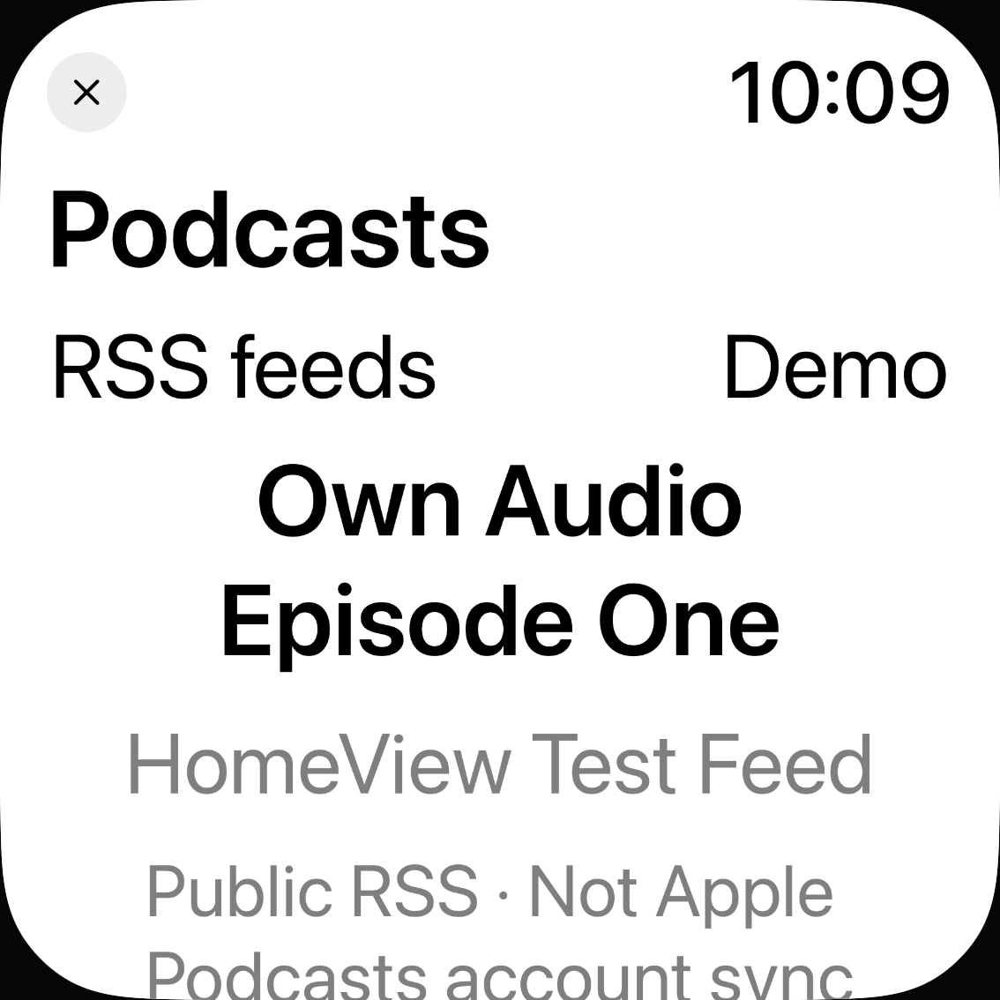
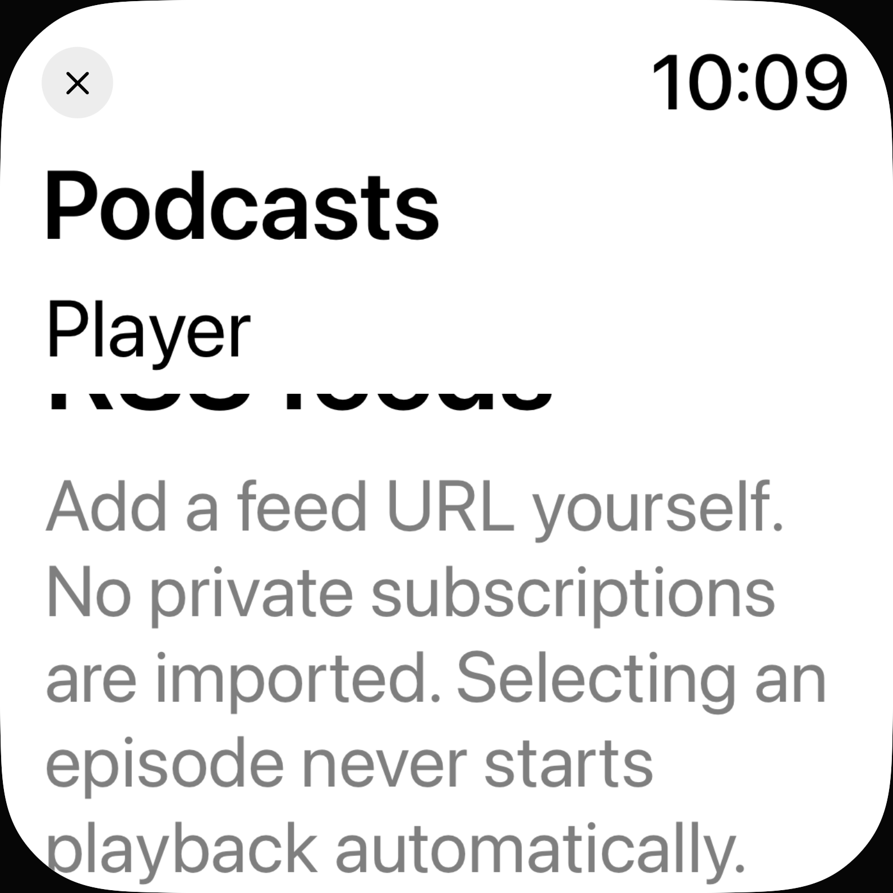

# Podcast-UI: Systemschrift bei unveränderter Normalansicht

30. Oktober 2026 · begrenzter Teil von [#73](https://github.com/Olli0103/homeview/issues/73); keine vollständige Accessibility-/Leseabnahme.

## Tatsächlicher Befund und Umfang

Acht funktionale Vorherausführungen bestanden, aber **40 native Textausdehnungsbedingungen blieben bei größter Schrift bei1,00**. Zwei semantische Settings-Kontrollen wuchsen korrekt. Acht weitere Bedingungen haben kein isoliertes AX-Textkind; gepolsterte Controlrahmen wurden nicht als Fontmetrik verwendet. Feld, Load und Remove waren schon vorher sichtbar größer und behalten ihre bestehenden semantischen Fonts.

Nur `PodcastsView` in `Controls.swift` sowie Menü-/Statustext in `PodcastCaptionControls` geändert: **17 lokale skalierende Metriken**, große Header-Anordnung und bei Accessibility-Schrift vertikale Menü-/Hinweisanordnung. Bestehender Scrollbereich, normale Anordnung, Farben, Datenmodell, Quellen, Import-/Auswahl-/Abspielregeln und der geladene Cue-Renderer unverändert. 164 andere Produkt-/Ressourceninputs sowie `Controls.swift` außerhalb der Podcast-View bytegleich. Native SwiftUI-Werkzeuge reichen; keine neue Abhängigkeit.

**Aktuell40/40 gemeldete Textausdehnungen grün**, Höhen1,343–8,586-fach einschließlich Umbruch und sichtbarer AX-Fragmentgrenzen. Das sind weder40 verschiedene neue Fonts noch isolierte Schriftfaktoren. Acht fehlende Textkind-Bedingungen bleiben unbewiesen, einschließlich der nun lokal skalierten RSS-Navigation.

## Geprüft

**Zwölf aktuelle UI-Ausführungen/vier Methoden bestanden**, null Fehler/Skips:

- Acht neue Normal-/XXXL-Ausführungen auf iPhone18Pro/iPadAir11-inchM4, iOS Simulator27.0/24A434. Demo, leere RSS-Ansicht, expliziter eigener XML-Import, Auswahl ohne Autoplay, Demo-Rückkehr und Feed-Entfernung. Kein Play-/Medienladeaufruf in diesen Inventuren; Fixture-Transport liest gebündeltes XML ohne Netz.
- Vier separate bestehende Regressionen: echte eigene Bundle-Captions mit `--mute-podcast-fixture`/Playerlautstärke0, erster/finaler Marker, Off, Seek und Quellenwechsel; außerdem tatsächliche OS-Appkarte und genaue Rückkehr der nicht abgesendeten synthetischen Feed-Eingabe. Keine realen Quellen/Konten und keine akustische Abnahme. Normalgröße, keine größte-Schrift-Abnahme geladener Cue-Texte.

**Alle50 ganzen normalen nativen RGBA-Paare exakt gleich**, ebenso50 Zielrahmen und tatsächliche Clips. Keine Toleranz, Maske, Registrierung oder Reskalierung. Zwei positive Settings-Paare sind enthalten. Exakte Bildidentität erlaubt ausdrücklich die Wiederverwendung der sechs bereits gesichteten normalen Vorher-Kontaktbögen; die50 Nachher-Viewports werden nicht als neue unabhängige Sichtungen gezählt.

Vorher und aktuell dieselbe neue UITestquelle;235 Inputs je eingefrorenem Stand: Vorher `52949a2c…`, aktuell `f9839aaf…`. Installierte App-/Runnerbytes vor/nach den Läufen geprüft. **Fünf aktuelle SDKs/73 Produktdateien und sechs Tooling-Tests grün** am aktuellen Quellenpin. 89 Core-/Package-/Coretestinputs zum historischen405-Test-Stand `0c42086` unverändert, kein neuer Core-Lauf. Gesamthistorie20 UI-Ausführungen/20PASS; die40 roten Vorher-Messbedingungen bleiben davon getrennt. Ein falscher Vorbereitungsanker stoppte vor jedem Edit; der anschließende Build ohne neue Tests wird als unbenutzte Vorbereitung erhalten, nicht als UI- oder Produktfehler.

Zehn UI-Inputarchive plus SDK-Archiv vollständig zurückgelesen.420 native PNGs dekodiert; zwölf Vorher- und sechs neue große eigene Viewport-Kontaktbögen sowie zwei Regressionstafeln tatsächlich gesichtet.200 ganze Bildschirmduplikate der Inventuren nur dekodiert, nicht einzeln gesichtet. Zwölf unmodifizierte eigene Viewports mit SHA-/Herkunftsmanifest veröffentlicht. Vier Schriftcontroller/zwölf Präferenzwrites einschließlich Rückstellungen stellen jeweils Original `large` wieder her und lesen es zurück.

## Grenzen bleiben sichtbar

AX-Rechtecke können sichtbare Fragmente umbrechender Texte abbilden; rechteckige Clip-Enthaltenheit beweist keine vollständige Literal-Lesbarkeit im gespeicherten Pixelbild. Die beibehaltenen Scrollposen zeigen abgeschnittene benachbarte und teilweise Zielzeilen. Die RSS-Erklärung war bereits vorab als Ausschnitt deklariert. Je84 konservative native Zielrechtecke überschneiden die vom schwarzen Außenrand verbundene Maske nicht; **das ist kein vollständiger Glyphen-/Wort-/Flow-Lesenachweis und kein Grund für erfundenes Produkt-Padding**. Wachstumsbedingungen bleiben berichtete AX-Ausdehnungen; kein stilles Umdeuten zur vollständigen Lesbarkeit.

UI-Test-App19 Dateien gegenüber22 im frischen Standard-SDK-iOS-Paket: fehlende drei UI-SSU/NLU-Dateien bleiben getrennt, kein neuer Shortcut-Paket-/Runtime-PASS. Strukturierte XCTest-Runtimewarnungen leer; vorhandene AX-Loader-/`noURL`-/Remote-AX-Rohmeldungen erhalten. Farben unverändert, keine neue Kontrast-, akustische, echte Hilfsmittel-, Original- oder physische Abnahme.

**#73 bleibt OPEN/F103 partial/parity=false.** Home-Sperre, Geräte-/Signing-Pause und Snoopy-Ausschluss bleiben bestehen. Weitere umsetzbare Arbeit folgt.

[Quellen, Messungen, Archive und getrennte Ausführungslanes](verification/podcast-controls-dynamic-type.json) · [Eigene native Bilder/SHA-256](verification/podcast-controls-dynamic-type-images.json).
