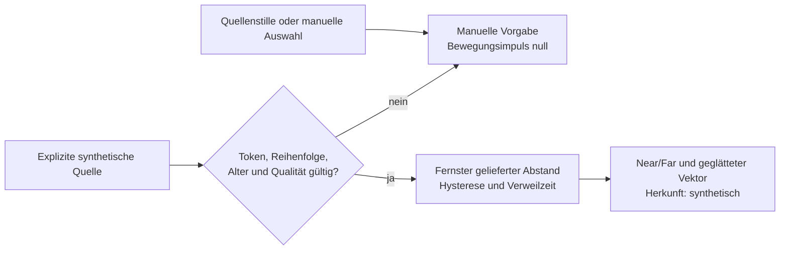

# Distanz und Bewegung: Quellen und synthetische Policy

20. Oktober 2026. Recherche und ausdrücklich **synthetische** Abnahme von #10. Echte Sensorquelle und automatische UI-Anbindung sind nicht implementiert; F010/F016 bleiben ohne Live-/Original-PASS.

## Öffentliche Möglichkeiten, nicht behauptete Messwerte

| Kandidat | Belegtes Angebot | Grenze für dieses Projekt |
|---|---|---|
| [Vision 3D Body Pose](https://developer.apple.com/documentation/vision/identifying-3d-human-body-poses-in-images) | iOS 17/macOS 14; 17 Gelenke, `cameraRelativePosition` und `cameraOriginMatrix` zur Abstandsschätzung. Funktioniert auch ohne Tiefendaten; Tiefe verbessert die Genauigkeit. | Der geprüfte Request liefert nur die prominenteste, typischerweise nächste Person. Körperkoordinaten haben ihren Ursprung an der Hüfte. Ohne passende Tiefe verwendet die Höhenabschätzung eine Referenz von 1,8 m. Das ist kein kalibrierter Abstand aller Personen zum Display. |
| [AVFoundation/LiDAR](https://developer.apple.com/documentation/avfoundation/capturing-depth-using-the-lidar-camera) | Synchronisierte Video-/Tiefendaten auf unterstützter Hardware; Apple nennt unter anderem geeignete iPad-Pro-Modelle. | Exaktes physisches Zielgerät, Kameraausrichtung, Kalibrierung, Berechtigung und Genauigkeit sind ungeprüft. Es wurde keine Kamera gesucht, geöffnet oder gestartet. |
| [Nearby Interaction](https://developer.apple.com/documentation/nearbyinteraction) | Entfernung/Richtung beteiligter UWB-Geräte und unterstützter Accessoires; Tokens und Datenverbindung. Öffentliche Hintergrundoption ab iOS 18.4 mit Live Activity. | Geräteabstand ist keine passive Erfassung aller Menschen oder deren Identität. Zielhardwarefähigkeit unbekannt. Keine Session, Tokenübertragung, Discovery oder Live Activity ausgelöst. |
| [Core Motion](https://developer.apple.com/documentation/coremotion) | Daten der verfügbaren Gerätehardware: unter anderem Beschleunigung, Drehrate und Lage. | Bewegt sich ein aufgestelltes iPad nicht, folgt daraus nichts über Menschen im Raum. Gerätebewegung wird nicht als Raumbewegung ausgegeben. Keine Sensorabfrage. |
| [UIDevice-Proximity](https://developer.apple.com/documentation/uikit/uidevice/proximitystate) | Boolescher Näherungszustand. | Kein Meterabstand oder zuverlässiger Raumbeleg. Keine Überwachung eingeschaltet. |
| [MediaPipe Pose Landmarker](https://ai.google.dev/edge/mediapipe/solutions/vision/pose_landmarker/ios) | Gepflegte quelloffene Option; konfigurierbare Pose-Anzahl und normalisierte/3D-Landmarks. World-Landmarks sind in Metern, aber mit Hüftmittelpunkt als Ursprung. | Kein direkt zurückgegebener Displayabstand. Kalibrierung und Modell-/Hardwarequalität blieben separat zu prüfen. Nicht installiert, gebaut, ausgeführt oder übernommen. |

Der [WWDC-Beitrag](https://developer.apple.com/videos/play/wwdc2023/111241/) bestätigt die Trennung zwischen einem 3D-Skelett der prominentesten Person und Personensegmentierung mehrerer Menschen. Eine Mehrpersonen-Segmentierungsfähigkeit ist kein Nachweis, dass derselbe 3D-Request gleichzeitig alle Abstände liefert.

Vor Eigenbau wurden die tatsächliche MediaPipe-Repositorybeschreibung, README und Apache-2.0-Lizenz gelesen, nicht nur eine Paketkarte. Das Repository war am Prüftag gepflegt. Die README beschreibt lokale Verarbeitung der Eingaben sowie Performance-/Nutzungsmetriken an Google. Es wurde weder eine Laufzeit-/Hostkompatibilität noch die Lizenz eines heruntergeladenen Modellpakets behauptet; keines wurde heruntergeladen. Keine neue Abhängigkeit oder fremder Implementierungscode wurde übernommen. Die nativen Apple-Bausteine sind Kandidaten für spätere Sensorarbeit; keiner ersetzt die hier benötigte app-eigene Zeit-/Hysterese-/Quellenpolitik.

Das konkrete physische iPadmodell ist in diesem Prüfstand nicht festgestellt. Deshalb wird keine Kamera-/LiDAR-/UWB-Unterstützung dieses Geräts behauptet und aus einer fehlenden Prüfung auch keine generelle Unmöglichkeit abgeleitet.

## Eigene Modellschicht ohne Sensorstart

`AnonymousPresencePolicy` verarbeitet ausschließlich explizit eingespeiste **synthetische** Werte. Sie ist nicht an AppModel, Control Center, FlowArtwork oder einen Sensoradapter angeschlossen. Der bestehende Far/Near-Schalter und Flow-Touch bleiben unverändert. Die Policy startet weder Kamera noch Sensor, Timer, Berechtigungsdialog, Netzverbindung oder persönliche Freigabe.

Das Modell enthält keine Namen, Profile, Gesichtsmerkmale oder Personenkennungen. Ein kurzlebiger Source-Token dient nur zur Entwertung eines ersetzten Datenlieferanten. Er ist kein Identitäts- oder Authentifizierungsnachweis. Distanz und Bewegungsvektor dürfen keine Geräteentsperrung oder Sicherheitsaktion autorisieren.

**Eigene Versuchswerte, keine rekonstruierten Apple-Konstanten:**

- Near bei höchstens 1,25 m, Far ab 2 m; dazwischen bleibt die bisherige Klasse erhalten. Wechsel erst nach einer Sekunde und mindestens drei eindeutigen aufeinanderfolgenden Messungen; maximal 0,5 s Abstand zwischen solchen Messungen.
- Der fernste **gelieferte** gültige Abstand bestimmt die Lesbarkeitsklasse. Für jede im gelieferten Frame gemeldete Erkennung muss eine Schätzung vorliegen; sonst manueller Rückfall. Dies beweist weder Vollständigkeit des Detektors noch Personen außerhalb des Bildes oder hinter Hindernissen. Der einzelne Vision-3D-Request wäre daher kein fertiger Mehrpersonenadapter.
- Eigene Eingabegrenzen: 0,25–10 m, Qualität 0,75–1, höchstens 16 Beobachtungen, Capture-Alter höchstens 0,5 s. Diese Qualitätswerte sind kein Beweis realer Messgenauigkeit.
- Source-Token, steigende Sequenz und Capture-Zeit sowie endliche monotone Empfangszeit verwerfen alte Antworten. Ein alter Lieferant darf die Uhr des neuen nicht vorverstellen. Ein späterer Adapter muss Capture- und Empfangszeit in dieselbe monotone Zeitbasis überführen.
- Leere, unvollständige oder ungültige Daten bedeuten **unbekannt**, nicht „niemand anwesend“. Der Rückfall ist die manuelle Vorgabe mit Bewegungsimpuls null. Drei Sekunden Quellenstille führen ebenfalls dorthin; Erholung braucht frische Verweilzeit. Der spätere Besitzer müsste die explizite `tick`-Schnittstelle bedienen; das Modell startet keinen Hintergrundtimer.
- Endliche normierte Bewegungswerte werden komponentenweise auf ±1 begrenzt und zeitbasiert geglättet. Erster Frame, zu großer Abstand und Quellenverlust setzen den Impuls zurück. Das ist weder aus Core Motion abgeleitete Menschenbewegung noch ein behaupteter Apple-Flow-Algorithmus.
- Eine manuelle Auswahl entwertet den Source-Token. Eine verspätete synthetische Antwort darf die Auswahl nicht überschreiben.

## Tatsächlich ausgeführte Prüfung

| Lane | Ergebnis |
|---|---|
| Core-XCTest-Paket | **320 Tests**, 17 neue Policy-Fälle; keine Fehler oder Skips |
| Separat kompilierter tatsächlicher Policy-Verlauf | **20 synthetische Zeilen / 114 Assertions bestanden** |
| SDK-Builds | iOS, macOS, tvOS, visionOS, watchOS erfolgreich. Die neue Policy gehört zum Haupttarget; der reduzierte Watch-Build ist nur Regression, keine Policy-Ausführung auf der Watch. |
| Öffentliche API-Deklarationen | Zwei qualifizierte Typechecks: iOS-Simulator und macOS. Funktionen ohne Aufruf, keine Objekte/Requests/Sessions erzeugt oder ausgeführt. |
| UI/Sensor/Hardware | **0 neue Ausführungen**; kein Pixel-, Energie-, Entfernungs- oder Live-Präsenz-PASS |

Die erste macOS-Deklarationsprobe scheiterte, weil `AVCaptureDepthDataOutput` dort ausdrücklich nicht verfügbar ist. Die korrigierte Probe begrenzt diesen Capture-Output auf iOS; `AVDepthData` und Vision-Verarbeitung vorhandener Daten bleiben auf macOS positiv geprüft. Der anfängliche Fehler bleibt dokumentiert und wird nicht nachträglich als geplante negative Prüfung gezählt. Eine zunächst abgeschnittene MediaPipe-iOS-Seite wurde nicht als Beleg akzeptiert; die anschließend vollständig gelesene Seite ist separat gebunden.

Der [Verlauf](verification/presence-policy-trace.json) schaltet nach Mehrpersonen-Far-Dwell zu Far, hält im Hystereseband, wechselt erst nach Near-Dwell zurück, fällt bei schlechter Qualität und Stille manuell zurück, erholt sich nach frischer Verweilzeit und schützt eine manuelle Auswahl vor alten Antworten. Eine ausdrücklich adversarielle Zeile liefert mit einem **alten** Token eine Zeit von 1000; diese wird ignoriert, die neue Quelle akzeptiert danach weiterhin ihre eigene Zeit 8. Das ist erfundene Testzeit, kein realer Sensortakt.

App-, Shared-, Ressourcen-, UI-Test- und Paketdateien sind gegenüber dem Ausgangsstand bytegleich. Nur die neue Core-/Testdatei und ihre generierte Xcode-Projekteinbindung ändern kompilierte Inputs. [209-Dateien-Manifest](verification/presence-policy-source.json), Digest `695f4b74f06afa5616ae812b51ed5eab711f6221d97bdb3fdde8675d76ce1c67`; Basis `73e4ab25e8c42cb74c5bc04e8e9e358f2a430e1c`.

[Quellen, eingefrorener Vertrag, Plattformgrenzen und bytegeprüfte Archivquittungen](verification/presence-policy.json). Der unabhängige Verlauf und die Deklarationsprobe liegen als eigene unverbundene `.swift.txt`-Dateien daneben. Es werden keine Apple-SDK-Header, Originalbilder, Modelle oder fremden Beispielprojekte verteilt.

## Abschluss dieses Recherchepakets, nicht der Originalfunktion

Die vier ursprünglichen Aufgaben sind durch öffentliche Kandidatenprüfung, das kennungsfreie Modell, definierte Hysterese/Mehrpersonen-/Quellenverlustfälle und unveränderten manuellen App-Standard abgedeckt. Die ausdrücklich synthetische Issue-Abnahme ist dokumentiert und ausgeführt. Deshalb kann das **Recherche-/Modellpaket** abgeschlossen werden.

Ein echter Adapter, ausgewählte Hardware, bewusst erteilte Berechtigung, Kamerakalibrierung, Erkennungsfehler/Mehrpersonenabdeckung, Vordergrund-/Abbruchverhalten und Energieverbrauch bleiben getrennte Implementierungs-/Abnahmearbeit. Keine automatische Quellenwahl oder dauerhafte Kamera als stiller Default. F010/F016 bleiben `research`, `parity_accepted=false` und mit offenen funktionalen/visuellen/Gerätekriterien erhalten. Keine Home-Anbindung oder tatsächlichen persönlichen Sensor-/Kontodaten.
