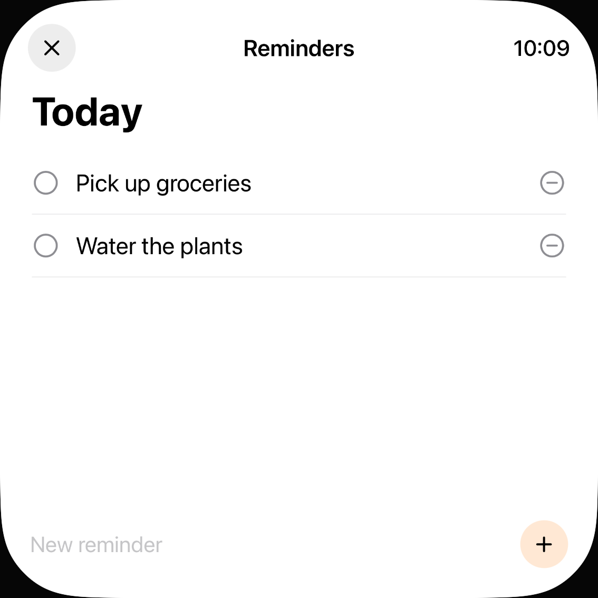
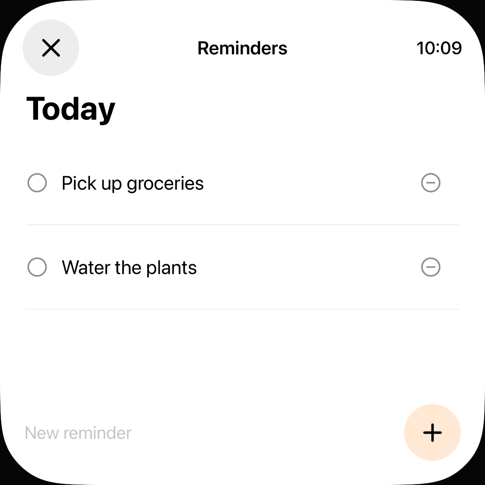
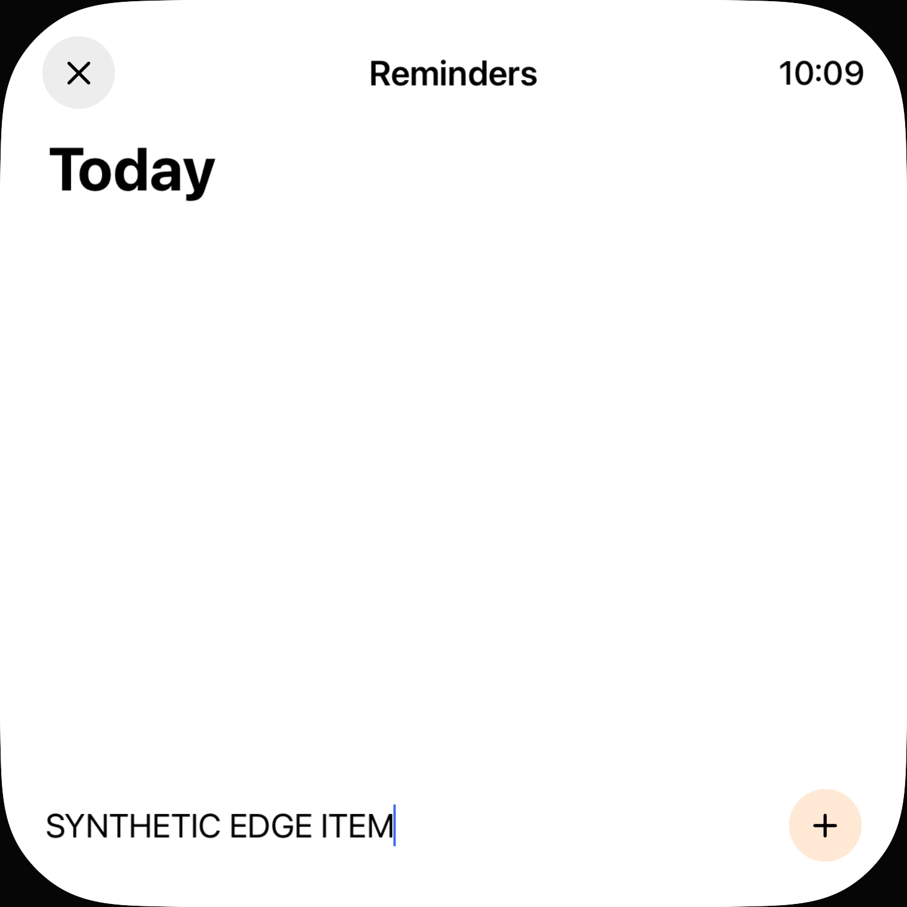
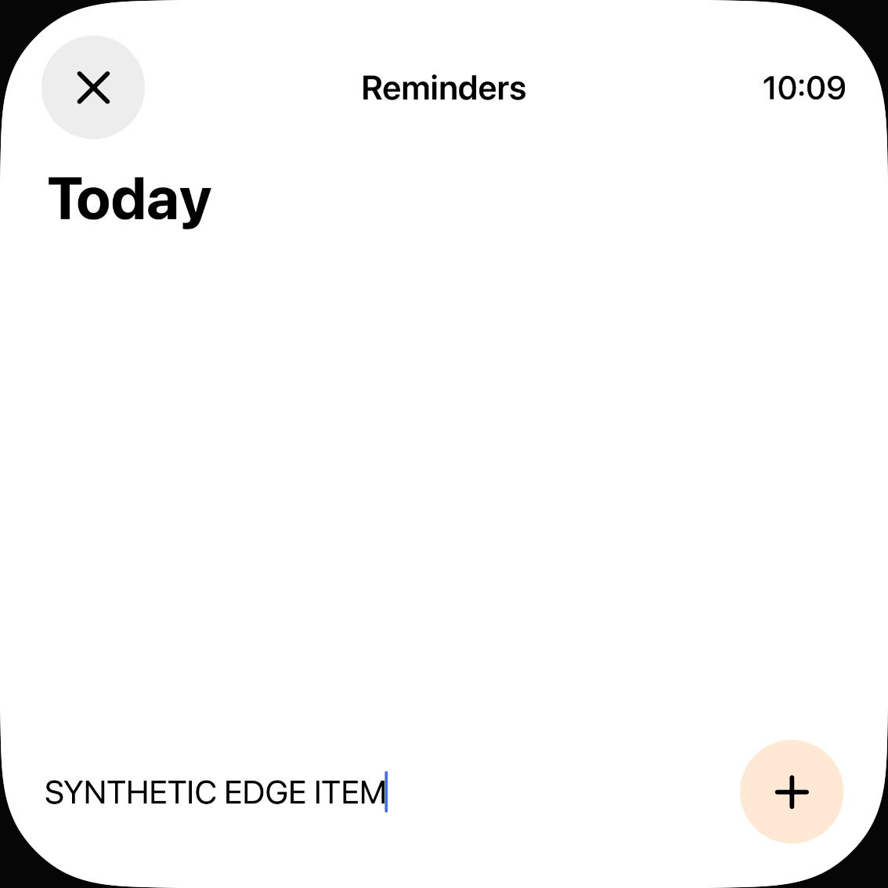

# Lokale Erinnerungen: Ziele und Schreibfokus

20. Oktober 2026 · [#73](https://github.com/Olli0103/homeview/issues/73) · [Prüfbericht und eigene Bilder](verification/reminder-hit-regions.json)

## Reproduzierte Fehler

Die unveränderte lokale Erinnerungsansicht wurde mit zwei eigenen Demoeinträgen, leerer Liste und sichtbarer Tastatur geprüft. Der öffentliche `.hitRegion`-Audit wurde ohne Ausnahmen ausgeführt: Alle gemeldeten Befunde wurden gesammelt, danach wurde eine leere Liste verlangt. Auf dem iPhone meldet der Vorherstand fünf Befunde in der gefüllten Liste und mit Tastatur: beide Erledigen-Schaltflächen, beide Löschknöpfe und das Eingabefeld. Leer bleibt ein Eingabefeld-Befund. Die drei iPad-Auditlisten sind bereits vorher leer; das ist kein Nachweis einer strengen 44-Punkte-Mindestgröße.

Ein zusätzlicher echter Randtest verlangt vor dem Tap ein sichtbares, vollständig im Viewport liegendes Ziel mit mindestens 44 × 44 nativen Punkten und Hittable-Status. Der erste Löschknopf misst vorher nur 31,84 Punkte auf dem iPad und 15,12 auf dem iPhone. Beide Prüfungen stoppen **vor** diesem ersten Tap; vorher wurde dort keine Lösch-Randaktion geliefert.

Die erste Korrektur vergrößert die Ziele und besteht alle sechs öffentlichen Audits. Der weiter unveränderte Randtest deckt aber den nächsten Fehler auf: Der obere Rand des nun 44 Punkte hohen Textfeldrechtecks setzt keinen Schreibfokus. Native Texteingabe scheitert auf beiden Geräten mit „Neither element nor any descendant has keyboard focus“. Davor sind ursprüngliches Löschen, Erledigt → Unerledigt und Leeren der Liste erfolgreich. Dieser fehlgeschlagene Produktstand bleibt separat archiviert; große Accessibility-Rechtecke werden nicht als genügender Interaktionsnachweis ausgegeben.

## Begrenzte Korrektur

Nur `Everyday.swift / RemindersView` wird verändert:

- Eintrags- und Löschlabels sowie Eingabefeld besitzen eine vom tatsächlichen Canvas-Transform abgeleitete native Mindestfläche. Rechteckige Content-Shapes gelten für die tatsächlichen Labels, nicht nur einen äußeren dekorativen Rahmen.
- Add und Close verwenden den bereits vorhandenen Größenparameter; Symbole/Kreise dürfen auf kleinen Displays wachsen. Keine globale Änderung an `RoundButton`, `AppHeader`, dem Canvas oder anderen App-Ansichten.
- Erledigte Einträge erhalten ein ausdrücklich lesbares Completed / Not completed. Das ist ergänzende Quellcode-Härtung und im finalen App-Test beobachtbar; es wird kein gesonderter ursprünglicher VoiceOver-Fehler behauptet.
- Das ganze Eingabefeld bekommt eine explizite Fokusbindung; ein Rand-Tap soll fokussieren, nicht senden. Die normale Zeichenbearbeitung bleibt beim SwiftUI-Textfeld.

Speicherung, Profile, Authentifizierung, ursprüngliche Titel, Eintrags-IDs und Add-/Toggle-/Delete-Algorithmen sind unverändert. Kein EventKit-Adapter und keine echte Erinnerungsliste wird verbunden.

## Abschließender Nachweis

Acht aktuelle UI-Ausführungen bestanden, vier Methoden auf beiden Geräten. Sechs vollständige öffentliche Auditlisten leer; 16 echte Zwei-Punkte-Rand-Taps mit nativen Mindestmaßen und tatsächlichen Folgezuständen erfolgreich. Auch Eingabefokus, Softwaretastatur, exakter neuer Eintrag, getrenntes Add, Löschen und Schließen sind damit in den gestarteten Simulator-Apps belegt. Keine Hilfsmittel- oder Geräteabnahme daraus abgeleitet.

Historie getrennt: Vorherstand 3 PASS / 5 FAIL, erster Produktstand 6 PASS / 2 FAIL, aktueller Stand 8 PASS / 0 FAIL; insgesamt 24 UI-Ausführungen, 17 erfolgreich, sieben historische Fehler. Keine Skips oder strukturierten Runtime-Warnungen. Der frühere Fokusfehler bleibt FAIL, nicht nachträglich umetikettiert.

Fünf SDK-Builds des aktuellen Produktstands bestanden. 206 Quellen und je 28 App-/Widget-/Test-/Metadaten-/Starteingaben samt installierter Appbytes gebunden; drei Archive mit jeweils 234 Einträgen vollständig zurückgelesen. 56 PNGs dekodiert, sechs Übersichten und vier zusätzliche Vollbilder gesichtet; 16 eigene Vorher-/Nachherbilder im Bericht. 72 Core-/Coretest-Dateien sind bytegleich zum historischen 301-Test-Lauf bei `2b223b7`; kein neuer Core-/nativer Modelllauf behauptet.

## Eigene Aufnahmen

| iPhone vorher | iPhone nachher |
| --- | --- |
|  |  |

| Eingabe vor bewusstem Add: iPad | Eingabe vor bewusstem Add: iPhone |
| --- | --- |
|  |  |

## Grenzen

Dies betrifft die lokale Demoliste. Verbundene Geräte-Erinnerungen, schreibgeschützte Listen, andere Personen, lange/mehrzeilige Titel, große Schrift und Offscreen-Listen sind nicht durch diese Auswahl abgenommen. Die öffentliche Flächenprüfung ist keine vollständige Accessibility-Prüfung: echte VoiceOver-/Voice-Control-/Switch-Control-/AssistiveTouch-, Fokusreihenfolgen-/Ansage-, Kontrast-, Hardware- und Originalabnahme fehlen weiterhin. Gleiche Titel können weiterhin gleiche sprachliche Namen haben.

Keine behauptete Pixelgleichheit: größere Ziele ändern Zeilenhöhe, verfügbare Breite und teilweise die sichtbare Schaltflächengröße. Keine neue Original-Parity. **#73 bleibt OPEN; F103 partial/parity=false.** Keine privaten Daten, Geräteberechtigungen, OS-Alarme, Wiedergabe, Nachrichten oder Anrufe, keine Home-Anbindung.
