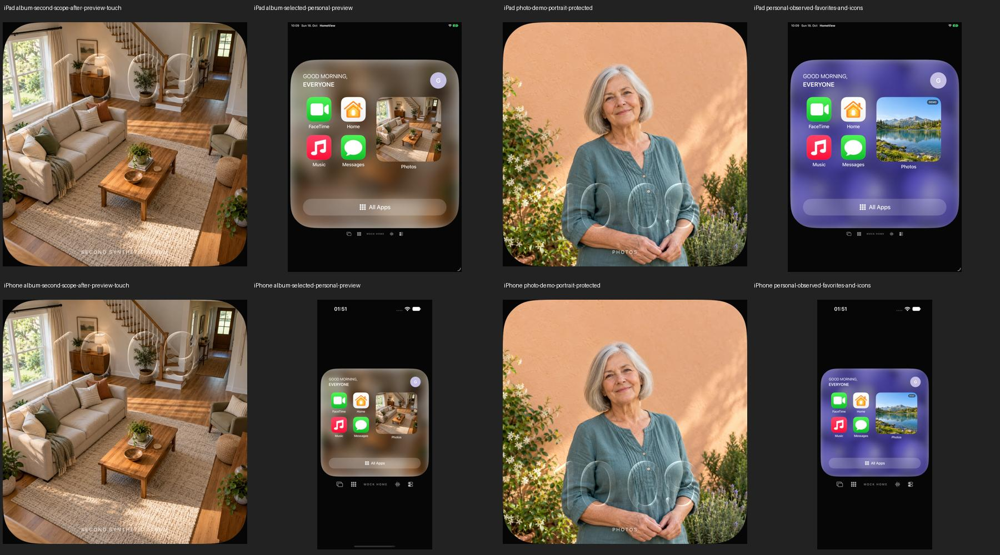

# Ausgewähltes Album auf dem gemeinsamen Bildschirm

18. Oktober 2026. Umsetzung zu [PHOTO-01, #11](https://github.com/Olli0103/homeview/issues/11).
Code: [d3bee86](https://github.com/Olli0103/homeview/commit/d3bee86b265ce64cab98a6c5fd0d569b8d3ca096),
integriert in [6994bde](https://github.com/Olli0103/homeview/commit/6994bde8db180bad27baa86e6941925c5792472f).
Dies ist eine begrenzte Funktionsabnahme, keine Original- oder Geräteabnahme.

## Zwei getrennte Freigaben

Die private Liste geteilter Alben öffnet sich erst nach Geräteauthentifizierung.
Eine OS-Fotofreigabe oder ein gewähltes Demo-Profil genügt nicht. Eine verspätete
Berechtigungsantwort darf nach Sperre keine Liste mehr lesen oder anzeigen.
Beim Verlassen der Einstellungen wird die Liste verworfen; Hintergrund und
persönliche Sperre invalidieren zusätzlich die zugehörigen Sitzungen.

Einmaliger Import und laufende Anzeige sind unterschiedliche Aktionen.
„Keep updated on this display“ wählt ausdrücklich genau ein zuvor angezeigtes
Album als Quelle für den gemeinsamen Bildschirm. Der Hinweis erklärt, dass
neue Bilder dieses Albums dort erscheinen und höchstens zehn Kopien bleiben.
Diese exportierten Bildschirmbilder sind nicht der private Albumkatalog.
Die bestätigte Quellenwahl bleibt lokal gespeichert. Beim nächsten Vordergrund
darf ausschließlich diese Quelle aktualisiert werden, ohne den Katalog erneut
zu enumerieren oder eine Berechtigung anzufordern.

## Begrenzte Aktualisierung

Vorhandene öffentliche PhotoKit-APIs liefern geteilte Alben, ausgewählte
Sammlungen, begrenzte Bildanfragen und Änderungsbeobachtung. Dafür ist keine
zusätzliche Bibliothek nötig. Es wird weder eine eigene Cloud-Synchronisation
noch ein Hintergrunddienst gebaut.

Während HomeView aktiv ist, markieren Änderungssignale die bekannte Quelle als
veraltet. Automatische Leseversuche sind über monotone Prozesszeit auf höchstens
einen Versuch je 30 Sekunden begrenzt; ohne Signal gibt es kein fortlaufendes
Polling. „Update now“ ist ein ausdrücklicher erneuter Versuch. Inaktivität und
Hintergrund lösen Beobachter und laufende Bildanfragen. Im Hintergrund wird
nicht gelesen. Eine Geräteauthentifizierungsaufforderung darf die Szene
vorübergehend inaktiv machen, ohne ihre eigene Anmeldung zu widerrufen.

PhotoKit liest höchstens die zehn neuesten Bilder des ausgewählten geteilten
Albums. Bildanfragen haben höchstens 20 Sekunden, der Bildabruf insgesamt
45 Sekunden Zeitbudget. Jede Kopie ist auf fünf MB, der Satz auf 30 MB begrenzt.
Ein vollständiges begrenztes ID-Fenster entscheidet, welche bisherigen Kopien
noch zum Album gehören: entfernte Bilder verschwinden auch dann, wenn andere
Bilder vorübergehend offline sind. Es werden keine weiteren Alben oder
beliebige Bibliotheksbestände für Ersatzbilder durchsucht.

Quellenwechsel, Trennen und Pausieren invalidieren ältere Antworten,
Fehlermeldungen und Aufräumaktionen. Entzogene Berechtigung oder nicht mehr
erreichbare Quelle beendet die Verbindung und entfernt die verknüpften Kopien.
Andere Abruffehler behalten die letzten zulässigen Kopien und zeigen einen
Fehlerstatus; sie werden nicht als frische Fotos etikettiert.

## Speicherung und Darstellung

Neue UUID-Dateien werden vor einer atomaren Metadatenumschaltung geschrieben.
Bei Speicherfehlern bleibt die vorherige Auswahl erhalten. Nach erfolgreicher
Umschaltung werden nicht mehr verwendete eigene Dateien entfernt.
Neue Speicherstände unterscheiden einzelne Fotos, Galerien, verknüpfte Alben
und eine bewusst leere Auswahl. Eine alte Einzeldatei darf weder gelöschte Fotos
noch ein leeres Album wieder auffüllen. Nicht sicher lesbare zukünftige
Speicherstände bleiben schreibgeschützt.

Ein bekanntes leeres Album zeigt einen leeren Zustand statt erfundener
Demo-Fotos. Die persönliche Home-Vorschau verwendet die tatsächlich ausgewählte
Kopie. Eine manuelle neue Foto-/Galerieauswahl beendet die bisherige laufende
Albumverbindung.

## Nachweise und Grenzen

Automatisierte Ausführungen konstruieren ausschließlich einen synthetischen
Albumprovider mit eigenen Demo-Bildern, keinen PhotoKit-Provider. Kontrollierte
Modelltests unterscheiden Permission, Geräteauthentifizierung und Datenlesen
sowie späte Erfolge, Fehler und Cleanup nach Sitzungswechseln.
Die 130 gebundenen Quellen haben SHA-256
4752c60279a7a31c952c4a54a576ea9c561ab44473a2e481ca8daecc22af6b55.
Alle 128 Modelltests bestehen, erneut nach Featurecommit und Integration. Der
aktuelle gezielte UI-Schritt besteht mit vier Fällen je iPad und iPhone
(acht Ausführungen), null Fehlern, Skips oder Runtime-Warnungen. Er umfasst den
Quellenwechsel mit echter Foto-Button-Berührung, schreibgeschützte unbekannte
Speicherstände, Home-Raster/Fotomarke und eigene Demo-Fotos. Alle fünf SDKs
kompilieren: iOS, macOS, tvOS, visionOS und watchOS.

Der vorausgehende breite Speicher-/Foto-Checkpoint ist bewusst getrennt:
34 Ausführungen, davon 31 bestanden und drei fehlgeschlagen. Zweimal überschrieb
eine äußere Accessibility-Kennung die Kennung des sichtbaren Foto-Buttons.
Im iPad-Schreibschutzfall wurde die mittige Test-Ziehbewegung von einem Slider
abgefangen. Bildschirm und Accessibility-Snapshot haben die erste Ursache,
das aufgezeichnete Bild die zweite eingegrenzt. Explizite Container und kurze
Ziehbewegungen im Inhaltsrand korrigieren diese Stellen; die vollständige
Sichtbarkeitsprüfung und die erwarteten Daten-/Bedienergebnisse bleiben bestehen.
Nur Home-Screen-Accessibility und UI-Testnavigation unterscheiden diesen Stand
vom breiten Checkpoint. Die Album-/Speicherlogik und alle Core-Testeingaben sind
identisch. Der breite Lauf wird nicht nachträglich als vollständig grün oder als
aktuelle Vollsuite ausgegeben.

Eine zusätzliche kontrollierte Modellprobe hatte einen echten Freigabefehler
gefunden: bekannte Entziehung nach einer Pause wartete zunächst auf die
30-Sekunden-Abrufdrossel. Zwei Regressionen scheiterten am alten Code und bestehen
nach der Korrektur. Aktive Wiederaufnahme und die Bereitschaftsprüfung entfernen
widerrufene Kopien nun vor dieser Drossel. Hierfür gibt es weder Bibliothekslesen
noch eine neue Berechtigungsanforderung.

[Prüfbeleg mit getrennten Checkpoints](verification/selected-album-updates.json),
[aktuelle Quellen](verification/selected-album-source.json) und
[Bildmanifest](screenshots/goal-20261018/selected-album-manifest.json).
Alle eigenen Bilder wurden in den relevanten Zuständen gesichtet.

Echte iCloud-/Shared-Album-Konten, PhotoKit-Änderungslieferung auf Hardware,
physische Geräteauthentifizierung, App-Switcher-Snapshotverhalten sowie genaue
Originaloptik bleiben getrennte offene Abnahmen. Diese Funktion schaltet keine
HomeKit-Geräte und liest keine reale Fotobibliothek in den automatisierten Tests.
