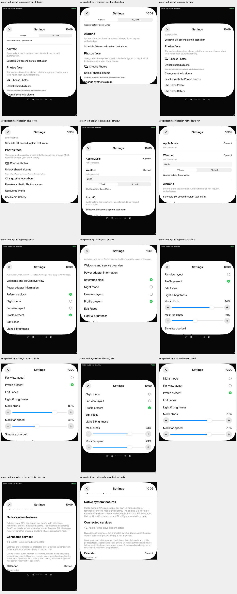
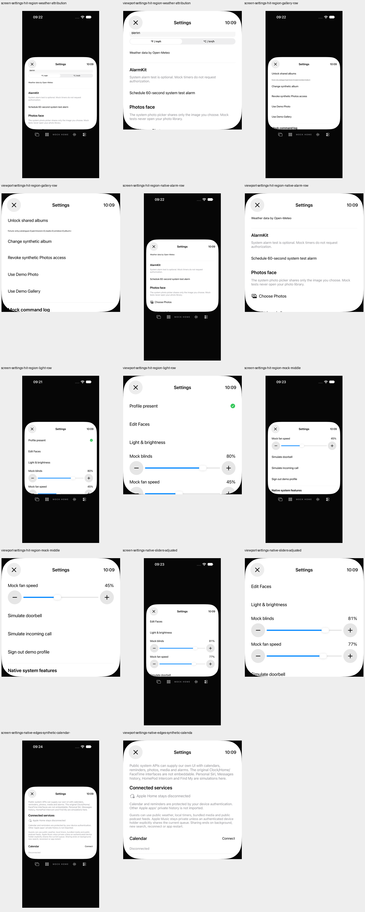

# Einstellungen: tatsächliche Touchflächen und Werte

20. Oktober 2026 · begrenzter Teilfix von [#73](https://github.com/Olli0103/homeview/issues/73). Das Gesamtissue bleibt offen.

## Reproduzierter Befund

Die ersten fünf ungefilterten öffentlichen Hitflächen-Audits bestehen auf iPad und scheitern auf iPhone: 31 Befunde bei 22 unterschiedlichen Controls. Die ergänzende Mock-Mitte liefert auf iPhone fünf weitere Befunde, darunter beide Schieberegler. Es wurden keine Auditbefunde ausgeblendet. Leere Listen garantieren keine 44 Punkte: Die zusätzliche native Randprüfung findet auch auf iPad zu kleine Texttasten und auf iPhone den nur 30,24 Punkte großen Close-Button. Boolean-Einstellungen haben keinen auslesbaren Ein-/Aus-Wert.

## Korrektur

Nur die Einstellungsseite verwendet `ceil(44 / nativeCanvasScale)` für einen lokalen Button-Label-Stil und die vorhandene Close-Größenoption. Der Stil gilt für den Scrollinhalt, nicht für unskalierte modale Ansichten. Die Boolean-Zeilen liefern On/Off passend zum Modell. Keine Authentifizierungs- oder Profilregeln geändert.

Die beiden Mock-Regler erhalten opt-in größere Plus-/Minus-Tasten. Ein äußerer SwiftUI-Rahmen allein genügte dem tatsächlichen nativen Slider nicht. Auf iOS/visionOS wird deshalb ein Standard-`UISlider` über die öffentliche `UIViewRepresentable`-Größenübergabe gehostet; der Prozentwert wird aus demselben Modell wie das sichtbare Label angegeben. Standard-SwiftUI-Regler anderer Aufrufer behalten Darstellung und Verhalten; lediglich das sichtbare Prozentlabel erhält einen Identifier. Es gibt keinen Audit-Waiver und keine versteckte oder ersetzte Slider-Accessibility. Die Änderung ist eine eigene Bedienbarkeitsentscheidung, kein Original-Pixelabgleich.

## Prüfung und bewusst erhaltene Fehlläufe

| Prüfstand | iPad PASS/FAIL | iPhone PASS/FAIL |
|---|---:|---:|
| Erster Audit, unverändertes Produkt | 5 / 0 | 0 / 5 |
| Ergänzende Vorher-Randprüfung | 1 / 2 | 0 / 3 |
| Erster Tasten-/Rahmenkandidat | 7 / 1 | 6 / 2 |
| Erweiterter nativer Kandidat | 9 / 1 | 9 / 1 |
| Letzter betroffener Gegenlauf | 4 / 0 | 4 / 0 |

Der erweiterte Kandidat hatte bereits 20 leere ungefilterte Auditlisten und 14 erfolgreiche Zwei-Punkte-Randaktionen: je Gerät Night Off→On→Off, Close→persönliche Oberfläche, Mock-Blinds Plus/Minus sowie synthetisches Calendar Connect/Disconnect. Trotzdem blieb er wegen der Sliderprüfung fehlgeschlagen: Auf iPhone nur 21,42 Punkte Höhe; auf iPad konnte der damalige Test den gelesenen Wert nicht als Zahl auswerten. Der ursprüngliche Rohwert wurde nicht gespeichert; eine genaue Ursache dieses Parserfehlers wird nicht behauptet.

Die letzte Größen-/Wertkorrektur wird mit vier betroffenen Methoden je Gerät nachgeprüft: zusätzliche sichtbare Bereiche, Mock-Mitte, beide Slider und Mock-Stepper/synthetische Verbindung. Acht Ausführungen bestehen, zehn vollständige Auditlisten sind leer. Beide Slider werden über native XCTest-Verstellung auf ungefähr 25 und 75 Prozent verändert; der native Wert muss dem sichtbaren Modellwert entsprechen. Dadurch reicht ein ausschließlich geändertes AX-Label ohne Modell-Callback nicht aus. **Nicht alle zehn Methoden wurden auf dem letzten Stand wiederholt**; die vorherigen 18 bestandenen Ausführungen bleiben an ihren älteren Checkpoint gebunden.

Ein früheres `label NOT CONTAINS`-Prädikat war syntaktisch ungültig. Das betraf den Test, nicht die Trennung selbst; die endgültige Prüfung verlangt exakt den Produktstatus `Disconnected`. Frühere Größen- und Wertfehler bleiben dokumentiert. Keine Skips oder strukturierten XCTest-Runtime-Warnungen. Fünf SDK-Builds auf dem gelieferten Quellstand erfolgreich; keine neuen Core-Gesamttests beansprucht, Core unverändert.

## Grenzen

Geprüft wird ein eigener unverbundener Einstellungszustand mit UUID-Demostores. Die tatsächlichen Connect-Taps verwenden ausschließlich den vor Systemprovider-Konstruktion ausgewählten Fixture-Provider. Kein echter Account oder Datensatz wird gelesen. Alarmtaste, Fotopicker und Quellenlink werden nur gescrollt/vermessen, nicht ausgelöst. Keine Aufnahme, Medienwiedergabe, Systemalarmierung oder Home-Anbindung.

Die Wetter-Texteingabe und der segmentierte Einheitenwähler sind damit nicht als durchgängig 44 Punkte groß oder vollständig barrierefrei abgenommen. Angemeldete/ausgewählte Albumzustände, neue modale Ansichten, echte VoiceOver-Ansagen/Fokus, Dynamic Type, Kontrast/Zoom, Voice Control, Switch Control, AssistiveTouch und physische Geräte bleiben offen. #73/F103 bleiben partial, Originalkriterien und Parity=false unverändert.

[Alle getrennten Quellstände, Ergebnisse, ungekürzten aktuellen Auditlisten/Geometrien und Archivhashes](verification/settings-hit-regions.json), [209-Dateien-Quellmanifest](verification/settings-hit-regions-source.json), [ursprüngliche vollständige Auditlisten](verification/settings-hit-regions-before-findings.json). Code, Tests, Ressourcen, Projekt/Package und App-/Testbundle/Launchkonfiguration wurden pro Lauf eingefroren; die installierten Apps gegen den Build zurückgelesen. Archive sind bytegeprüft, eigene PNGs dekodiert und Geräteübersichten gesichtet. Keine Behauptung eines neuen grünen Gesamtlaufs.

