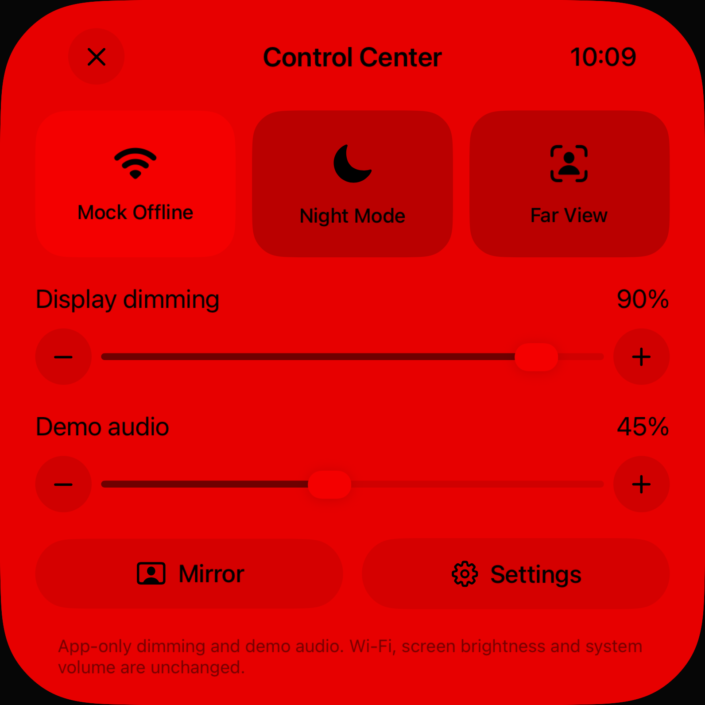
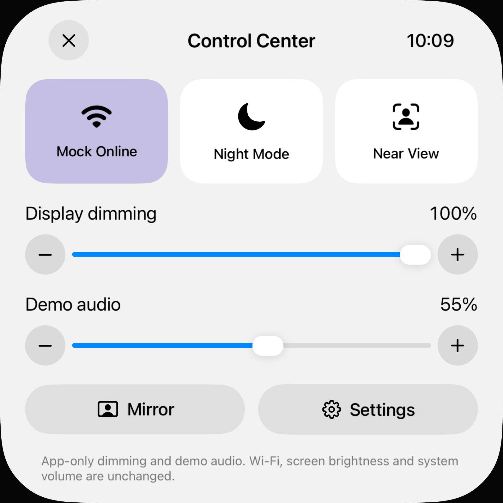

# Control Center und Einstellungen: Zustände statt Scheinregler

19. Oktober 2026 · [#65](https://github.com/Olli0103/homeview/issues/65).

## Belegter Originalumfang und eigene Umsetzung

Der archivierte [Verge-Bericht vom 13. Oktober](https://www.theverge.com/tech/1009877/apple-homeview-smart-home-display-hands-on) beschreibt das herabgezogene Control Center und den Spiegelzugang. Die [technischen Daten](https://www.apple.com/apple-homeview/specs/) führen Settings als eingebaute App auf. Beide Archive wurden am 19. Oktober erneut gelesen. Ein vollständiger Original-Settings-Baum oder ein unverzerrter Control-Center-Zustand ist damit **nicht** belegt.

| Einstellung | Tatsächlich gesteuerter Zustand | Grenze |
|---|---|---|
| Mock Online/Offline | Lokaler MockHome-Zustand, zurückgelesener On/Off-Wert | Kein WLAN-/Internet-Schalter |
| Night Mode | Appweiter Rotfilter, gespeicherter Zustand | Kein automatischer Umgebungslichtsensor |
| Near/Far View | Appinterne Ansicht, gespeicherter Zustand | Keine reale Präsenzerkennung |
| Display dimming | Schwarze App-Überlagerung, gespeicherter Wert | Keine Hardwarehelligkeit; 100% bedeutet keine Abdunklung |
| Demo audio | Lautstärke der lokalen Demo-Player, gespeicherter Wert | Weder Systemlautstärke noch MusicKit-Lautstärke |
| Keep Display On | Nativer UIKit-idleTimer-Readback im Vordergrund; macOS-Aktivität | Hintergrund/Verlassen gibt frei; keine physische Energieabnahme |
| Reference clock | Sitzungsgebundener Referenzmodus | Bewusst keine dauerhafte echte Uhrzeiteinstellung |
| Verbindungen | Explizite Dienstfreigabe und dauerhaft gespeicherter Widerruf | Keine Home-Einrichtung; OS-Berechtigung ist nicht Geräteentsperrung |

Die Oberfläche benennt den Geltungsbereich jetzt ausdrücklich und zeigt für die drei Control-Schalter ihren tatsächlichen App-Zustand an. Scheitert ein Speichervorgang, rollen App-Schalter und Werte zurück; Demo-Lautstärke und native Wachhaltewirkung werden nicht als erfolgreich angewendet ausgegeben.

## Fehlende Originaloptionen

- Original-WLAN-/Bluetooth-Netzverwaltung: kein belegter eingebetteter oder öffentlich steuerbarer Pfad; OS-Einstellungen bleiben separat.
- Original-Hardwarehelligkeit, automatische Lichtsteuerung und Systemlautstärke: nicht nachgebildet oder vermessen. Die vorhandenen App-Regler behaupten dies nicht.
- Echte Haushaltsidentität, Präsenz, Home-Zentrale und Home-Geräteverwaltung: keine Originalabnahme; Home bleibt konstruktionsseitig deaktiviert.
- Original-Settings-Unterseiten, Reihenfolge, Texte und vollständige Optionen: im vorhandenen Referenzsatz unbekannt. Keine pauschale visuelle Parity.
- Eigene Kalender-/Listen-/Foto-/Musikverbindungen bleiben ausdrückliche Nutzeraktionen mit separaten Freigaben. Trennen innerhalb der App widerruft nicht stillschweigend die OS-Berechtigung.

## Prüfung

171 Modelltests des unveränderten Core und 16 gezielte native UI-Ausführungen (acht je iPad Air 11″ M4 und iPhone 18 Pro, iOS 27.0) bestanden; keine UI-Fehler, Skips oder XCTest-Runtime-Warnungen. Fünf SDK-Builds des finalen Statuszeilen-Stands bestanden. Der erste gemeinsame Quellstand umfasst Fade-, Einstellungs- und Musik-Suchkorrektur; alle 143 Quellen und die 21 kompilierten Eingaben bleiben im UI-Lauf unverändert. Eine anschließende, allein auf Root und den UI-Test begrenzte Statuszeilenkorrektur hat sechs zusätzliche gezielte UI-Ausführungen bestanden. Deren 143 Quellen und 21 Eingaben sind separat eingefroren und unverändert; keine frühere Prüfung wird auf den neuen Stand umetikettiert. Installierte App-Dateien wurden bytegeprüft.

Zwei neue Kernfälle prüfen dauerhafte Verbindungen, Neuerzeugung, Widerruf und verspätete Freigabe mit einem synthetischen Provider in separaten UUID-UserDefaults-Suites. Keine echte Berechtigung oder persönliche Daten gelesen. Native UI-Fälle prüfen 90 % App-Dimming, 45 % Demo-Audio, alle drei Schalter und Keep-awake über echten Prozessneustart, erneutes Aktivieren sowie vollständigen Rollback unter Schreibschutz. Die Offline-Fehlermeldung verhindert weiterhin Thermostat-Schreibvorgänge; der Offline-Status sitzt jetzt in der vorhandenen äußeren Statuszeile und überdeckt keine Überschrift mehr, auch nicht beim Thermostat. Kamera-, Nacht- und Offline-Regressionswege bleiben geprüft.

Der erste Testharness scheiterte vor Testausführung an einem relativen Produktpfad. Der nächste Lauf scheiterte an lokalisierten geschützten Leerzeichen vor %. Beide bleiben als fehlgeschlagen erhalten; die korrigierte Prüfung entfernt nur Whitespace, nicht Zahlen oder Prozentzeichen. Frühere Einzelpaketläufe zählen nicht zusätzlich zu den 16 Integrationsprüfungen oder den sechs gezielten Nachprüfungen.

[Quellen und Nachweis](verification/issues-20261019.json) · [vollständiger Quellmanifest](verification/issues-20261019-source.json).

| Persistierte App-Werte | Schreibschutz-Rollback |
|---|---|
|  |  |

**#65 ist im bilanzierten App-Control-Umfang abgeschlossen.** Vollständige Originaldarstellung bleibt bei den offenen Parity-Issues; echte Haushaltsidentität und Einrichtung bleiben gesondert offen.

Der Abschluss bezieht sich nur auf die oben bilanzierten App-Control-Zustände. Physische Helligkeit, akustische Lautstärke, Energie, vollständige Originaloptionen und reale Konten bleiben unbewiesen. Keine Home-Anbindung oder Systemkonfigurationsänderung.
