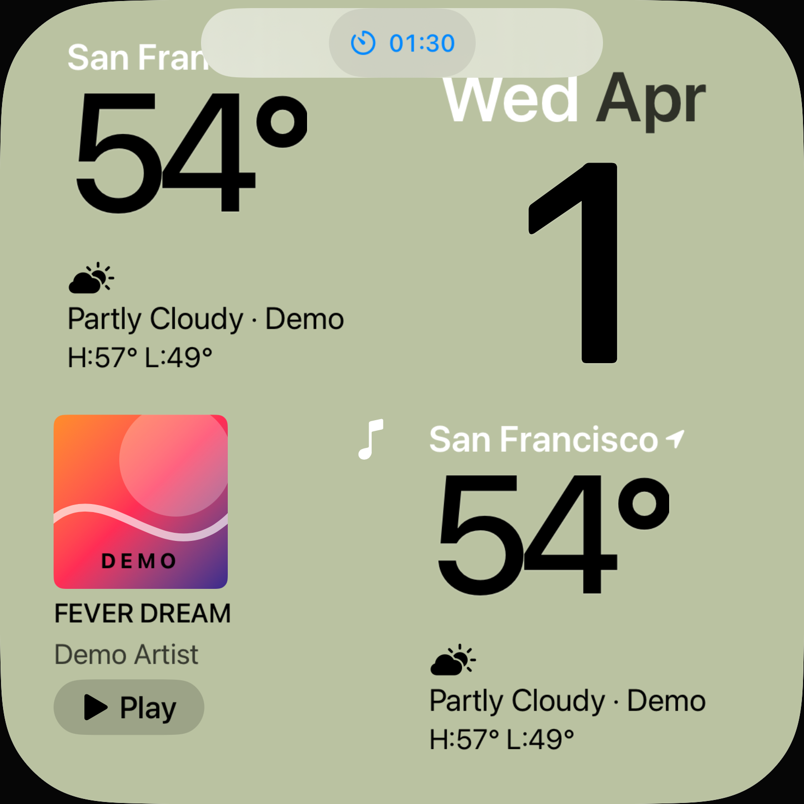
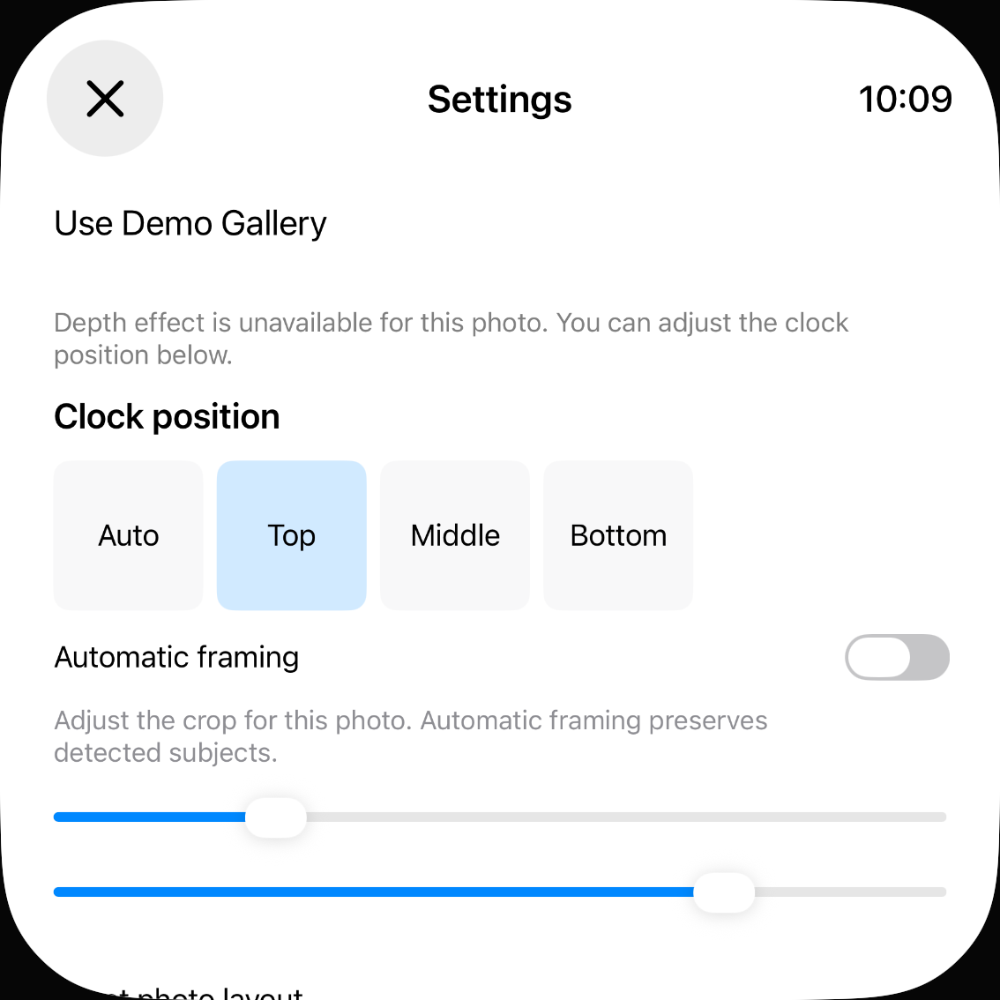

# Gültige Daten trotz voller oder beschädigter Tabellen erhalten

20. Oktober 2026 · begrenzter Fix für [#80](https://github.com/Olli0103/homeview/issues/80). Das Issue bleibt offen; keine vollständige Daten-/Lifecycle-Abnahme.

## Reproduzierter Fehler

Der Snapshot-Lader begrenzte sortierte Tabellenschlüssel, bevor er Schlüssellänge und Werte erfolgreich dekodiert hatte. So konnten unbekannte Face-/Profilnamen gültige bekannte Einträge verdrängen. Nichtobjekte verbrauchten im Foto-Korrekturcache sogar als Standardkorrekturen Platz, weil dessen Felddecoder tolerant ist. Überlange Schlüssel verbrauchten ebenfalls das vorgeschaltete Budget. Die Slotdekodierung begrenzte vor der Wertprüfung und priorisierte bekannte Slotnamen nicht.

Acht neue Modellfälle gegen unveränderte Produktionsquellen: sechs Fehlerfälle mit 20 fehlgeschlagenen Assertions, zwei bestandene Kontrollen. Ein separat hinzugefügter neunter Fall scheiterte mit zwei Assertions: Die Auswahl von 64 aus 80 Systemdienst-IDs entsprach nicht der eingefrorenen kanonischen Reihenfolge. Das belegt diese Auswahlabweichung, nicht eine gemessene Schwankung zwischen wiederholten Starts.

## Bestehenden Decoder korrigiert

Keine neue Speicherschicht oder Abhängigkeit. Die vorhandenen Grenzen bleiben bestehen:

- Bekannte Face- und Profilnamen kommen vor unbekannten Namen; danach lexikografische Reihenfolge.
- Nur zulässige Schlüssel und erfolgreich dekodierte **Objekte** verbrauchen das Tabellenbudget. Feldweise Standardwerte innerhalb eines Objekts bleiben möglich.
- Bei Slots zählen nur gültige Komplikationswerte. Bekannte Slotnamen werden bevorzugt; bestehende Familienregeln bleiben erhalten.
- Gültige unbekannte Namen und alte Foto-Schlüssel wie `synthetic` bleiben unterhalb der Grenzen unterstützt.
- Timer-/Alarmdienst-IDs werden vor der 64er-Begrenzung nach kanonischem UUID-String sortiert.

Das bevorzugt bekannte Daten innerhalb begrenzter Tabellen; es ist keine verlustfreie Rettung jedes beliebigen übervollen Speichers. Gültige unbekannte Objekte können verbleibenden Platz nutzen. Fotoeinträge werden nicht anhand einer erfundenen Nutzungsrangfolge bewertet. Reader, Versionsschutz, atomarer Writer, Recovery-Bytekopie und Reset-Bereinigung sind unverändert.

## Tatsächliche Prüfung

| Lane | Ergebnis und Grenze |
| --- | --- |
| Core | 329 XCTest-Tests bestanden, null Fehler/Skips; neun neue Fälle einschließlich Erhalt gültiger unbekannter Daten, echter Überlaufgrenzen und kanonischem Roundtrip |
| App auf iPad/iPhone | Zwei Methoden je Gerät, **vier bestandene Ausführungen**, keine Skips oder Laufzeitwarnungen. Echter App-Lader, gewöhnliche UI-Writes und Prozessneustart ohne erneute Fixture |
| Face/Profil | Sage/Weather/Clock aus überfüllter Tabelle geladen, rechter Slot normal auf Date geändert und nach Neustart erhalten. Alex- und Jamie-Canary jeweils sichtbar, die andere jeweils nicht; vor und nach Neustart |
| Foto | Korrektur des tatsächlich erzeugten eigenen Fotos geladen: Uhr unten, automatischer Zuschnitt aus, Offsets 0,23/0,77. Uhr normal nach oben geändert, Neustart ohne Fixture, Einstellung bleibt erhalten |
| Unabhängiger Datei-Read-back | Nur die vier vom Test ausgegebenen frischen UUID-Verzeichnisse gelesen. Originalkopie entspricht dem beim Seeden geschriebenen SHA-256. Normalisierte Datei enthält die gespeicherten Slots/Profile/Fotokorrekturen; gesunde Flow-Konfiguration, Mocktemperatur 73, pausierter 90-Sekunden-Timer, leere Dienst-IDs und leere Verbindungsfreigabe erhalten |
| SDKs | iOS Simulator, macOS, tvOS Simulator, visionOS Simulator und watchOS Simulator bestanden. Watch ist ein reduzierter Target-Regressionsbuild, keine funktionale UI-Abnahme |

Die Fixture läuft nur mit `--uitesting`, gültigem explizitem Test-UUID, eigenem neuen Testverzeichnis und separatem Flag. Sie schreibt keine normalen Nutzerdateien. Das einzige zusätzliche Timerobjekt ist **pausiert, ohne Deadline**. Die Nachrichtenansichten lesen nur erfundene lokale Canaries; es wurde nichts gesendet. Keine Bibliothek oder Serviceverbindung eingerichtet.

## Quellenbindung und Bilder

[Maschinenlesbarer Bericht](verification/state-table-pressure.json), [vollständige finale Quellenliste](verification/state-table-pressure-source.json), [native Ausführungseingaben](verification/state-table-pressure-ui-inputs.json) und [separate Host-Assertions](verification/state-table-pressure-readback.py.txt).

Jeder Checkpoint bindet 209 Quell-/Test-/Ressourcen-/Projekt-/Package-Eingaben. Die drei Core-Prüfstände samt jeweils 23 kompilierten Produktdateien wurden getrennt archiviert und vollständig zurückgelesen. Die erste Sealer-Fassung nahm einen alten SwiftPM-Produktpfad an und brach vor der Archiverstellung ab; nach Auflösen des tatsächlichen Produktpfads wurden alle Archive verifiziert. Das war kein Produktfehler und kein zusätzlicher Testlauf.

Nach dem 329er-Core-Lauf kamen ausschließlich AppModel-Testfixture und UI-Tests hinzu; Core und CoreTests sind bytegleich. Der Core-Lauf wird nicht als erneute Ausführung der späteren vollständigen Quellenrevision dargestellt. Native Runs und fünf SDKs verwenden denselben späteren Quellenstand. 28 native Eingaben einschließlich App, Runner, Konfiguration und Harness sind vor/nach identisch; installierte Appbytes auf beiden Simulatoren zurückgelesen. Das native Archiv enthält 237 Einträge und wurde vollständig geprüft. Alle 24 PNGs dekodiert, zwei Kontaktbögen gesichtet; zwölf eigene Viewports veröffentlicht.

## Offen

Die übrige Galerie-/Timer-/Rezept-/Profil-/Provider-/Offline-/Alarmoperationsmatrix wird hiermit nicht pauschal abgenommen. Kanonisch begrenzte Dienst-IDs beweisen keine echte Registrierung oder Abmeldung bei AlarmKit. Keine Originalgleichheit, echte Hilfsmittel-, Konto-, Sensor-, Audio- oder Hardwareabnahme. Keine Home-Anbindung.
