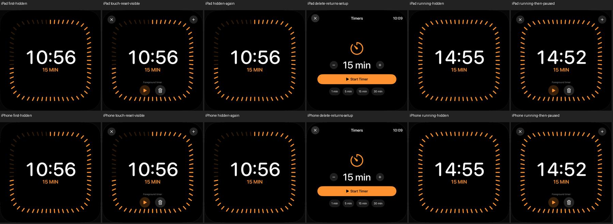

# Timer: reale Inaktivität und Touch-Fristneustart

18. Oktober 2026 · [DAY-03 / #49](https://github.com/Olli0103/homeview/issues/49).
Begrenzte native Softwareprüfung, keine vollständige Timer-/Originalabnahme.

## Vorhandene Regel tatsächlich ausführen

Der Produktivpfad blendet die Timer-Bedienung aus, wenn die letzte Interaktion mehr
als vier Sekunden zurückliegt. Der bestehende globale Ein-Sekunden-Puls prüft diese
Bedingung. Das ist keine millisekundengenaue Vier-Sekunden-Zustellung.
Normale UI-Tests hielten die Bedienelemente bisher absichtlich sichtbar.

`--timer-idle-test` aktiviert zusammen mit `--uitesting` genau diesen vorhandenen
Produktivzweig auch für die synthetischen Tests. Ohne UITesting ändert sich die
Regel nicht; alle bisherigen UI-Tests ohne diese ausdrückliche Option behalten
ihren bisherigen Sichtbarkeitsmodus. Countdown-Modell, produktive Fristen,
Alarmadapter und Timer-Geometrie bleiben unverändert. Es werden weder native
Systemalarme noch echte Accounts oder HomeKit-Geräte verwendet.

## Native Bedienungsfälle

Zwei Fälle je iPad und iPhone, **vier erfolgreiche Ausführungen** ohne Fehler,
Skips oder Runtime-Warnungen:

- Pausierte 10:56: Bedienung verschwindet nach realer Inaktivität. Tatsächlicher
  Koordinaten-Touch auf die Anzeige zeigt Resume. Nach 2,8 Sekunden folgt ein
  zweiter Touch; nach weiteren 2,3 Sekunden bleibt die Bedienung sichtbar, obwohl
  seit dem ersten Einblenden bereits mehr als fünf Sekunden vergangen sind.
  Danach verschwindet sie erneut. Wert unverändert; Touch und Löschen führen
  tatsächlich zur Einrichtung zurück.
- Lokaler 15-Minuten-Timer: Der Countdown läuft bei verborgenen Bedienelementen
  weiter. Touch und Pause stoppen ihn tatsächlich; nach weiterer Wartezeit bleibt
  sein Wert unverändert. Löschen führt zur Einrichtung zurück.

Das Verschwinden wird mit einer oberen Wartegrenze von acht Sekunden beobachtet;
kein exakter Versteckzeitpunkt wird behauptet. Die 2,8/2,3 Sekunden sind ausdrückliche
Testwartezeiten; XCTest-/Renderzeiten kommen hinzu. Referenzuhrzeit und tatsächliche
Inaktivitätsuhr sind getrennt. Systemzeitänderungen wurden hier nicht simuliert.

## Bilder und Quellen

Zwölf native Bilder beider Größen sind gesichtet. Die zwei verborgenen Bilder des
pausierten 10:56-Timers sind jeweils über das gesamte Quadrat exakt pixelgleich.
Eine vorab aus dem Renderer und dem früheren Pilot festgelegte untere zentrale
Kontrollregion zeigt beim sichtbaren Positivfall 141.823 geänderte RGB-Kanäle auf
dem iPad und 71.555 auf dem iPhone. Damit wird nicht nur ein Accessibility-Flag als
sichtbares Ein-/Ausblenden ausgegeben.

139 Modelltests, erneut nach Feature und Integration; fünf SDK-Builds bestanden.
133 Quellen vor/nach Lauf und gegen Feature-/Integrationsbytes identisch. Nur
Everyday.swift und UI-Tests unterscheiden sich vom vorherigen Flowstand. Der
frühere einzelne iPad-Pilot zählt nicht zu den vier finalen Ausführungen. Kein
neuer vollständiger UI-Suite-PASS, keine Laufzeitabnahme auf fünf Plattformen.

[Prüfbeleg](verification/timer-idle.json), [Quellenmanifest](verification/timer-idle-source.json),
[Bildmanifest](screenshots/goal-20261018/timer-idle-manifest.json),
[Herkunft der eigenen Übersicht](screenshots/goal-20261018/timer-idle-native-states.json).

## Weiter offen

Die bestehende Vier-Sekunden-Regel ist getestet, aber nicht als exaktes
Originaltiming kalibriert. Die [UI14-Geometrieprüfung](timer-ui14.md) bleibt ein
separater früherer Quellenstand. Sämtliche Mehrtimer-/Neusortierregeln,
Hintergrund-/Neustart-/Systemzeitwechsel, tatsächliche Systemalarmzustellung,
VoiceOver und physische Originalabnahme bleiben offen. #49 bleibt offen.
