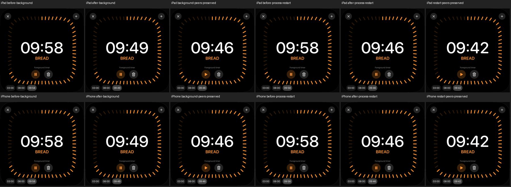

# Lokale Timer: Hintergrund und App-Prozessneustart

18. Oktober 2026 · [DAY-03 / #49](https://github.com/Olli0103/homeview/issues/49).
Nur native Softwareprüfung; die vorhandene Produktionslogik ist unverändert.

Zwei neue Tests verwenden jeweils einen frischen, isolierten UUID-Test-Speicher.
Drei eigene Timer starten pausiert: Tea 03:00, Pasta 08:00 und Bread 10:00.
Bread wird tatsächlich angetippt und gestartet. Systemalarme sind deaktiviert.

Der erste Fall drückt die Home-Taste, wartet und aktiviert die App erneut. Der
zweite beendet den App-Prozess und startet ihn mit demselben UUID-Speicher neu,
**ohne die anfängliche Fixture erneut zu laden**. In beiden Fällen läuft Bread
entsprechend der vergangenen Zeit weiter. Tatsächliche Auswahl und Kontrolle
bestätigen die erhaltenen pausierten Werte von Tea und Pasta. Am Ende wird Bread
über den sichtbaren Pause-Knopf angehalten.

## Messung und begrenzter Nachweis

Vier erfolgreiche Ausführungen, zwei je iPad-/iPhone-Simulator iOS 27.0 / 24A434;
keine Fehler, übersprungenen Fälle oder XCTest-Runtime-Warnungen. 139 Modelltests,
erneut nach Feature- und Integrationscommit, sowie fünf SDK-Builds bestanden.
133 Quellen sind vor/nach Prüfung und gegen beide Codecommits gebunden.
**Nur die UI-Testdatei wurde geändert**, keine Produktions-, Fixture- oder
Persistenzimplementierung. Der separate Zwei-Fälle-Pilot zählt nicht zu den vier.

| Fall | Gerät | Anzeige vorher → nachher (Sekunden) | Beobachtete monotone Zeit |
|---|---|---|---|
| Hintergrund | iPad | 598 → 590 | 7,218 s |
| Hintergrund | iPhone | 598 → 590 | 7,194 s |
| Prozessneustart | iPad | 598 → 587 | 10,771 s |
| Prozessneustart | iPhone | 598 → 587 | 10,724 s |

Die vorab festgelegte Abweichungsgrenze von drei Sekunden berücksichtigt den
vorhandenen Sekundentakt, Aufrundung und asynchrones Ablesen. Sie ist kein
Nachweis exakten Originaltimings. Bilder werden **nach** der Messung aufgenommen
und zeigen deshalb etwas spätere Zählerstände. Zwölf tatsächliche native
Zustandsbilder wurden dekodiert und gesichtet; keine nachgezeichneten Anzeigen.

[Prüfbeleg einschließlich Messwerten](verification/timer-lifecycle.json) ·
[Quellenmanifest](verification/timer-lifecycle-source.json) ·
[eigene Bilddateien und Digests](screenshots/goal-20261018/timer-lifecycle-manifest.json).

## Weiter offen

Kein Geräte-/OS-Neustart, Systemzeitwechsel, gleichzeitiger Ablauf, AlarmKit-
Abgleich oder physisches Gerät wurde geprüft. Keine vollständige UI-Suite oder
Laufzeitabnahme auf fünf Plattformen. Original-Mehrtimerlayout und Originaltiming
bleiben offen; F063 teilweise, #49 offen. Keine echten Accounts oder Homes.
