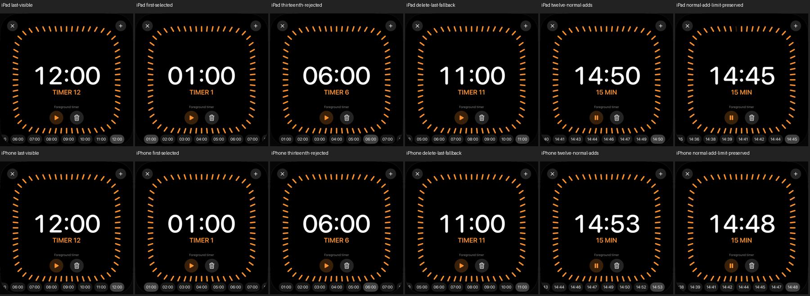

# Timer: horizontale Auswahl und eigene Zwölf-Timer-Grenze

18. Oktober 2026 · [DAY-03 / #49](https://github.com/Olli0103/homeview/issues/49).
Begrenzte native Softwareprüfung. Zwölf ist die vorhandene **eigene App-Grenze**,
keine behauptete Apple-HomeView-Grenze oder Original-Sortierregel.

## Vorhandene Bedienung tatsächlich prüfen

Die vorhandene Timerleiste bleibt horizontal scrollbar. Eine zugängliche Gruppe
beschreibt nun „Timer choices“ und die tatsächliche Anzahl; einzelne Timer behalten
ihre eigenen Labels, Auswahlwerte und Touchziele. Die Produktionslogik für Timer,
Auswahl-Fallback, Sortierung und Anzahlbegrenzung bleibt unverändert.

Eine ausdrücklich unter `--uitesting` gewählte Fixture enthält zwölf eigene
pausierte Timer mit einer bis zwölf Minuten. Der Test zieht die Leiste mit echten
Simulator-Wischbewegungen bis zum letzten, ersten und mittleren Eintrag und tippt
sichtbare Ziele tatsächlich an. Der dreizehnte Timer wird mit der vorhandenen
App-Meldung abgelehnt; Anzahl und Auswahl bleiben erhalten. Nach Löschen des
letzten Timers bleiben elf und die vorhandene Ersatzwahl zeigt Timer elf.

Ein zweiter Fall beginnt ohne Timer: Start und elf tatsächliche Add-Aktionen
legen zwölf laufende lokale Timer an. Nummer 13 wird abgelehnt, ohne den gewählten
Timer zu ersetzen. Systemalarme sind unter UITesting ohne ausdrückliche separate
Option deaktiviert; solche Freigaben werden hier nicht angefordert.

Die „rejected“-Bilder zeigen den erhaltenen Zustand **nach Bestätigung** der
normalen App-Meldung, nicht eine nachträglich eingezeichnete Meldung.

## Korrekte Koordinatenprüfung statt behauptetem Clipping

Ein früherer Testtreiber verwechselte unterschiedliche Zahlenpräzision mit
überschrittenen Rändern. Der erste Befund war ein linker Rahmenrand von
11,999999999999991 statt 12 Punkten. Eine getrennte Diagnose hielt die exakten
Rahmen fest; ein Produktions-Clippingfehler wurde damit nicht belegt. Die genannten
Koordinaten stammen aus den getrennten Diagnosen; sie werden nicht als nachträglich
vorhandene Rahmenprotokolle der ursprünglichen Fehlstände ausgegeben.

Die strengere Prüfung verlangt zusätzlich den bestehenden 40-Punkte-Innenabstand.
Auf dem iPad lag ein gemeldeter Zielrand bei 754,933349609375, während die in Double
berechnete Grenze 754,9333333333334 Punkte betrug. **Auf Float32 gerundet sind
beide exakt identisch.** Die Zielkoordinaten zeigten diese Float32-Rundung.

Der Test vergleicht daher beide Rechtecke in derselben gemeldeten Präzision und
führt Gesten im sichtbaren Schnittbereich aus. Der 40-Punkte-Abstand bleibt
bestehen. Keine Pixelfarbtoleranz wurde eingeführt oder verändert. Echte größere
Rahmenüberschreitungen bleiben Fehler. Die vorherigen Fehlprüfstände bleiben mit
ihren ursprünglichen Ergebnissen getrennt, nicht rückwirkend grün.

## Finaler geprüfter Stand

Vier Fälle je iPad und iPhone, **acht erfolgreiche Ausführungen** ohne Fehler,
Skips oder Runtime-Warnungen: zwei Zwölf-Timer-/Grenzfälle und die beiden vorherigen
Drei-Timer-Fälle zu Ersatzwahl/Löschen sowie unabhängigem Starten/Pausieren.
139 Modelltests, erneut nach Feature und Integration; fünf SDK-Builds bestehen.
133 Quellen vor/nach Lauf und gegen beide Codecommits identisch.

Die nativen Bilder beider Größen sind gesichtet. Vier ausgewählte Rand-/Mittenchips
je Gerät enthalten weiße Glyphen; ihr Hintergrund ist 39 RGB-Stufen heller als ein
ungewählter Vergleichschip derselben Komponente aus der Drei-Timer-Regression
**desselben Quellenstandes**. Diese Referenz wird nicht als gleichzeitig sichtbarer
Nachbarchip oder Originalbild ausgegeben. Auch die bisherigen vier Auswahlzustände
beider Geräte behalten ihre sichtbare Markierung.

Alle acht pausierten Drei-Timer-Ganzbilder sind pixel- und PNG-bytegleich mit dem
[vorherigen eigenen Stand](timer-selection.md). Der neue Container verändert keine
Timer-Geometrie. 48 eigene native PNGs samt Herkunft und Digests sind gesichert;
keine Originalbilder oder privaten Hostpfade. Kein vollständiger UI-Suite-PASS,
keine Laufzeitabnahme auf fünf Plattformen und keine vollständige VoiceOver-Abnahme.

[Prüfbeleg und getrennte Fehlerhistorie](verification/timer-overflow.json),
[Quellenmanifest](verification/timer-overflow-source.json),
[eigene Bilder](screenshots/goal-20261018/timer-overflow-manifest.json),
[Herkunft der Übersicht](screenshots/goal-20261018/timer-overflow-native-states.json).

## Weiter offen

Original-Anzahlgrenze, Sortierung und Mehrtimerlayout, gleichzeitiger Ablauf,
Hintergrund/Neustart/Systemzeitwechsel, tatsächlicher AlarmKit-Abgleich und
Hardware bleiben offen. F063 bleibt teilweise umgesetzt beziehungsweise abgenommen;
#49 bleibt offen. Keine echten Homes, Accounts, Nachrichten oder Anrufe.
