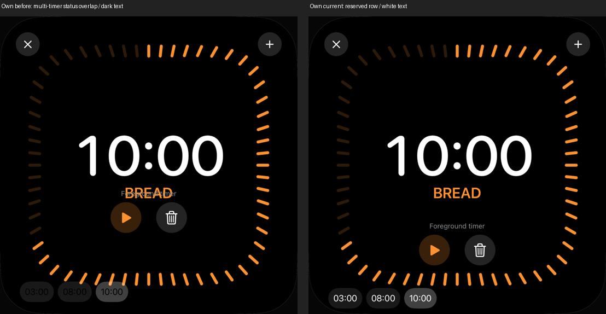
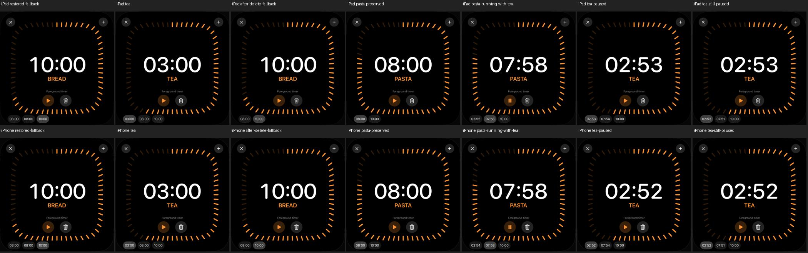

# Mehrere Timer: Anordnung, Kontrast und unabhängige Zähler

18. Oktober 2026 · [DAY-03 / #49](https://github.com/Olli0103/homeview/issues/49).
Begrenzte native Softwareprüfung, keine Original-Mehrtimerabnahme.

## Tatsächlicher Befund statt vermutetem Auswahlfehler

Die genaue Quellenprüfung widerlegte den anfänglichen Verdacht: Die visuelle
Markierung verwendete bereits den tatsächlich angezeigten Timer, einschließlich
Ersatzwahl nach Laden oder Löschen. Dieser Algorithmus wird **nicht geändert**.
Es wird weder ein solcher Fehler als behoben ausgegeben noch eine neue
Original-Neusortierregel erfunden.

Die native Drei-Timer-Fixture zeigte dagegen zwei wirkliche Darstellungsfehler:
Eine unbeschränkte horizontale ScrollView verschob den Status über den Titel;
die Zeitangaben der Auswahlchips waren schwarz auf dunklem Grund.

Die Auswahlleiste erhält 44 Punkte Höhe und zehn Punkte unteren Abstand. Ihre
54 Punkte werden vom bisherigen 90-Punkte-Abstand der Aktionen abgezogen:
bei mehreren Timern bleiben dort 36 Punkte. Status und Aktionen behalten damit
die Einzel-Timer-Position; die Auswahl liegt unter den Randstrichen. Bei einem
Timer bleiben die bisherigen 90 Punkte erhalten. Die Chips bekommen weiße Schrift,
sprechende Accessibility-Labels und den zur vorhandenen Markierung passenden
Selected-Wert. Das ist keine vollständige VoiceOver-Abnahme.

## Native Funktion und sichtbare Markierung

Die ausdrücklich unter `--uitesting` aktivierte Fixture enthält drei eigene,
pausierte Timer: Tea 03:00 von fünf Minuten, Pasta 08:00 von zehn Minuten und
Bread 10:00 von 15 Minuten. Eine zunächst fehlende Auswahl bildet den Ladefall
nach; es werden keine vorhandenen persönlichen Timer ersetzt.

Vier Fälle je iPad und iPhone, **acht erfolgreiche Ausführungen** ohne Fehler,
Skips oder Runtime-Warnungen:

- Ersatzwahl beim Laden, tatsächliches Auswählen, Löschen des gewählten Timers
  und korrekte Anzeige der unveränderten übrigen pausierten Werte.
- Tea und Pasta laufen gleichzeitig. Tea lässt sich pausieren, während Pasta
  weiterläuft; Bread bleibt unberührt pausiert. Tea bleibt danach unverändert.
- Vorhandener einzelner Referenztimer mit echtem Touch zum Einblenden.
- Vorhandene lange Anzeige 23:59:59 mit tatsächlichem Löschen.

Status- und Titelrahmen dürfen nicht überlappen; die Auswahlrahmen müssen im
Viewport und unterhalb seiner 90-Prozent-Linie liegen. Zusätzlich werden die
**tatsächlich gerenderten einzelnen Chips** aufgenommen. Eine vorher aus dem
Kapsel-/Textpadding festgelegte Region prüft die Helligkeit abseits der Glyphen.
In allen vier Auswahlzuständen beider Geräte ist der ausgewählte Hintergrund
39 RGB-Stufen heller als die übrigen; alle Chips enthalten deutlich weiße
Textpixel. Die Markierung wird somit nicht allein aus Accessibility-Metadaten
als sichtbar ausgegeben.

## Abgrenzung des ersten Testfehlers

Der erste Pilot bestand einen Fall; ein zweiter sah nach fest gewarteten 1,5
Sekunden noch keinen ersten Tick. Die Fehleraufnahme zeigte bereits das Pause-
Symbol des gestarteten Timers. Das belegt keinen kaputten Produktiv-Countdown.
Ein getrennt eingefrorener Teststand verlangte diesen tatsächlichen Pause-Zustand,
wartete höchstens sechs Sekunden auf eine wirkliche Anzeigeänderung und prüfte
danach strikt den kleineren Restwert. Das bestand bei unverändertem Produktivcode.
Die finale Synchronisation verwendet diese begrenzte Zustandsprüfung.

Der ursprüngliche Fehler bleibt separat dokumentiert; er wird nicht rückwirkend
zum PASS und nicht als behobener Countdown-Fehler ausgegeben. Die sichtbare
Überlagerung und der schlechte Chip-Kontrast wurden dagegen direkt aufgenommen
und durch die oben beschriebene Layout-/Farbkorrektur behoben.

## Quellengebundener Stand

139 Modelltests, erneut nach Feature und Integration; fünf SDK-Builds bestanden.
133 Quellen vor/nach Lauf und gegen beide Codecommits identisch. Geändert sind
nur AppModel-Testfixture, Timer-Darstellung und UI-Tests. Countdown-Core, Fristen,
Alarmadapter, Auswahl-Fallback und Sortierung bleiben unverändert. Frühere Piloten
zählen nicht zu den acht finalen Ausführungen; keine neue vollständige UI-Suite.

Die Einzel-Timer-Bilder 10:56 und 23:59:59 sind auf beiden Geräten **vollständig
pixel- und PNG-bytegleich** mit ihren separat gekennzeichneten früheren eigenen
Prüfständen. Das ist ein Software-Regressionsnachweis, kein Originalpixelvergleich.

[Prüfbeleg](verification/timer-selection.json), [aktuelle Quellen](verification/timer-selection-source.json),
[ursprünglicher Pilot](verification/timer-selection-initial-source.json),
[eigene Bilder](screenshots/goal-20261018/timer-selection-manifest.json),
[Herkunft des eigenen Vergleichs](screenshots/goal-20261018/timer-selection-own-comparison.json).

## Weiter offen

UI14 belegt nur einen sichtbaren Timer. Exakte Original-Mehrtimer-Anordnung,
Neusortierung, vollständige Zwölf-Timer-/Überlaufprüfung, Ablauf mehrerer Timer,
Hintergrund/Neustart/Systemzeitwechsel, tatsächliche Systemalarmzustellung und
Hardware bleiben offen. Hier wurden weder Systemalarmfreigaben angefordert noch
echte Accounts oder HomeKit-Geräte verwendet. #49 bleibt offen.
