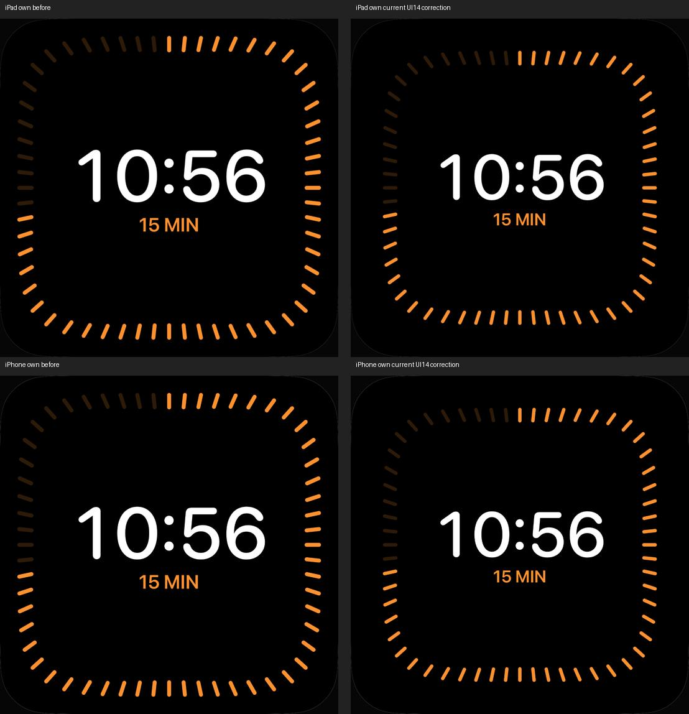

# Timer: UI14-Geometrie und lange Anzeige

18. Oktober 2026 · [DAY-03 / #49](https://github.com/Olli0103/homeview/issues/49).
Code und Quellen stehen im [Prüfbeleg](verification/timer-ui14.json).
Begrenzter Bild-/Bedienungsschritt, keine vollständige Timer- oder Originalabnahme.

## Befund und Korrektur

Der Gesamtatlas mit zwölf eigenen Ansichten je iPad/iPhone machte den zu großen
Countdown und Randring sichtbar. UI14 ist eine Produktaufnahme mit Gerätegehäuse.
Ihre angenäherte größte schwarze Frontfläche ist **keine kalibrierte Displaygrenze**;
Gehäuse und Ständer werden nicht als App-Abstände behandelt. Die Korrektur ist
entsprechend ein begrenzter Geometrieschritt, kein Originalpixel-PASS.

Countdown 112 statt 128 Punkte, Titel 30 statt 34; Ringradius 40 statt 44,3 Prozent,
Strichlänge 20 statt 22, Breite 6 statt 7. Fortschrittsformel und 60 Markierungen
bleiben erhalten. Lange Anzeigen erhalten eine begrenzte einzeilige Skalierung
und ausreichend Innenraum, statt die Randstriche zu berühren. Die Referenzfixture
ist kontrolliert pausiert bei 10:56/15 Minuten, keine behauptete laufende Originaluhr.

## Prüfung sichtbarer Glyphen

Der erste Pilot hatte einen bestandenen und zwei fehlgeschlagene Fälle. Eine
neue Rahmenprüfung nahm irrtümlich an, volle Font-Layout-Rechtecke dürften nicht
überlappen. Die Fehler-Videos zeigten tatsächlich getrennte weiße/orangefarbene
Glyphen, obwohl die Accessibility-Rechtecke überlappten. Sie zeigten außerdem den
**wirklichen** Kontakt der langen Anzeige mit Randstrichen. Dieser wurde durch
mehr Innenraum behoben, nicht als Metadatenproblem abgetan.

Die finale Prüfung verlangt vollständige Rahmen innerhalb der inneren 70 Prozent
des Displays und prüft zusätzlich die tatsächliche Pixeltrennung von weißem
Countdown und orangefarbenem Titel in vorher festgelegten zentralen Regionen.
Die Zahl 23:59:59 bleibt pausiert korrekt. Tatsächlicher Koordinaten-Touch zeigt
die passenden Resume-/Löschaktionen; Löschen führt zur Timer-Einrichtung zurück.
Das ist keine vollständige VoiceOver-Abnahme.

## Finaler Quellenstand

139 Modelltests, erneut nach Feature- und Integrationscommit. Fünf gezielte Fälle
je iPad/iPhone, zehn Ausführungen ohne Fehler, Skips oder Runtime-Warnungen:
ruhende Referenz/Touch, lange Anzeige/Löschen, lokales Pause/Fortsetzen/Löschen,
synthetische Türklingel-Rückkehr zum laufenden Timer und Rezept-Inline-Timer.
Alle fünf SDKs bestehen. Eigene Bilder beider Größen sind gesichtet. Kein neuer
vollständiger UI-Suite-PASS; frühere Piloten zählen nicht zu den zehn Ausführungen.

133 Quellen vor/nach Lauf und gegen Feature-/Integrationsbytes identisch.
Nur AppModel-Testfixture, Timer-Renderer und UI-Tests unterscheiden sich vom
vorherigen Wetterstand. Countdown-Modell, produktive Fristen und Alarmadapter
bleiben unverändert. Die lange pausierte Fixture entsteht nur mit --uitesting,
--reference-timer und --reference-timer-long. Es wurde kein Systemalarm-Test und
keine echte Alarmfreigabe für diese Geometrieprüfung ausgeführt.

[Quellenmanifest](verification/timer-ui14-source.json),
[Ergebnisse und sichtbare Pixelabstände](verification/timer-ui14.json),
[Bildmanifest](screenshots/goal-20261018/timer-ui14-manifest.json),
[Herkunft des eigenen Vergleichs](screenshots/goal-20261018/timer-ui14-own-comparison.json).

## Offen

Exakte Originalschrift, kalibrierte Displaygeometrie, sämtliche Timer-/Titelvarianten,
automatisches Ausblenden nach Inaktivität, Mehrtimer-/Neusortierregeln sowie Neustart,
Systemzeitänderung, echte Alarmzustellung und Hardwareabgleich bleiben offen.
Die Prüfung zeigt den kontrolliert ruhenden Zustand und Einblenden per Touch,
keine neue Abnahme der automatischen Ruheregel. #49 bleibt offen. Nur synthetische
Daten und MockHome; keine echten Homes, Accounts, Bibliotheken oder Anrufe.
