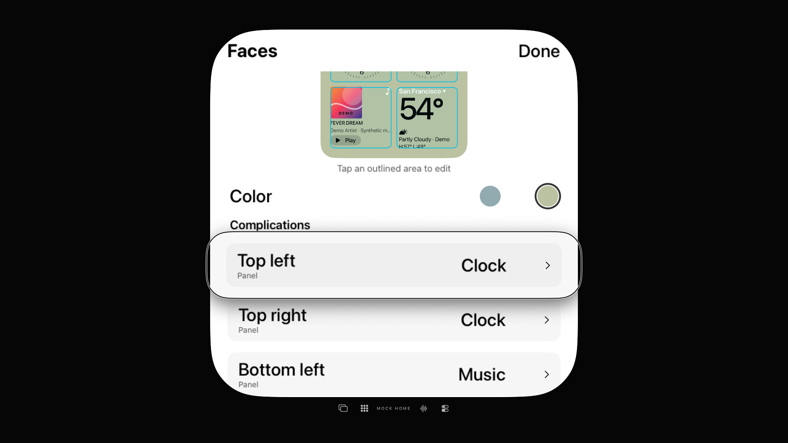

# TV-Face-Editor: versteckten Vorschau-Fokus korrigiert

30. Oktober 2026 · [#73](https://github.com/Olli0103/homeview/issues/73) bleibt offen, F103 partial/parity=false. Die ursprüngliche Editor-/Originalabnahme in [#7](https://github.com/Olli0103/homeview/issues/7) bleibt ebenfalls offen.

**Echter Fehler:** `allowsHitTesting(false)` und `accessibilityHidden(true)` verhindern nicht, dass die TV-Fokusengine nach einem Slot-Abbruch auf einen verschachtelten Button der schreibgeschützten Vorschau gelangt. Die native Diagnose zeigt die App weiterhin im Vordergrund, keinen sichtbaren AX-Fokus und im tatsächlichen Bild den Fokusglanz auf dem verborgenen Wetter-Control. Zwei Beobachtungen liegen tatsächlich 4,489 Sekunden auseinander; die angeforderte Wartezeit war drei Sekunden.

**Korrektur:** Nur der eingebettete schreibgeschützte `FaceView` erhält unter tvOS `.disabled(true)`. Die interaktiven Slot-Rahmen bleiben aktiv. Keine Layout-/Farb-/Schriftänderung oder Änderung anderer Plattformzweige.

## Aktuelle Ergebnisse

| Prüfung | Ergebnis |
|---|---|
| TV mit echtem nativen VoiceOver-Zustand | 1 PASS, 17 erforderliche Fokus-/Sprachwerte |
| TV ohne VoiceOver | 1 PASS, Slot-Abbruch → Clock-Auswahl → Done |
| iPhone und iPad | je 1 PASS, Inline-Slotfilter/Off/Clock/Neustart/World-Clock-Route |
| Ganze festgelegte TV-Vorschau, 362×361 Pixel | **0 geänderte RGBA-Pixel**, maximale Kanalabweichung 0 |
| iOS/macOS/tvOS/visionOS/watchOS | 5 SDK-PASS, 77 Produktdateien zurückgelesen |

Der native TV-Fall öffnet tatsächlich Settings → Edit Faces, liest das ausgewählte Modular-Face, wechselt zu Sage, bricht die erste Slotwahl ohne Änderung ab, wählt Clock und kehrt mit Done zurück. Ein echter App-Neustart nutzt denselben eigenen UUID-Store ohne Reset: Sage und Clock bleiben erhalten. Die Rückkehr zum Face und Faces-Footer funktioniert. Neue Sprachmeldungen werden nach tatsächlichem Nachbar-/Rückfokus geprüft, nicht als automatische Änderungsansage oder akustische Abnahme.

iOS benötigt die bestehende normale Metadata-Clean-/Build-Wiederholung: Die erste Kompilierung meldet bereits Exit0, generierte SSU-Dateien sind zunächst unvollständig. Erst die normale Wiederholung liefert vollständige Metadaten; der Erstbefund bleibt erhalten. Drei neue SDK-Dateiversionen sind archiviert, übrige Bytes aus gemeinsamen Archiven zurückgelesen.

Vier aktuelle UI-Ausführungen ohne Skip oder strukturierte XCTest-Runtime-Warnung. Der native Kandidat und die normale TV-/Mobile-Abnahme haben **zwei Test-Quellpins**; Produktinputs und alle zwölf nativen TV-Appdateien sind exakt gleich. Die späteren Teständerungen ergänzen nur den normalen TV-Fall und die Vordergrundprüfung einer Fehlerbeobachtung. Pro TV-Build 18, mobil 31 kompilierte App-/Runner-/Launcheingaben archiviert und zurückgelesen. Die 96 Core-/Package-/Testinputs sind exakt zum früheren 458-PASS-Lauf; kein neuer Corelauf wird behauptet.

In allen vier historischen/aktuellen Servicefällen ist der ursprüngliche VoiceOver-Aus-Zustand exakt wiederhergestellt und der eigene Runnerbericht unabhängig bytegleich zurückgelesen. 63 native PNGs vollständig dekodiert, sechs Kontaktseiten und vier Vollbilder gesichtet. Sieben Quellmanifeste aus gemeinsamen Archiven und Deltas vollständig rekonstruiert.

## Grenzen und Vorherfehler

Die Pixelgrenze wurde **vor dem Produktbuild** anhand der ganzen eigenen Sage-Vorschau einschließlich Rand festgelegt. Keine nachträgliche Maske oder Toleranzänderung. Der PASS gilt für dieses ganze 362×361-Rechteck im gleichen Zustand, nicht für den gesamten Editor, alle Faces oder das Apple-Original. Die separaten drei gescheiterten ganzen Rezept-Bildpaare bleiben offen.

Alle drei vorausgehenden UI-Fehler bleiben erhalten: zunächst keine neue Sprachmeldung bei bereits fokussierter Auswahl, danach Fokusverlust beim Rückweg und die getrennte unveränderte Diagnose des Vorschaufehlers. **Insgesamt sieben UI-Ausführungen: vier PASS, drei historische FAIL.** Skalierungs-/Farbannahmen und ein falsches Arbeitsverzeichnis während der Messvorbereitung sind separat dokumentiert, nicht als Produktfehler oder zusätzliche UI-Läufe gezählt. Die ungetestete Änderung war vor der endgültigen Messdeklaration vollständig zurückgenommen worden.

[253 finale Quellinputs](verification/tv-editor-voiceover-source-20261030.json). Keine echte Home-, Account-, Mikrofon-, Kamera-, Authentifizierungs- oder OS-Transfer-Nutzung. Geräte-/Signingabnahmen bleiben pausiert. Weitere zentrale Hilfsmittelpfade werden unabhängig fortgesetzt; keine pauschale Accessibility- oder Originalabnahme.
