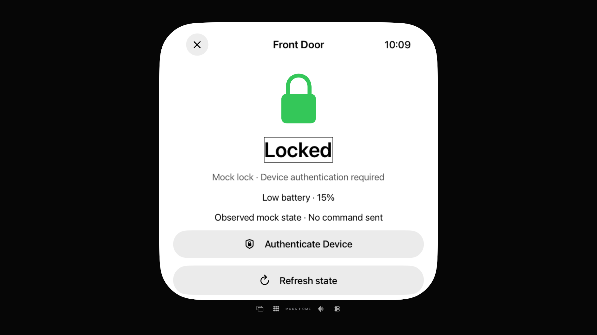

# TV-Schloss: Lesetexte und persönlicher Rückweg korrigiert

30. Oktober 2026 · [#73](https://github.com/Olli0103/homeview/issues/73) bleibt offen, F103 partial/parity=false. Ausschließlich lokales MockHome; keine Geräteauthentifizierung oder Schlossanweisung.

## Zwei tatsächliche Fokusfehler

Am unveränderten Produkt sind Tür-Control und Überschrift nativ lesbar, der Zustand „Locked“ aber nicht per Remote fokussierbar. Zustand, Richtlinie, Batterie und Anfragestatus erhalten deshalb nur unter tvOS und bei tatsächlich aktivem VoiceOver Lesefokus; der dekorative Fokuseffekt bleibt aus.

Auch nach dem Schließen der lokalen Anmeldesperre schlägt der Rückweg über den persönlichen Home-Button fehl. Der tatsächliche Fokusverlauf wechselt zwischen Messages und dem Thermostat der **unscharfen schreibgeschützten Hintergrundansicht**. Nur dieser dekorative `FaceView` wird unter tvOS deaktiviert. Sichtbare Apps und andere interaktive Vordergrundelemente bleiben aktiv; kein Layout, keine Schrift und keine Farbe wird umgestaltet. Der AppDrawer-Hintergrund ist nicht Teil dieses Patches; der erste dortige Missing-Match-Abbruch bleibt ohne behauptete genaue Ursache erhalten.

## Abnahme und ihre Grenzen

Der native Lauf erreicht 14 verlangte Fokus-/Sprachwerte: Tür, Überschrift, Locked, Richtlinie, 15%-Testbatterie, „No command sent“, Refresh, erneutes Locked, lokale Anmeldesperre und Close. Anschließend führen tatsächliche Remote-Aktionen über Home zurück zum unverändert gesperrten Schloss. „Unlock“ wird nie ausgewählt, eine Bestätigung existiert nicht. Der Zustand wird separat gegen „Unlocked“ abgegrenzt. Vollständige lange Lektüre oder akustische Abnahme werden nicht behauptet; der Zustands-Hinweis erscheint nur als bekannter Reporterpräfix, und Home enthält den eigenen testweisen „Reference viewport“-Marker.

Die zusätzliche gewöhnliche TV-Kontrolle fokussiert Messages ohne Aktivierung und geht anschließend tatsächlich über Home zurück zum Schloss. So wird der korrigierte persönliche Rückweg auch **ohne VoiceOver** geprüft. Die normale Vier-Bilder-Referenz nutzt bewusst den anderen sichtbaren Rückweg über Faces und den Tür-Button des Faces. Frühere gescheiterte Rückwege bleiben getrennt erhalten.

| Prüfspur | Ergebnis |
|---|---|
| Native TV-VoiceOver-Bedienung | PASS, 14 verlangte gemeldete Werte und tatsächliche Callbacks |
| Gewöhnliche TV-Kontrollen | PASS, einschließlich zusätzlicher Wiederholung derselben Bildmethode |
| iPhone-/iPad-Inventar und Abbruch ohne Connect/Unlock | je 1 PASS |
| iOS/macOS/tvOS/visionOS/watchOS | 5 SDK-PASS, 77 Produktdateien zurückgelesen |
| Vier finale ganze Schloss-/Gate-Bildpaare | **Alle RGBA- und PNG-Bytes exakt gleich** |
| Früherer Refresh-Bildvergleich | 26.537 Pixel **FAIL**, erhalten; gleiche Variation auch bei identischen Appbytes |
| Zusätzlicher ganzer persönlicher Startbildschirm | 7.064 Pixel **FAIL**, nicht abgenommen |

Sechs aktuelle UI-Ausführungen sind bestanden (vier TV, darin eine zusätzliche Wiederholung derselben normalen Bildmethode; je eine iPhone/iPad), keine Skips oder strukturierten XCTest-Runtime-Warnungen. Insgesamt zehn Ausführungen: sieben PASS, drei historische FAIL; der unveränderte Referenzlauf ist kein aktueller Produktlauf. Pro TV-Build 18, mobil 31 kompilierte App-/Runner-/Launcheingaben archiviert und zurückgelesen. 6 Quellmanifeste rekonstruiert, 141 native PNGs dekodiert; 13 Kontaktseiten und vier volle TV-Bilder tatsächlich gesichtet. Mobile Aufnahmen sind Read-only-Inventar-/Scrollzustände, keine gleichzeitige vollständige Absatz-/Batterielektüre.

Die finale iOS-Kompilierung benötigt die bestehende normale Metadata-Clean-/Build-Wiederholung: erster Compiler-Exit0 bei unvollständigen SSU-Dateien, anschließend vollständige geprüfte Metadaten. Erstbefund erhalten, kein zusätzlicher Compilerfehler erfunden. Drei neue SDK-Dateiversionen archiviert, alle übrigen Bytes aus gemeinsamen Archiven zurückgelesen. Der anfänglich veraltete aktuelle Provenienz-Hash für HomeScreens wurde korrigiert; DemoAlbumCover-Quellblock und alle 59 Ressourcen sind unverändert, 18 Provenienzinputs wieder geprüft.

Der native Kandidat und der finale zusätzliche gewöhnliche Test haben verschiedene Testpins, aber exakt gleiche zwölf TV-Appdateien und Produktinputs. Die bestehenden erfolgreichen Methoden bleiben unverändert. Der ursprüngliche VoiceOver-Aus-Zustand wird in beiden Servicefällen exakt wiederhergestellt und der gespeicherte eigene Runnerbericht unabhängig bytegleich zurückgelesen. Die 96 Core-/Package-/Testinputs sind exakt zum früheren 458-PASS-Lauf; kein neuer Corelauf wird behauptet.

### Pixel nicht schönrechnen

Vier ganze 1920×1080-Bilder verlangen vor der Produktänderung deklarierte Null-Pixel-Abweichung und gleiche PNG-Bytes, ohne Maske. Der erste Kandidat liefert 0 / 26.537 / 0 / 0; dessen Refresh-Paar bleibt FAIL. Eine einzige getrennte Wiederholung derselben normalen Methode mit exakt denselben zwölf Appdateien unterscheidet sich ebenfalls genau an diesen 26.537 Pixeln. Der finale Satz stimmt dagegen in allen vier Bildern exakt mit der ursprünglichen unveränderten Referenz überein. Die genaue Renderer-/Fokus-/Timingursache wird nicht behauptet, der erste Fehler nicht gelöscht.

Der zusätzliche ganze Startbildschirmvergleich wurde ehrlich **nach dem ersten Produktedit, vor seiner neuen finalen Testmethode und Aufnahme** deklariert. Er bleibt mit 7.064 Pixeln FAIL. Die nachträgliche Lokalisation liegt im Rechteck `[622,160,1003,710]`; sie ist keine neue Maske oder Ersatzabnahme. Keine allgemeine Normalbild- oder Original-Parity. Auch die früheren separaten Rezept-Bildfehler bleiben offen.

[Quellinputs](verification/tv-lock-voiceover-source-20261030.json) · [Ergebnisse, Digests und Grenzen](verification/tv-lock-voiceover-20261030.json). Keine realen Konten, persönlichen Stores, Home-, Mikrofon-, Kamera-, Authentifizierungs- oder OS-Übergabeaufrufe. Geräte-/Signingabnahmen bleiben pausiert; weitere zentrale Hilfsmittelpfade werden unabhängig fortgesetzt.
