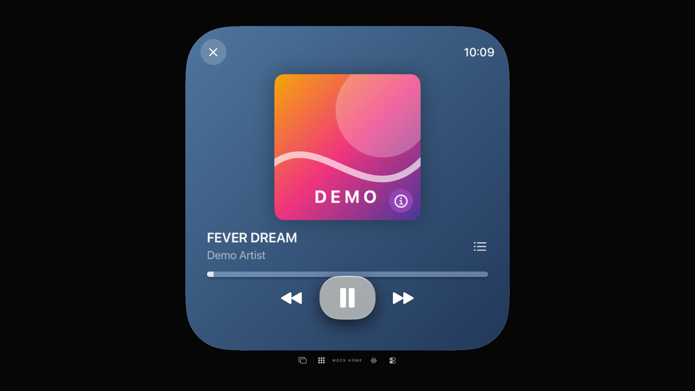
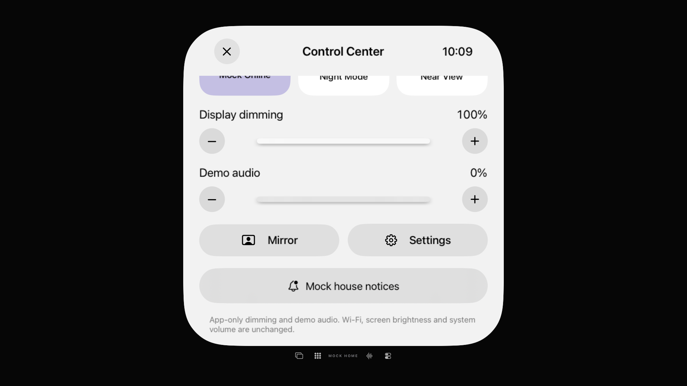
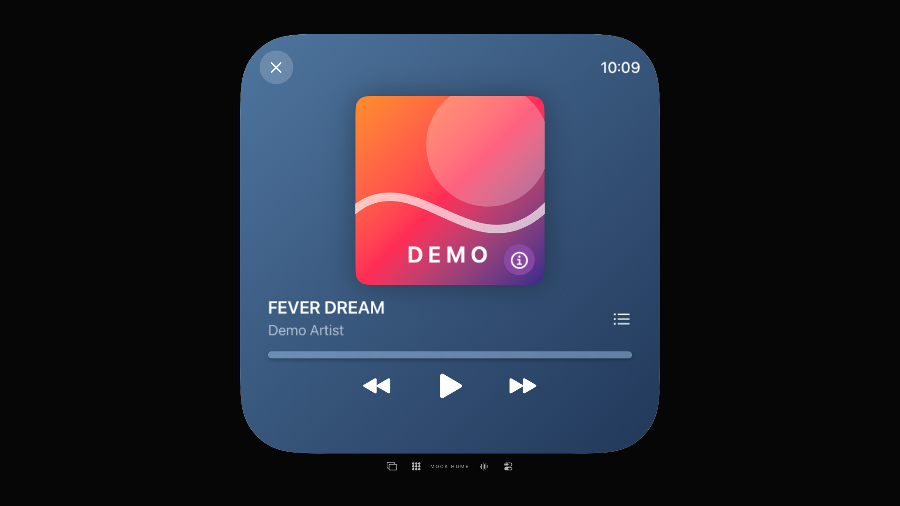
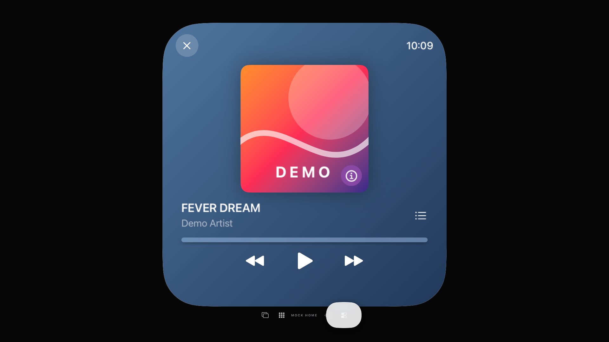

# Native TV media: reachable controls without a new layout

30 October 2026 · [#79](https://github.com/Olli0103/homeview/issues/79). **#79 remains open.** This is a native tvOS simulator correction and runtime check, not complete platform/hardware/original acceptance. The [own movie and public-capability contract](demo-animated-artwork.md) remain separate from catalog rights, lyrics and OS Now Playing.

## Actual defect and correction

Two new native remote cases failed before playback: after 80 bounded direction presses, focus stayed on the Music screen's corner Close button instead of reaching Control Center. No Select was dispatched to the wrong target and no audio was started. All twelve installed TV App files matched the published SDK product exactly; this is not a different mock UI host.

A narrow focus section on the footer did not fix either case. Its complete paused screenshot remained pixel-identical to baseline; those two failed candidate runs are preserved too. The effective change is only:

```swift
#if os(tvOS)
  .frame(maxWidth: .infinity).focusSection()
#endif
```

The existing footer's focus region now bridges the horizontal gap from the corner control. Buttons, spacing, labels, visible styling and other platforms are not redesigned. The actual remote reaches Control Center, reduces the app's **Demo audio** setting to zero before explicit Play, returns through Apps, and reaches the player. System volume is untouched.

## Actual playback, not only a successful button

The supported own local H.264 cover actually moves on TV. Three consecutive native ROI samples establish continued changes; explicit Pause and reduced-motion playing states establish zero pixel changes. The ROI was fixed **before the product correction**, from the actual unchanged native image: viewport x40–60%, y23–38%, excluding lettering, information button, focus effects, progress and player controls. Native tvOS AX activation rectangles include extra padding; they are not interchangeable with the source's 72-point information-overlay size.

Final independent decoded-RGBA comparisons:

| State pair | Changed channels |
|---|---:|
| Moving A → B | 45,533 |
| Moving B → C | 51,451 |
| Explicit Pause | 0 |
| Return from actual Home/background | 44,422 |
| Playing with reduced motion | 0 |

The background test observes the existing **UI playing flag/Play–Pause label**, then requires the actual video pixels to follow that state. Raw historical attachment keys mention audio; they are **not independent AVAudioPlayer/backend audio-liveness measurements**. No acoustic or hardware audio continuity is inferred. The work changes neither the demo audio engine nor the connected MusicKit player.

## Bounded current acceptance

- **Seven native TV methods passed**: both media cases plus browser/Menu return, nine-camera grid/detail/mock talkback, gallery selection and both timer-navigation/action cases. Zero failures, skips or structured runtime warnings in this current seven-method selection. Earlier two successful media pilots and four failed focus cases are separate checkpoints, not added to a fabricated all-green suite.
- **One separate same-focus native reference passed** with exactly the same twelve App files as the seven-method run. With Close focused in both captures, the entire **1920×1080 image is exactly equal in decoded RGBA**, as are the viewport and four footer AX rectangles. A reachable, differently focused footer correctly displays its native focus bubble; that is not a same-pose comparison.
- **Two separate mobile executions passed**, one paused-reference/information-sheet method each on iPhone/iPad. Both whole own viewports are exactly equal to the pre-artwork baseline. This does not claim a complete mobile regression suite.
- **Five SDK builds passed; 77 product files fully read back.** The ordinary single iOS missing-SSU metadata clean/build recovery is retained. The Core/package/test inputs remain identical to the prior 458-test PASS; no redundant Core run is claimed.

Product/test commit: `da251dc6e1f3039176ea51f8258c2991b6345374`. All253 delivery inputs match that commit and reconstructed archives. 98 checkpoint PNGs were fully decoded; seven contact pages and additional native originals were actually viewed. Seven own PNG copies are published below. 998 terminal evidence files (178,207,902 bytes) are sealed and read back in place, sharing unchanged source/binary archives.

[Source-bound results, images and limits](verification/tv-media-focus-20261030.json) · [253 delivery inputs](verification/tv-media-focus-source-20261030.json).

Instrument corrections remain explicit: the first unused ROI formula assumed non-TV AX padding and was corrected against the native baseline before product edits. An early analysis picked the white Control Center capture by attachment order instead of the named blue Music state; that invalid comparison is retained separately and was not treated as an app layout defect. The final preservation proof uses the separately captured identical Close-focus state, not a post-hoc mask. Unreviewed draft contact pages with insufficient row height were replaced by separate correctly spaced review pages; raw native captures were unchanged.

## Remaining boundaries

This adds actual TV remote/video evidence, not real camera/photos/Home access, microphone recording, catalog playback, lyrics, AirPlay, OS animated-artwork presentation or physical remote/audio acceptance. Mac computer access was freshly checked and still reports an unavailable provider/desktop session; no host configuration, TCC or Developer-mode change was made, and the earlier timed-out Mac runner was not blindly repeated. Remaining Mac, Vision/Watch, account and hardware criteria stay open at #79 and the related original issues. Home/device/signing holds remain unchanged; the overall backlog continues.

## Own native captures

| Actual TV video / focused Pause | Explicit demo-volume zero before Play |
|---|---|
|  |  |

| Same-focus paused reference, exact to baseline | Newly reachable native footer focus |
|---|---|
|  |  |
